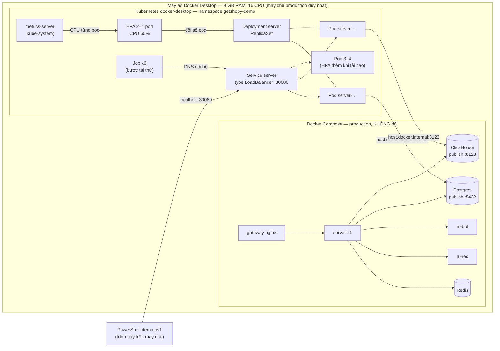

# Demo Kubernetes cho Getshopy — proof of concept

> **Đây là bản DEMO, không phải chuyển production sang Kubernetes.** Production vẫn chạy bằng
> Docker Compose như cũ (`docker-compose.yml` ở gốc repo, project `kltn`) và không bị sửa gì.
> Demo dựng thêm **tầng ứng dụng** (server Express) thành nhiều pod trên cluster Kubernetes một
> node của Docker Desktop, dùng chung **tầng dữ liệu** của production, để minh hoạ bốn ý mà GVHD
> hỏi về "load balancer": cân bằng tải, tự phục hồi, tự co giãn, cập nhật không gián đoạn.

Soạn 17/11/2026, nhánh `feat/k8s-demo`.

## 1. Kiến trúc demo



- Pod gọi Postgres / ClickHouse của production qua `host.docker.internal` + cổng đang publish ra
  máy host (5432, 8123). Redis, ai-rec, ai-bot **không** publish cổng nên pod không dùng (mục 6).
- Pod chạy **image riêng** `kltn-server:k8s-demo` build từ nhánh này (thêm header `X-Served-By`),
  không ghi đè `kltn-server:latest` của Compose.
- Pod **bỏ qua `docker-entrypoint.sh`** (`command: ["node", "src/index.js"]`): entrypoint chạy
  `prisma migrate deploy`, `DROP/CREATE TRIGGER` trên bảng `Inventory` và `seed-demo.js` — pod
  tự phục hồi / scale / rolling update lần nào là ghi vào DB production lần đó, có khi 4 pod cùng
  lúc. Schema đã do container server của Compose áp, pod demo chỉ chạy server.

## 2. Mỗi bước minh hoạ gì

| Bước (`-Step`) | Làm gì | Khái niệm Kubernetes |
|---|---|---|
| 1 `apply` | Áp namespace, Secret, ConfigMap, Deployment 2 pod, Service, HPA, metrics-server; đợi Ready | Khai báo trạng thái mong muốn; readinessProbe |
| 2 `pods` | `get pods -o wide`, Deployment/ReplicaSet/Service/HPA, EndpointSlice | Pod, ReplicaSet, Service gom pod Ready sau một địa chỉ |
| 3 `lb` | 20 request `localhost:30080/api/health`, in `X-Served-By` và bảng phân bố | **Cân bằng tải**: Service + kube-proxy chọn pod ngẫu nhiên cho mỗi **kết nối TCP** |
| 4 `heal` | Vòng request chạy nền, xoá 1 pod, theo dõi pod mới lên, đếm request lỗi | **Tự phục hồi**: ReplicaSet bù pod thiếu; Service bỏ pod đang xoá |
| 5 `hpa` | k6 bắn ~`LoadRps` request/giây vào `/api/b2c/categories` ≤ 2 phút; in CPU / số pod HPA mỗi 5 s; rồi theo dõi thu về 2 pod | **Tự co giãn**: HPA = ceil(pod × CPU TB / 60%), kẹp [2, 4] |
| 6 `rolling` | Vòng request chạy nền, `rollout restart`, `rollout status`, đếm request lỗi | **Cập nhật cuốn chiếu**: maxSurge 1, maxUnavailable 0 + readiness |
| 7 `teardown` | Xoá namespace + metrics-server, in RAM, nhắc tắt Kubernetes | Dọn sạch bằng một namespace |

Ghi chú để trình bày:

- **L4, không phải L7.** Service chia **kết nối**, không chia request. Client giữ keep-alive sẽ
  dính một pod; vì vậy `demo.ps1` gọi bằng `-DisableKeepAlive` và k6 đặt `noConnectionReuse`.
  Chia theo từng request (L7) là việc của Ingress / reverse proxy (nginx). 20 request không nhất
  thiết chia 10/10 — kube-proxy chọn ngẫu nhiên; chạy lại vài lần sẽ thấy dao động quanh 50/50.
- **Vì sao xoá pod / rolling update không rớt request:** pod chuyển Terminating là bị gỡ khỏi
  EndpointSlice ngay, kết nối mới đi sang pod khác. Server chưa bắt SIGTERM (Node là PID 1) nên
  pod cũ vẫn trả lời request đang dở cho tới hết `terminationGracePeriodSeconds: 15` rồi mới bị
  SIGKILL. Pod mới chỉ nhận kết nối sau khi `/api/health` (ping ClickHouse) trả 200.
- **HPA đo theo `requests.cpu` = 250m.** Ngưỡng 60% = 150m trung bình mỗi pod. Server lúc rảnh
  dùng vài millicore nên chỉ tải thật mới vượt. Chiều giảm được rút còn 60 s ổn định + bớt 1 pod
  mỗi 30 s (mặc định 5 phút) để thấy được trong buổi demo.

## 3. Bật Kubernetes trong Docker Desktop

Docker Desktop 4.47 trên máy này. Theo tài liệu Docker
(https://docs.docker.com/desktop/features/kubernetes/):

1. Docker Desktop → **Kubernetes** → **Create cluster**.
2. Cluster provisioning method: chọn **Kubeadm** (một node, phiên bản do Docker Desktop chọn).
   - Không dùng **kind** cho demo này: node kind là container riêng, chưa kiểm chứng được nó thấy
     image build cục bộ (`imagePullPolicy: Never` sẽ báo `ErrImageNeverPull`).
3. (Tuỳ chọn) bật **Show system containers (advanced)** nếu muốn `docker stats` thấy container
   `k8s_*` — `demo.ps1` dùng được cả khi không bật.
4. **Create**. Xong thì có context `docker-desktop`:
   `kubectl config get-contexts` (kubectl có sẵn ở `C:\Program Files\Docker\Docker\resources\bin`).

**Chọn lúc vắng khách để bật:** tài liệu không nói việc tạo cluster có khởi động lại Docker
Engine hay không (bản Docker Desktop cũ thì có — "Apply & Restart"). Coi như có thể gián đoạn vài
phút; các service production đều `restart: unless-stopped` nên tự lên lại. Lần đầu Docker Desktop
kéo image control plane (vài trăm MB, vào đĩa D:).

## 4. Chuẩn bị

Thứ tự, chạy trong PowerShell (5.1 được) tại `deploy/k8s-demo/`:

```powershell
# 0. Số RAM gốc — TRƯỚC khi bật Kubernetes (đọc /proc/meminfo qua container tạm alpine/socat:1.8.0.3 có sẵn)
.\demo.ps1 -Step baseline

# 1. Image server có header X-Served-By — tag riêng, không đụng kltn-server:latest của Compose.
#    Kiểm đĩa D: còn >= 20 GB trước (Docker để đĩa ảo trên D:). Nhánh này không đổi
#    package-lock nên lớp npm ci thường dùng lại cache build của image production.
docker build -t kltn-server:k8s-demo ..\..\ktln-Getshopy\qu-n-ly-ban-l\source\server

# 2. Kéo trước image demo cần mạng (để lúc trình bày không phải chờ)
docker pull grafana/k6:1.8.2
docker pull registry.k8s.io/metrics-server/metrics-server:v0.8.1

# 3. Bật Kubernetes (mục 3), rồi kiểm Secret sẽ sinh ra (chỉ in TÊN khoá):
.\make-secret.ps1 -ProjectDir "C:\Users\AD\Desktop\TDTU 2023-2024\KLTN\ktln-Getshopy" -DryRun
```

Không build được / không muốn build: `.\demo.ps1 -Image kltn-server:latest` chạy bằng image
production — mọi bước vẫn chạy, chỉ là không có header nên bước 3 đếm phân bố từ log từng pod, bước
4 và 6 chỉ đếm thành công / lỗi.

`-ProjectDir` trỏ tới thư mục có `.env` production. Chạy từ repo chính (sau khi merge) thì bỏ qua
được; chạy từ worktree `D:\kltn-wt\k8s-demo` thì bắt buộc.

## 5. Chạy demo

```powershell
.\demo.ps1 -ProjectDir "C:\Users\AD\Desktop\TDTU 2023-2024\KLTN\ktln-Getshopy"
```

Mỗi bước dừng chờ Enter. Chạy lại riêng một bước: `-Step pods|lb|heal|hpa|rolling`;
in RAM lúc bất kỳ: `-Step ram`. Tham số khác: `-LoadRps 1000` (HPA không tăng pod thì nâng, máy ì
thì hạ), `-LoadHoldSeconds 75` (tối đa 90 → cả bài ≤ 2 phút), `-NoPause`.

Script chỉ gọi `kubectl --context docker-desktop`, chỉ đụng namespace `getshopy-demo` và
metrics-server; không chạy lệnh `docker compose` nào. Lệnh docker duy nhất nó chạy: `image inspect`,
`ps`/`stats`, và container tạm `alpine/socat` (`--network none`) để đọc RAM.

### Secret

`make-secret.ps1` lấy env của service `server` **đúng như Compose đưa cho container production**
(`docker compose config --format json`, đã giải `.env`) rồi dựng Secret `server-env`:

| Khoá | Nguồn |
|---|---|
| `DATABASE_URL`, `DIRECT_URL` | Từ production, host `postgres` → `host.docker.internal:<cổng publish>`, thêm `connection_limit=5` (4 pod × 5 = tối đa 20 kết nối thêm vào Postgres) |
| `JWT_SECRET` | **Sinh ngẫu nhiên** cho demo (giữ nguyên nếu Secret đã có): token demo và token production không dùng lẫn |
| `NODE_ENV`, `CLICKHOUSE_DB`, `PAYMENT_EXPIRE_SCAN_INTERVAL_SECONDS`, … | Chép nguyên — danh sách `$PassThroughKeys` trong script, chỉ khoá không bí mật |

Không chép SePay, SMTP, VietQR, khoá API AI trả phí, MinIO… — demo không cần, không đưa vào etcd.
Không in giá trị nào, không ghi file tạm (YAML đi vào `kubectl apply` qua stdin, server-side apply).
Secret nằm trong etcd của cluster demo (không mã hoá) cho tới khi xoá namespace.

## 6. Redis / ai-rec / ai-bot: không bắc cầu — demo chạy được gì

Quyết định: **không** mở đường nào từ pod tới Redis / ai-rec / ai-bot của production.

- Redis của production không có mật khẩu và chỉ `expose` trong mạng compose. Muốn pod tới được thì
  phải publish ra máy host; publish `0.0.0.0` là mở Redis không mật khẩu ra cả LAN (rule tường lửa
  "Docker Desktop Backend" cho vào ở mọi profile — xem chú thích gateway trong `docker-compose.yml`).
  Publish `127.0.0.1` thì pod có tới được hay không phụ thuộc cách Docker Desktop chuyển
  `host.docker.internal` (chưa kiểm chứng), và mọi tiến trình trên máy vẫn đọc/xoá được cache.
- Dùng chung Redis còn trộn cache demo với production (pod demo `scan`+`del` khoá `products:*`
  là xoá cache của production).
- Server đã tự lùi khi thiếu ba dịch vụ này (đọc code 17/11/2026), nên demo không cần chúng.

| Chức năng trên pod demo | Kết quả | Vì sao |
|---|---|---|
| `/api/health`, danh mục, hãng, chi nhánh, sản phẩm | Chạy | Postgres + ClickHouse qua `host.docker.internal`; `cached()` lùi về cache trong bộ nhớ từng pod (`src/redis.js`) |
| Dashboard / analytics (admin) | Chạy, nhưng mọi lần gọi đều truy vấn ClickHouse | `fetchWithCache` ở `index.js` chỉ cache khi có Redis |
| Gợi ý sản phẩm | Chạy, chỉ phần theo luật + hành vi | `AI_REC_URL` trống → bỏ nhánh CF của ai-rec (`RecommendationService.js`) |
| Chatbot, smart search, tìm bằng ảnh, giọng nói, AI so sánh | HTTP 502 "AI Bot service unavailable" kèm câu báo cho khách | `forwardToAiBot` không gọi được ai-bot |
| Quên mật khẩu | HTTP 503 (`MAIL_NOT_CONFIGURED` / `RESET_UNAVAILABLE`) | Không có SMTP, không có Redis (`routes/passwordReset.js`) |
| Đặt hàng | **Đừng làm qua cổng demo** — đơn ghi THẬT vào DB production; đơn chuyển khoản không có QR | Không có `VIETQR_*` (`checkoutService.buildQR` trả null) |
| Webhook SePay | Bị từ chối | Không có khoá SePay; gateway cũng không chuyển webhook tới demo |

Muốn có cache dùng chung giữa các pod mà không đụng Redis production: dựng một Redis riêng trong
namespace (image `redis:7-alpine` có sẵn) — để làm hướng phát triển, chưa đưa vào demo.

## 7. Lựa chọn thiết kế

| Lựa chọn | Lý do |
|---|---|
| Image `kltn-server:k8s-demo`, `imagePullPolicy: Never` | Cluster kubeadm của Docker Desktop dùng chung image store với Docker Engine, không cần registry; tag riêng để `docker compose up` không vô tình chạy image của nhánh demo |
| `command: ["node", "src/index.js"]` | Bỏ entrypoint (migrate, DDL, seed) — xem mục 1 |
| requests 250m / 192Mi, limits 1 CPU / 512Mi | 250m làm mẫu số cho HPA (rảnh ≈ 0%, tải thật mới vượt 150m); Node chủ yếu một luồng nên hơn 1 CPU không dùng hết; container production rảnh dùng 68 MiB (đo 17/11/2026), 512Mi + heap 320 MB (`NODE_OPTIONS`) đủ chỗ; 4 pod chỉ giữ chỗ 1/16 CPU |
| readiness và liveness cùng `/api/health`, liveness nới (6 × 10 s) | `/api/health` ping ClickHouse: readiness đúng nghĩa "sẵn sàng phục vụ"; liveness nới để ClickHouse chậm một lúc không làm restart mọi pod. Production nên có endpoint liveness riêng |
| `maxSurge 1`, `maxUnavailable 0`, grace 15 s | Không lúc nào thiếu pod; xem mục 2 |
| HPA 2–4, CPU 60%, scale-down 60 s | Max 4 vì máy ảo 9 GB còn chạy production |
| Service LoadBalancer cổng 30080 | Docker Desktop đưa ra `localhost`; 30080 không trùng cổng nào đang dùng (kiểm 17/11/2026) |
| metrics-server v0.8.1 + `--kubelet-insecure-tls` | 0.8.x hỗ trợ Kubernetes 1.31+ (0.9.x đòi 1.34+); kubelet Docker Desktop dùng chứng chỉ tự ký. File gốc giữ nguyên byte, vá bằng kustomize |
| k6 1.8.2 chạy **trong cluster** (Job) | Tải đi thẳng qua kube-proxy, không vòng qua bộ chuyển cổng của Docker Desktop trên Windows; xoá cùng namespace |
| k6 gọi `/api/b2c/categories` | Chỉ đọc, cache trong pod 300 s → Postgres ~1 truy vấn / pod / 5 phút; CPU dồn vào Node đúng thứ HPA đo. Tránh `/api/products` (trả cả catalog) |
| k6 gắn `X-Forwarded-For` ngẫu nhiên trong 198.18.0.0/15 | Rate limit 2000 req/phút/IP; mọi request từ pod k6 chung IP sẽ thành 429. Server tin XFF từ IP mạng riêng (`trust proxy`), dải RFC 2544 dành cho đo kiểm → mô phỏng nhiều khách |

## 8. Giới hạn và rủi ro

- **Một máy, một node**: Kubernetes ở đây không cho HA phần cứng — máy tắt là mất cả production lẫn
  demo. Demo minh hoạ cơ chế (cân bằng tải, tự phục hồi, co giãn, rolling update), không chứng minh
  độ sẵn sàng.
- **Pod demo dùng DB production.** Bài tải thử gần như không đọc Postgres (cache trong pod) nhưng vẫn
  chiếm CPU của cùng máy ảo — chạy ngoài giờ có khách. Không đặt hàng / tracking qua cổng demo.
- **Cổng 30080 có thể mở trên mọi địa chỉ** (0.0.0.0) chứ không chỉ localhost — `demo.ps1` in địa
  chỉ thật sau bước apply. Khi đó máy khác cùng mạng gọi thẳng được API (không qua gateway). Chỉ demo
  trên mạng tin cậy, dọn ngay sau đó.
- **RAM**: máy ảo 9 GB, production dùng ~5,9 GB lúc rảnh; ClickHouse được phép lên tới 3 GB khi dbt
  chạy. Kubernetes + demo cộng thêm khoảng **0,7–1,1 GB lúc rảnh, 1,2–1,8 GB lúc tải thử — số ƯỚC
  TÍNH, chưa đo** (control plane kubeadm ~0,5–0,8 GB, metrics-server, 2–4 pod server 70–250 MB/pod,
  k6). Đo thật bằng `-Step baseline` / `-Step ram`. Xong demo thì **Stop** Kubernetes.
- **Job đóng đơn quá hạn** (`expireScheduler`) chạy trong mọi bản server, kể cả pod demo, cùng
  Postgres với production. An toàn: `pg_try_advisory_lock` nên mỗi lúc chỉ một bản quét, và mọi
  UPDATE đều có điều kiện `payment_status = 'PENDING'`. (Quan sát thêm: lock/unlock là khoá theo
  session nhưng chạy qua pool của Prisma, có thể rơi vào hai kết nối khác nhau — không gây sai dữ
  liệu, chỉ là bản nào "giữ" khoá thì bản đó hay được quét.)
- **Trạng thái trong bộ nhớ từng pod** — cùng các vấn đề khi chạy nhiều bản server sau nginx trong
  Compose:
  - Rate limit (`express-rate-limit`, bộ nhớ): hạn mức thực tế = hạn mức × số pod; `aiLimiter`
    20/phút/IP cũng nhân lên → ngân sách LLM. Cần store dùng chung (Redis).
  - Buffer sự kiện hành vi (`BehaviorService`, gom ≤ 5 s): pod bị dừng mất phần chưa flush (server
    không bắt SIGTERM nên `shutdown()` không chạy); gợi ý realtime chỉ gộp buffer của pod đang trả
    lời.
  - Cache trạng thái khách (`customerStatusCache`, 30 s): vô hiệu hoá khách chỉ `invalidate` ở pod
    nhận request quản trị, pod khác trễ tới 30 s.
  - Cache `cached()` trong bộ nhớ: `invalidate` chỉ xoá ở pod hiện tại; pod khác cũ tới hết TTL.
  - WebSocket: client dính một pod; `broadcastStockUpdate` chỉ tới client của pod xử lý thay đổi;
    mỗi pod có client KPI tự truy vấn ClickHouse 5 s/lần. Cần sticky session + pub/sub.
- **Chưa kiểm chứng trên máy này** (Kubernetes chưa bật lúc soạn): `host.docker.internal` từ pod,
  cluster thấy image cục bộ, địa chỉ bind của cổng LoadBalancer, số RAM. `demo.ps1` báo rõ khi một
  trong các điều này không đúng (mục 10).

## 9. Dọn dẹp

```powershell
.\demo.ps1 -Step teardown      # xoá namespace getshopy-demo + metrics-server, in RAM
```

Rồi **tắt Kubernetes** để trả RAM cho production: Docker Desktop → Kubernetes → **Stop** (bản cũ:
Settings → Kubernetes → bỏ "Enable Kubernetes" → Apply). Sau đó `.\demo.ps1 -Step ram` để so với
số gốc. Image `kltn-server:k8s-demo`, `grafana/k6:1.8.2` xoá bằng `docker image rm` nếu cần chỗ.

## 10. Xử lý sự cố

| Triệu chứng | Nguyên nhân thường gặp | Cách xử lý |
|---|---|---|
| Pod `ErrImageNeverPull` | Chưa build `kltn-server:k8s-demo`, hoặc cluster kiểu kind | Build (mục 4) / `-Image kltn-server:latest` / dựng lại bằng Kubeadm |
| Pod Running nhưng không Ready, log lỗi kết nối DB / ClickHouse | Pod không phân giải được `host.docker.internal` | `kubectl -n getshopy-demo exec deploy/server -- node -e "require('dns').lookup('host.docker.internal',console.log)"` |
| `CrashLoopBackOff`, log "Thiếu JWT_SECRET" | Chưa có Secret | `.\make-secret.ps1 -ProjectDir …` rồi `kubectl -n getshopy-demo rollout restart deployment/server` |
| HPA `TARGETS <unknown>` | metrics-server chưa có số (≈1 phút) hoặc lỗi x509 | `kubectl -n kube-system logs deploy/metrics-server` |
| HPA không tăng pod | Tải chưa đủ | `-Step hpa -LoadRps 2000` |
| Không gọi được `localhost:30080` | Docker Desktop chưa mở cổng LoadBalancer / cổng bị chiếm | `kubectl -n getshopy-demo get svc server` (EXTERNAL-IP phải là `localhost`) |

## 11. Đưa vào khoá luận

Viết như **thử nghiệm khái niệm / hướng phát triển**, nói rõ production vẫn là Docker Compose một
máy. Số liệu dưới đây **đo khi chạy demo** — chưa có số nào, không điền ước đoán:

| Nội dung | Chụp / ghi lại | Số cần đo |
|---|---|---|
| Kiến trúc | Sơ đồ mục 1 | — |
| Pod & Service | Màn hình bước 2 (`get pods -o wide`, EndpointSlice) | — |
| Cân bằng tải | Bảng phân bố bước 3 (chạy 3 lần) | [đo] số request mỗi pod / 20 |
| Tự phục hồi | Màn hình bước 4: tên pod cũ → pod mới, AGE, dòng "Tổng … lỗi" | [đo] thời gian tới khi pod mới Ready; [đo] số request lỗi |
| Tự co giãn | Các dòng HPA mỗi 5 s + tóm tắt k6 + Events của HPA | [đo] RPS thực, p95, tỉ lệ lỗi; [đo] thời điểm 2→3→4 pod và 4→2 |
| Rolling update | `rollout status`, bảng pod cũ → mới theo thời gian, "Tổng … lỗi" | [đo] thời gian rollout; [đo] số request lỗi / tổng |
| Chi phí tài nguyên | Các dòng RAM: gốc / sau apply / lúc tải / sau dọn / sau Stop | [đo] MiB cộng thêm của Kubernetes |

Nên kèm một đoạn so sánh với phương án cân bằng tải bằng nginx `upstream` trên Compose: nginx chia
tải theo request (L7) nhưng không tự thay bản hỏng, không tự thêm bản theo tải, không có rolling
update có kiểm tra sẵn sàng; và cả hai phương án đều vấp các vấn đề trạng thái trong bộ nhớ ở mục 8.

## 12. Tệp

| Tệp | Nội dung |
|---|---|
| `manifests/00-namespace.yaml` … `40-hpa.yaml` | Namespace, ConfigMap, Deployment, Service, HPA |
| `metrics-server/` | Bản gốc v0.8.1 + kustomization vá `--kubelet-insecure-tls` |
| `loadtest/k6-job.yaml` | Script k6 (ConfigMap) + Job — chỉ áp ở bước 5 |
| `make-secret.ps1` | Sinh Secret `server-env`, không in giá trị (`-DryRun` để xem tên khoá) |
| `demo.ps1` | Kịch bản 7 bước |
| `../../ktln-Getshopy/qu-n-ly-ban-l/source/server/src/middleware/servedBy.js` | Header `X-Served-By`, chỉ bật khi `SERVED_BY_HEADER=1` |

Hai file `.ps1` lưu UTF-8 **có BOM** — có chủ đích: PowerShell 5.1 đọc file không BOM theo code page
ANSI và làm hỏng chuỗi tiếng Việt.
