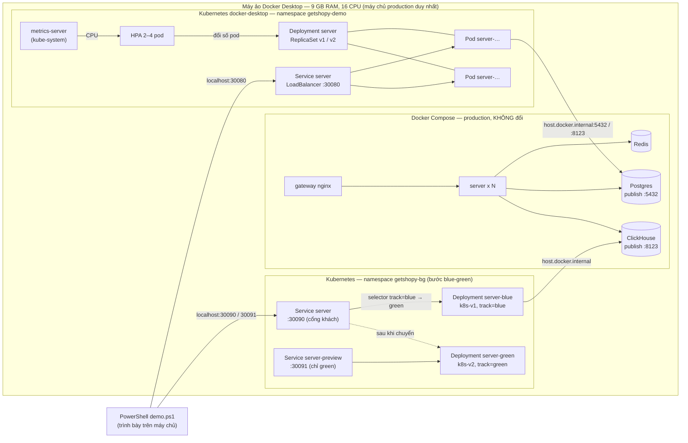

# Demo Kubernetes cho Getshopy — proof of concept

> **Đây là bản DEMO, không phải chuyển production sang Kubernetes.** Production vẫn chạy bằng
> Docker Compose như cũ (`docker-compose.yml` ở gốc repo, project `kltn`) và không bị sửa gì.
> Demo dựng thêm **tầng ứng dụng** (server Express) thành nhiều pod trên cluster Kubernetes một
> node của Docker Desktop, dùng chung **tầng dữ liệu** của production, để minh hoạ: cân bằng tải,
> tự phục hồi, tự co giãn, và **phát hành không gián đoạn** — nâng cấp cuốn chiếu v1 → v2, bản
> phát hành lỗi bị chặn rồi quay lui, blue-green có kiểm thử trước khi chuyển khách.

Soạn 17/11/2026 (nhánh `feat/k8s-demo`); phần phát hành không gián đoạn bổ sung 19/11/2026
(nhánh `feat/k8s-zero-downtime-demo`). **Chưa chạy trên cluster thật** — mọi số liệu để `[đo]`.

## 1. Kiến trúc demo



- Pod gọi Postgres / ClickHouse của production qua `host.docker.internal` + cổng đang publish ra
  máy host (5432, 8123). Redis, ai-rec, ai-bot **không** publish cổng nên pod không dùng (mục 9).
- **Image `kltn-server:k8s-v1` và `kltn-server:k8s-v2` là HAI TAG CỦA CÙNG MỘT IMAGE production**
  (`kltn-server:latest`, bước `images` chỉ `docker tag`, không build). v2 **không có code khác v1** —
  nói thẳng khi trình bày: thứ được minh hoạ là **cơ chế phát hành** (đổi image trong pod template →
  ReplicaSet mới → thay pod theo chiến lược, giữ bản cũ để quay lui), một bản v2 có code khác đi đúng
  con đường đó. Tag riêng nên `docker compose up` của production không bao giờ chạy nhầm tag demo.
- **An toàn DB production — pod bỏ qua `docker-entrypoint.sh`.** Image có
  `ENTRYPOINT ["sh", "/app/docker-entrypoint.sh"]`, `CMD ["node", "src/index.js"]`. Entrypoint chạy
  `prisma migrate deploy`, `DROP/CREATE TRIGGER` trên `Inventory` (`prisma/sql/inventory_constraints.sql`),
  seed nền khi DB trống, `ensure-inventory`, `seed-demo` — và **không có công tắc bỏ qua**
  (`STARTUP_LOCK=0` chỉ bỏ khoá xếp hàng, phần ghi DB vẫn chạy). Mỗi lần pod khởi động (tự phục hồi,
  scale, rolling, blue-green) sẽ là một lần ghi vào DB production. Vì vậy mọi Deployment của demo đặt
  `command: ["node", "src/index.js"]`: trong Kubernetes `command` **thay ENTRYPOINT** của image, và vì
  không khai `args` nên CMD của image cũng bị bỏ — container chạy thẳng server. Schema đã do container
  server của Compose áp. Node vẫn là PID 1 và tự bắt SIGTERM, nên tắt êm không bị ảnh hưởng.
- **Pool Postgres nhỏ:** `connection_limit=5` mỗi pod. Từ 18/11/2026 compose tự gắn
  `?connection_limit=${SERVER_DB_CONNECTION_LIMIT:-10}` vào `DATABASE_URL` của production;
  `make-secret.ps1` **ghi đè** giá trị đó (bản cũ chỉ thêm khi thiếu, nên pod demo sẽ nhận pool cỡ
  production).

## 2. Mỗi bước minh hoạ gì

| Bước (`-Step`) | Làm gì | Khái niệm Kubernetes |
|---|---|---|
| — `baseline` | Lưu RAM máy ảo Docker **trước khi** bật Kubernetes | — |
| 1 `images` | Kiểm `kltn-server:latest` có (và có tắt êm + `X-Served-By`), `docker tag` → `k8s-v1`, `k8s-v2`; in ID để thấy hai tag cùng một image | Image bất biến, phiên bản = tag |
| 2 `apply` | Namespace, Secret, ConfigMap, Deployment v1 (2 pod), Service, HPA, metrics-server; đợi Ready | Khai báo trạng thái mong muốn; readinessProbe |
| 3 `pods` | Pod, Deployment/ReplicaSet (kèm nhãn version), Service/HPA, EndpointSlice | Pod, ReplicaSet, Service gom pod Ready |
| 4 `lb` | 20 request `localhost:30080/api/health`, in `X-Served-By` và phân bố | **Cân bằng tải** theo **kết nối TCP** (L4) |
| 5 `heal` | Vòng request chạy nền, xoá 1 pod, theo dõi pod mới, đếm lỗi | **Tự phục hồi** + pod bị xoá tắt êm |
| 6 `hpa` | k6 bắn `LoadRps` request/giây ≤ 2 phút; in CPU / số pod mỗi 5 s; theo dõi thu về 2 pod | **Tự co giãn** |
| 7 `rolling` | Vòng request chạy nền; `kubectl set image` v1 → v2; mỗi 2 s in số response của **bản cũ / bản mới / lỗi** (theo ReplicaSet của pod trả lời) + trạng thái pod; tổng kết, `rollout history` | **Rolling update**: maxSurge 1, maxUnavailable 0, readiness, minReadySeconds, tắt êm |
| 8 `badrelease` | Phát hành bản lỗi (mặc định: `PORT=8081` → app không nghe cổng 8080, readiness không bao giờ đạt; `-BadRelease image`: tag không tồn tại → `ErrImageNeverPull`); cho thấy pod lỗi không bao giờ Ready, khách 100% ở bản cũ, `rollout status --timeout=15s` hết hạn; rồi `kubectl rollout undo` | Readiness chặn bản hỏng; rollout đứng yên; quay lui |
| 9 `bluegreen` | Namespace riêng `getshopy-bg`: blue (v1) phục vụ ở `:30090`; triển khai green (v2) song song; **smoke test chỉ đọc** qua cổng preview `:30091`; đạt thì đổi selector Service khách sang green; thu blue về 0 (tắt êm); in lệnh rollback. Smoke test hỏng → **không chuyển**, xoá green | **Blue-green**: hai Deployment, Service chọn bằng nhãn `track` |
| 10 `teardown` | Xoá namespace `getshopy-demo`, `getshopy-bg` + metrics-server, in RAM, nhắc tắt Kubernetes | Dọn sạch bằng namespace |
| — `ram` | In RAM hiện tại | — |

Ghi chú để trình bày:

- **L4, không phải L7.** Service chia **kết nối**, không chia request. Client giữ keep-alive sẽ
  dính một pod; vì vậy `demo.ps1` gọi bằng `-DisableKeepAlive` và k6 đặt `noConnectionReuse`.
  Chia theo từng request (L7) là việc của Ingress / reverse proxy (nginx).
- **Nhận ra bản cũ / bản mới từ đâu:** header `X-Served-By` = tên pod (downward API `POD_NAME`). Tên
  pod = `<tên ReplicaSet>-<5 ký tự>`, tên ReplicaSet = `<Deployment>-<pod-template-hash>` — mỗi lần đổi
  pod template là một ReplicaSet mới, nên chỉ từ header đã biết response đến từ phiên bản nào.
- **Vòng request khi phát hành gọi `GET /api/b2c/categories`, không gọi `/api/health`:** pod đang tắt
  êm *cố ý* trả 503 ở `/api/health` (để thôi nhận khách) nhưng vẫn phục vụ request nghiệp vụ trong
  thời gian drain — vòng request phải đo thứ khách thấy. Endpoint chỉ đọc, cache trong bộ nhớ pod 300 s.
- **HPA đo theo `requests.cpu` = 250m**, ngưỡng 60% = 150m trung bình mỗi pod; chiều giảm rút còn
  60 s ổn định + bớt 1 pod mỗi 30 s để thấy được trong buổi demo.

## 3. Phát hành không gián đoạn — cơ chế và các núm thời gian

### 3.1 Một lần thay pod trong rolling update

1. `kubectl set image` đổi pod template → Deployment tạo ReplicaSet mới (revision mới).
2. Thêm **1** pod mới (`maxSurge: 1`). Container chạy thẳng `node src/index.js`.
3. `readinessProbe` gọi `/api/health` mỗi 2 s; đạt **2 lần liên tiếp** (`successThreshold: 2`) thì pod
   Ready → vào EndpointSlice → bắt đầu nhận kết nối mới.
4. Pod mới Ready **liên tục 5 s** (`minReadySeconds: 5`) mới tính là *available*; chỉ khi đó
   Deployment mới bỏ **1** pod cũ (`maxUnavailable: 0`: số pod available không lúc nào dưới mong muốn).
5. Pod cũ bị xoá → **hai việc song song, không chờ nhau**: kubelet gửi SIGTERM vào container; còn
   EndpointSlice controller gỡ pod khỏi Service, rồi kube-proxy (và bộ chuyển cổng LoadBalancer của
   Docker Desktop) mới cập nhật luật định tuyến. SIGTERM có thể tới **trước** khi luật đổi xong.
6. Server nhận SIGTERM (`src/lifecycle/gracefulShutdown.js`): `/api/health` → 503, mọi response kèm
   `Connection: close`, **vẫn phục vụ request bình thường thêm 5 s** (`SHUTDOWN_DRAIN_DELAY_MS`), rồi
   `server.close()`, chờ request dở dang, đẩy buffer hành vi sang ClickHouse, đóng Prisma / ClickHouse,
   `exit(0)`.
7. Lặp lại 2–6 tới khi hết pod cũ. ReplicaSet cũ còn lại với 0 pod = bản lưu cho `rollout undo`.

Bản phát hành **không bao giờ Ready** (bước 8) dừng ở bước 3: không pod cũ nào bị bỏ, rollout đứng
yên; sau `progressDeadlineSeconds` Deployment ghi `ProgressDeadlineExceeded`. Kubernetes **không tự
quay lui** — người / pipeline chạy `kubectl rollout undo`.

### 3.2 Các núm và lý do

| Núm | Giá trị | Ở đâu | Vì sao |
|---|---|---|---|
| `strategy.rollingUpdate` | `maxSurge: 1`, `maxUnavailable: 0` | Deployment | Không lúc nào ít pod sẵn sàng hơn mong muốn; chỉ tốn thêm 1 pod trong lúc rollout |
| `readinessProbe` | `/api/health`, `initialDelaySeconds 2`, `periodSeconds 2`, `timeoutSeconds 2`, `successThreshold 2`, `failureThreshold 2` | container | Pod chỉ nhận khách khi đã trả lời 2 lần liên tiếp (route đã nạp, nghe cổng, ping được ClickHouse) chứ không chỉ "cổng đã mở"; thăm dò 2 s để pod mới vào Service sớm và pod hỏng ra sau ~4 s |
| `minReadySeconds` | 5 | Deployment | Pod mới phải đứng vững 5 s trước khi bỏ pod cũ; bản chết sau vài giây bị chặn ở pod đầu tiên. Không làm chậm việc *nhận khách*, chỉ làm chậm việc *bỏ pod cũ* |
| `progressDeadlineSeconds` | 90 | Deployment | Bản không tiến triển 90 s thì `rollout status` báo lỗi rõ ràng (pod khởi động bình thường mất vài giây — `[đo]`) |
| `SHUTDOWN_DRAIN_DELAY_MS` | 5000 | env Deployment | Che khoảng trễ bất đồng bộ ở bước 5 (gỡ endpoint vs SIGTERM). 5 s là mức thường dùng cho khoảng trễ này (cùng ý với preStop `sleep 5`), dư so với cluster một node, mỗi pod cũ chỉ mất thêm ~5 s |
| `SHUTDOWN_TIMEOUT_MS` | 20000 | env Deployment | Mốc cứng **tính từ SIGTERM, đã gồm drain**: 5 s drain + tới ~12,5 s cho request dở dang + 2,5 s dọn dẹp |
| `terminationGracePeriodSeconds` | 30 | pod | Phải > `SHUTDOWN_TIMEOUT_MS` (+ dự phòng): 20 s + 10 s — server luôn tự thoát trước SIGKILL. Bình thường pod thoát sau ~drain + vài trăm ms (`[đo]`, log `[shutdown] xong sau … ms`); 30 chỉ là trần |
| `livenessProbe` | `/api/health`, 20 s đầu, 10 s/lần, 6 lần trượt | container | Nới tay để ClickHouse chậm một lúc không làm restart mọi pod; lúc tắt êm `/api/health` trả 503 tối đa 20 s — chưa đủ 6 lần trượt nên liveness không giết pod giữa chừng |

Ràng buộc phải giữ khi đổi số: `SHUTDOWN_DRAIN_DELAY_MS` < `SHUTDOWN_TIMEOUT_MS` − 2,5 s (phần dọn dẹp)
và `SHUTDOWN_TIMEOUT_MS` < `terminationGracePeriodSeconds`. Biến tắt êm đặt trong **Deployment** (không
trong ConfigMap): đổi chúng là đổi pod template → một revision mới, nằm cạnh
`terminationGracePeriodSeconds` mà chúng phải khớp.

### 3.3 Đọc màn hình bước 7–9

```
10:31:04           [================########]  cũ  16  mới   8  lỗi  0  chậm nhất   45 ms
                   pod  cũ: 1 Ready, 1 đang tắt | mới: 1 Ready, 1 chưa Ready (Running)
```

Mỗi dòng = 2 giây response của vòng request (~10 request/giây, mỗi request một kết nối TCP mới);
`=` (cyan) bản cũ / blue, `#` (xanh lá) bản mới / green, `x` (đỏ) lỗi — độ dài theo tỉ lệ, ký tự khác
nhau để ảnh chụp đen trắng vẫn đọc được. Dòng xám bên dưới chỉ in khi trạng thái pod đổi. Cuối bước:
tổng request / lỗi, bảng theo nhóm (ReplicaSet, lần đầu → lần cuối) và theo từng pod.

### 3.4 Thí nghiệm đối chứng (tuỳ chọn)

Muốn cho thấy drain có tác dụng: tắt nó, phát hành lại, so số lỗi với lần có drain.

```powershell
kubectl --context docker-desktop -n getshopy-demo set env deployment/server SHUTDOWN_DRAIN_DELAY_MS=0
.\demo.ps1 -Step rolling          # pod cũ (drain 0) bị thay — đếm lỗi: [đo]
kubectl --context docker-desktop -n getshopy-demo set env deployment/server SHUTDOWN_DRAIN_DELAY_MS=5000
```

Lệnh `set env` tự nó cũng là một lần rollout. Trên cluster một node, luật định tuyến có thể đổi đủ
nhanh để lần không drain cũng ra 0 lỗi — khi đó ghi đúng như vậy (`[đo]`), không suy diễn.

## 4. So sánh: rolling update, blue-green, Compose recreate

| Tiêu chí | Rolling update (bước 7) | Blue-green (bước 9) | Compose recreate (`docker compose up -d` sau khi đổi image) |
|---|---|---|---|
| Gián đoạn | Không có lúc thiếu pod sẵn sàng (maxUnavailable 0) + tắt êm; request lỗi trong demo: `[đo]` | Chuyển ở Service, bản cũ vẫn chạy lúc chuyển; request lỗi: `[đo]` | Container tạo lại gần như cùng lúc — có khoảng không bản nào sẵn sàng (`docs/load-balancing.md` mục 8); thời gian gián đoạn: `[đo]` |
| Điểm kiểm chứng trước khi nhận khách | readinessProbe từng pod (`/api/health` 2 lần) + minReadySeconds; **không** có kiểm thử nghiệp vụ | readiness **+ smoke test nghiệp vụ chỉ đọc** (health, danh mục, danh sách, chi tiết sản phẩm) qua cổng preview, trên đúng pod sẽ nhận khách | healthcheck chỉ đánh dấu healthy / unhealthy, không chặn việc thay bản cũ |
| Hai phiên bản cùng phục vụ | Có, trong lúc rollout (khách có thể gặp v1 rồi v2) | Không — mỗi lúc một màu | Không |
| Bản lỗi | Dừng ở pod mới đầu tiên, bản cũ giữ khách (bước 8) | Không chuyển; xoá green | Bản lỗi thay luôn bản cũ |
| Rollback | `kubectl rollout undo` = một lần rolling nữa (`[đo]` s) | Đổi selector về blue: tức thì khi blue còn chạy; sau khi thu blue về 0 thì scale lại, chờ Ready rồi mới đổi (`[đo]` s) | Gắn lại tag cũ rồi `up -d` — lại một lần recreate có gián đoạn |
| Tài nguyên thêm khi phát hành | +1 pod (maxSurge) | Gấp đôi số pod trong lúc hai màu cùng chạy; RAM: `[đo]` (bước 9 in RAM lúc blue + green cùng chạy) | Không thêm |
| Kết nối Postgres thêm (5 / pod) | +5 | +5 × số pod một màu | 0 |
| Cần thêm gì | Có sẵn trong Deployment | Hai Deployment, Service chọn theo nhãn, script / người đổi selector | Không |

## 5. Bật Kubernetes trong Docker Desktop

Docker Desktop 4.47 trên máy này. Theo tài liệu Docker
(https://docs.docker.com/desktop/features/kubernetes/):

1. Docker Desktop → **Kubernetes** → **Create cluster**.
2. Cluster provisioning method: chọn **Kubeadm** (một node, phiên bản do Docker Desktop chọn).
   - Không dùng **kind** cho demo này: node kind là container riêng, chưa kiểm chứng được nó thấy
     image cục bộ (`imagePullPolicy: Never` sẽ báo `ErrImageNeverPull`).
3. (Tuỳ chọn) bật **Show system containers (advanced)** nếu muốn `docker stats` thấy container
   `k8s_*` — `demo.ps1` dùng được cả khi không bật.
4. **Create**. Xong thì có context `docker-desktop`:
   `kubectl config get-contexts` (kubectl có sẵn ở `C:\Program Files\Docker\Docker\resources\bin`).

**Chọn lúc vắng khách để bật:** tài liệu không nói việc tạo cluster có khởi động lại Docker
Engine hay không (bản Docker Desktop cũ thì có — "Apply & Restart"). Coi như có thể gián đoạn vài
phút; các service production đều `restart: unless-stopped` nên tự lên lại. Lần đầu Docker Desktop
kéo image control plane (vài trăm MB, vào đĩa D:).

## 6. Chuẩn bị

Chạy trong PowerShell (5.1 được) tại `deploy/k8s-demo/`:

```powershell
# 0. Số RAM gốc — TRƯỚC khi bật Kubernetes
.\demo.ps1 -Step baseline

# 1. Kéo trước image cần mạng (lúc trình bày khỏi chờ)
docker pull grafana/k6:1.8.2
docker pull registry.k8s.io/metrics-server/metrics-server:v0.8.1

# 2. Bật Kubernetes (mục 5), rồi kiểm Secret sẽ sinh ra (chỉ in TÊN khoá, không in giá trị):
.\make-secret.ps1 -ProjectDir "C:\Users\AD\Desktop\TDTU 2023-2024\KLTN\ktln-Getshopy" -DryRun
```

Không cần build: bước `images` gắn tag từ `kltn-server:latest` đang có (image production). Image
production phải là bản từ 18/11/2026 trở đi (có tắt êm + `X-Served-By`) — bước `images` tự kiểm bằng
một container tạm không mạng, bỏ entrypoint (không chạm DB); bản cũ hơn vẫn chạy được nhưng pod cũ bị
SIGKILL khi hết hạn thay vì tắt êm.

**RAM:** máy ảo 9 GB, production dùng ~5,9 GB lúc rảnh. Lúc đông pod nhất của buổi demo là bước 9:
2 pod `getshopy-demo` + 2 × `BgReplicas` pod blue/green (mặc định 6 pod server, limit 512Mi mỗi pod).
`-Step ram` trước bước 9 thấy còn ít RAM thì chạy `.\demo.ps1 -Step bluegreen -BgReplicas 1`.

`-ProjectDir` trỏ tới thư mục có `.env` production — cần cho bước `apply` và `bluegreen` khi chạy từ
worktree (`D:\kltn-wt\k8s-zdt`); chạy từ repo chính (sau khi merge) thì bỏ được.

## 7. Chạy demo — trình tự trình bày

```powershell
cd "C:\Users\AD\Desktop\TDTU 2023-2024\KLTN\ktln-Getshopy\deploy\k8s-demo"   # hoặc D:\kltn-wt\k8s-zdt\deploy\k8s-demo
$P = "C:\Users\AD\Desktop\TDTU 2023-2024\KLTN\ktln-Getshopy"

.\demo.ps1 -Step images                   # 1. tag k8s-v1 / k8s-v2 (cùng image, nói rõ)
.\demo.ps1 -Step apply -ProjectDir $P     # 2. v1 lên Kubernetes, 2 pod
.\demo.ps1 -Step pods                     # 3.
.\demo.ps1 -Step lb                       # 4.
.\demo.ps1 -Step heal                     # 5.
.\demo.ps1 -Step hpa                      # 6. (~5 phút, có thể bỏ nếu thiếu giờ)
.\demo.ps1 -Step rolling                  # 7. v1 -> v2 trong lúc khách gọi, 0 lỗi
.\demo.ps1 -Step badrelease               # 8. bản lỗi bị chặn, rollout undo
.\demo.ps1 -Step bluegreen -ProjectDir $P # 9. green song song, smoke test, chuyển, thu blue
.\demo.ps1 -Step teardown                 # 10. dọn
# Docker Desktop -> Kubernetes -> Stop, rồi:
.\demo.ps1 -Step ram
```

Hoặc cả 10 bước một mạch (dừng chờ Enter giữa các bước): `.\demo.ps1 -ProjectDir $P`.

Mỗi bước chạy lại riêng được. `rolling` chạy lần hai khi đã ở v2 thì đổi về v1 (vẫn là một lần phát
hành thật). `bluegreen` chạy lại luôn bắt đầu từ "chỉ có blue, khách ở blue". Tham số khác:
`-BadRelease image` (bản lỗi kiểu tag không tồn tại), `-BgReplicas 1`, `-LoadRps 1000`,
`-LoadHoldSeconds 75`, `-ImageV1/-ImageV2/-SourceImage` (đổi tag), `-NoPause`.

Script chỉ gọi `kubectl --context docker-desktop`, chỉ đụng namespace `getshopy-demo`, `getshopy-bg`
và metrics-server; không chạy lệnh `docker compose` nào. Lệnh docker nó chạy: `image inspect`, `tag`
(bước 1), `ps`/`stats`, container tạm `alpine/socat` (`--network none`) để đọc RAM, và container tạm
từ `kltn-server:latest` (`--network none`, bỏ entrypoint) để kiểm image ở bước 1.

### Rollback bằng tay (in sẵn ở cuối bước 8, 9)

```powershell
# rolling: về revision trước
kubectl --context docker-desktop -n getshopy-demo rollout undo deployment/server
# blue-green, blue còn chạy: tức thì
kubectl --context docker-desktop -n getshopy-bg set selector service/server 'app=server,track=blue'
# blue-green, blue đã về 0: bật lại, đợi Ready, RỒI mới chuyển
kubectl --context docker-desktop -n getshopy-bg scale deployment/server-blue --replicas=2; kubectl --context docker-desktop -n getshopy-bg rollout status deployment/server-blue; kubectl --context docker-desktop -n getshopy-bg set selector service/server 'app=server,track=blue'
```

(`'app=server,track=blue'` phải trong nháy: PowerShell hiểu `a,b` không nháy là mảng.)

## 8. Secret

`make-secret.ps1` lấy env của service `server` **đúng như Compose đưa cho container production**
(`docker compose config --format json`, đã giải `.env`) rồi dựng Secret `server-env` trong namespace
được chỉ (`getshopy-demo` ở bước 2, `getshopy-bg` ở bước 9):

| Khoá | Nguồn |
|---|---|
| `DATABASE_URL`, `DIRECT_URL` | Từ production, host `postgres` → `host.docker.internal:<cổng publish>`; `DATABASE_URL` **đặt / ghi đè** `connection_limit=5` |
| `JWT_SECRET` | **Sinh ngẫu nhiên** cho demo (giữ nguyên nếu Secret đã có): token demo và token production không dùng lẫn |
| `NODE_ENV`, `CLICKHOUSE_DB`, `PAYMENT_EXPIRE_SCAN_INTERVAL_SECONDS`, … | Chép nguyên — danh sách `$PassThroughKeys` trong script, chỉ khoá không bí mật |

Không chép SePay, SMTP, VietQR, khoá API AI trả phí, MinIO… — demo không cần, không đưa vào etcd.
Không in giá trị nào, không ghi file tạm (YAML đi vào `kubectl apply` qua stdin, server-side apply).
Secret nằm trong etcd của cluster demo (không mã hoá) cho tới khi xoá namespace.

Kết nối Postgres tối đa của demo = số pod × 5: `getshopy-demo` 2–4 pod (HPA) = 10–20; bước 9 thêm
2 × `BgReplicas` pod = 20 (mặc định). Bước 9 in con số này lúc bắt đầu. Production dùng
`SERVER_REPLICAS × SERVER_DB_CONNECTION_LIMIT` (3 × 10) + ai-bot + Debezium… trên `max_connections`
100 (`docs/load-balancing.md` mục 5) — đừng chạy bước 9 khi HPA còn đang ở 4 pod.

## 9. Redis / ai-rec / ai-bot: không bắc cầu — demo chạy được gì

Quyết định: **không** mở đường nào từ pod tới Redis / ai-rec / ai-bot của production.

- Redis của production không có mật khẩu và chỉ `expose` trong mạng compose. Muốn pod tới được thì
  phải publish ra máy host; publish `0.0.0.0` là mở Redis không mật khẩu ra cả LAN (rule tường lửa
  "Docker Desktop Backend" cho vào ở mọi profile — xem chú thích gateway trong `docker-compose.yml`).
  Publish `127.0.0.1` thì pod có tới được hay không phụ thuộc cách Docker Desktop chuyển
  `host.docker.internal` (chưa kiểm chứng), và mọi tiến trình trên máy vẫn đọc/xoá được cache.
- Dùng chung Redis còn trộn cache demo với production (pod demo `scan`+`del` khoá `products:*`
  là xoá cache của production).
- Server tự lùi khi thiếu ba dịch vụ này (cache, rate limit, bus về bộ nhớ từng pod), nên demo không
  cần chúng.

| Chức năng trên pod demo | Kết quả | Vì sao |
|---|---|---|
| `/api/health`, danh mục, hãng, chi nhánh, sản phẩm | Chạy | Postgres + ClickHouse qua `host.docker.internal`; `cached()` lùi về cache trong bộ nhớ từng pod (`src/redis.js`) |
| Dashboard / analytics (admin) | Chạy, nhưng mọi lần gọi đều truy vấn ClickHouse | `fetchWithCache` chỉ cache khi có Redis |
| Gợi ý sản phẩm | Chạy, chỉ phần theo luật + hành vi | `AI_REC_URL` trống → bỏ nhánh CF của ai-rec |
| Chatbot, smart search, tìm bằng ảnh, giọng nói, AI so sánh | HTTP 502 "AI Bot service unavailable" | `forwardToAiBot` không gọi được ai-bot |
| Quên mật khẩu | HTTP 503 | Không có SMTP, không có Redis |
| Đặt hàng | **Đừng làm qua cổng demo** — đơn ghi THẬT vào DB production; đơn chuyển khoản không có QR | Không có `VIETQR_*` |
| Webhook SePay | Bị từ chối | Không có khoá SePay; gateway cũng không chuyển webhook tới demo |

Smoke test ở bước 9 **chỉ GET** (health, danh mục, danh sách sản phẩm `limit=5`, chi tiết một sản
phẩm) — không đặt hàng, không đăng nhập, không ghi gì.

## 10. Lựa chọn thiết kế

| Lựa chọn | Lý do |
|---|---|
| `kltn-server:k8s-v1` / `k8s-v2` = tag của `kltn-server:latest`, `imagePullPolicy: Never` | Không build trên máy production (đĩa, thời gian); cluster kubeadm của Docker Desktop dùng chung image store với Docker Engine, không cần registry; tag riêng để Compose không chạy nhầm |
| `command: ["node", "src/index.js"]` | Bỏ entrypoint (migrate, DDL, seed vào DB production) — mục 1 |
| Phát hành bằng `kubectl set image` (không `rollout restart`) + annotation `kubernetes.io/change-cause` + nhãn `app.kubernetes.io/version` trên Deployment | Đúng thao tác phát hành phiên bản mới; `rollout history` có cột CHANGE-CAUSE đọc được. Nhãn version đặt ở Deployment chứ không ở pod template vì `set image` không đổi nhãn trong template (sẽ nói sai); ở blue-green mỗi Deployment một phiên bản cố định nên nhãn nằm trong template |
| Bản lỗi mặc định = `PORT=8081` (không phải tag không tồn tại) | Cho thấy đúng cơ chế **readiness chặn** một bản *chạy được nhưng hỏng*; kiểu tag không tồn tại (`-BadRelease image`) chỉ cho thấy container không khởi động |
| Blue-green ở namespace riêng `getshopy-bg`, cổng 30090 / 30091 | Không đụng Deployment `server` / HPA của các bước khác; teardown xoá cả hai namespace |
| Preview là Service **LoadBalancer** `:30091` (không NodePort) | Cùng một cơ chế đưa cổng ra `localhost` với 30080 (chỉ một thứ phải kiểm chứng trên máy); không đụng dải nodePort mà các Service LoadBalancer tự cấp ngẫu nhiên |
| Đổi selector bằng `kubectl set selector` (không `kubectl patch -p '{json}'`) | PowerShell 5.1 làm mất dấu nháy kép khi truyền JSON cho lệnh ngoài; `set selector` không cần JSON |
| Vòng request: `Start-Job`, ~10 request/giây, mỗi request một kết nối mới, đếm theo giây | Đo thứ khách thấy trong lúc phát hành, nhận phiên bản qua tên pod; tick mỗi giây để in dòng thời gian trong lúc job còn chạy |
| readiness 2 s × 2 lần, minReadySeconds 5, drain 5 s, timeout 20 s, grace 30 s | Mục 3.2 |
| requests 250m / 192Mi, limits 1 CPU / 512Mi | 250m làm mẫu số cho HPA; Node chủ yếu một luồng; 512Mi + heap 320 MB (`NODE_OPTIONS`) |
| HPA 2–4, CPU 60%, scale-down 60 s | Max 4 vì máy ảo 9 GB còn chạy production |
| metrics-server v0.8.1 + `--kubelet-insecure-tls` | 0.8.x hỗ trợ Kubernetes 1.31+; kubelet Docker Desktop dùng chứng chỉ tự ký. File gốc giữ nguyên byte, vá bằng kustomize |
| k6 1.8.2 chạy **trong cluster** (Job), gọi `/api/b2c/categories`, `X-Forwarded-For` ngẫu nhiên trong 198.18.0.0/15 | Tải đi thẳng qua kube-proxy; endpoint chỉ đọc, cache trong pod; tránh rate limit theo IP |

## 11. Giới hạn và rủi ro

- **Một máy, một node**: không có HA phần cứng — máy tắt là mất cả production lẫn demo. Demo minh
  hoạ cơ chế, không chứng minh độ sẵn sàng.
- **v1 và v2 cùng code** (mục 1). Demo không chứng minh được việc chuyển giữa hai phiên bản *khác
  nhau* (ví dụ đổi schema DB — khi đó cả rolling lẫn blue-green còn cần migration tương thích hai
  chiều, ngoài phạm vi demo).
- **`/api/health` không kiểm Postgres** — readiness chỉ chứng minh "server chạy + ClickHouse trả lời".
  Một bản sai `DATABASE_URL` vẫn Ready; rolling update sẽ đưa nó cho khách. Blue-green bù bằng smoke
  test nghiệp vụ (có truy vấn Postgres) trước khi chuyển. Production nên có readiness kiểm cả DB.
- **Pod demo dùng DB production.** Vòng request và smoke test chỉ đọc; bài tải thử gần như không đọc
  Postgres (cache trong pod) nhưng vẫn chiếm CPU của cùng máy ảo — chạy ngoài giờ có khách. Không đặt
  hàng / tracking qua cổng demo.
- **Cổng 30080 / 30090 / 30091 có thể mở trên mọi địa chỉ** (0.0.0.0) — `demo.ps1` in địa chỉ thật.
  Máy khác cùng mạng gọi thẳng được API (không qua gateway). Chỉ demo trên mạng tin cậy, dọn ngay.
- **RAM**: Kubernetes + demo cộng thêm khoảng 0,7–1,1 GB lúc rảnh — **số ƯỚC TÍNH, chưa đo**; bước 9
  nhiều pod nhất. Đo thật bằng `-Step baseline` / `-Step ram` (bước 2, 9, 10 tự in). Xong demo thì
  **Stop** Kubernetes.
- **Job đóng đơn quá hạn** (`expireScheduler`) chạy trong mọi bản server, kể cả pod demo, cùng
  Postgres với production. An toàn: `pg_try_advisory_lock`, mọi UPDATE có điều kiện
  `payment_status = 'PENDING'`; khi tắt êm job được dừng (chờ lượt đang chạy) trước khi đóng cổng.
- **Trạng thái trong bộ nhớ từng pod** (không có Redis): rate limit thành theo-từng-pod (hạn mức thực
  tế × số pod), cache `cached()` / trạng thái khách lệch tới hết TTL giữa các pod, WebSocket dính một
  pod (tắt êm đóng mã 1001; `Dashboard.jsx` không tự nối lại). Buffer hành vi được đẩy sang ClickHouse
  khi tắt êm (trước đây mất khi pod bị dừng).
- **Rolling update cho khách thấy hai phiên bản xen kẽ** trong vài giây — chấp nhận được khi hai bản
  tương thích API; không thì dùng blue-green.
- **Chưa kiểm chứng trên máy này** (Kubernetes chưa bật lúc soạn): `host.docker.internal` từ pod,
  cluster thấy image cục bộ, địa chỉ bind và độ trễ chuyển của cổng LoadBalancer, số RAM. Các bước
  1–3, 5, 7–10 đã chạy thử với `kubectl` / `docker` **giả lập** (không cluster, dịch vụ HTTP giả trả
  `X-Served-By`) để kiểm logic PowerShell — không thay cho lần chạy thật.

## 12. Dọn dẹp

```powershell
.\demo.ps1 -Step teardown      # xoá namespace getshopy-demo, getshopy-bg + metrics-server, in RAM
```

Rồi **tắt Kubernetes**: Docker Desktop → Kubernetes → **Stop** (bản cũ: Settings → Kubernetes → bỏ
"Enable Kubernetes" → Apply). Sau đó `.\demo.ps1 -Step ram` để so với số gốc. Tag
`kltn-server:k8s-v1` / `k8s-v2` không chiếm thêm chỗ (cùng image với `latest`); gỡ:
`docker image rm kltn-server:k8s-v1 kltn-server:k8s-v2`.

## 13. Xử lý sự cố

| Triệu chứng | Nguyên nhân thường gặp | Cách xử lý |
|---|---|---|
| Pod `ErrImageNeverPull` (ngoài bước 8 kiểu `image`) | Chưa gắn tag, hoặc cluster kiểu kind | `.\demo.ps1 -Step images` / dựng lại bằng Kubeadm |
| Pod Running nhưng không Ready, log lỗi kết nối ClickHouse | Pod không phân giải được `host.docker.internal` | `kubectl -n getshopy-demo exec deploy/server -- node -e "require('dns').lookup('host.docker.internal',console.log)"` |
| `CrashLoopBackOff`, log "Thiếu JWT_SECRET" | Chưa có Secret | `.\make-secret.ps1 -ProjectDir …` (thêm `-Namespace getshopy-bg` cho blue-green) rồi `rollout restart` |
| Bước 7 / 8 báo "Deployment chưa ở trạng thái ổn định" | Bản lỗi của lần chạy bước 8 trước bị ngắt giữa chừng | `kubectl --context docker-desktop -n getshopy-demo rollout undo deployment/server` |
| Bước 7 có request lỗi | Luật định tuyến đổi chậm hơn drain, hoặc request dài hơn ~12 s | Xem log pod cũ (`[shutdown] …`); tăng `SHUTDOWN_DRAIN_DELAY_MS` (giữ ràng buộc mục 3.2) |
| Bước 9 smoke test `[HỎNG] … không phải pod server-green-*` | Cổng 30091 chưa cập nhật / Service preview sai selector | `kubectl -n getshopy-bg get svc,endpointslices -o wide` |
| Không gọi được `localhost:30080` / `30090` / `30091` | Docker Desktop chưa mở cổng LoadBalancer / cổng bị chiếm | `kubectl -n <namespace> get svc` (EXTERNAL-IP phải là `localhost`) |
| HPA `TARGETS <unknown>` | metrics-server chưa có số (≈1 phút) hoặc lỗi x509 | `kubectl -n kube-system logs deploy/metrics-server` |
| HPA không tăng pod | Tải chưa đủ | `-Step hpa -LoadRps 2000` |

## 14. Đưa vào khoá luận

Viết như **thử nghiệm khái niệm / hướng phát triển**, nói rõ production vẫn là Docker Compose một
máy và v1 / v2 cùng code. Số liệu **đo khi chạy demo** — chưa có số nào, không điền ước đoán:

| Nội dung | Chụp / ghi lại | Số cần đo |
|---|---|---|
| Kiến trúc | Sơ đồ mục 1 | — |
| Cân bằng tải | Bảng phân bố bước 4 (chạy 3 lần) | [đo] số request mỗi pod / 20 |
| Tự phục hồi | Màn hình bước 5 | [đo] thời gian tới khi pod mới Ready; [đo] request lỗi |
| Tự co giãn | Dòng HPA + tóm tắt k6 + Events | [đo] RPS, p95, tỉ lệ lỗi; [đo] mốc 2→3→4 và 4→2 pod |
| Rolling update v1 → v2 | Các dòng `[====####]`, bảng theo ReplicaSet, `rollout history` | [đo] thời gian rollout; [đo] request lỗi / tổng; [đo] số giây hai bản cùng trả lời |
| Bản lỗi bị chặn | Dòng thời gian 100% bản cũ, `get pods` (pod lỗi 0/1), `rollout status` hết hạn, history sau undo | [đo] request lỗi (mục tiêu 0); [đo] thời gian undo |
| Blue-green | Bảng smoke test, dòng thời gian quanh lệnh `set selector`, RAM lúc hai màu cùng chạy | [đo] request lỗi; [đo] giây từ `set selector` tới response green đầu tiên; [đo] RAM thêm |
| Đối chứng drain (tuỳ chọn) | Bước 7 với `SHUTDOWN_DRAIN_DELAY_MS=0` | [đo] request lỗi |
| Chi phí tài nguyên | Các dòng RAM: gốc / sau apply / blue + green / sau dọn / sau Stop | [đo] MiB cộng thêm |

Kèm bảng so sánh mục 4, và đoạn so với cân bằng tải bằng nginx `upstream` trên Compose
(`docs/load-balancing.md`): nginx chia tải theo request (L7) và đã có tắt êm, nhưng không tự thay bản
hỏng, không tự thêm bản theo tải, không có rolling update có kiểm tra sẵn sàng.

## 15. Tệp

| Tệp | Nội dung |
|---|---|
| `manifests/00-namespace.yaml` … `40-hpa.yaml` | Namespace, ConfigMap, Deployment (v1, tắt êm, readiness), Service :30080, HPA |
| `bluegreen/00-namespace.yaml` … `30-services.yaml` | Namespace `getshopy-bg`, ConfigMap, `server-blue` (v1), `server-green` (v2), Service khách :30090 + preview :30091 |
| `metrics-server/` | Bản gốc v0.8.1 + kustomization vá `--kubelet-insecure-tls` |
| `loadtest/k6-job.yaml` | Script k6 (ConfigMap) + Job — chỉ áp ở bước 6 |
| `make-secret.ps1` | Sinh Secret `server-env` cho một namespace, không in giá trị (`-DryRun` để xem tên khoá) |
| `demo.ps1` | Kịch bản 10 bước |
| `../../ktln-Getshopy/qu-n-ly-ban-l/source/server/src/lifecycle/gracefulShutdown.js` | Tắt êm (`SHUTDOWN_DRAIN_DELAY_MS`, `SHUTDOWN_TIMEOUT_MS`) |
| `../../ktln-Getshopy/qu-n-ly-ban-l/source/server/src/middleware/servedBy.js` | Header `X-Served-By`, bật khi `SERVED_BY_HEADER=1` |

Hai file `.ps1` lưu UTF-8 **có BOM** — có chủ đích: PowerShell 5.1 đọc file không BOM theo code page
ANSI và làm hỏng chuỗi tiếng Việt.
