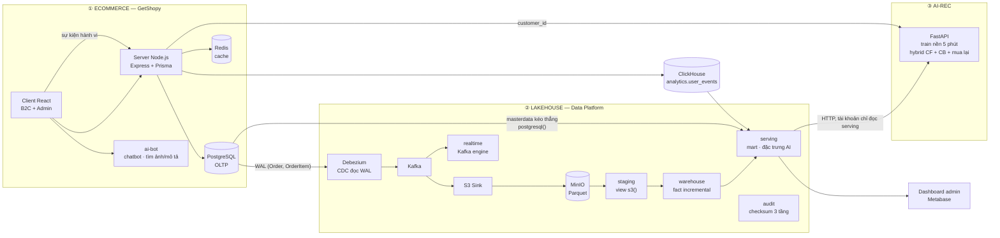
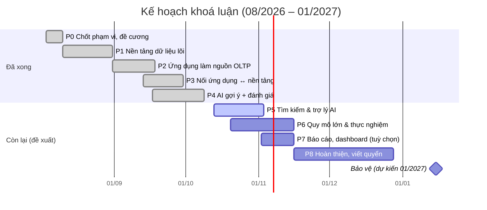

# MÔ TẢ ĐỀ TÀI, KẾ HOẠCH TRIỂN KHAI VÀ TIẾN ĐỘ

### Phát triển hệ thống Thương mại điện tử tích hợp xử lý dữ liệu lớn và hệ thống AI Recommendation/Searching trên nền tảng Data Lakehouse (OLAP)

| | |
|---|---|
| **GVHD** | Võ Văn Thành |
| **Thời gian thực hiện** | 08/2026 – 12/2026 · bảo vệ dự kiến 01/2027 |
| **Cập nhật** | 10/10/2026 |
| **Mã nguồn** | Một repo, ba hệ: `ktln-Getshopy/` (Ecommerce + AI), `local-infra-sandbox/` (Lakehouse), `data-platform-poc/` (bộ sinh dữ liệu) |
| **Tài liệu liên quan** | [00 Đề cương & kiến trúc](00-DE-CUONG-VA-KIEN-TRUC.md) · [05 Cần chốt với GVHD](05-CAN-CHOT-VOI-GVHD.md) · [Luồng hiện tại](current-flow.md) · [Nhật ký kết quả](implement-phase/results/results.md) · [Hợp đồng dữ liệu](implement-phase/implement-plan/data-contract-warehouse.md) · [Đánh giá AI-Rec](../ktln-Getshopy/qu-n-ly-ban-l/source/ai-rec/evaluation/README.md) |

Ký hiệu trạng thái dùng trong tài liệu: ✅ đã xong và đã kiểm chứng · 🟡 làm được một phần · ⬜ chưa làm · 🔷 tuỳ chọn.

---

## 1. Bối cảnh và bài toán

### 1.1. Bối cảnh

Doanh nghiệp bán lẻ có chuỗi cửa hàng và kênh thương mại điện tử sinh dữ liệu liên tục từ nhiều nguồn phân tán: POS tại cửa hàng, website/app bán hàng, hệ thống khuyến mãi – voucher, kho, thanh toán. Cách làm phổ biến là cắm ứng dụng và báo cáo trực tiếp vào CSDL tác nghiệp (OLTP). Cách này bộc lộ ba hạn chế:

| # | Hạn chế | Biểu hiện |
|---|---|---|
| 1 | **Hiệu năng và tranh chấp tài nguyên** | Truy vấn duyệt, lọc, tổng hợp trên hàng triệu dòng của CSDL lưu theo dòng rất chậm, và cạnh tranh tài nguyên với luồng ghi đơn hàng |
| 2 | **Phân mảnh nguồn dữ liệu** | Sản phẩm, đơn hàng, khuyến mãi, tồn kho nằm ở nhiều hệ OLTP khác nhau; ghép tay, khó tái lập |
| 3 | **Không có nền dữ liệu sạch có lịch sử** | Dữ liệu tác nghiệp chỉ giữ trạng thái hiện tại, không lưu vết theo dạng phân tích → khó xây hệ gợi ý và báo cáo chính xác |

### 1.2. Nền tảng sẵn có

Nhóm đã có một nền tảng dữ liệu tập trung theo kiến trúc **Lakehouse** (Armbrust et al., 2021): dữ liệu thô lưu trên **MinIO** dạng **Parquet**, được chuẩn hoá bằng **dbt-core** và nạp vào kho phân tích **ClickHouse** theo mô hình chiều (Kimball & Ross, 2013), hiển thị qua công cụ BI. Nền tảng đã thông luồng đầu-cuối ở môi trường sandbox và máy ảo đơn. Mô hình lấy ý tưởng từ nhu cầu thực tế của doanh nghiệp: quản lý dữ liệu lớn và truy xuất báo cáo near real-time từ các chi nhánh trên toàn quốc.

### 1.3. Phát biểu bài toán

Xây dựng một ứng dụng thương mại điện tử B2C **kết nối trực tiếp vào nền tảng Lakehouse** với vai trò kép:

- **Nguồn dữ liệu:** mọi giao dịch phát sinh trên ứng dụng chảy vào data lake qua CDC, không có đường tắt.
- **Nơi tiêu thụ:** ứng dụng dùng lại dữ liệu đã tinh chế cho gợi ý cá nhân hoá, tìm kiếm thông minh và báo cáo.

Câu hỏi trung tâm: **tách tải phân tích và AI khỏi CSDL tác nghiệp** như thế nào để ứng dụng vẫn nhanh ở quy mô lớn, dữ liệu phân tích vẫn đúng và đủ so với nguồn, và kết quả AI quay về giao diện ở mức near real-time.

---

## 2. Mục tiêu

| # | Mục tiêu | Tiêu chí hoàn thành *(đề xuất — cần chốt với GVHD)* |
|---|---|---|
| **MT1** | **Hiệu năng ở quy mô lớn** (~1 triệu bản ghi): duyệt, tìm kiếm, lọc, phân loại sản phẩm chạy mượt; update/delete trong luồng dữ liệu lớn không nghẽn; đối soát xuyên tầng bảo đảm toàn vẹn | p95 API duyệt/lọc/tìm < 300 ms ở 600k–1M sản phẩm, có đối chứng trước/sau tối ưu · trạng thái mới nhất ở kho khớp 100% với nguồn sau update/delete · checksum 3 tầng KHỚP sau mỗi lượt xử lý |
| **MT2** | **Gợi ý thông minh**: Collaborative Filtering + Content-Based Filtering, huấn luyện trên hành vi và lịch sử mua lấy từ data lake, trả kết quả về giao diện near real-time | Vượt Most-Popular có ý nghĩa thống kê (CI 95% bootstrap) trên giao thức đánh giá offline · thay đổi hành vi phản ánh vào gợi ý trong ≤ 10 phút · API gợi ý trả từ cache |
| **MT3** | **Trợ lý AI và tìm kiếm thông minh**: giải đáp chính sách và sản phẩm, tìm theo hình ảnh và mô tả | Tìm được khi gõ không dấu và gõ sai nhẹ · tìm bằng ảnh trả đúng danh mục · bộ câu hỏi chính sách mẫu trả lời đúng |
| **MT4** 🔷 | **Phân tích và báo cáo**: doanh thu, bán lẻ, hiệu quả chiến dịch | Dashboard đọc từ kho ClickHouse, số liệu khớp nguồn |

> **Lưu ý trung thực:** toàn bộ dữ liệu trong đề tài là **dữ liệu mô phỏng** (bộ sinh có hạt giống cố định, tái lập được). Mọi kết quả thực nghiệm phải ghi rõ điều này.

---

## 3. Phạm vi

| Trong phạm vi (làm thật, có kiểm chứng) | Ngoài phạm vi (chỉ thiết kế / hướng phát triển) |
|---|---|
| Ứng dụng B2C GetShopy: duyệt, tìm, lọc, giỏ, đặt đơn, thanh toán, theo dõi đơn, trang quản trị | Ứng dụng di động, cổng giao vận thật |
| Thanh toán chuyển khoản VietQR có đối soát webhook (SePay) và COD | Cổng thanh toán quốc tế |
| Lakehouse một máy: PostgreSQL → Debezium/Kafka → MinIO Parquet → ClickHouse → dbt | Vận hành hệ thống thật của doanh nghiệp |
| AI-Rec: hybrid Item-CF + Content-based + kênh mua lại, đánh giá offline có giao thức | Đánh giá online (A/B test) với người dùng thật |
| Trợ lý chatbot, tìm kiếm theo ảnh / mô tả | Huấn luyện mô hình ngôn ngữ / thị giác riêng |
| Bộ sinh dữ liệu mô phỏng có chủ đích | Dữ liệu thật của doanh nghiệp |
| Triển khai bằng một lệnh `docker compose up` | Cụm nhiều máy, Kubernetes *(xem §10 — điểm lệch với đề cương)* |

---

## 4. Kiến trúc tổng thể

### 4.1. Ba hệ và quan hệ giữa chúng

| Hướng | Cơ chế | Lý do chọn |
|---|---|---|
| Ecom → Lakehouse (giao dịch) | CDC Debezium đọc WAL của PostgreSQL | Không thêm tải truy vấn lên OLTP, bắt được mọi thay đổi theo thời gian, phát lại được qua Kafka |
| Ecom → Lakehouse (danh mục) | ClickHouse `postgresql()` kéo thẳng, dựng lại mỗi lượt dbt | Dữ liệu chiều ít thay đổi, không cần lịch sử — dựng cả đường CDC là thừa |
| Ecom → ClickHouse (hành vi) | Server ghi sự kiện vào `analytics.user_events` | Khối lượng sự kiện lớn, không thuộc nghiệp vụ giao dịch — không nên ghi vào OLTP |
| Lakehouse → AI-Rec | AI-Rec tự kéo qua HTTP interface của ClickHouse, tài khoản chỉ đọc schema `serving` | Hợp đồng dữ liệu rõ ràng, AI không chạm dữ liệu cá nhân ở `masterdata` |
| AI-Rec → Ecom | Server gọi API gợi ý theo `customer_id` | Gợi ý tính sẵn trong cache, đổi bản model nguyên tử |

### 4.2. Công nghệ

| Tầng | Công nghệ |
|---|---|
| Ứng dụng | React + Vite, Node.js/Express, Prisma, Redis |
| Nguồn OLTP | PostgreSQL 16 (`wal_level = logical`) |
| Thu nhận | Debezium 2.5, Kafka, Kafka Connect, Confluent S3 Sink |
| Lưu trữ thô | MinIO (build từ mã nguồn — bản cộng đồng chỉ còn phát hành dạng mã nguồn) + Parquet |
| Xử lý | dbt-core + dbt-clickhouse; lịch chạy ofelia mỗi 5 phút |
| Kho | ClickHouse — `ReplacingMergeTree(version, is_deleted)`, đọc `FINAL` |
| AI gợi ý | Python, FastAPI, NumPy/SciPy, scikit-learn |
| AI trợ lý / tìm kiếm | Zero-shot mDeBERTa (phân loại ý định), Qwen2.5 qua Hugging Face, Gemini (thị giác) |
| BI | Dashboard admin trong ứng dụng, Metabase |
| Triển khai | Docker Compose, một lệnh dựng đủ hệ; seed tách thành lệnh riêng |

---

## 5. Danh sách tính năng

### (A) E-commerce cốt lõi — bắt buộc

| # | Tính năng | Trạng thái | Ghi chú |
|---|---|---|---|
| A1 | Duyệt danh sách sản phẩm quy mô lớn — catalog 600.000 sản phẩm, ~1,2 triệu dòng tồn kho | ✅ | Catalog cân bằng: 8 nhóm, 45 danh mục lá, 91 hãng, giá theo danh mục. Chưa đo hiệu năng có đối chứng |
| A2 | Lọc theo danh mục, hãng, giá; sắp xếp | ✅ | Các cột lọc đã có index |
| A3 | Tìm kiếm theo từ khoá | 🟡 | Chạy được nhưng dùng `ILIKE '%từ%'`: quét toàn bảng, gõ không dấu ra 0 kết quả, không chịu gõ sai, không xếp hạng theo độ liên quan — **khoảng trống lớn nhất so với MT1** |
| A4 | Trang chi tiết, mô hình 3D sản phẩm, so sánh sản phẩm | ✅ | |
| A5 | Giỏ hàng, đặt đơn theo biến thể, giữ chỗ tồn kho, voucher | ✅ | Đã thử race condition tồn kho |
| A6 | Thanh toán COD và chuyển khoản VietQR, đối soát webhook SePay, tự hết hạn, huỷ, hoàn tiền | ✅ | Webhook qua ngrok tên miền cố định (chốt 07/10) |
| A7 | Theo dõi trạng thái đơn | ✅ | |
| A8 | Đăng nhập email/mật khẩu và Google OAuth (xác thực ID token phía server) | ✅ | Đã vá lỗ hổng chiếm tài khoản ở `/auth/social` |
| A9 | Onboarding sở thích lần đầu đăng nhập (danh mục, hãng, tầm giá, mục không quan tâm), cho phép bỏ qua | ✅ | |
| A10 | Trang quản trị: dashboard, tài chính, fulfillment, đối soát thanh toán, cảnh báo, hành vi khách, quản lý chatbot, đánh giá | ✅ | ⚠ API `/api/b2b/*` chưa có xác thực |

### (B) Trợ lý AI, tìm kiếm và gợi ý — bắt buộc, trọng tâm AI

| # | Tính năng | Trạng thái | Ghi chú |
|---|---|---|---|
| B1 | Trợ lý ảo giải đáp chính sách, sản phẩm | 🟡 | Phân loại ý định + câu trả lời chính sách **viết cố định** + LLM cho câu chung; chưa có kho tri thức chính sách |
| B2 | Tìm kiếm theo hình ảnh | 🟡 | Gemini trích thuộc tính (danh mục, hãng, màu, từ khoá) → truy vấn sản phẩm; khâu truy xuất vẫn là `ILIKE`; phụ thuộc hạn mức API miễn phí |
| B3 | Tìm kiếm theo mô tả (smart search) | 🟡 | LLM/luật phân tích câu → từ khoá + bộ lọc → `ILIKE` |
| B4 | Thu thập lịch sử mua | ✅ | Đơn hàng đi qua CDC → lake → kho; chỉ tính đơn đã thanh toán, không huỷ |
| B5 | Thu thập hành vi | ✅ | Xem, thời gian xem, giỏ, yêu thích, bỏ giỏ, bỏ checkout, hiển thị/nhấp gợi ý; khách lấy từ token; ghép phiên ẩn danh sau đăng nhập |
| B6 | Gợi ý cá nhân hoá | ✅ | Hybrid Item-CF (Sarwar et al., 2001) + Content-based (Pazzani & Billsus, 2007) + kênh mua lại (Anderson et al., 2014); lọc cứng mục "không quan tâm"; train nền 5 phút, tính sẵn cho mọi khách, đổi bản nguyên tử |
| B7 | Đánh giá offline có giao thức | ✅ | Cắt thời gian toàn cục, chọn tham số trên validation, baseline, bootstrap CI, tách khám phá / mua lại, khách mới mô phỏng, đối chứng EASE^R và iALS |
| B8 | Tín hiệu hành vi phụ cho CF | 🟡 | Đã cài và có test; đang **tắt** vì chưa có dữ liệu hành vi đủ lớn |

### (C) Nền tảng dữ liệu Lakehouse — bắt buộc

| # | Tính năng | Trạng thái | Ghi chú |
|---|---|---|---|
| C1 | CDC `Order`, `OrderItem` → Kafka → Parquet trên MinIO | ✅ | |
| C2 | Staging (view `s3()`) → warehouse `fact_orders_detail` nạp tăng dần | ✅ | `ReplacingMergeTree`; mốc thời gian riêng từng nguồn để không mất bản ghi xả muộn |
| C3 | Masterdata (sản phẩm, danh mục, hãng, khách, chi nhánh, voucher, sở thích) | ✅ | |
| C4 | Serving cho dashboard và AI (mart doanh thu, cặp khách–món, sự kiện mua, đặc trưng sản phẩm, tín hiệu sở thích, sự kiện hành vi) | ✅ | Có hợp đồng dữ liệu |
| C5 | Đối soát checksum 3 tầng Nguồn → Staging → Kho mỗi lượt `dbt build` | ✅ | |
| C6 | Lịch dbt 5 phút, OPTIMIZE định kỳ, backup PostgreSQL | ✅ | |
| C7 | Nhánh realtime (Kafka engine → `orders_live`) | ✅ | |
| C8 | Dựng toàn hệ bằng một lệnh, bootstrap tự khởi tạo | ✅ | |
| C9 | Thu thập từ **nhiều** nguồn OLTP | 🟡 | Hiện chỉ có **một** nguồn PostgreSQL; POS mô phỏng ghi vào cùng CSDL |
| C10 | Tiến hoá lược đồ (thêm cột ở nguồn) | ⬜ | Cột mới không tới Parquet (cột `province`) — hạn chế đã ghi nhận |
| C11 | Giám sát hạ tầng, dashboard SLA (Prometheus/Grafana) | ⬜ | Có trong đề cương, chưa làm |

### (D) Phân tích và báo cáo — tuỳ chọn

| # | Tính năng | Trạng thái | Ghi chú |
|---|---|---|---|
| D1 | Dashboard doanh thu, tài chính, hành vi trong trang admin, đọc ClickHouse | ✅ | |
| D2 | Metabase | 🟡 | Có trong stack; bộ dashboard chưa được ghi nhận trong nhật ký kết quả |
| D3 | Hiệu quả chiến dịch / voucher | ⬜ | |

---

## 6. Kế hoạch triển khai theo giai đoạn

Nguyên tắc: **lát cắt dọc** — mỗi giai đoạn hoàn thành một mạch đi xuyên nguồn → kho → giao diện, thay vì làm xong từng tầng. Ranh giới giai đoạn đặt ở **điểm cần quyết định hoặc phụ thuộc bên ngoài**, không đặt theo khối lượng code.

### P0 — Khởi động và chốt phạm vi · 03–09/08/2026 · ✅

- **Công việc:** đề cương, kiến trúc 4 góc nhìn, danh sách câu hỏi cần chốt với GVHD, dựng lại môi trường.
- **Đầu ra:** [00 Đề cương & kiến trúc](00-DE-CUONG-VA-KIEN-TRUC.md), [05 Cần chốt với GVHD](05-CAN-CHOT-VOI-GVHD.md), [Kế hoạch tuần](../KE-HOACH-THUC-HIEN.md).
- **Còn mở:** một số điểm ở tài liệu 05 chưa có quyết định chính thức (xem §10).

### P1 — Nền tảng dữ liệu lõi · 10–30/08/2026 · ✅

- **Công việc:** sandbox PostgreSQL → Debezium/Kafka → MinIO Parquet → ClickHouse → dbt; lớp `audit` đối soát checksum.
- **Đầu ra:** luồng đầu-cuối ở sandbox và máy ảo đơn.

### P2 — Ứng dụng GetShopy làm nguồn OLTP · 31/08–17/09/2026 · ✅

- **Công việc:**
  - chuyển ứng dụng sang PostgreSQL;
  - tách `OrderItem`, tồn kho theo biến thể, chống sửa giá phía client;
  - thanh toán VietQR với đối soát webhook, hết hạn tự động, COD;
  - trang quản trị; Google OAuth (vá lỗ hổng chiếm tài khoản);
  - gộp ba hệ vào một `docker-compose`, seed tất định.
- **Đầu ra:** ứng dụng chạy được đầy đủ luồng mua hàng; mọi đơn đi qua CDC.

### P3 — Nối ứng dụng ↔ nền tảng · 13–29/09/2026 · ✅

- **Công việc:**
  - fact nạp tăng dần trên `ReplacingMergeTree`;
  - masterdata kéo thẳng; tầng serving cho dashboard và AI theo hợp đồng dữ liệu;
  - lịch dbt 5 phút, OPTIMIZE định kỳ, nhánh realtime;
  - sửa hai lỗi mất dữ liệu im lặng trong nạp tăng dần (lọc hai nguồn riêng rẽ; một mốc thời gian chung).
- **Đầu ra:** `dbt build` 68/68 PASS; `fact_orders_detail` 6.262 dòng / 3.509 đơn, khớp tuyệt đối PostgreSQL; checksum 3 tầng KHỚP.

### P4 — AI gợi ý và đánh giá · 17/09–08/10/2026 · ✅ phần lõi

- **Công việc:**
  - Item-CF đọc từ warehouse, train nền, đổi bản nguyên tử;
  - onboarding sở thích → content-based → hybrid có trọng số, lọc cứng mục không quan tâm;
  - kênh mua lại theo tần suất đơn có giảm theo thời gian;
  - tracking hành vi phía client + ghép phiên; tín hiệu hành vi phụ cho CF;
  - catalog sinh lại cân bằng; bộ sinh dữ liệu v2 (gu theo danh mục/hãng/giá, gu trôi dần, hành vi xem trước khi mua);
  - benchmark v1 → v3.
- **Đầu ra:** service AI-Rec, 41/41 test; giao thức và kết quả ở [README đánh giá](../ktln-Getshopy/qu-n-ly-ban-l/source/ai-rec/evaluation/README.md); tài liệu mô hình ở `ai-rec/doc/`.
- **Còn mở:** half-life đổi sang 37 ngày (08/10) theo phân tích chu kỳ mua lại, **chưa benchmark lại**; tín hiệu hành vi phụ đang tắt.

### P5 — Tìm kiếm và trợ lý AI · đề xuất 13/10–02/11/2026 · ⬜

| Bước | Nội dung | Chờ gì |
|---|---|---|
| 5.1 | **Chốt phương án tìm kiếm**: tối ưu ngay trong PostgreSQL (`unaccent` + `pg_trgm`, index GIN) hay thêm search engine (Elasticsearch/OpenSearch nối vào đường CDC sẵn có, hoặc Meilisearch) | **Quyết định của nhóm** — đánh đổi đã phân tích: search engine mạnh hơn về xếp hạng, autocomplete, facet nhưng tốn 2–4 GB RAM, cần đường đồng bộ và cấu hình hệ thống trên Windows |
| 5.2 | Tìm không dấu, chịu gõ sai, xếp theo độ liên quan; một tầng truy xuất dùng chung cho tìm từ khoá, tìm theo mô tả, tìm theo ảnh và chatbot | 5.1 |
| 5.3 | Trợ lý chính sách: thay câu trả lời viết cố định bằng kho tri thức chính sách có truy xuất (RAG) | Quyết định phạm vi chatbot; nội dung chính sách cửa hàng |
| 5.4 | Đo trước/sau: độ trễ p95, tỉ lệ có kết quả với truy vấn không dấu/gõ sai | 5.2 |

**Đầu ra:** tìm kiếm đạt tiêu chí MT1/MT3, có số đo đối chứng.

### P6 — Quy mô lớn và thực nghiệm · đề xuất 20/10–15/11/2026 · ⬜

| Bước | Nội dung | Chờ gì |
|---|---|---|
| 6.1 | Chạy bộ dữ liệu demo 40.000 khách · 3.000.000 đơn (đã viết 05/10, **chưa chạy**) — đơn đi đúng đường CDC → lake → dbt → AI-Rec | **Máy demo đủ tài nguyên** (máy dev không chịu được tải) |
| 6.2 | Đo duyệt/lọc/tìm ở 600k–1M sản phẩm, có đối chứng | P5 |
| 6.3 | Đo độ trễ đầu-cuối đơn → kho → gợi ý; chi phí xử lý update/delete trên `ReplacingMergeTree` | 6.1 |
| 6.4 | Đối soát dưới tiêm lỗi (hạ Kafka, hạ ClickHouse, kill giữa lúc ghi) → checksum về KHỚP, không mất, không nhân bản | 6.1 |
| 6.5 | Chạy lại benchmark AI trên dữ liệu mới, chọn lại cấu hình trên validation (gồm half-life) | 6.1 |

**Đầu ra:** bảng số liệu thực nghiệm cho chương kết quả.

### P7 — Báo cáo và dashboard · đề xuất 02–15/11/2026 · 🔷

- **Công việc:** dashboard doanh thu theo chi nhánh/danh mục; nếu chốt làm thì thêm hiệu quả chiến dịch/voucher; Metabase hoặc trang admin.
- **Chờ:** quyết định có làm D3 hay không.

### P8 — Hoàn thiện, viết quyển, bảo vệ · đề xuất 16/11/2026 – 01/2027

- **Công việc:**
  - đóng băng tính năng; xử lý tồn đọng bảo mật (xác thực `/api/b2b/*`, xoay các khoá bí mật);
  - viết quyển, slide, video demo; tập dượt.
- **Chờ:** GVHD duyệt bản thảo — cần chừa thời gian sửa sau góp ý.

**Đường găng:** quyết định phương án tìm kiếm (P5.1) → máy demo chạy bộ 3 triệu đơn (P6.1) → góp ý của GVHD (P8). Viết code không phải phần chậm nhất; các mốc chờ quyết định và tài nguyên mới quyết định tiến độ.

---

## 7. Tiến độ hiện tại (đến 10/10/2026)

| Nhóm | Trạng thái | Số liệu chính |
|---|---|---|
| (A) E-commerce | ✅ đủ luồng mua hàng; 🟡 tìm kiếm | 600.000 sản phẩm, ~1,2 triệu dòng tồn kho; tìm kiếm chưa đạt (quét toàn bảng ~150–650 ms, không tìm được khi gõ không dấu) |
| (B) AI gợi ý | ✅ | Dữ liệu đơn đang có trong hệ (sinh bởi mô phỏng POS), NDCG@10 trên test: tổng thể 0,309 → **0,356** (+0,047, CI 95% [+0,018; +0,074]); Item-CF tinh chỉnh khám phá 0,377 — không thua EASE^R (0,359), iALS (0,373) |
| (B) AI gợi ý — dữ liệu mô phỏng v2 | ✅ | Tổng thể 0,197 → **0,357** (+0,160 [+0,142; +0,178]); khách mới chỉ có hành vi duyệt: 0,400 so với 0,099 của Most-Popular |
| (B) Trợ lý, tìm theo ảnh/mô tả | 🟡 | Chạy được; chính sách viết cố định, truy xuất bằng `ILIKE` |
| (C) Lakehouse | ✅ | `dbt build` 68/68 PASS; checksum 3 tầng KHỚP; fact khớp tuyệt đối nguồn |
| (D) Báo cáo | 🟡 | Dashboard admin chạy trên ClickHouse |
| Quy mô ~1 triệu bản ghi | 🟡 | Đạt ở catalog và tồn kho; **đơn hàng mới ~3.500**; bộ 3 triệu đơn chưa chạy |

> Số AI-Rec ở trên đo ngày 01/10 với half-life 7 ngày. Cấu hình đang chạy đã đổi sang 37 ngày (08/10) và chưa có số tương ứng — cần chạy lại ở P6.5. Dữ liệu đơn hàng hiện có do bộ mô phỏng POS sinh; xem mục Hạn chế trong README đánh giá trước khi dùng số liệu.

---

## 8. Đầu ra của đề tài

| # | Đầu ra | Hình thức |
|---|---|---|
| 1 | **Hệ thống phần mềm** gồm ba hệ trong một repo, dựng bằng một lệnh | Mã nguồn + `docker-compose.yml` + README hướng dẫn máy demo Windows |
| 2 | **Nền tảng dữ liệu** có hợp đồng dữ liệu, kiểm thử dbt, đối soát xuyên tầng | Mô hình dbt + `data-contract-warehouse.md` |
| 3 | **Dịch vụ AI-Rec** và **pipeline đánh giá** tái lập được | Service FastAPI + `evaluation/` (xuất dữ liệu, benchmark, báo cáo kèm CI) |
| 4 | **Trợ lý AI và tìm kiếm thông minh** | Service `ai-bot` + tầng truy xuất sau P5 |
| 5 | **Bộ sinh dữ liệu mô phỏng** có hạt giống cố định | catalog 600k, mô phỏng POS, bộ sinh v2, bộ demo 40k khách / 3 triệu đơn |
| 6 | **Bộ số liệu thực nghiệm** | Bảng kết quả P6 |
| 7 | **Tài liệu** | Đề cương, kiến trúc, luồng hiện tại, nhật ký kết quả, tài liệu mô hình AI |
| 8 | **Quyển khoá luận, slide, video demo** | P8 |

---

## 9. Rủi ro và hạn chế đã biết

| Rủi ro / hạn chế | Ảnh hưởng | Hướng xử lý |
|---|---|---|
| Dữ liệu hoàn toàn mô phỏng; bộ sinh cũ cho gu theo lát mã sản phẩm, ít tín hiệu nội dung | Content-based khó chứng minh trên dữ liệu cũ | Bộ sinh v2 + nêu rõ tính vòng tròn của mô phỏng trong quyển |
| Tìm kiếm chưa tối ưu | Không đạt MT1 ở phần tìm kiếm | P5 |
| Bộ 3 triệu đơn chưa chạy | Chưa có số liệu ở quy mô mục tiêu | P6.1 trên máy demo |
| API `/api/b2b/*` chưa xác thực | Lỗ hổng bảo mật trang quản trị | P8 |
| Khoá bí mật từng nằm trong repo / `.env` | Lộ khoá API, khoá ký | Xoay khoá; giữ repo private |
| MinIO cộng đồng không còn bản vá bảo mật | Chấp nhận được ở môi trường khoá luận | Triển khai thật dùng kho S3 còn bảo trì |
| Tìm theo ảnh và chatbot phụ thuộc API ngoài miễn phí | Hạn mức, độ trễ, mạng | Có đường dự phòng; nêu rõ trong quyển |
| Xoá lẻ `OrderItem` không lan tới fact (`REPLICA IDENTITY DEFAULT`) | Nghiệp vụ hiện chỉ huỷ đơn, không xoá | Ghi nhận ở hạn chế |
| Một máy, một nguồn OLTP | Chưa chứng minh "nhiều nguồn" và sẵn sàng cao | Hướng phát triển §11 |

---

## 10. Điểm khác với đề cương 08/2026 — cần chốt với GVHD

Mô tả trong tài liệu này đặt **ứng dụng thương mại điện tử và AI** lên trước, khác với đề cương [00](00-DE-CUONG-VA-KIEN-TRUC.md) vốn lấy **nền tảng dữ liệu** làm trọng tâm. Các điểm dưới đây chưa có quyết định và cần GVHD xác nhận trước khi viết quyển:

| # | Đề cương 08/2026 | Mô tả hiện tại | Câu hỏi |
|---|---|---|---|
| 1 | Tỉ lệ đề xuất: nền tảng 60% – ứng dụng 15% – AI 25% | Ứng dụng TMĐT là sản phẩm chính | Trọng tâm chấm điểm là gì? |
| 2 | AI = gợi ý + dự báo nhu cầu + tối ưu campaign (+ trợ lý dữ liệu) | AI = gợi ý + chatbot + tìm kiếm ảnh/mô tả | Dự báo và campaign chuyển sang hướng phát triển? |
| 3 | Giám sát Prometheus/Grafana, dashboard SLA (MT4) | Không nhắc | Còn bắt buộc không? |
| 4 | Tái lập cụm VM, sẵn sàng cao (MT7) | Không nhắc | Còn trong phạm vi không? |
| 5 | Thực nghiệm ở 1M / 10M / 50M dòng | ~1 triệu bản ghi | Mốc quy mô nào được tính? |
| 6 | Thu nhận từ nhiều nguồn OLTP | Hiện một nguồn PostgreSQL | Có cần thêm một nguồn OLTP độc lập (vd. hệ kho hoặc voucher riêng) để chứng minh "nhiều nguồn"? |
| 7 | BI: Metabase, Grafana | Nhắc PowerBI, Metabase | Có cần PowerBI không? |

---

## 11. Hướng phát triển

**Tìm kiếm**
- Search engine (Elasticsearch/OpenSearch) nhận dữ liệu qua chính đường CDC đang có: một luồng log nuôi nhiều kho dẫn xuất (Kleppmann, 2017).
- Tìm kiếm ngữ nghĩa bằng vector cho tìm theo mô tả và theo ảnh (embedding đa phương thức).
- Autocomplete và facet.

**AI gợi ý**
- Kênh "xem gần đây" và gợi ý theo phiên.
- Đưa iALS (Hu et al., 2008) hoặc EASE^R (Steck, 2019) vào production khi dữ liệu thưa hơn.
- Half-life theo từng danh mục.
- Đánh giá online bằng A/B test với dữ liệu hiển thị/nhấp đã thu.

**Trợ lý AI**
- RAG trên chính sách và thông số sản phẩm.
- Trợ lý hỏi đáp dữ liệu (text-to-SQL trên kho).

**Nền tảng dữ liệu**
- Avro + Schema Registry cho tiến hoá lược đồ.
- Apache Iceberg cho tầng thô.
- Điều phối bằng Airflow/Dagster khi số pipeline tăng.
- Giám sát Prometheus/Grafana và cảnh báo theo SLA.
- Thêm nguồn OLTP độc lập.
- Triển khai cụm nhiều máy.

**Phân tích**
- Dự báo nhu cầu và tối ưu chiến dịch/voucher (các module của đề cương ban đầu).

---

## Tài liệu tham khảo

- Anderson, A., Kumar, R., Tomkins, A., & Vassilvitskii, S. (2014). The dynamics of repeat consumption. *WWW '14*.
- Armbrust, M., Ghodsi, A., Xin, R., & Zaharia, M. (2021). Lakehouse: A new generation of open platforms that unify data warehousing and advanced analytics. *CIDR '21*.
- Burke, R. (2002). Hybrid recommender systems: Survey and experiments. *User Modeling and User-Adapted Interaction, 12*(4).
- Campos, P. G., Díez, F., & Cantador, I. (2014). Time-aware recommender systems: A comprehensive survey and analysis of existing evaluation protocols. *UMUAI, 24*.
- Cremonesi, P., Koren, Y., & Turrin, R. (2010). Performance of recommender algorithms on top-N recommendation tasks. *RecSys '10*.
- Hu, Y., Koren, Y., & Volinsky, C. (2008). Collaborative filtering for implicit feedback datasets. *ICDM '08*.
- Kimball, R., & Ross, M. (2013). *The Data Warehouse Toolkit* (3rd ed.). Wiley.
- Kleppmann, M. (2017). *Designing Data-Intensive Applications*. O'Reilly.
- Pazzani, M. J., & Billsus, D. (2007). Content-based recommendation systems. In *The Adaptive Web*.
- Sarwar, B., Karypis, G., Konstan, J., & Riedl, J. (2001). Item-based collaborative filtering recommendation algorithms. *WWW '01*.
- Steck, H. (2019). Embarrassingly shallow autoencoders for sparse data. *WWW '19*.
- Tài liệu chính thức: Debezium, ClickHouse (`ReplacingMergeTree`), dbt.
