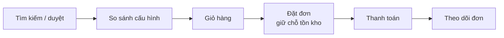
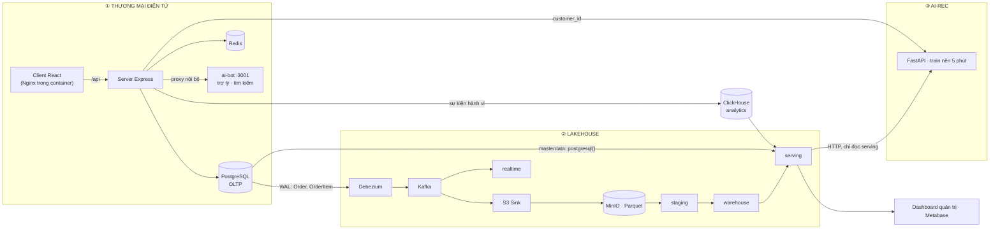
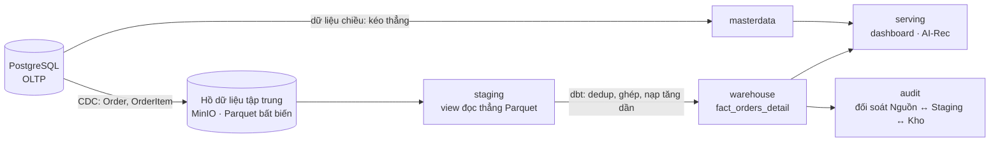
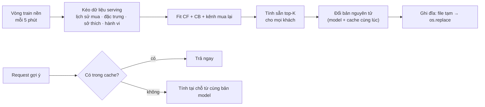
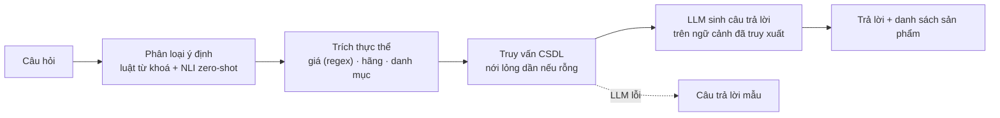
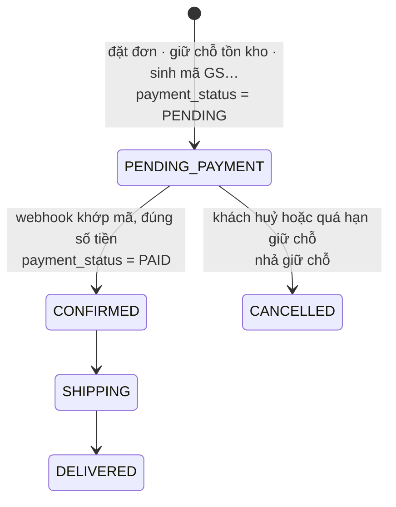

# BÁO CÁO KHOÁ LUẬN TỐT NGHIỆP

## PHÁT TRIỂN HỆ THỐNG THƯƠNG MẠI ĐIỆN TỬ TÍCH HỢP XỬ LÝ DỮ LIỆU LỚN VÀ HỆ THỐNG AI RECOMMENDATION/SEARCHING TRÊN NỀN TẢNG DATA LAKEHOUSE (OLAP)

| | |
|---|---|
| **Giảng viên hướng dẫn** | Võ Văn Thành |
| **Thời gian thực hiện** | 08/2026 – 12/2026 |
| **Phiên bản** | Bản thảo — 14/10/2026 |

> **Quy ước bản thảo:** chỗ đánh dấu ⟦Cần xác nhận⟧ là thông tin chưa kiểm chứng được trong mã nguồn hoặc chưa có quyết định; chỗ ⟦Bổ sung sau thực nghiệm⟧ là số liệu sẽ điền khi chạy xong giai đoạn thực nghiệm. Xoá toàn bộ dấu này trước khi nộp.

---

## TÓM TẮT

Doanh nghiệp bán lẻ đa kênh sinh dữ liệu liên tục từ cửa hàng, website, khuyến mãi, kho và thanh toán. Cắm ứng dụng và báo cáo thẳng vào cơ sở dữ liệu tác nghiệp (OLTP) dẫn tới ba hạn chế: truy vấn tổng hợp chậm và tranh chấp tài nguyên với luồng ghi, nguồn dữ liệu phân mảnh, và không có nền dữ liệu sạch có lịch sử để xây hệ gợi ý.

Khoá luận phát triển ứng dụng thương mại điện tử B2C **GetShopy** kết nối trực tiếp vào một nền tảng dữ liệu theo kiến trúc **Lakehouse**, với ứng dụng giữ vai trò kép: vừa là **nguồn dữ liệu** (mọi giao dịch chảy vào data lake qua Change Data Capture), vừa là **nơi tiêu thụ** (dùng lại dữ liệu đã tinh chế cho gợi ý cá nhân hoá, tìm kiếm thông minh và báo cáo).

Hệ thống gồm ba phân hệ:
1. **Ứng dụng thương mại điện tử** (React, Node.js, PostgreSQL) quản lý catalog 600.000 sản phẩm, giữ chỗ tồn kho nguyên tử và thanh toán chuyển khoản VietQR có đối soát tự động.
2. **Nền tảng Lakehouse** (Debezium, Kafka, MinIO/Parquet, ClickHouse, dbt) nạp tăng dần trên `ReplacingMergeTree` và đối soát xuyên ba tầng.
3. **Phân hệ AI**: dịch vụ gợi ý lai giữa lọc cộng tác theo sản phẩm, lọc theo nội dung và kênh mua lại; trợ lý hội thoại, tìm kiếm theo mô tả và theo hình ảnh.

Mô hình gợi ý được đánh giá offline theo giao thức cắt thời gian toàn cục, chọn tham số trên tập validation, so với các đường cơ sở và báo cáo khoảng tin cậy bootstrap. ⟦Bổ sung sau thực nghiệm: một câu tóm tắt kết quả chính⟧.

**Từ khoá:** Lakehouse, Change Data Capture, ClickHouse, dbt, hệ gợi ý lai, lọc cộng tác, lọc theo nội dung, thương mại điện tử.

---

## DANH MỤC TỪ VIẾT TẮT

| Viết tắt | Nghĩa |
|---|---|
| OLTP / OLAP | Xử lý giao dịch trực tuyến / Xử lý phân tích trực tuyến |
| CDC | Change Data Capture — thu nhận thay đổi dữ liệu |
| WAL | Write-Ahead Log — nhật ký ghi trước của PostgreSQL |
| CF / CBF | Collaborative Filtering / Content-Based Filtering |
| NLI / NLU | Natural Language Inference / Natural Language Understanding |
| LLM | Large Language Model — mô hình ngôn ngữ lớn |
| RAG | Retrieval-Augmented Generation |
| NDCG | Normalized Discounted Cumulative Gain |
| TTL | Time To Live — thời gian sống |

---

# CHƯƠNG 1. MỞ ĐẦU

## 1.1. Lý do chọn đề tài

Bán lẻ thiết bị công nghệ ở Việt Nam vận hành song song cửa hàng và kênh trực tuyến. Mỗi kênh sinh dữ liệu liên tục từ nhiều nguồn: POS tại cửa hàng, website/app, khuyến mãi – voucher, kho, thanh toán. Cách làm phổ biến là cắm cả nghiệp vụ lẫn báo cáo vào cùng một CSDL tác nghiệp. Cách này bộc lộ ba hạn chế:

1. **Hiệu năng và tranh chấp tài nguyên.** CSDL tác nghiệp lưu theo dòng, tối ưu cho đọc/ghi từng bản ghi. Truy vấn duyệt, lọc, tổng hợp trên hàng triệu dòng phải đọc nhiều cột không cần thiết và cạnh tranh tài nguyên với luồng ghi đơn hàng. Kho lưu theo cột chỉ đọc đúng các cột truy vấn cần và nén tốt hơn, nên phù hợp tải phân tích hơn (Stonebraker et al., 2005; Abadi et al., 2008).
2. **Phân mảnh nguồn dữ liệu.** Sản phẩm, đơn hàng, khuyến mãi, tồn kho nằm ở nhiều hệ khác nhau; mỗi báo cáo phải ghép tay và khó tái lập.
3. **Không có nền dữ liệu sạch có lịch sử.** CSDL tác nghiệp chỉ giữ trạng thái hiện tại. Không có vết thay đổi theo thời gian thì không dựng được dữ liệu huấn luyện đúng thời điểm cho hệ gợi ý, cũng không đối chiếu được báo cáo với nguồn.

Song song, trải nghiệm mua sắm trực tuyến đòi hỏi tìm kiếm theo ngôn ngữ tự nhiên, tìm bằng hình ảnh và gợi ý cá nhân hoá. Các chức năng này cần chính loại dữ liệu mà OLTP không giữ: lịch sử mua, hành vi duyệt, đặc trưng sản phẩm đã chuẩn hoá.

Nhóm đã có sẵn một nền tảng dữ liệu theo hướng **Lakehouse** (§2.3): một **hồ dữ liệu tập trung** lưu dữ liệu thô dạng Parquet trên MinIO; từ hồ, dữ liệu được biến đổi bằng dbt-core rồi đẩy xuống kho ClickHouse theo mô hình chiều (Kimball & Ross, 2013). Đề tài đặt câu hỏi: **dựng một ứng dụng thương mại điện tử thật trên nền tảng đó** thì tách được tải phân tích và AI khỏi OLTP tới mức nào, mà vẫn bảo đảm dữ liệu đúng, đủ, kịp thời.

## 1.2. Mục tiêu đề tài

| # | Mục tiêu | Tiêu chí đánh giá |
|---|---|---|
| **MT1** | **Hiệu năng ở quy mô lớn:** duyệt, tìm kiếm, lọc, phân loại sản phẩm mượt ở ~1 triệu bản ghi; update/delete trong luồng dữ liệu lớn không nghẽn; đối soát xuyên tầng bảo đảm toàn vẹn | ⟦Cần xác nhận ngưỡng⟧ p95 API duyệt/lọc/tìm < 300 ms ở 600 nghìn – 1 triệu sản phẩm; trạng thái mới nhất ở kho khớp 100% nguồn; checksum ba tầng khớp sau mỗi lượt xử lý |
| **MT2** | **Gợi ý cá nhân hoá:** CF + CBF huấn luyện trên lịch sử mua và hành vi lấy từ data lake, kết quả về giao diện near real-time | Vượt Most-Popular có ý nghĩa thống kê trên giao thức đánh giá offline; thay đổi hành vi phản ánh vào gợi ý trong ⟦Cần xác nhận⟧ ≤ 10 phút |
| **MT3** | **Trợ lý AI và tìm kiếm thông minh:** giải đáp chính sách và sản phẩm, tìm theo mô tả và theo hình ảnh | ⟦Cần xác nhận⟧ độ chính xác phân loại ý định trên bộ câu hỏi mẫu; tìm được khi gõ không dấu và gõ sai nhẹ |
| **MT4** *(tuỳ chọn)* | **Phân tích và báo cáo:** doanh thu, bán lẻ, hiệu quả chiến dịch | Dashboard đọc từ kho, số liệu khớp nguồn |

## 1.3. Đối tượng và phạm vi nghiên cứu

### 1.3.1. Đối tượng nghiên cứu

- Kiến trúc tách tải tác nghiệp và phân tích: CDC dựa trên log, data lake, kho cột, mô hình chiều.
- Cơ chế xử lý cập nhật/xoá trên kho OLAP vốn tối ưu cho ghi thêm.
- Hệ gợi ý lai trên dữ liệu phản hồi ngầm (lịch sử mua, hành vi duyệt) và phương pháp đánh giá offline.
- Ứng dụng mô hình ngôn ngữ và thị giác vào tìm kiếm và tư vấn trong thương mại điện tử.

### 1.3.2. Phạm vi

| Trong phạm vi | Ngoài phạm vi |
|---|---|
| Ứng dụng B2C GetShopy và trang quản trị | Ứng dụng di động |
| Nền tảng Lakehouse một máy, dựng bằng Docker Compose | Cụm nhiều máy, vận hành hệ thống thật của doanh nghiệp |
| Dịch vụ gợi ý (CF + CBF + mua lại) và đánh giá offline | Đánh giá online (A/B test) với người dùng thật |
| Trợ lý hội thoại, tìm theo mô tả, tìm theo hình ảnh dùng mô hình có sẵn | Huấn luyện mô hình ngôn ngữ/thị giác riêng |
| Thanh toán chuyển khoản qua SePay ở quy mô thử nghiệm, kèm bộ giả lập webhook | Vận hành thanh toán thương mại |
| Dữ liệu mô phỏng có hạt giống cố định, tái lập được | Dữ liệu thật của doanh nghiệp |

Toàn bộ dữ liệu trong khoá luận là **dữ liệu mô phỏng**. Kết quả thực nghiệm được trình bày cùng giới hạn của bộ sinh dữ liệu (Chương 6).

## 1.4. Phương pháp nghiên cứu

- **Nghiên cứu tài liệu:** Lakehouse, mô hình chiều, CDC dựa trên log, cơ chế merge của ClickHouse, hệ gợi ý và phương pháp đánh giá, phân loại văn bản zero-shot.
- **Phát triển tăng dần theo lát cắt dọc:** mỗi vòng hoàn thành một mạch đi xuyên nguồn → kho → giao diện, thay vì làm xong từng tầng.
- **Thực nghiệm có đối chứng:** mọi cải tiến đều so với trạng thái trước hoặc đường cơ sở, trên cùng dữ liệu, cùng giao thức; số liệu kèm khoảng tin cậy khi có thể.
- **Kiểm chứng chất lượng dữ liệu:** kiểm thử dbt, đối soát checksum xuyên tầng, kiểm thử đơn vị và tích hợp cho dịch vụ.

## 1.5. Ý nghĩa của đề tài

- **Thực tiễn:** một mô hình tham chiếu chạy được trọn vẹn — từ đơn hàng trên web tới gợi ý quay về giao diện — dựng bằng một lệnh, có kiểm chứng từng chặng.
- **Khoa học:** cho thấy cách xử lý cập nhật/xoá trên kho chỉ-ghi-thêm mà vẫn đúng trạng thái mới nhất, cách đối soát dữ liệu tự động xuyên tầng, và cách đánh giá hệ gợi ý trung thực trên dữ liệu phản hồi ngầm.

## 1.6. Bố cục báo cáo

Chương 2 trình bày tổng quan nghiệp vụ và cơ sở lý thuyết. Chương 3 phân tích yêu cầu và thiết kế. Chương 4 mô tả hiện thực từng phân hệ. Chương 5 trình bày triển khai. Chương 6 là thực nghiệm và đánh giá. Chương 7 kết luận và nêu hướng phát triển.

---

# CHƯƠNG 2. TỔNG QUAN VÀ CƠ SỞ LÝ THUYẾT

## 2.1. Khảo sát nghiệp vụ bán lẻ công nghệ trực tuyến

### 2.1.1. Quy trình mua hàng



### 2.1.2. Thách thức

| Thách thức | Biểu hiện |
|---|---|
| Truy xuất ở quy mô lớn | Catalog hàng trăm nghìn sản phẩm: lọc nhiều điều kiện, phân trang sâu, tìm theo chuỗi con đều có nguy cơ quét toàn bảng |
| Tranh chấp tồn kho | Nhiều khách đặt cùng món trong đợt flash sale → bán vượt tồn (overselling) nếu kiểm tra và trừ kho không nguyên tử |
| Đối soát thanh toán chuyển khoản | Khách chuyển thiếu, chuyển dư, chuyển trễ, ghi sai nội dung; cổng gửi webhook lặp lại |
| Tìm theo nhu cầu tự nhiên | Khách gõ "điện thoại chụp ảnh đẹp dưới 10 triệu", gõ không dấu, hoặc chỉ có ảnh sản phẩm |
| Báo cáo và AI trên dữ liệu tác nghiệp | Tổng hợp trên OLTP làm chậm luồng bán hàng; OLTP không có lịch sử thay đổi |

## 2.2. OLTP, OLAP và lưu trữ theo cột

OLTP tối ưu cho nhiều giao dịch ngắn đọc/ghi vài bản ghi; OLAP tối ưu cho truy vấn quét và tổng hợp trên khối lượng lớn. Hệ lưu theo cột chỉ đọc các cột được truy vấn, nén tốt nhờ dữ liệu cùng kiểu nằm liền nhau và xử lý theo lô vector, nên nhanh hơn đáng kể cho tải phân tích (Stonebraker et al., 2005; Abadi et al., 2008). Mô hình chiều tổ chức dữ liệu phân tích thành bảng sự kiện (fact) và bảng chiều (dimension) để truy vấn tổng hợp đơn giản và nhất quán (Kimball & Ross, 2013).

## 2.3. Data Lake, Data Warehouse và Lakehouse

**Lakehouse** là từ ghép của **data lake** và **data warehouse**:

| | Data warehouse | Data lake |
|---|---|---|
| Dữ liệu | Đã mô hình hoá, có lược đồ chặt | Thô, nhiều dạng, lược đồ khi đọc |
| Lưu trữ | Định dạng riêng của hệ quản trị | Tệp mở (Parquet, ORC) trên kho đối tượng giá rẻ |
| Mạnh | Giao dịch, quản trị, truy vấn phân tích nhanh | Rẻ, linh hoạt, giữ được mọi dữ liệu thô |
| Yếu | Đắt, kém linh hoạt với dữ liệu thô | Thiếu quản trị, thiếu giao dịch, truy vấn chậm |

Kiến trúc phổ biến trước đây ghép hai hệ thành **hai tầng**: lake giữ dữ liệu thô, một phần được ETL tiếp vào warehouse. Armbrust et al. (2021) chỉ ra nhược điểm của cách này: dữ liệu bị giữ hai bản, bản ở warehouse trễ so với lake, và thêm một bước ETL dễ lỗi. Lakehouse đưa các tính năng quản lý của warehouse — giao dịch ACID, phiên bản dữ liệu, chỉ mục, tối ưu truy vấn — xuống chạy **trực tiếp trên tệp mở ở lake**, thường thông qua một định dạng bảng mở như Delta Lake (Armbrust et al., 2020) hoặc Apache Iceberg.

Trong đề tài:
- MinIO giữ các tệp Parquet bất biến làm tầng thô.
- ClickHouse đọc trực tiếp các tệp đó qua hàm `s3()` ở tầng staging, không sao chép.
- Các bảng đã tinh chế (warehouse, serving) nằm trong định dạng riêng của ClickHouse.
- dbt quản lý biến đổi dưới dạng mã có kiểm thử.

### Định vị kiến trúc của đề tài

Đề tài theo **hướng Lakehouse**, với data lake đóng vai trò **hồ dữ liệu tập trung**: mọi dữ liệu giao dịch đổ về hồ trước, sau đó mới được biến đổi và đẩy xuống kho. Ba nguyên tắc:

1. **Hồ dữ liệu là nguồn sự thật của tầng phân tích.** Mọi thay đổi giao dịch từ OLTP được ghi vào hồ đúng một lần, ở dạng Parquet mở và bất biến, nên phát lại được khi tầng sau hỏng.
2. **Biến đổi đọc thẳng từ hồ.** Tầng staging là view đọc trực tiếp tệp Parquet; giữa hồ và kho không có hệ ETL trung gian nào khác ngoài dbt.
3. **Kho là dữ liệu dẫn xuất.** Bảng sự kiện dựng lại được hoàn toàn từ hồ. Điều này đã được thực hiện thật khi full-refresh `fact_orders_detail` từ Parquet (29/09/2026), cho kết quả khớp nguồn tới từng dòng (§6.1).

**Khác Lakehouse theo định nghĩa của Armbrust et al. (2021)** ở chỗ: tầng tinh chế (warehouse, serving) nằm trong định dạng riêng của ClickHouse, chưa nằm trên định dạng bảng mở ở hồ.

Lý do chọn như vậy: `MergeTree` cho phép sắp xếp vật lý theo khoá, nén theo cột, và `ReplacingMergeTree` xử lý cập nhật bằng phiên bản (§2.5). Đây là các tính năng cần để dashboard và AI-Rec đọc với độ trễ thấp. Đưa tầng tinh chế lên định dạng bảng mở là hướng phát triển (§7.3).

**Ngoại lệ có chủ đích:** dữ liệu chiều (sản phẩm, danh mục, hãng, khách, chi nhánh) được kéo thẳng từ PostgreSQL vào kho, không đi qua hồ. Lý do: chúng ít thay đổi và phân tích chỉ cần ảnh chụp mới nhất, không cần lịch sử (§4.3.1).

## 2.4. Change Data Capture dựa trên log

CDC dựa trên log đọc nhật ký giao dịch của CSDL (WAL của PostgreSQL) thay vì truy vấn bảng, nên không thêm tải đọc lên OLTP và bắt được mọi thay đổi — kể cả cập nhật và xoá — theo đúng thứ tự cam kết (Kleppmann, 2017, ch. 11). Kafka làm vùng đệm và nhật ký có thể phát lại giữa nguồn và đích (Kreps et al., 2011). Kafka chỉ bảo đảm thứ tự **trong một partition**, nên mọi lập luận về thứ tự sự kiện phải gắn với cấu hình partition.

## 2.5. Xử lý cập nhật trên kho chỉ-ghi-thêm

ClickHouse tối ưu cho ghi thêm theo lô. Thay vì sửa tại chỗ, mỗi thay đổi được ghi thành một **phiên bản mới**; bảng `ReplacingMergeTree(version, is_deleted)` giữ lại phiên bản có version lớn nhất cho mỗi khoá khi hợp nhất các phần dữ liệu. Việc hợp nhất chạy nền, không có thời điểm bảo đảm, nên truy vấn cần kết quả đúng phải đọc kèm `FINAL` để hợp nhất ngay lúc đọc (ClickHouse, n.d.).

## 2.6. Hệ gợi ý

- **Lọc cộng tác theo sản phẩm (item-based CF):** điểm của món *j* với khách *u* là tổng độ tương đồng cosine giữa *j* và các món *u* đã tương tác, có trọng số (Sarwar et al., 2001).
- **Phản hồi ngầm:** lịch sử mua và lượt xem không cho biết khách *không* thích gì, chỉ cho biết mức tin cậy; thường biến đổi số lần tương tác qua thang log (Hu et al., 2008).
- **Lọc theo nội dung (CBF):** dựng hồ sơ khách trên đặc trưng sản phẩm rồi chấm điểm món theo độ khớp với hồ sơ (Pazzani & Billsus, 2007; Lops et al., 2011).
- **Hybrid có trọng số:** trộn điểm của nhiều bộ gợi ý theo trọng số (Burke, 2002).
- **Mua lặp lại:** độ gần đây và tần suất là hai tín hiệu mạnh nhất dự đoán việc mua lại (Anderson et al., 2014).
- **Đánh giá offline:** nên cắt dữ liệu theo thời gian thay vì ngẫu nhiên (Campos et al., 2014); luôn so với đường cơ sở như Most-Popular (Cremonesi et al., 2010); NDCG đo chất lượng xếp hạng (Järvelin & Kekäläinen, 2002). Đánh giá trên log chỉ thưởng các món có trong log, nên thiên về món phổ biến (Marlin & Zemel, 2009).

## 2.7. Tìm kiếm, hiểu ngôn ngữ tự nhiên và mô hình đa phương thức

- **Tìm kiếm văn bản:** chỉ mục đảo (inverted index) tra từ → tài liệu thay vì quét bảng; xếp hạng theo độ liên quan bằng BM25 (Robertson & Zaragoza, 2009). PostgreSQL có `pg_trgm` (chỉ mục trigram cho tìm chuỗi con và độ giống) và `unaccent` (bỏ dấu) (PostgreSQL Global Development Group, n.d.).
- **Phân loại ý định zero-shot bằng NLI:** coi mỗi nhãn ý định là một giả thuyết ("Câu này hỏi về giá") và dùng mô hình suy luận ngôn ngữ để chấm mức kéo theo — phân loại được mà không cần dữ liệu huấn luyện riêng (Yin et al., 2019). Đề tài dùng mDeBERTa-v3 (He et al., 2021) tinh chỉnh trên MNLI và XNLI (Conneau et al., 2018; Laurer et al., 2024), hỗ trợ tiếng Việt.
- **Sinh câu trả lời có căn cứ:** truy xuất dữ liệu liên quan rồi đưa vào ngữ cảnh của mô hình sinh, để câu trả lời bám dữ liệu thật thay vì do mô hình tự bịa (Lewis et al., 2020).
- **Mô hình đa phương thức:** nhận ảnh đầu vào, trả mô tả có cấu trúc (Gemini Team, 2023).

## 2.8. Toàn vẹn giao dịch, idempotency và chịu lỗi

- **Giữ chỗ nguyên tử:** kiểm tra tồn và giữ chỗ trong **một** câu `UPDATE` có điều kiện; CSDL khoá dòng trong lúc cập nhật, nên hai giao dịch đồng thời không thể cùng vượt qua điều kiện (PostgreSQL Global Development Group, n.d.).
- **Idempotency:** xử lý một thông điệp nhiều lần cho cùng kết quả như một lần — điều kiện bắt buộc khi bên gửi có cơ chế gửi lại (Kleppmann, 2017).
- **Circuit breaker:** khi một phụ thuộc lỗi liên tục thì ngắt gọi tạm thời, tránh kéo cả hệ thống chờ theo (Nygard, 2018).

---

# CHƯƠNG 3. PHÂN TÍCH YÊU CẦU VÀ THIẾT KẾ HỆ THỐNG

## 3.1. Tác nhân

| Tác nhân | Vai trò |
|---|---|
| Khách vãng lai | Duyệt, tìm, xem sản phẩm, trò chuyện với trợ lý |
| Khách hàng | Thêm: đặt đơn, thanh toán, theo dõi đơn, yêu thích, onboarding, nhận gợi ý cá nhân hoá |
| Quản trị viên | Quản lý catalog, đơn, fulfillment, đối soát thanh toán, xem báo cáo |
| SePay | Gửi webhook giao dịch ngân hàng |
| Nền tảng dữ liệu | Thu nhận, tinh chế, phục vụ dữ liệu cho báo cáo và AI |

## 3.2. Yêu cầu chức năng

**(A) Thương mại điện tử cốt lõi**
- Duyệt danh sách sản phẩm quy mô lớn; lọc theo danh mục, hãng, giá; sắp xếp.
- Tìm kiếm theo từ khoá.
- Chi tiết sản phẩm, mô hình 3D, so sánh cấu hình.
- Giỏ hàng; đặt đơn theo biến thể; voucher; flash sale.
- Thanh toán COD và chuyển khoản VietQR; theo dõi trạng thái đơn.
- Đăng nhập email/mật khẩu, Google; onboarding sở thích.
- Trang quản trị.

**(B) Trợ lý AI, tìm kiếm và gợi ý**
- Trợ lý hội thoại về chính sách và sản phẩm.
- Tìm kiếm theo mô tả, theo hình ảnh.
- Thu thập lịch sử mua và hành vi duyệt.
- Gợi ý cá nhân hoá bằng CF + CBF.

**(C) Nền tảng dữ liệu**
- Thu nhận thay đổi từ nguồn OLTP về data lake.
- Biến đổi bằng dbt thành bảng tinh chế ở kho.
- Đối soát xuyên tầng.

**(D) Báo cáo** *(tuỳ chọn)*
- Doanh thu, bán lẻ, hiệu quả chiến dịch.

## 3.3. Yêu cầu phi chức năng

| Nhóm | Yêu cầu |
|---|---|
| Hiệu năng | Phản hồi nhanh ở quy mô 600 nghìn – 1 triệu sản phẩm; tải phân tích không chạy trên OLTP |
| Toàn vẹn dữ liệu | Kho phản ánh đúng trạng thái mới nhất của nguồn, kể cả sau update/delete; lệch giữa các tầng phải được phát hiện tự động |
| An toàn tồn kho | Không bán vượt tồn khi đặt đồng thời |
| Bảo mật thanh toán | Server tự tính lại tổng tiền, không tin giá client gửi; webhook xác thực chữ ký, xử lý lặp lại không đổi kết quả |
| Bảo mật danh tính | Danh tính khách lấy từ token đã xác thực, không lấy từ tham số client gửi |
| Quyền tối thiểu | Dịch vụ AI chỉ đọc đúng schema dữ liệu nó cần |
| Tái lập | Dựng toàn hệ bằng một lệnh; dữ liệu mô phỏng có hạt giống cố định |
| Suy giảm êm | Dịch vụ AI ngoài lỗi thì có đường dự phòng, không chặn luồng mua hàng |

## 3.4. Kiến trúc tổng thể



**Hình 3.1.** Ba phân hệ và các đường dữ liệu giữa chúng.

| Đường dữ liệu | Cơ chế | Lý do |
|---|---|---|
| Giao dịch → lake | CDC đọc WAL | Không thêm tải lên OLTP; bắt mọi thay đổi; phát lại được |
| Dữ liệu chiều → kho | ClickHouse kéo thẳng từ PostgreSQL mỗi lượt dbt | Ít thay đổi, không cần lịch sử |
| Hành vi → ClickHouse | Server ghi sự kiện vào `analytics.user_events` | Khối lượng lớn, không thuộc nghiệp vụ giao dịch |
| Kho → AI-Rec | AI-Rec tự kéo qua HTTP của ClickHouse, tài khoản chỉ đọc `serving` | Hợp đồng dữ liệu rõ ràng; AI không chạm dữ liệu cá nhân |
| AI-Rec → giao diện | Server gọi API gợi ý theo `customer_id` | Gợi ý tính sẵn, trả từ cache |

## 3.5. Thiết kế CSDL tác nghiệp

Lược đồ PostgreSQL gồm 21 thực thể, chia theo miền nghiệp vụ:

| Miền | Thực thể |
|---|---|
| Danh tính | `User` (quản trị), `B2CCustomer`, `CustomerPreference` |
| Catalog | `Category`, `Brand`, `Product`, `Branch` |
| Tồn kho | `Inventory` (`on_hand`, `reserved` theo sản phẩm × biến thể × chi nhánh), `StockReservation` |
| Đơn hàng – thanh toán | `Order`, `OrderItem` (snapshot tên, giá, hãng, danh mục lúc mua), `PaymentTransaction` |
| Khuyến mãi | `Voucher`, `VoucherTier`, `VoucherUsage`, `FlashSale`, `FlashSaleItem`, `LoyaltyTransaction` |
| Tương tác | `Review`, `Wishlist`, `ChatLog` |

Hai quyết định thiết kế quan trọng:
- **`OrderItem` lưu snapshot** tên, giá, hãng, danh mục tại thời điểm mua. Báo cáo doanh thu lịch sử không bị đổi theo giá hiện tại.
- **Tồn kho tách `on_hand` và `reserved`.** Giữ chỗ khi đặt đơn chuyển khoản, trừ thật khi thanh toán xong, nhả khi huỷ hoặc hết hạn.

Chỉ mục trên `Product`: `category_id`, `brand_id`, `price`, `(is_deleted, id)`. Chưa có chỉ mục phục vụ tìm kiếm văn bản (§6.4).

## 3.6. Thiết kế kho dữ liệu



**Hình 3.2.** Luồng từ hồ dữ liệu tập trung xuống kho.

| Tầng | Vai trò | Vật liệu hoá |
|---|---|---|
| `staging` | Ánh xạ phong bì Debezium (`before`/`after`/`op`/`ts_ms`) trong Parquet thành cột | View trên `s3()` |
| `warehouse` | `fact_orders_detail` — một dòng mỗi `OrderItem`, ghép thông tin đơn | Bảng `ReplacingMergeTree`, nạp tăng dần |
| `masterdata` | Dữ liệu chiều: sản phẩm, danh mục, hãng, khách, chi nhánh, voucher, sở thích | Bảng, dựng lại mỗi lượt |
| `serving` | Bảng phục vụ: mart doanh thu, cặp khách–món, sự kiện mua, đặc trưng sản phẩm, tín hiệu sở thích, sự kiện hành vi | Bảng; quyền đọc cho AI-Rec |
| `audit` | Đối soát số dòng và tổng tiền Nguồn ↔ Staging ↔ Kho | Bảng, chạy mỗi lượt `dbt build` |
| `realtime` | Đơn mới nhất đọc thẳng từ Kafka | Kafka engine + materialized view |

## 3.7. Thiết kế dịch vụ gợi ý



**Hình 3.3.** Vòng đời một bản train của AI-Rec.

- Model và cache gói chung trong **một** đối tượng, đổi bằng một phép gán. Không tồn tại lúc model là bản mới mà cache còn của bản cũ.
- Trong lúc train bản mới, bản cũ vẫn phục vụ bình thường.

## 3.8. Thiết kế phân hệ trợ lý và tìm kiếm



**Hình 3.4.** Luồng xử lý của trợ lý hội thoại.

## 3.9. Thiết kế luồng thanh toán chuyển khoản



**Hình 3.5.** Vòng đời đơn chuyển khoản (rút gọn). Đơn có hai trường trạng thái:
- `status` — vòng đời giao hàng: `PENDING_PAYMENT`, `CONFIRMED`, `SHIPPING`, `DELIVERED`, `CANCELLED`.
- `payment_status` — `UNPAID`, `PENDING`, `PAID`, `EXPIRED`, `FAILED`, `CANCELLED`, `REFUND_REQUIRED`, `REFUNDED`.

Tiền về sau khi đơn đã hết hạn được xử lý riêng ở bước đối soát (§4.2.4).

---

# CHƯƠNG 4. HIỆN THỰC HỆ THỐNG

## 4.1. Công nghệ sử dụng

**Bảng 4.1.** Công nghệ theo phân hệ (phiên bản theo `package.json` và cấu hình trong repo)

| Phân hệ | Công nghệ | Vai trò |
|---|---|---|
| Giao diện | React 19, Vite 6, Ant Design 5, ECharts 5, Leaflet, Three.js + React Three Fiber | Ứng dụng trang đơn (SPA) cho khách và quản trị; biểu đồ; bản đồ cửa hàng; mô hình 3D |
| Máy chủ | Node.js, Express 5, Prisma 5 | API REST, nghiệp vụ, truy cập CSDL có kiểu |
| CSDL tác nghiệp | PostgreSQL 16 (`wal_level = logical`) | Nguồn sự thật; nguồn CDC |
| Bộ đệm | Redis | Cache danh mục, hãng, KPI dashboard |
| Thu nhận | Debezium 2.5, Kafka, Kafka Connect, Confluent S3 Sink | CDC từ WAL về data lake |
| Lưu trữ thô | MinIO (build từ mã nguồn), Parquet | Data lake |
| Kho và biến đổi | ClickHouse, dbt-core + dbt-clickhouse, lịch chạy ofelia | Kho cột; biến đổi có kiểm thử; chạy mỗi 5 phút |
| Gợi ý | Python, FastAPI, NumPy/SciPy, scikit-learn | Dịch vụ AI-Rec |
| Trợ lý, tìm kiếm | mDeBERTa-v3 NLI (Hugging Face), Qwen2.5-7B-Instruct (Hugging Face), Gemini (thị giác) | Phân loại ý định, sinh câu trả lời, đọc ảnh |
| Thanh toán | SePay (webhook), VietQR | Chuyển khoản tự động đối soát |
| Hạ tầng | Docker Compose | 17 service, dựng bằng một lệnh |

## 4.2. Phân hệ thương mại điện tử

### 4.2.1. Xác thực và phân quyền

- Khách đăng nhập bằng email/mật khẩu hoặc Google. Với Google, server **tự xác thực ID token**, không tin email client gửi lên — điểm này được sửa sau khi phát hiện lỗ hổng chiếm tài khoản ở bản đầu.
- Phiên làm việc dùng JWT có hạn. Hệ thống **không** dùng refresh token.
- Danh tính khách ở mọi API nhạy cảm (đơn hàng, yêu thích, sở thích, tracking) lấy từ token, không lấy từ tham số. Trước đây một số API nhận `customer_id` từ client, nên ai cũng đọc hoặc sửa được dữ liệu người khác; đã sửa.
- Trang quản trị có đăng nhập riêng; các API dashboard yêu cầu token quản trị. ⚠ Nhóm API `/api/b2b/*` hiện **chưa** có middleware xác thực (hạn chế §7.2).

### 4.2.2. Catalog, lọc và phân trang

- Catalog 600.000 sản phẩm, sinh lại cân bằng: thiết bị (điện thoại, laptop, tablet, đồng hồ) chiếm 40%, phụ kiện – nghe nhìn – camera chiếm 60%. Không hãng nào vượt 10% catalog. Giá rơi trong khoảng riêng của từng danh mục theo phân phối log-uniform.
- Lọc theo danh mục (mở rộng cả danh mục con), một hoặc nhiều hãng, khoảng giá; các cột lọc đều có chỉ mục.
- Phân trang theo offset; trang danh sách khách hàng hiện chưa đặt trần cho `limit` (hạn chế §7.2).
- Cache Redis cho cây danh mục và danh sách hãng (TTL 300 giây), lựa chọn onboarding (600 giây).

### 4.2.3. Giữ chỗ tồn kho

Giữ chỗ bằng **một** câu lệnh:

```sql
UPDATE "Inventory"
SET    reserved = reserved + :qty
WHERE  product_id = :pid AND variant_id = :vid AND branch_id = :bid
  AND  on_hand - reserved >= :qty;
```

Số dòng bị ảnh hưởng bằng 0 nghĩa là hết hàng. Kiểm tra và giữ chỗ nằm trong cùng một thao tác nguyên tử ở CSDL, nên không cần khoá ở tầng ứng dụng và không bán vượt tồn khi đặt đồng thời. Kịch bản đặt đồng thời đã được kiểm thử. Đơn chuyển khoản giữ chỗ có thời hạn; đơn COD trừ kho ngay.

### 4.2.4. Thanh toán chuyển khoản và đối soát

- Mỗi đơn có **mã đối soát** dạng `GS…`, nhúng vào nội dung chuyển khoản của mã VietQR động.
- **Thời hạn:** mã QR hiển thị 300 giây; tồn kho được giữ 480 giây (cấu hình qua biến môi trường). Job quét hết hạn chạy mỗi 60 giây, huỷ đơn quá hạn và nhả giữ chỗ.
- Mỗi khách giữ tối đa 3 đơn chờ thanh toán cùng lúc, để chặn việc giữ kho hàng loạt.
- **Server tự tính lại tổng tiền** từ giá trong CSDL; giá client gửi lên bị bỏ qua.
- **Webhook SePay:**
  - xác thực chữ ký HMAC; lưu nguyên payload để còn điều tra;
  - **idempotent** nhờ khoá unique `provider_txn_id` — webhook gửi lại trả về kết quả cũ;
  - chuyển đơn sang đã thanh toán bằng một câu `UPDATE … WHERE payment_status = 'PENDING'`, nên hai webhook đồng thời không thể cùng xác nhận một đơn.
- Nguyên tắc: **không bao giờ im lặng bỏ qua tiền**. Mỗi giao dịch được gán một trạng thái đối soát:

| Trạng thái | Ý nghĩa |
|---|---|
| `MATCHED` | Khớp đơn còn hiệu lực |
| `LATE_MATCHED` | Đơn đã hết hạn nhưng giữ chỗ lại được → vẫn ghi nhận đã thanh toán |
| `UNMATCHED` | Chưa tìm ra đơn — chưa phải trạng thái cuối; job đối khớp lại quét sau (ví dụ webhook đến trước khi đơn kịp tạo) |
| `REFUND_REQUIRED` | Tiền đã vào nhưng không gán được vào đơn còn hiệu lực (ví dụ sai số tiền, hết hạn mà hết hàng) → hàng đợi cho người xử lý hoàn tiền |
| `DUPLICATE` | Đơn đã thanh toán rồi, đây là tiền thừa |
- Bộ giả lập webhook (`simulate-payment.sh`) dùng khi kiểm thử không có giao dịch ngân hàng thật.

### 4.2.5. Onboarding và thu thập hành vi

- **Onboarding** hiện ở lần đăng nhập đầu, cho phép bỏ qua. Khách chọn danh mục, hãng, tầm giá quan tâm và các danh mục/hãng **không** quan tâm. Server kiểm tra hợp lệ (mã tồn tại, không vừa thích vừa ghét).
- **Tracking hành vi:** xem sản phẩm (kèm thời gian xem khi tab đang hiển thị), thêm/bỏ giỏ, yêu thích, bỏ dở thanh toán, món gợi ý được hiển thị và được nhấp.
  - Sự kiện gửi kèm token; giờ sự kiện do server gán.
  - Phiên ẩn danh được ghép với khách sau khi đăng nhập.
  - Truy vấn ClickHouse đều tham số hoá.

### 4.2.6. Trang giao diện

| Phân hệ | Trang |
|---|---|
| Khách hàng | Trang chủ, Danh sách sản phẩm, Chi tiết sản phẩm (mô hình 3D), So sánh, Thanh toán, Tài khoản, Onboarding, Giới thiệu; giỏ hàng dạng ngăn kéo; cửa sổ trợ lý |
| Quản trị | Dashboard, Quản lý chung (sản phẩm, khách hàng, flash sale…), Tài chính, Đối soát thanh toán, Cảnh báo, Fulfillment, Đánh giá, Phân tích hành vi, Quản lý chatbot |
| Minh hoạ nền tảng | Trang Data Lake demo |

### 4.2.7. Chịu lỗi khi đọc kho

Các truy vấn ClickHouse của dashboard đi qua **circuit breaker** (thư viện `opossum`): timeout 5 giây, ngắt khi trên 50% lỗi (Nygard, 2018). Kết quả được cache Redis, nên kho quá tải hay gián đoạn không kéo sập trang quản trị.

## 4.3. Nền tảng Lakehouse

### 4.3.1. Thu nhận

Debezium đọc WAL hai bảng giao dịch `Order` và `OrderItem`, ghi vào Kafka (mỗi topic một partition). S3 Sink gom sự kiện thành tệp Parquet trên MinIO theo ngày, xả theo số bản ghi hoặc theo thời gian thực mỗi 15 giây. Dữ liệu chiều không đi qua CDC mà được ClickHouse kéo thẳng từ PostgreSQL bằng hàm `postgresql()`.

### 4.3.2. Nạp tăng dần cho bảng sự kiện

`fact_orders_detail` ghép hai nguồn CDC (đơn và dòng hàng). Nạp tăng dần phải giải hai vấn đề:

1. **Thay đổi một phía.** Giữa hai lần chạy thường chỉ một phía đổi: đơn chuyển sang PAID mà dòng hàng giữ nguyên, hoặc snapshot dòng hàng được sửa mà đơn giữ nguyên. Lọc hai nguồn riêng rẽ theo mốc thời gian làm JOIN hụt và thay đổi bị bỏ mà không báo lỗi.
   **Giải pháp:** gom tập đơn có biến động ở *bất kỳ* nguồn nào, rồi lấy phiên bản mới nhất của đơn và của *mọi* dòng hàng thuộc đơn đó trên toàn lịch sử.
2. **Nguồn xả lệch thời điểm.** Tệp Parquet của hai topic được xả ở hai thời điểm khác nhau. Một mốc chung có thể bị nguồn đi trước kéo vượt qua bản ghi của nguồn đi sau chưa kịp xuống lake, và bản ghi đó không bao giờ được nạp. Đo thực tế: hai mốc lệch nhau 8 giờ.
   **Giải pháp:** lưu **mốc riêng cho từng nguồn**. Với mỗi topic một partition và một task ghi theo thứ tự offset, bản ghi chưa xuống lake luôn có thời điểm ≥ mốc của chính nguồn đó (§2.4).

Phiên bản (`_event_ts`) là thời điểm muộn hơn giữa đơn và dòng hàng; `ReplacingMergeTree` giữ phiên bản mới nhất.

### 4.3.3. Tầng phục vụ

- **Cho dashboard:** mart doanh thu theo ngày × danh mục × hãng × phương thức thanh toán; các view tương thích cho trang quản trị.
- **Cho AI-Rec:**
  - cặp khách–món và sự kiện mua, chỉ tính đơn đã thanh toán và không huỷ;
  - đặc trưng sản phẩm (danh mục gốc, hãng, tầm giá);
  - tín hiệu sở thích onboarding đã làm sạch;
  - sự kiện hành vi đã ghép phiên.

Các bảng phục vụ AI-Rec được vật liệu hoá thành **bảng** chứ không phải view. Lý do: view thường của ClickHouse kiểm quyền trên bảng gốc theo người gọi, nên tài khoản `ai_rec` (chỉ có quyền `serving`) sẽ bị từ chối. Cấp thêm quyền thì lại mở cả dữ liệu cá nhân của khách.

### 4.3.4. Đối soát xuyên tầng và vận hành

- **Đối soát:** mỗi lượt `dbt build` so số dòng và tổng tiền giữa PostgreSQL, staging và kho; lệch thì kiểm thử báo lỗi.
- **Lịch chạy:** dbt chạy mỗi 5 phút; `OPTIMIZE` định kỳ cho các bảng nhiều phần dữ liệu; sao lưu PostgreSQL định kỳ.
- **Kiểm thử dbt:** khoá duy nhất, không rỗng, giá trị hợp lệ, quan hệ khoá ngoại, không mâu thuẫn sở thích, và tính duy nhất sau `FINAL`.

## 4.4. Dịch vụ gợi ý AI-Rec

### 4.4.1. Mô hình

Điểm cuối cùng của món *i* với khách *u*:

$$
\text{final}(u,i) = \alpha_u\,\widehat{cf}(u,i) + (1-\alpha_u)\,\widehat{cb}(u,i) + \gamma\,\widehat{rep}(u,i), \qquad \alpha_u = \frac{n_u}{n_u + k}
$$

- $\widehat{cf}$ — **Item-CF** (Sarwar et al., 2001), chỉ tính trên món **chưa mua**. Ma trận khách × món dùng thang log (Hu et al., 2008) và giảm trọng số theo thời gian $w = q \cdot 0{,}5^{d/h}$.
- $\widehat{cb}$ — **content-based**. Hồ sơ khách là phân phối trên ba nhóm đặc trưng (danh mục gốc, hãng, tầm giá), dựng từ lịch sử mua cộng câu trả lời onboarding; điểm của món là tích vô hướng giữa hồ sơ và vector one-hot của món (Pazzani & Billsus, 2007).
- $\widehat{rep}$ — **kênh mua lại**: tần suất đơn có giảm theo thời gian (Anderson et al., 2014).
- Mỗi kênh được chuẩn hoá về [0, 1] theo giá trị lớn nhất của từng khách. Trộn theo kiểu hybrid có trọng số (Burke, 2002). Khách mới ($n_u = 0$) dùng hoàn toàn content-based từ onboarding; khách không có tín hiệu nào nhận món phổ biến.
- Danh mục và hãng khách chọn "không quan tâm" bị **lọc cứng** trên mọi kênh, kể cả kết quả CF.
- Chỉ gợi ý món còn bán. Mỗi món kèm `reason` (`cf` / `content` / `repeat` / `popular`) để giao diện giải thích được vì sao món đó xuất hiện.
- **Tín hiệu hành vi phụ** (xem, giỏ, yêu thích) chỉ đi vào hồ sơ của CF. Đã hiện thực và có kiểm thử, nhưng đang tắt do chưa có dữ liệu hành vi đủ lớn.

### 4.4.2. Tham số

$k$, $\gamma$ và half-life $h$ được **chọn trên tập validation** bằng pipeline đánh giá (§6.3), không đặt tay. Riêng mức gợi ý lại (2–3 món cũ trong 10 ô) là quyết định sản phẩm. Half-life hiện đặt 37 ngày theo phân tích chu kỳ mua lại (trung vị 73 ngày) ⟦Cần xác nhận: chạy lại benchmark với cấu hình này⟧.

## 4.5. Phân hệ trợ lý và tìm kiếm (ai-bot)

`ai-bot` là service Node.js riêng, lắng nghe cổng 3001 trong mạng nội bộ. Server chính chuyển tiếp các yêu cầu AI tới service này, nên trình duyệt không gọi thẳng `ai-bot`.

### 4.5.1. Trợ lý hội thoại

1. **Phân loại ý định hai tầng:** tầng luật từ khoá bắt các mẫu rõ ràng với độ tin cậy cố định; câu không khớp luật mới chuyển sang phân loại zero-shot bằng NLI (mDeBERTa-v3) trên **49 nhãn** (`INTENT_LABELS`), ví dụ chào hỏi, tìm sản phẩm, hỏi giá, hỏi cấu hình, hỏi đổi trả, hỏi giao hàng.
2. **Dựng ngữ cảnh:** trích giá, hãng, danh mục từ câu hỏi; truy vấn CSDL; nếu không có kết quả thì **nới lỏng dần** điều kiện (bỏ hãng, nới khoảng giá).
3. **Sinh câu trả lời:** LLM Qwen2.5-7B-Instruct (Qwen Team, 2024) nhận ngữ cảnh đã truy xuất từ CSDL — một dạng sinh câu trả lời có căn cứ theo tinh thần RAG (Lewis et al., 2020), truy xuất trên CSDL quan hệ chứ không dùng vector.
4. **Suy giảm êm:** LLM lỗi thì trả câu trả lời mẫu theo ý định.

Các câu hỏi chính sách (đổi trả, giao hàng, thanh toán) hiện trả lời bằng **nội dung viết sẵn**, chưa có kho tri thức chính sách. Hội thoại được lưu vào `ChatLog`.

### 4.5.2. Tìm kiếm theo mô tả

- LLM trích ra cấu trúc JSON (từ khoá, hãng, danh mục, khoảng giá); LLM lỗi thì rơi về bộ luật.
- **Khoảng giá luôn trích bằng biểu thức chính quy** ("dưới X triệu", "trên X", "từ X đến Y", "tầm/khoảng X", "Xtr", "Xk"…) để không phụ thuộc mô hình.
- Kết quả trích được chuyển thành truy vấn sản phẩm.

### 4.5.3. Tìm kiếm theo hình ảnh

- Ảnh tải lên được gửi tới Gemini; mô hình trả JSON gồm danh mục (ràng buộc vào đúng danh sách danh mục của cửa hàng), hãng, màu, từ khoá, mô tả.
- Hỗ trợ kết hợp ảnh với từ khoá. Kết quả trích được chuyển thành truy vấn sản phẩm.
- Ở nhánh `main-trieu` có thêm danh sách model dự phòng `GEMINI_MODELS`: model lỗi hoặc timeout thì thử model kế tiếp. ⟦Cần xác nhận: nhánh này chưa hợp nhất vào `main`⟧

### 4.5.4. Nhập liệu bằng giọng nói

⟦Cần xác nhận: chưa tìm thấy mã nguồn của chức năng này trên repo — kể cả nhánh `main-trieu` và `QA` (tính tới 08/10/2026). Chỉ đưa vào báo cáo khi đã có mã nguồn, và kèm số đo WER.⟧

### 4.5.5. Khâu truy xuất sản phẩm

Cả trợ lý, tìm theo mô tả và tìm theo ảnh đều kết thúc bằng truy vấn `ILIKE '%từ khoá%'` trên tên sản phẩm. Đây là điểm nghẽn chung về tốc độ lẫn chất lượng (§6.4).

---

# CHƯƠNG 5. TRIỂN KHAI HỆ THỐNG

## 5.1. Môi trường

Toàn hệ thống mô tả trong một tệp `docker-compose.yml` ở gốc repo, gồm **17 service**:

| Nhóm | Service |
|---|---|
| Ứng dụng | `client` (React build + Nginx), `server`, `ai-bot`, `ai-rec` |
| Dữ liệu tác nghiệp | `postgres`, `redis` |
| Lakehouse | `zookeeper`, `kafka`, `kafka-connect`, `minio`, `clickhouse`, `dbt`, `dbt-scheduler`, `bootstrap` |
| BI | `metabase` |
| Seed (chạy riêng) | `seed-catalog`, `seed-data` |

- `docker compose up` chỉ chạy migrate và seed nền (vài giây).
- `bootstrap` tự khởi tạo bucket MinIO, tài khoản ClickHouse chỉ đọc cho AI-Rec, masterdata và hai connector CDC.
- Catalog 600.000 sản phẩm và bộ dữ liệu demo là lệnh riêng (profile `seed`), để lần khởi động thường không phải chờ.

## 5.2. Cấu hình và bí mật

- Biến môi trường tập trung ở `.env` (không đưa lên repo); `.env.example` liệt kê đủ biến.
- Thiếu `.env` thì compose dừng sớm và báo rõ, thay vì chạy với mật khẩu mặc định.

## 5.3. Điều phối truy cập

- Nginx **chạy trong container `client`**: phục vụ tệp tĩnh và chuyển `/api/` tới `server:8080`.
- Server chuyển tiếp yêu cầu AI tới `ai-bot` và gọi `ai-rec` qua mạng nội bộ Docker.
- Chỉ `client` cần mở cổng ra ngoài.

## 5.4. Webhook thanh toán

- SePay cần một URL công khai cố định để gửi webhook. Quick tunnel của Cloudflare **đổi URL mỗi lần khởi động lại**, mỗi lần đổi phải khai lại bên SePay; sai URL thì đơn nằm chờ rồi hết hạn dù tiền đã vào tài khoản. Ngoài ra mạng nơi làm việc chặn cổng 7844 mà tunnel cần.
- Từ 07/10/2026, webhook đi qua **tên miền tĩnh miễn phí của ngrok** (chạy qua cổng 443, URL không đổi). Cloudflare quick tunnel chỉ còn dùng để chia sẻ giao diện web.
- Khi không nhận được webhook thật thì dùng bộ giả lập.

## 5.5. Dữ liệu mô phỏng và sao lưu

| Bộ sinh | Nội dung |
|---|---|
| Catalog | 600.000 sản phẩm cân bằng, ~1,2 triệu dòng tồn kho |
| Mô phỏng POS | Đơn hàng theo "gu" khách, ghi vào PostgreSQL rồi đi qua CDC |
| Bộ sinh v2 | Gu ẩn theo danh mục/hãng/tầm giá, gu trôi dần theo thời gian, hành vi "xem trước khi mua", onboarding có nhiễu |
| Bộ demo | 40.000 khách, 3.000.000 đơn, theo mô hình gu của bộ sinh v2; đơn đi đúng đường CDC → lake → dbt → AI-Rec ⟦Cần xác nhận: đã viết, chưa chạy trên máy demo⟧ |

Mọi bộ sinh dùng hạt giống cố định nên tái lập được. Sao lưu PostgreSQL định kỳ; dữ liệu ở lake và kho là dữ liệu dẫn xuất, dựng lại được từ nguồn.

## 5.6. MinIO

Bản cộng đồng của MinIO chỉ còn phát hành dạng mã nguồn; image dựng sẵn không còn kéo được (MinIO, 2025). Đề tài build MinIO từ mã nguồn chính thức, ghim đúng phiên bản dữ liệu đang dùng, và bỏ phụ thuộc vào `mc` bằng cách gọi S3 API trực tiếp với chữ ký SigV4. Hạn chế: bản cộng đồng không còn bản vá bảo mật.

---

# CHƯƠNG 6. THỰC NGHIỆM VÀ ĐÁNH GIÁ

> Mọi số liệu trong chương này đo trên **dữ liệu mô phỏng**.

## 6.1. Toàn vẹn dữ liệu xuyên tầng

**Bảng 6.1.** Đối soát sau khi sửa logic nạp tăng dần (29/09/2026)

| Kiểm tra | Trước | Sau |
|---|---|---|
| 7 sản phẩm sửa snapshot hãng/danh mục (335 dòng `OrderItem`) | 6/7 sai hãng trong kho | 7/7 đúng, khớp PostgreSQL |
| Số dòng / số đơn / tổng `net_amount` | — | 6.262 / 3.509 / 154.649.475.200 — khớp PostgreSQL |
| Đối soát ba tầng | — | KHỚP |
| Chỉ dòng hàng đổi | logic cũ: 0 dòng | cả đơn được ghi lại, mốc dòng hàng mới |
| Chỉ đơn đổi | logic cũ: 0 dòng | 3/3 dòng hàng được ghi lại, mốc đơn mới |

- Kiểm thử dùng cập nhật không đổi giá trị (`SET x = x`): PostgreSQL vẫn ghi WAL nên Debezium vẫn phát sự kiện, còn dữ liệu không bị thay đổi.
- Sau khi chuyển MinIO sang bản build từ mã nguồn (04/10/2026): `dbt build` 68/68 PASS. Debezium chụp lại toàn bộ bảng nên lake chứa bản trùng, nhưng kho vẫn khớp tuyệt đối với nguồn — bản trùng được khử, không đếm đôi.

⟦Bổ sung sau thực nghiệm: độ trễ đầu-cuối đơn → kho → gợi ý; chi phí xử lý update/delete; đối soát dưới tiêm lỗi (dừng Kafka, dừng ClickHouse, kill giữa lúc ghi)⟧

## 6.2. Thanh toán và tồn kho

- **Webhook:** 20/20 kịch bản đối soát đạt, gồm:
  - cổng gửi lại webhook; khách chuyển hai lần; sai số tiền; nội dung chứa nhiều mã;
  - đơn hết hạn còn hàng (`LATE_MATCHED`); đơn hết hạn hết hàng (`REFUND_REQUIRED`);
  - webhook đến trước khi đơn kịp tạo (job đối khớp lại xử lý).
- **Tồn kho:** kịch bản đặt đồng thời cùng một món không gây bán vượt tồn.

⟦Bổ sung: bảng chi tiết từng kịch bản và kết quả, lấy từ nhật ký kiểm thử⟧

## 6.3. Hệ gợi ý

### 6.3.1. Giao thức đánh giá

1. **Cắt theo thời gian toàn cục:** 70% đơn đầu để train, 15% kế để validation, 15% cuối để test (Campos et al., 2014).
2. Tập train dựng **y như dữ liệu production**, rồi chạy qua đúng code đang phục vụ.
3. Tập ứng viên content-based dựng lại chỉ từ doanh số trong cửa sổ train, để không rò rỉ doanh số tương lai.
4. **Chọn tham số trên validation, đo một lần trên test.**
5. **Tách hai bài toán:** *khám phá* (món chưa từng mua) và *mua lại*. Gộp chung thì một mô hình chỉ gợi ý lại đồ cũ trông rất tốt mà không khám phá được gì.
6. **Đường cơ sở:** Random, Most-Popular, Repeat-only; đối chứng mạnh EASE^R (Steck, 2019) và iALS (Hu et al., 2008).
7. **Khoảng tin cậy 95%:** bootstrap theo khách (Efron & Tibshirani, 1993); chênh lệch được so ghép cặp.
8. **Chỉ số:** Precision@K, Recall@K, HitRate@K, MAP@K, NDCG@K (Järvelin & Kekäläinen, 2002), Coverage.

### 6.3.2. Kết quả

**Bảng 6.2.** Trên dữ liệu đơn trong hệ — NDCG@10 trên test, đo 01/10/2026

| Bài toán | Cấu hình trước | Cấu hình chọn trên validation | Chênh lệch (CI 95%) |
|---|---|---|---|
| Tổng thể | 0,309 | 0,356 | +0,047 [+0,018; +0,074] |
| Khám phá | 0,258 | 0,267 | +0,008 (không có ý nghĩa thống kê) |
| Mua lại | 0,264 | 0,332 | +0,068 [+0,029; +0,106] |

**Đối chứng ở bài toán khám phá:** Item-CF đã tinh chỉnh đạt 0,377, không thua EASE^R (0,359) hay iALS (0,373).

**Bảng 6.3.** Trên dữ liệu bộ sinh v2 — NDCG@10

| Chỉ số | Cấu hình cũ | Cấu hình mới | Chênh lệch (CI 95%) |
|---|---|---|---|
| Tổng thể | 0,197 | 0,357 | +0,160 [+0,142; +0,178] |
| Khám phá | 0,021 | 0,176 | +0,154 |
| Khách mới chỉ có hành vi duyệt (so với Most-Popular) | 0,099 | 0,400 | — |

### 6.3.3. Thảo luận

- **CF học được cấu trúc đồng mua thật:** ở bản đánh giá đầu (29/09/2026), Item-CF đạt NDCG@10 khám phá 0,350, so với 0,141 của Most-Popular.
- **Content-based không giúp khách đã có lịch sử trên dữ liệu đơn hiện có**, vì bộ sinh cũ tạo "gu" theo lát mã sản phẩm liên tiếp, gần như không gắn với danh mục, hãng hay giá.
  - Trên bộ sinh v2 (gu gắn với đặc trưng), content-based có đóng góp.
  - Với khách mới mô phỏng, content-based từ onboarding hơn Most-Popular +0,046 NDCG@10 [+0,016; +0,075], dưới giả định khách khai đúng gu — đây là **cận trên**.
- **Tính vòng tròn của mô phỏng:** bộ sinh giả định "xem trước khi mua", nên hiển nhiên ưu ái tín hiệu hành vi. Kết quả trên dữ liệu mô phỏng chỉ cho thấy mô hình *khai thác được* cấu trúc khi cấu trúc đó tồn tại, không chứng minh hành vi khách thật có cấu trúc đó.
- Cấu hình đang chạy (half-life 37 ngày) chưa có số đo tương ứng ⟦Bổ sung sau thực nghiệm⟧.

Chi tiết lưới tham số, khoảng tin cậy và hạn chế: `ai-rec/evaluation/README.md`.

## 6.4. Tìm kiếm và duyệt sản phẩm

**Bảng 6.4.** Hiện trạng tìm kiếm trên catalog 600.000 sản phẩm (đo 10/10/2026)

| Đo | Kết quả |
|---|---|
| Kế hoạch thực thi tìm 2 từ (`ILIKE '%tai nghe%' AND ILIKE '%sony%'`) | Quét tuần tự song song toàn bảng (parallel seq scan) |
| Thời gian thực thi | ~140–200 ms khi cache đã nóng, ~650 ms khi nguội |
| Gõ có dấu `điện thoại` | 89.974 kết quả |
| Gõ không dấu `dien thoai` | **0 kết quả** |
| Gõ sai `samsng` | **0 kết quả** |
| Xếp hạng | Theo id/giá/số đã bán, không theo độ liên quan |

**Phương án cải tiến** (đang chờ quyết định):
- Ngay trong PostgreSQL: `unaccent` + chỉ mục trigram `pg_trgm`.
- Thêm search engine nhận dữ liệu qua đường CDC sẵn có — Elasticsearch/OpenSearch, xếp hạng BM25 (Robertson & Zaragoza, 2009).

⟦Bổ sung sau thực nghiệm: p95 duyệt/lọc/tìm trước và sau tối ưu ở 600 nghìn – 1 triệu sản phẩm⟧

## 6.5. Trợ lý AI

⟦Bổ sung sau thực nghiệm⟧ Cần đo trên một bộ câu hỏi mẫu có nhãn:
- độ chính xác phân loại ý định trên 49 nhãn;
- Precision@K của sản phẩm truy xuất;
- độ trễ p50/p95 theo từng loại tác vụ;
- tỉ lệ rơi về đường dự phòng.

Chưa có số đo thì báo cáo **không** khẳng định độ chính xác của trợ lý.

## 6.6. Kịch bản demo

**Khách hàng**
1. Đăng nhập lần đầu → onboarding.
2. Tìm theo mô tả ("tai nghe chống ồn dưới 5 triệu") và theo ảnh.
3. Lọc, so sánh, hỏi trợ lý về cấu hình.
4. Thêm giỏ, thanh toán bằng QR.
5. Webhook khớp tiền → đơn chuyển PAID.
6. Sau chu kỳ dbt + AI-Rec, ô "Dành riêng cho bạn" thay đổi, kèm lý do gợi ý.

**Quản trị**
1. Theo dõi đơn mới.
2. Xử lý fulfillment.
3. Xem đối soát thanh toán, cảnh báo, biểu đồ doanh thu và hành vi đọc từ kho.

**Nền tảng**
1. Đơn vừa đặt xuất hiện ở lake rồi ở kho.
2. Checksum ba tầng khớp.

---

# CHƯƠNG 7. KẾT LUẬN VÀ HƯỚNG PHÁT TRIỂN

## 7.1. Kết quả đạt được

| Mục tiêu | Mức đạt (14/10/2026) |
|---|---|
| MT1 — Hiệu năng ở quy mô lớn | Đạt ở duyệt/lọc và xử lý update/delete có đối soát; **chưa đạt ở tìm kiếm** (§6.4); chưa có số đo p95 có đối chứng |
| MT2 — Gợi ý cá nhân hoá | Đạt: hybrid CF + CBF + mua lại, train nền 5 phút, đánh giá có giao thức và khoảng tin cậy |
| MT3 — Trợ lý và tìm kiếm thông minh | Một phần: chạy được đủ ba chức năng; chính sách viết sẵn; khâu truy xuất chưa tối ưu; chưa có số đo độ chính xác |
| MT4 — Báo cáo | Một phần: dashboard đọc kho; chưa có báo cáo hiệu quả chiến dịch |

## 7.2. Hạn chế

1. Toàn bộ dữ liệu là mô phỏng; kết quả gợi ý phụ thuộc giả định của bộ sinh.
2. Tìm kiếm quét toàn bảng, không tìm được khi gõ không dấu, không chịu gõ sai.
3. **Bảo mật:**
   - `/api/b2b/*` chưa có xác thực;
   - endpoint KPI dashboard ghép tham số vào chuỗi SQL ClickHouse;
   - trang danh sách sản phẩm chưa đặt trần `limit`.
4. Chính sách cửa hàng trong trợ lý là nội dung viết sẵn.
5. Một nguồn OLTP; chưa chứng minh thu thập từ nhiều nguồn độc lập.
6. Thêm cột ở nguồn không tự chảy tới Parquet (thiếu cơ chế tiến hoá lược đồ).
7. Xoá lẻ một `OrderItem` không lan tới kho do `REPLICA IDENTITY DEFAULT`; nghiệp vụ hiện chỉ huỷ đơn, không xoá.
8. Tìm theo ảnh và trợ lý phụ thuộc API mô hình bên ngoài ở gói miễn phí.

## 7.3. Hướng phát triển

**Tìm kiếm**
- `pg_trgm` + `unaccent`, hoặc search engine nhận dữ liệu qua CDC.
- Tìm kiếm ngữ nghĩa bằng vector, ví dụ pgvector, cho tìm theo mô tả và theo ảnh.

**Trợ lý**
- Kho tri thức chính sách có truy xuất (RAG đầy đủ).
- Tinh chỉnh mô hình phân loại ý định trên dữ liệu hội thoại đã thu.

**Gợi ý**
- Kênh "xem gần đây", gợi ý theo phiên.
- Đánh giá online bằng A/B test với dữ liệu hiển thị/nhấp đã thu.

**Nền tảng**
- Định dạng bảng mở (Apache Iceberg hoặc Delta Lake) cho tầng tinh chế, để giao dịch và phiên bản dữ liệu nằm ngay trên lake.
- Avro + Schema Registry cho tiến hoá lược đồ.
- Thêm nguồn OLTP độc lập.
- Điều phối bằng Airflow/Dagster.
- Giám sát Prometheus/Grafana.
- Triển khai cụm nhiều máy.

**Bảo mật**
- Lớp xác thực cho `ai-bot` và `/api/b2b/*`; tham số hoá toàn bộ truy vấn.

## 7.4. Kết luận

⟦Viết sau khi có đủ số liệu Chương 6. Kết luận chỉ khẳng định những gì đã có số đo.⟧

---

# TÀI LIỆU THAM KHẢO

1. Abadi, D. J., Madden, S. R., & Hachem, N. (2008). Column-stores vs. row-stores: How different are they really? *Proceedings of ACM SIGMOD*, 967–980.
2. Anderson, A., Kumar, R., Tomkins, A., & Vassilvitskii, S. (2014). The dynamics of repeat consumption. *Proceedings of WWW '14*, 419–430.
3. Armbrust, M., Das, T., Sun, L., et al. (2020). Delta Lake: High-performance ACID table storage over cloud object stores. *Proceedings of the VLDB Endowment, 13*(12), 3411–3424.
4. Armbrust, M., Ghodsi, A., Xin, R., & Zaharia, M. (2021). Lakehouse: A new generation of open platforms that unify data warehousing and advanced analytics. *CIDR '21*.
5. Burke, R. (2002). Hybrid recommender systems: Survey and experiments. *User Modeling and User-Adapted Interaction, 12*(4), 331–370.
6. Campos, P. G., Díez, F., & Cantador, I. (2014). Time-aware recommender systems: A comprehensive survey and analysis of existing evaluation protocols. *User Modeling and User-Adapted Interaction, 24*(1–2), 67–119.
7. ClickHouse. (n.d.). *ReplacingMergeTree*. ClickHouse Documentation. https://clickhouse.com/docs/en/engines/table-engines/mergetree-family/replacingmergetree
8. Conneau, A., Rinott, R., Lample, G., Williams, A., Bowman, S., Schwenk, H., & Stoyanov, V. (2018). XNLI: Evaluating cross-lingual sentence representations. *Proceedings of EMNLP 2018*, 2475–2485.
9. Cremonesi, P., Koren, Y., & Turrin, R. (2010). Performance of recommender algorithms on top-N recommendation tasks. *Proceedings of RecSys '10*, 39–46.
10. Debezium. (n.d.). *Debezium connector for PostgreSQL*. https://debezium.io/documentation/
11. Efron, B., & Tibshirani, R. J. (1993). *An Introduction to the Bootstrap*. Chapman & Hall.
12. Gemini Team, Google. (2023). Gemini: A family of highly capable multimodal models. *arXiv:2312.11805*.
13. He, P., Gao, J., & Chen, W. (2021). DeBERTaV3: Improving DeBERTa using ELECTRA-style pre-training with gradient-disentangled embedding sharing. *arXiv:2111.09543*.
14. Hu, Y., Koren, Y., & Volinsky, C. (2008). Collaborative filtering for implicit feedback datasets. *Proceedings of ICDM '08*, 263–272.
15. Järvelin, K., & Kekäläinen, J. (2002). Cumulated gain-based evaluation of IR techniques. *ACM Transactions on Information Systems, 20*(4), 422–446.
16. Kimball, R., & Ross, M. (2013). *The Data Warehouse Toolkit: The Definitive Guide to Dimensional Modeling* (3rd ed.). Wiley.
17. Kleppmann, M. (2017). *Designing Data-Intensive Applications*. O'Reilly Media.
18. Kreps, J., Narkhede, N., & Rao, J. (2011). Kafka: A distributed messaging system for log processing. *Proceedings of NetDB '11*.
19. Laurer, M., van Atteveldt, W., Casas, A., & Welbers, K. (2024). Less annotating, more classifying: Addressing the data scarcity issue of supervised machine learning with deep transfer learning and BERT-NLI. *Political Analysis, 32*(1), 84–100.
20. Lewis, P., Perez, E., Piktus, A., et al. (2020). Retrieval-augmented generation for knowledge-intensive NLP tasks. *Advances in NeurIPS 33*, 9459–9474.
21. Lops, P., de Gemmis, M., & Semeraro, G. (2011). Content-based recommender systems: State of the art and trends. In *Recommender Systems Handbook* (pp. 73–105). Springer.
22. Marlin, B. M., & Zemel, R. S. (2009). Collaborative prediction and ranking with non-random missing data. *Proceedings of RecSys '09*, 5–12.
23. MinIO. (2025). *MinIO community edition* (README, kho mã nguồn). https://github.com/minio/minio
24. Nygard, M. T. (2018). *Release It! Design and Deploy Production-Ready Software* (2nd ed.). Pragmatic Bookshelf.
25. Pazzani, M. J., & Billsus, D. (2007). Content-based recommendation systems. In *The Adaptive Web* (LNCS 4321, pp. 325–341). Springer.
26. PostgreSQL Global Development Group. (n.d.). *PostgreSQL 16 Documentation: Concurrency Control; pg_trgm; unaccent*. https://www.postgresql.org/docs/16/
27. Qwen Team. (2024). Qwen2.5 technical report. *arXiv:2412.15115*.
28. Robertson, S., & Zaragoza, H. (2009). The probabilistic relevance framework: BM25 and beyond. *Foundations and Trends in Information Retrieval, 3*(4), 333–389.
29. Sarwar, B., Karypis, G., Konstan, J., & Riedl, J. (2001). Item-based collaborative filtering recommendation algorithms. *Proceedings of WWW '01*, 285–295.
30. Steck, H. (2019). Embarrassingly shallow autoencoders for sparse data. *Proceedings of WWW '19*, 3251–3257.
31. Stonebraker, M., Abadi, D. J., Batkin, A., et al. (2005). C-Store: A column-oriented DBMS. *Proceedings of VLDB '05*, 553–564.
32. Yin, W., Hay, J., & Roth, D. (2019). Benchmarking zero-shot text classification: Datasets, evaluation and entailment approach. *Proceedings of EMNLP-IJCNLP 2019*, 3914–3923.
