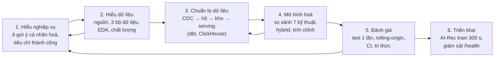
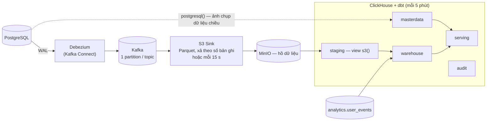
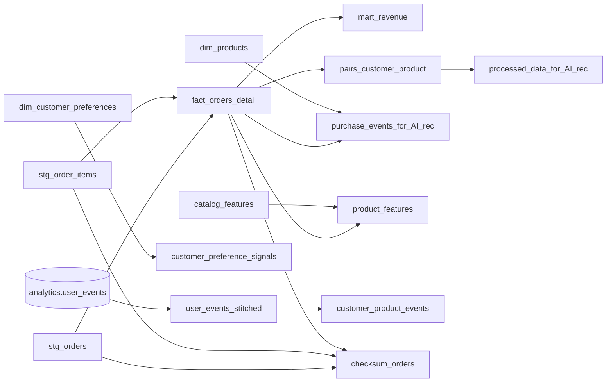
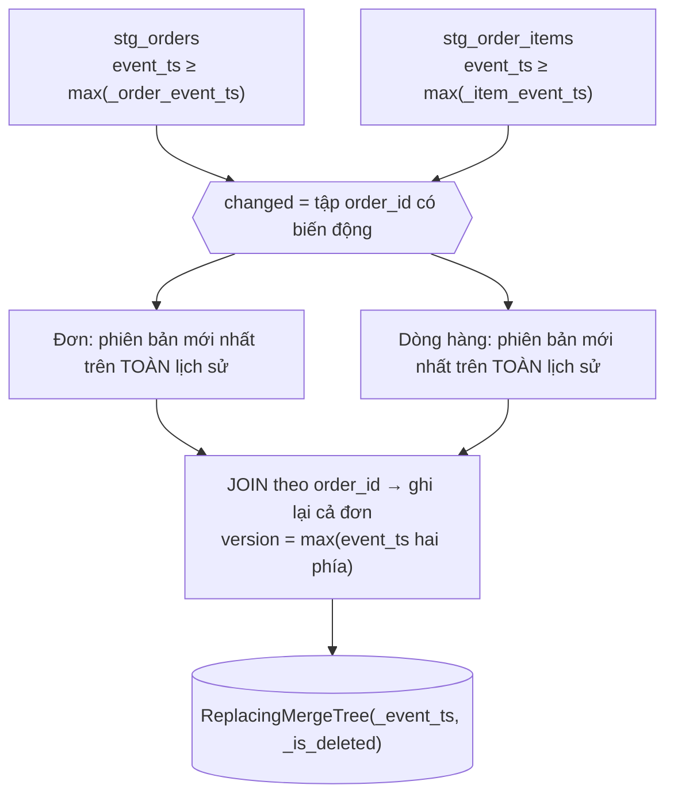
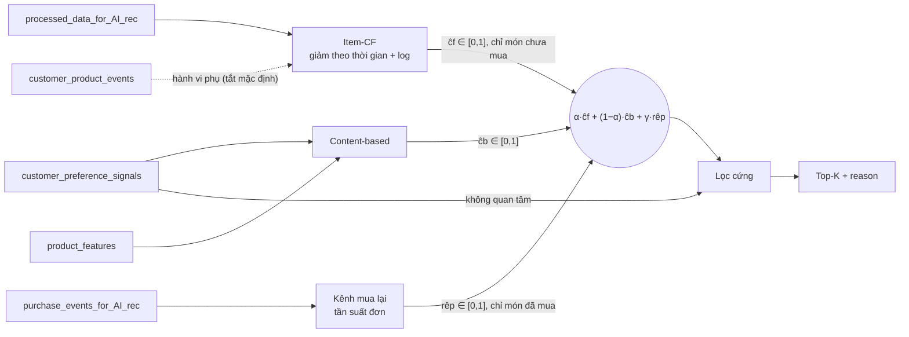
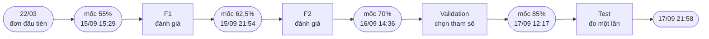
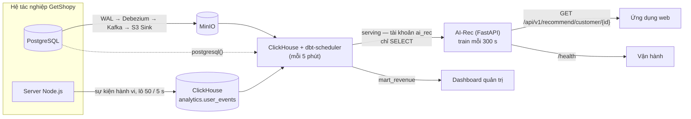
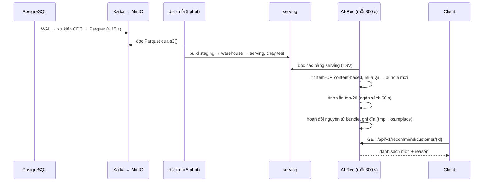

<!-- ===================================================================
     BÁO CÁO MÔN KHAI PHÁ DỮ LIỆU VÀ KHAI PHÁ TRI THỨC
     Trình bày theo mẫu bìa TDTU (mau+bia+khoa+luan+tot+nghiep.doc), Mẫu 1 và Mẫu 2.
     Khung nội dung theo CRISP-DM (Chapman et al., 2000) — đúng yêu cầu tiêu chí 6 của rubric.
     Cỡ chữ ghi trong chú thích HTML — áp lại khi chuyển sang Word.
     Các chỗ ⟦…⟧ là thông tin nhóm phải tự điền hoặc xác nhận trước khi nộp.
     =================================================================== -->

<!-- MẪU 1 — TRANG BÌA CHÍNH -->

TỔNG LIÊN ĐOÀN LAO ĐỘNG VIỆT NAM <!-- size 14 -->
**TRƯỜNG ĐẠI HỌC TÔN ĐỨC THẮNG** <!-- bold, size 14 -->
**KHOA CÔNG NGHỆ THÔNG TIN** <!-- bold, size 14 -->

**LÊ VĂN TRIỀU AN**
**ĐINH QUỐC CƯỜNG** <!-- bold, size 14 — ⟦Cần xác nhận danh sách thành viên nhóm môn học⟧ -->

**KHAI PHÁ DỮ LIỆU GIAO DỊCH TRÊN NỀN TẢNG LAKEHOUSE ĐỂ XÂY DỰNG HỆ GỢI Ý SẢN PHẨM LAI CHO THƯƠNG MẠI ĐIỆN TỬ** <!-- bold, size 24 -->

**BÁO CÁO CUỐI KỲ MÔN KHAI PHÁ DỮ LIỆU VÀ KHAI PHÁ TRI THỨC** <!-- bold, size 22 — ⟦Cần xác nhận tên học phần chính thức và loại báo cáo⟧ -->

**KỸ THUẬT PHẦN MỀM** <!-- bold, size 22 -->

**THÀNH PHỐ HỒ CHÍ MINH, NĂM 2026** <!-- bold, size 14 -->

---

<!-- MẪU 2 — TRANG BÌA PHỤ -->

TỔNG LIÊN ĐOÀN LAO ĐỘNG VIỆT NAM <!-- size 14 -->
**TRƯỜNG ĐẠI HỌC TÔN ĐỨC THẮNG** <!-- bold, size 14 -->
**KHOA CÔNG NGHỆ THÔNG TIN** <!-- bold, size 14 -->

**LÊ VĂN TRIỀU AN – 52300002**
**ĐINH QUỐC CƯỜNG – 52300012** <!-- bold, size 14 -->

**KHAI PHÁ DỮ LIỆU GIAO DỊCH TRÊN NỀN TẢNG LAKEHOUSE ĐỂ XÂY DỰNG HỆ GỢI Ý SẢN PHẨM LAI CHO THƯƠNG MẠI ĐIỆN TỬ** <!-- bold, size 22 -->

**BÁO CÁO CUỐI KỲ MÔN KHAI PHÁ DỮ LIỆU VÀ KHAI PHÁ TRI THỨC** <!-- bold, size 20 -->

**KỸ THUẬT PHẦN MỀM** <!-- bold, size 20 -->

Giảng viên hướng dẫn <!-- size 14 -->
**⟦Học hàm, học vị, họ tên giảng viên môn học⟧** <!-- bold, size 14 -->

**THÀNH PHỐ HỒ CHÍ MINH, NĂM 2026** <!-- bold, size 14 -->

---

# LỜI CẢM ƠN

Nhóm xin chân thành cảm ơn **⟦giảng viên môn học⟧** đã truyền đạt kiến thức nền tảng về quy trình khai phá dữ liệu, tiền xử lý và đánh giá mô hình. Những nội dung đó là cơ sở để nhóm tổ chức báo cáo theo đúng các pha của một quy trình khai phá, thay vì chỉ trình bày một sản phẩm phần mềm.

Nhóm cũng cảm ơn **ThS. Võ Văn Thành**, giảng viên hướng dẫn khoá luận. Hệ thống được phân tích trong báo cáo là một phần của đề tài khoá luận do thầy định hướng.

Báo cáo chắc chắn còn hạn chế, nhất là về dữ liệu: phần lớn dữ liệu được sinh bằng mô phỏng, chưa phải hành vi của khách hàng thật. Nhóm mong nhận được góp ý của thầy cô để hoàn thiện.

*TP. Hồ Chí Minh, ngày … tháng … năm 2026*
*Nhóm tác giả*
*(Ký tên và ghi rõ họ tên)*

---

# LỜI CAM ĐOAN

**CÔNG TRÌNH ĐƯỢC HOÀN THÀNH**
**TẠI TRƯỜNG ĐẠI HỌC TÔN ĐỨC THẮNG** <!-- bold, size 16 -->

Chúng tôi xin cam đoan đây là công trình của riêng nhóm, được thực hiện dưới sự hướng dẫn của **⟦giảng viên môn học⟧**. Các nội dung nghiên cứu và kết quả trong báo cáo là trung thực và chưa công bố dưới bất kỳ hình thức nào trước đây. Các số liệu trong bảng biểu dùng để phân tích, nhận xét và đánh giá do nhóm tự đo trên hệ thống của đề tài. Nguồn gốc từng con số được ghi kèm: tệp kết quả benchmark, mô hình dbt, hoặc đoạn mã tương ứng.

Các nhận xét, phương pháp và số liệu của tác giả khác dùng trong báo cáo đều có trích dẫn và ghi nguồn trong phần tài liệu tham khảo.

Nếu phát hiện có bất kỳ sự gian lận nào, chúng tôi xin hoàn toàn chịu trách nhiệm về nội dung báo cáo của mình. Trường Đại học Tôn Đức Thắng không liên quan đến những vi phạm tác quyền, bản quyền do chúng tôi gây ra trong quá trình thực hiện (nếu có).

*TP. Hồ Chí Minh, ngày … tháng … năm 2026*
*Nhóm tác giả*
*(Ký tên và ghi rõ họ tên)*

---

# TÓM TẮT

Báo cáo trình bày một dự án khai phá dữ liệu trên dữ liệu giao dịch của một hệ thương mại điện tử bán lẻ đồ công nghệ. Dự án được tổ chức theo sáu pha của CRISP-DM: hiểu nghiệp vụ, hiểu dữ liệu, chuẩn bị dữ liệu, mô hình hoá, đánh giá và triển khai.

**Bài toán nghiệp vụ.** Mỗi khách cần một ô gợi ý cá nhân hoá có ba tính chất:

- vừa nhắc món khách hay mua lại, vừa giới thiệu món mới;
- phục vụ được khách mới ngay sau khi họ khai sở thích;
- tuyệt đối không gợi ý thứ khách đã nói "không quan tâm".

Bài toán này được chuyển thành bài toán xếp hạng top-K trên phản hồi ngầm, tách hai bài toán con là *khám phá* (món chưa mua) và *mua lại*.

**Dữ liệu và chuẩn bị dữ liệu.** Dữ liệu đơn hàng được thu nhận bằng Change Data Capture từ PostgreSQL qua Debezium và Kafka, ghi thành Parquet trên MinIO làm hồ dữ liệu tập trung. Sau đó dữ liệu được ClickHouse và dbt làm sạch, tích hợp và biến đổi thành các bảng đặc trưng. Pha này xử lý ba lỗi dữ liệu làm sai mô hình mà không có lỗi nào được báo ra:

- đếm trùng các phiên bản CDC;
- mất bản ghi khi nạp tăng dần;
- độ tương đồng cosine bị thổi phồng ở các sản phẩm có quá ít người mua.

**Mô hình hoá.** Hệ so sánh phản biện bảy kỹ thuật, gồm các đường cơ sở và hai mô hình đối chứng mạnh là EASE^R và iALS, về độ chính xác, độ phức tạp và độ phù hợp với dữ liệu. Mô hình được chọn là một bộ gợi ý lai có trọng số, gồm ba kênh:

- lọc cộng tác theo sản phẩm, có giảm trọng số theo thời gian và thang log;
- lọc theo nội dung trên danh mục, hãng và tầm giá, kết hợp sở thích khai báo;
- kênh mua lại theo tần suất đơn.

**Đánh giá.** Tham số được tinh chỉnh trên validation (1.920 bộ tham số, luật chọn chốt trước khi đo), và tập test chỉ đo một lần. Độ ổn định được kiểm tra bằng kiểm định chéo theo thời gian kiểu rolling-origin. Mọi kết quả có khoảng tin cậy bootstrap 95%.

Trên dữ liệu đơn trong hệ (3.498 đơn, 176 khách ở test):

- NDCG@10 tổng thể tăng từ 0,309 lên 0,356, tức +0,047, CI 95% [+0,018; +0,074].
- 79% khách có ít nhất một món trúng trong 10 ô gợi ý.
- Ở bài toán khám phá, Item-CF đạt 0,377. Mức này không thua EASE^R (0,359) và iALS (0,373), và gấp 2,5 lần Most-Popular (0,148).

Trên dữ liệu của bộ sinh có gu ẩn theo đặc trưng, hybrid tăng NDCG@10 tổng thể +0,160.

**Tri thức rút ra.** Đánh đổi giữa khám phá và mua lại là một quyết định sản phẩm, không phải một tham số tối ưu được. Phân tích còn phát hiện một phần "tri thức về hành vi" thực chất là dấu vết của bộ sinh dữ liệu.

Mọi số liệu đều đo trên **dữ liệu mô phỏng**. Báo cáo nêu rõ giới hạn của từng kết luận.

**Từ khoá:** CRISP-DM, khai phá tri thức, tiền xử lý dữ liệu, Change Data Capture, Lakehouse, hệ gợi ý, lọc cộng tác, phản hồi ngầm, kiểm định chéo theo thời gian.

---

# ABSTRACT

This report presents a data mining project on the transactional data of a consumer-electronics e-commerce system, organised along the six CRISP-DM phases: business understanding, data understanding, data preparation, modelling, evaluation and deployment.

**Business problem.** Each customer needs a personalised recommendation slot with three properties:

- it reminds customers of items they rebuy while still introducing new ones;
- it serves new customers right after onboarding;
- it never shows anything the customer marked "not interested".

This is translated into top-K ranking on implicit feedback, split into *discovery* (unseen items) and *repurchase*.

**Data and preparation.** Order data is captured from PostgreSQL by log-based CDC (Debezium, Kafka) into Parquet on MinIO, which serves as a centralised data lake. ClickHouse and dbt then clean, integrate and transform it into feature tables. This phase addresses three silent failures:

- double counting of CDC versions;
- record loss in incremental loads;
- inflated cosine similarity for items with very few buyers.

**Modelling.** Seven techniques, including naive baselines and the strong baselines EASE^R and iALS, are compared critically on accuracy, complexity and fit to the data. The chosen model is a weighted hybrid with three channels:

- time-decayed, log-scaled item-based CF;
- content-based scoring over category, brand and price band, with onboarding preferences;
- an order-frequency repurchase channel.

**Evaluation.** Hyperparameters are tuned on validation (1,920 configurations, pre-registered selection rule) and the test set is measured once. Stability is checked with rolling-origin temporal cross-validation, and all results carry bootstrap 95% confidence intervals.

On the in-system order data (3,498 orders, 176 test customers):

- Overall NDCG@10 rises from 0.309 to 0.356 (+0.047, 95% CI [+0.018; +0.074]).
- 79% of customers get at least one hit in their top-10.
- On discovery, the tuned Item-CF (0.377) is not worse than EASE^R (0.359) or iALS (0.373), and is 2.5 times Most-Popular (0.148).

On a feature-driven taste simulator, the hybrid gains +0.160 overall NDCG@10.

**Findings.** The discovery–repurchase trade-off is a product decision, not a tunable optimum. The analysis also reveals that part of the apparent behavioural "knowledge" is an artefact of the data generator.

All results are measured on **simulated data**, and their limits are stated explicitly.

**Keywords:** CRISP-DM, knowledge discovery, data preprocessing, change data capture, lakehouse, recommender systems, collaborative filtering, implicit feedback, temporal cross-validation.

---

# MỤC LỤC

<!-- Số trang cập nhật khi chuyển sang Word (References → Table of Contents). -->

- LỜI CẢM ƠN · LỜI CAM ĐOAN · TÓM TẮT · ABSTRACT
- DANH MỤC HÌNH VẼ, BẢNG BIỂU, CHỮ VIẾT TẮT
- CHƯƠNG 1. GIỚI THIỆU
- CHƯƠNG 2. CƠ SỞ LÝ THUYẾT
- CHƯƠNG 3. HIỂU NGHIỆP VỤ (Business Understanding)
- CHƯƠNG 4. HIỂU DỮ LIỆU (Data Understanding)
- CHƯƠNG 5. CHUẨN BỊ DỮ LIỆU (Data Preparation)
- CHƯƠNG 6. MÔ HÌNH HOÁ (Modeling)
- CHƯƠNG 7. ĐÁNH GIÁ (Evaluation)
- CHƯƠNG 8. TRIỂN KHAI (Deployment)
- CHƯƠNG 9. KẾT LUẬN VÀ TỔNG KẾT DỰ ÁN
- TÀI LIỆU THAM KHẢO
- PHỤ LỤC A. Ánh xạ nội dung vào mã nguồn
- PHỤ LỤC B. Tái lập từ đầu đến cuối

---

# DANH MỤC HÌNH VẼ

- Hình 1.1. Sáu pha CRISP-DM và thành phần hiện thực tương ứng
- Hình 5.1. Pipeline chuẩn bị dữ liệu
- Hình 5.2. Dòng phụ thuộc giữa các mô hình dbt
- Hình 5.3. Nạp tăng dần bảng sự kiện theo tập đơn có biến động
- Hình 6.1. Kiến trúc bộ gợi ý lai
- Hình 6.2. Thiết kế kiểm thử: cắt thời gian và các lượt rolling-origin
- Hình 8.1. Kiến trúc triển khai
- Hình 8.2. Chu trình cập nhật dữ liệu – huấn luyện – phục vụ

# DANH MỤC BẢNG BIỂU

- Bảng 1.1. Pha CRISP-DM, nhiệm vụ chuẩn và vị trí trong báo cáo
- Bảng 2.1. Đối chiếu CRISP-DM với KDD
- Bảng 3.1. Mục tiêu nghiệp vụ → mục tiêu khai phá → tiêu chí thành công
- Bảng 3.2. Tài nguyên, ràng buộc và rủi ro
- Bảng 3.3. Tiến trình dự án
- Bảng 3.4. Hoàn thiện theo góp ý vòng Tiến độ
- Bảng 4.1. Nguồn dữ liệu
- Bảng 4.2. Ba bộ dữ liệu
- Bảng 4.3. Thống kê mô tả bộ dữ liệu A
- Bảng 4.4. Báo cáo chất lượng dữ liệu
- Bảng 5.1. Tổ chức tầng dữ liệu
- Bảng 5.2. Đặc trưng và tập dữ liệu phục vụ mô hình
- Bảng 5.3. Kết quả đối soát xuyên tầng
- Bảng 5.4. Chi phí bộ nhớ của hai cách khử trùng
- Bảng 5.5. Tác động của các bước chuẩn bị dữ liệu lên kết quả
- Bảng 6.1. So sánh phản biện các kỹ thuật
- Bảng 6.2. Độ phức tạp tính toán
- Bảng 6.3. Các lượt của thiết kế kiểm thử
- Bảng 6.4. Không gian tìm kiếm siêu tham số
- Bảng 6.5. Siêu tham số của mô hình
- Bảng 7.1 – 7.4. Kết quả trên test: tổng thể, khám phá, mua lại, độ phủ
- Bảng 7.5. Trước/sau trên test
- Bảng 7.6. Kiểm định chéo theo thời gian
- Bảng 7.7. Đối chứng mạnh
- Bảng 7.8 – 7.9. Đánh đổi khám phá – mua lại
- Bảng 7.10. Khách mới mô phỏng
- Bảng 7.11. Ablation hành vi trên bộ A
- Bảng 7.12 – 7.14. Nghiên cứu mô phỏng
- Bảng 7.15. Diễn giải thực tiễn các chỉ số
- Bảng 7.16. Tóm tắt tri thức rút ra
- Bảng 7.17. Đối chiếu tiêu chí thành công
- Bảng 7.18. Các lần rà soát giao thức đánh giá
- Bảng 8.1. Cấu hình đã kiểm định và cấu hình đang chạy
- Bảng 8.2. Kế hoạch giám sát và bảo trì
- Bảng 9.1. Tự đánh giá theo mục tiêu
- Bảng 9.2. Phân công và đánh giá chéo

# DANH MỤC CÁC CHỮ VIẾT TẮT

| Viết tắt | Đầy đủ | Nghĩa |
|---|---|---|
| CRISP-DM | Cross-Industry Standard Process for Data Mining | Quy trình chuẩn liên ngành cho khai phá dữ liệu |
| KDD | Knowledge Discovery in Databases | Khai phá tri thức từ cơ sở dữ liệu |
| OLTP / OLAP | Online Transaction / Analytical Processing | Xử lý giao dịch / phân tích trực tuyến |
| CDC | Change Data Capture | Thu nhận thay đổi dữ liệu |
| WAL | Write-Ahead Log | Nhật ký ghi trước của PostgreSQL |
| CF / Item-CF | (Item-based) Collaborative Filtering | Lọc cộng tác (theo sản phẩm) |
| CB | Content-Based filtering | Lọc theo nội dung |
| EASE^R | Embarrassingly Shallow Autoencoder | Mô hình tự mã hoá tuyến tính (Steck, 2019) |
| iALS | implicit Alternating Least Squares | Phân rã ma trận cho phản hồi ngầm |
| NDCG | Normalized Discounted Cumulative Gain | Độ lợi tích luỹ có chiết khấu, chuẩn hoá |
| MAP | Mean Average Precision | Độ chính xác trung bình |
| CI | Confidence Interval | Khoảng tin cậy |
| EDA | Exploratory Data Analysis | Phân tích khám phá dữ liệu |
| TMĐT | — | Thương mại điện tử |

---

# CHƯƠNG 1. GIỚI THIỆU

## 1.1. Bối cảnh

GetShopy là hệ thương mại điện tử bán lẻ đồ công nghệ do nhóm xây dựng trong khuôn khổ khoá luận.

- **Catalog:** 600.000 sản phẩm thuộc 8 danh mục gốc: điện thoại, laptop, máy tính bảng, đồng hồ thông minh, phụ kiện di động, phụ kiện laptop, thiết bị âm thanh – hình ảnh, máy ảnh.
- **Nguồn dữ liệu:** mọi đơn hàng, dòng hàng, thanh toán và sở thích khách khai báo đều phát sinh trong PostgreSQL (OLTP). Hành vi duyệt web được ghi vào một bảng sự kiện riêng.

Từ dữ liệu này nảy sinh hai nhu cầu tri thức:

1. **Mô tả:** doanh thu theo ngày, danh mục, hãng, phương thức thanh toán.
2. **Dự báo:** với mỗi khách, những sản phẩm nào khách có khả năng mua tiếp — tức bài toán gợi ý cá nhân hoá.

Báo cáo tập trung vào nhu cầu thứ hai và vào nền tảng dữ liệu phục vụ nó. Cụ thể, báo cáo trình bày hai phân hệ:

- **nền tảng dữ liệu lớn theo hướng Lakehouse** (`local-infra-sandbox`);
- **dịch vụ gợi ý AI-Rec** (`ai-rec`).

Phần ứng dụng bán hàng và trợ lý hội thoại thuộc báo cáo khoá luận, không nằm trong báo cáo này.

## 1.2. Mục tiêu

- **M1 — Chuẩn bị dữ liệu:** pipeline CDC → hồ dữ liệu → kho → tầng phục vụ, có kiểm thử và đối soát xuyên tầng.
- **M2 — Mô hình:** bộ gợi ý lai, huấn luyện định kỳ từ tầng phục vụ, giải thích được lý do gợi ý.
- **M3 — Đánh giá:** giao thức offline có kiểm soát:
  - cắt thời gian;
  - kiểm định chéo theo thời gian;
  - tách bài toán con;
  - đối chứng mạnh;
  - khoảng tin cậy;
  - luật chọn khai báo trước.
- **M4 — Diễn giải:** rút ra và kiểm chứng tri thức; tách tri thức về hành vi với dấu vết của dữ liệu.

## 1.3. Phạm vi

**Trong phạm vi:**

- thu nhận CDC hai bảng `Order` và `OrderItem`;
- kéo dữ liệu chiều từ PostgreSQL;
- các mô hình dbt từ staging tới serving và audit;
- dịch vụ AI-Rec;
- bộ đánh giá offline `evaluation/benchmark.py`;
- các bộ sinh dữ liệu mô phỏng.

**Ngoài phạm vi:**

- giao diện bán hàng, thanh toán, trợ lý hội thoại;
- dự báo nhu cầu và tối ưu khuyến mãi (chưa hiện thực);
- đánh giá trực tuyến (A/B test) trên khách thật.

**Về dữ liệu:** toàn bộ dữ liệu là **mô phỏng** (§4.2). Báo cáo không khẳng định hiệu năng trên khách hàng thật.

## 1.4. Phương pháp: CRISP-DM

Dự án được tổ chức theo CRISP-DM (Chapman et al., 2000; Wirth & Hipp, 2000). Đây là quy trình sáu pha, có vòng lặp giữa các pha.

**Hình 1.1.** Sáu pha CRISP-DM và thành phần hiện thực tương ứng



**Bảng 1.1.** Pha CRISP-DM, nhiệm vụ chuẩn và vị trí trong báo cáo

| Pha | Nhiệm vụ chuẩn (Chapman et al., 2000) | Chương |
|---|---|---|
| Hiểu nghiệp vụ | Xác định mục tiêu nghiệp vụ; đánh giá hiện trạng; xác định mục tiêu khai phá; lập kế hoạch | 3 |
| Hiểu dữ liệu | Thu thập; mô tả; khám phá; kiểm tra chất lượng | 4 |
| Chuẩn bị dữ liệu | Lựa chọn; làm sạch; xây dựng đặc trưng; tích hợp; định dạng | 5 |
| Mô hình hoá | Chọn kỹ thuật; thiết kế kiểm thử; xây dựng; đánh giá mô hình | 6 |
| Đánh giá | Đánh giá kết quả theo tiêu chí nghiệp vụ; rà soát quy trình; quyết định bước tiếp | 7 |
| Triển khai | Kế hoạch triển khai; giám sát và bảo trì; báo cáo cuối; tổng kết dự án | 8, 9 |

**Các vòng lặp ngược trong Hình 1.1 đã xảy ra thật trong dự án:**

- **Đánh giá → Hiểu nghiệp vụ:** chọn $\gamma$ theo chỉ số tổng thể làm ô gợi ý biến thành danh sách đồ cũ. Từ đó nhóm bổ sung ràng buộc nghiệp vụ "2–3 món cũ trong 10 ô" (§3.3, §7.7).
- **Mô hình hoá → Chuẩn bị dữ liệu:** món một người mua chiếm top gợi ý. Từ đó nhóm thêm ngưỡng số người mua (§5.4.1).
- **Đánh giá → Hiểu dữ liệu:** half-life ngắn thắng lớn bất thường. Truy ngược lại thì phát hiện đó là dấu vết của bộ sinh, và nhóm chốt cận dưới cho half-life (§4.4, §7.13).

## 1.5. Đóng góp

1. **Một pipeline chuẩn bị dữ liệu có bảo đảm đúng đắn.** Pipeline nạp tăng dần đúng cho bảng sự kiện ghép từ hai nguồn CDC xả lệch thời điểm, và có đối soát ba tầng (§5.3, §5.6).
2. **Một bộ gợi ý lai có thể giải thích.** Mỗi kênh trả lời một câu hỏi riêng, và mỗi gợi ý kèm lý do.
3. **Một giao thức đánh giá offline có kiểm soát:**
   - tách bài toán con;
   - đối chứng mạnh;
   - luật chọn khai báo trước;
   - kiểm định chéo theo thời gian;
   - ablation có kiểm soát.
4. **Một phân tích trung thực về giới hạn của dữ liệu mô phỏng.**

## 1.6. Bố cục

- **Chương 2:** cơ sở lý thuyết.
- **Chương 3 – 8:** lần lượt sáu pha CRISP-DM.
- **Chương 9:** kết luận, tự đánh giá và phân công.

---

# CHƯƠNG 2. CƠ SỞ LÝ THUYẾT

## 2.1. Quy trình khai phá dữ liệu: CRISP-DM và KDD

Fayyad et al. (1996) định nghĩa KDD là *quá trình không tầm thường nhằm nhận diện các mẫu hợp lệ, mới, có khả năng hữu ích và cuối cùng là hiểu được trong dữ liệu*. Trong quá trình đó, **khai phá dữ liệu** chỉ là một bước.

CRISP-DM (Chapman et al., 2000) mở rộng KDD theo hai hướng:

- đặt **hiểu nghiệp vụ** ở đầu quy trình;
- đặt **triển khai** ở cuối quy trình.

Nhờ vậy, một mô hình chỉ được coi là thành công khi đạt tiêu chí *nghiệp vụ*, không chỉ tiêu chí thống kê.

**Bảng 2.1.** Đối chiếu CRISP-DM với KDD

| CRISP-DM | KDD (Fayyad et al., 1996) |
|---|---|
| Hiểu nghiệp vụ | (hiểu miền ứng dụng — tiền đề của KDD) |
| Hiểu dữ liệu | Lựa chọn |
| Chuẩn bị dữ liệu | Tiền xử lý, biến đổi |
| Mô hình hoá | Khai phá dữ liệu |
| Đánh giá | Diễn giải / đánh giá |
| Triển khai | (sử dụng tri thức — ngoài phạm vi các bước) |

## 2.2. Tiền xử lý dữ liệu

Han et al. (2012, ch. 3) chia tiền xử lý thành bốn nhóm việc. Mỗi nhóm có hiện thực cụ thể ở Chương 5:

- **Làm sạch:** xử lý thiếu, nhiễu, trùng, mâu thuẫn.
- **Tích hợp:** ghép nhiều nguồn, giải xung đột lược đồ.
- **Rút gọn:** giảm số chiều hoặc số bản ghi mà vẫn giữ thông tin.
- **Biến đổi:** chuẩn hoá, rời rạc hoá, xây dựng đặc trưng.

## 2.3. Nền tảng dữ liệu phân tích

### 2.3.1. OLTP, OLAP và lưu trữ theo cột

Hai loại hệ thống có đặc điểm truy vấn ngược nhau:

- **OLTP** tối ưu cho nhiều giao dịch nhỏ, đọc và ghi theo dòng.
- **OLAP** tối ưu cho truy vấn quét nhiều dòng nhưng ít cột.

Lưu trữ theo cột chỉ đọc các cột cần thiết và nén tốt hơn, nên nhanh hơn nhiều lần với tải phân tích (Abadi et al., 2008). ClickHouse là một hệ quản trị cột thuộc nhóm này.

### 2.3.2. Data lake, data warehouse và Lakehouse

**Lakehouse** là từ ghép của *data lake* và *data warehouse*:

- **Data lake** giữ dữ liệu thô ở tệp mở, chẳng hạn Parquet, trên kho đối tượng giá rẻ.
- **Data warehouse** giữ dữ liệu đã mô hình hoá, có lược đồ chặt và truy vấn nhanh.

Kiến trúc hai tầng truyền thống phải giữ hai bản dữ liệu và thêm một bước ETL dễ lỗi. Lakehouse đưa các tính năng quản lý của warehouse xuống chạy trực tiếp trên tệp mở ở lake (Armbrust et al., 2021), thường qua một định dạng bảng mở như Delta Lake (Armbrust et al., 2020).

**Định vị của đề tài.** Đề tài theo **hướng Lakehouse**, với data lake là **hồ dữ liệu tập trung**:

1. Mọi thay đổi giao dịch được ghi vào hồ đúng một lần, ở dạng Parquet bất biến.
2. Biến đổi đọc thẳng từ hồ qua hàm `s3()` của ClickHouse.
3. Kho là dữ liệu dẫn xuất, dựng lại được hoàn toàn từ hồ.

Đề tài **khác** định nghĩa của Armbrust et al. (2021) ở chỗ tầng tinh chế nằm trong định dạng `MergeTree` riêng của ClickHouse, chưa nằm trên định dạng bảng mở.

### 2.3.3. Change Data Capture dựa trên log

CDC dựa trên log đọc nhật ký giao dịch (WAL) thay vì truy vấn bảng, nên có hai lợi thế (Kleppmann, 2017, ch. 11):

- không thêm tải đọc lên OLTP;
- bắt được cả cập nhật và xoá, theo đúng thứ tự cam kết.

Kafka làm vùng đệm và nhật ký phát lại được giữa nguồn và đích (Kreps et al., 2011). Kafka chỉ bảo đảm thứ tự **trong một partition**.

### 2.3.4. Cập nhật trên kho chỉ-ghi-thêm

ClickHouse không sửa dòng tại chỗ. Mỗi thay đổi được ghi thành phiên bản mới, và `ReplacingMergeTree(version, is_deleted)` giữ phiên bản lớn nhất cho mỗi khoá khi hợp nhất. Việc hợp nhất chạy nền, không có thời điểm bảo đảm, nên truy vấn cần kết quả đúng phải dùng `FINAL` (ClickHouse, n.d.).

## 2.4. Hệ gợi ý

### 2.4.1. Phản hồi ngầm

Với phản hồi ngầm (Hu et al., 2008), số lần hoặc số lượng mua $r_{ui}$ là **mức tin cậy** rằng khách thích món, không phải mức độ thích. Hai hệ quả:

- Món chưa tương tác là *thiếu thông tin*, không phải tín hiệu âm.
- Giá trị lớn nên được nén lại, chẳng hạn bằng $\log(1 + r)$.

### 2.4.2. Lọc cộng tác theo sản phẩm

Item-based CF (Sarwar et al., 2001; Linden et al., 2003) dựa trên độ tương đồng cosine giữa hai cột của ma trận khách × món:

$$
\operatorname{sim}(i, j) = \frac{\mathbf{r}_{\cdot i}^{\top}\mathbf{r}_{\cdot j}}{\lVert \mathbf{r}_{\cdot i} \rVert\,\lVert \mathbf{r}_{\cdot j} \rVert}, \qquad cf(u, j) = \sum_{i \in I_u} r_{ui}\,\operatorname{sim}(i, j)
$$

### 2.4.3. Yếu tố thời gian

Tương tác gần đây nên được tin hơn tương tác cũ. Dạng phổ biến là giảm theo hàm mũ với chu kỳ bán rã $h$ (Ding & Li, 2005), với $d$ là số ngày kể từ tương tác:

$$
w(d) = 0{,}5^{\,d/h}
$$

### 2.4.4. Lọc theo nội dung

Content-based filtering gồm hai bước (Pazzani & Billsus, 2007; Lops et al., 2011):

1. Dựng hồ sơ khách trên đặc trưng của sản phẩm.
2. Chấm điểm món theo độ khớp với hồ sơ.

Phương pháp này không cần dữ liệu của khách khác, nên giải được khởi đầu lạnh phía khách khi có sở thích khai báo.

### 2.4.5. Mua lặp lại

Độ gần đây và tần suất là hai tín hiệu mạnh nhất dự đoán tiêu dùng lặp lại (Anderson et al., 2014). Chu kỳ mua lại phụ thuộc loại hàng (Bhagat et al., 2018).

### 2.4.6. Hybrid có trọng số

Kiểu *weighted hybrid* trong phân loại của Burke (2002) lấy tổ hợp tuyến tính điểm của các bộ thành phần.

### 2.4.7. Mô hình đối chứng mạnh

**EASE^R** (Steck, 2019) học ma trận món–món $B$ bằng bài toán hồi quy:

$$
\min_B \lVert X - XB \rVert_F^2 + \lambda\lVert B\rVert_F^2 \quad \text{s.t. } \operatorname{diag}(B) = 0
$$

Bài toán có nghiệm đóng. Đặt $P = (X^{\top}X + \lambda I)^{-1}$, ta có $B_{ij} = -P_{ij}/P_{jj}$ với $i \neq j$.

**iALS** (Hu et al., 2008; Koren et al., 2009) phân rã ma trận với trọng số tin cậy:

$$
\min_{x,y}\sum_{u,i} c_{ui}(p_{ui} - x_u^{\top}y_i)^2 + \lambda\Big(\sum_u\lVert x_u\rVert^2 + \sum_i\lVert y_i\rVert^2\Big), \qquad p_{ui} = \mathbb{1}[r_{ui} > 0],\ c_{ui} = 1 + \alpha r_{ui}
$$

Dacrema et al. (2019) cho thấy nhiều mô hình phức tạp không vượt được đường cơ sở đơn giản *đã tinh chỉnh đúng cách*. Vì vậy so sánh với các đối chứng đã tinh chỉnh là điều kiện cần.

### 2.4.8. Tín hiệu hành vi phụ và vòng tự củng cố

Lượt xem làm ma trận tương tác dày hơn (Gao et al., 2019). Thời gian xem (dwell) phản ánh mức quan tâm tốt hơn số lần bấm (Yi et al., 2014).

Tuy nhiên, huấn luyện lại trên lượt xem do chính ô gợi ý dẫn tới sẽ tạo vòng tự củng cố, làm danh sách gợi ý ngày càng đồng nhất (Chaney et al., 2018).

## 2.5. Đánh giá offline

### 2.5.1. Chỉ số

Relevance nhị phân. $R_u$ là tập món khách $u$ thực sự mua ở giai đoạn đánh giá; $\text{rel}_k = 1$ nếu món ở vị trí $k$ thuộc $R_u$:

$$
P@K = \frac{|L_u^K \cap R_u|}{K}, \qquad R@K = \frac{|L_u^K \cap R_u|}{|R_u|}, \qquad \text{Hit}@K = \mathbb{1}\big[|L_u^K \cap R_u| > 0\big]
$$

$$
AP@K = \frac{1}{\min(|R_u|, K)}\sum_{k=1}^{K} P@k\cdot\text{rel}_k, \qquad
NDCG@K = \frac{\sum_{k=1}^{K}\text{rel}_k/\log_2(k+1)}{\text{IDCG}@K}
$$

- NDCG (Järvelin & Kekäläinen, 2002) thưởng món trúng ở vị trí cao, nên là chỉ số chính.
- **Coverage@K** là số món khác nhau trong top-K của mọi khách, chia cho số ứng viên.

**Vì sao không dùng các chỉ số phân loại** (accuracy, F1, AUC trên mọi cặp): đây là bài toán **xếp hạng** với một số rất nhỏ ô hiển thị. Hơn nữa, lớp "không mua" không phải nhãn âm thật (§2.4.1). Ranh giới quyết định trên mọi cặp vì vậy không phản ánh thứ khách nhìn thấy, tức 10 ô đầu.

### 2.5.2. Cắt dữ liệu và kiểm định chéo theo thời gian

**Không dùng k-fold ngẫu nhiên.** Với dữ liệu có thứ tự thời gian, chia ngẫu nhiên đưa các đơn *xảy ra sau* thời điểm dự đoán vào tập train. Mô hình được học từ tương lai, gây rò rỉ (Campos et al., 2014). Với bài toán có mua lại, chia ngẫu nhiên còn đặt lần mua lại sau của chính khách vào train, làm điểm mua lại bị thổi phồng. Kiểm định chéo chuẩn mặc định các mẫu độc lập, giả định này không đúng với chuỗi thời gian (Bergmeir & Benítez, 2012).

**Thay bằng rolling-origin** (Tashman, 2000). Chọn nhiều mốc $t_1 < t_2 < \dots$. Ở mỗi mốc:

- train trên mọi dữ liệu *trước* mốc;
- đánh giá trên cửa sổ ngay *sau* mốc.

Như vậy mỗi lượt đều tôn trọng thứ tự thời gian.

**Khoảng tin cậy.** Bootstrap lấy mẫu lại khách có hoàn lại (Efron & Tibshirani, 1993). Chênh lệch giữa hai mô hình được tính **ghép cặp** trên cùng mẫu khách.

**Đường cơ sở bắt buộc.** Luôn so với Most-Popular (Cremonesi et al., 2010).

### 2.5.3. Thiên lệch cố hữu

- **Đánh giá trên log** chỉ thưởng món có trong log, nên thiên về món phổ biến (Marlin & Zemel, 2009).
- **Đánh giá bằng mô phỏng** chỉ đo được cấu trúc mà bộ sinh đã mã hoá sẵn (Ie et al., 2019).

---

# CHƯƠNG 3. HIỂU NGHIỆP VỤ (Business Understanding)

## 3.1. Bối cảnh nghiệp vụ và hiện trạng

**Ô gợi ý trên trang khách hàng là mặt tiền cá nhân hoá duy nhất của cửa hàng.** Catalog có 600.000 món, nên khách không thể tự duyệt hết. Ô gợi ý quyết định khách thấy gì trước tiên.

**Hiện trạng trước dự án** — phiên bản ngày 17/09/2026:

- Ô gợi ý dùng Item-CF thuần, không có yếu tố thời gian.
- Ô gợi ý chưa có chỗ cho khách mới.
- Ô gợi ý không biết khách "không quan tâm" gì.
- Hệ không có số đo nào cho biết gợi ý tốt hay xấu.

**Đặc thù của hàng công nghệ.** Thiết bị chính (điện thoại, laptop) hiếm khi mua lại trong thời gian ngắn. Phụ kiện thì mua lặp và thường mua kèm thiết bị. Vì vậy một ô gợi ý tốt phải xử lý được cả hai kiểu mua.

## 3.2. Mục tiêu nghiệp vụ

Các mục tiêu dưới đây rút từ yêu cầu chức năng của đề tài và các quyết định thiết kế đã được nhóm chốt trong quá trình làm:

- **BO1 — Cá nhân hoá:** mỗi khách thấy những món họ có khả năng mua.
- **BO2 — Cân bằng mua lại và khám phá:** ô gợi ý nhắc được món hay mua lại nhưng không biến thành danh sách đồ cũ.
- **BO3 — Khách mới:** khách vừa đăng ký và khai sở thích cũng nhận được gợi ý hợp gu, không chỉ món bán chạy.
- **BO4 — Tôn trọng lựa chọn:** không bao giờ gợi ý danh mục hoặc hãng khách đã chọn "không quan tâm".
- **BO5 — Giải thích được:** mỗi gợi ý có lý do hiển thị được cho khách.
- **BO6 — Cập nhật mà không ảnh hưởng bán hàng:** gợi ý theo kịp đơn mới, nhưng truy vấn phân tích và huấn luyện không chạy trên CSDL bán hàng.
- **BO7 — Số liệu đúng:** dữ liệu phân tích khớp với nguồn giao dịch.

## 3.3. Chuyển hoá thành mục tiêu khai phá và tiêu chí thành công

**Bảng 3.1.** Mục tiêu nghiệp vụ → mục tiêu khai phá → tiêu chí thành công

| Mục tiêu nghiệp vụ | Mục tiêu khai phá | Chỉ số đo | Tiêu chí thành công (offline) |
|---|---|---|---|
| BO1 Cá nhân hoá | Xếp hạng top-10 trên phản hồi ngầm | NDCG@10 tổng thể (chính); P, R, Hit, MAP@10 | Vượt Most-Popular và cấu hình cũ; cận dưới CI 95% của chênh lệch ghép cặp > 0 |
| BO2 Cân bằng | Tách bài toán **khám phá** / **mua lại**; ràng buộc số món cũ | NDCG@10 từng bài toán; số món đã mua / 10 ô | 2–3 món cũ / 10 trên validation; NDCG khám phá cao hơn Most-Popular |
| BO3 Khách mới | Gợi ý từ sở thích khai báo khi chưa có lịch sử | NDCG@10 trên khách mới mô phỏng | Vượt Most-Popular, cận dưới CI > 0 |
| BO4 Tôn trọng lựa chọn | Ràng buộc cứng trên tập kết quả | Số món vi phạm trong top-K | 0 trong mọi trường hợp |
| BO5 Giải thích được | Mô hình có cấu trúc kênh tách rời | Tỉ lệ gợi ý có `reason` | 100% |
| BO6 Cập nhật, không ảnh hưởng bán hàng | Huấn luyện từ tầng phân tích tách khỏi OLTP | Chu kỳ dữ liệu → mô hình; số truy vấn phân tích trên OLTP | Chu kỳ ≈ 10 phút theo cấu hình; 0 truy vấn huấn luyện trên OLTP |
| BO7 Số liệu đúng | Pipeline không mất, không đếm trùng | Đối soát ba tầng; kiểm thử dbt | Khớp 100% số dòng và tổng tiền; mọi test PASS |

**Hai điểm cần nói rõ:**

- **Ràng buộc 2–3 món cũ / 10 là quyết định sản phẩm, không phải kết quả tối ưu.** Nếu để tối ưu thuần tuý theo NDCG tổng thể, validation chọn gần 8/10 ô là món cũ (§7.7). Ràng buộc được chốt *trước* khi đo bản giao thức ngày 01/10.
- **Các KPI kinh doanh thật chỉ đo được trực tuyến khi có khách thật**, như tỉ lệ bấm, tỉ lệ chuyển đổi, doanh thu từ ô gợi ý. Báo cáo chưa đặt ngưỡng cho chúng; các chỉ số offline ở trên là đại lượng thay thế.

## 3.4. Phát biểu bài toán khai phá

**Dữ liệu vào.** Ký hiệu $U$ là tập khách, $I$ là tập sản phẩm. Gồm bốn nhóm:

- **Giao dịch:** $D = \{(u, o, i, q, t)\}$ — khách $u$ mua $q$ đơn vị món $i$ trong đơn $o$ tại thời điểm $t$. Chỉ tính đơn đã thanh toán và không bị huỷ.
- **Đặc trưng món:** $f(i) = (c_i, b_i, p_i)$ — danh mục gốc, hãng, tầm giá.
- **Sở thích khai báo:** $L_u^{+}$ (thích) và $L_u^{-}$ (không quan tâm).
- **Hành vi phụ:** $E$ — xem, thời gian xem, giỏ, yêu thích.

**Dữ liệu ra.** Tại thời điểm $t_0$, với mỗi khách $u$, một danh sách xếp hạng $L_u$ gồm $K$ món:

- không chứa món thuộc $L_u^{-}$;
- chỉ gồm món còn bán;
- tối đa hoá số món $u$ mua trong $(t_0, t_0 + \Delta]$.

**Tính chất của dữ liệu:**

- Phản hồi ngầm: không có nhãn âm.
- Hai bài toán con: *khám phá* (món chưa từng mua) và *mua lại*.

**Câu hỏi nghiên cứu:**

- **RQ1.** Dữ liệu từ OLTP cần được chuẩn bị thế nào để thành tập huấn luyện tin cậy — không đếm trùng, không mất bản ghi, không rò rỉ tương lai?
- **RQ2.** Bộ gợi ý lai có vượt đường cơ sở và đối chứng mạnh không, xét riêng từng bài toán con?
- **RQ3.** Quá trình khai phá rút ra tri thức gì về hành vi mua và về chính dữ liệu?

## 3.5. Tài nguyên, ràng buộc và rủi ro

**Bảng 3.2.** Tài nguyên, ràng buộc và rủi ro

| Hạng mục | Mô tả | Hệ quả cho thiết kế |
|---|---|---|
| Dữ liệu | Chưa có khách thật; mọi dữ liệu là mô phỏng | Kết luận chỉ ở mức "hệ khai thác được cấu trúc khi nó tồn tại"; dùng hai bộ sinh khác nhau để đối chiếu (§4.2) |
| Tính toán | Một máy, ClickHouse trần khoảng 7,2 GB RAM | Phép khử trùng phải tràn đĩa được (§5.7); mô hình phải huấn luyện lại rẻ |
| Quyền dữ liệu | Dịch vụ gợi ý không được đọc dữ liệu cá nhân | Tài khoản `ai_rec` chỉ có quyền đọc lược đồ `serving` (§5.1) |
| Độ trễ | Huấn luyện lại mỗi 5 phút | Ưu tiên mô hình không cần huấn luyện lặp nhiều vòng (§6.1) |
| Rủi ro 1 | Lỗi pipeline làm sai mô hình mà không báo | Kiểm thử dbt và đối soát ba tầng mỗi lượt (§5.6) |
| Rủi ro 2 | Chọn tham số quá khớp với validation | Luật chọn khai báo trước; test đo một lần; kiểm định chéo theo thời gian (§6.3) |
| Rủi ro 3 | Nhầm dấu vết của bộ sinh với hành vi khách | Phân tích nguồn gốc dữ liệu (§4.4); so sánh chéo hai bộ sinh |

## 3.6. Tiến trình dự án

**Bảng 3.3.** Tiến trình dự án (các mốc có ghi nhận trong kho mã và tài liệu kết quả)

| Mốc | Pha CRISP-DM | Nội dung |
|---|---|---|
| 17/09/2026 | Triển khai (bản đầu) | Item-CF đọc từ ClickHouse, phục vụ qua FastAPI, huấn luyện định kỳ |
| 29/09/2026 | Chuẩn bị dữ liệu · Đánh giá | Sửa logic nạp tăng dần, đối soát khớp; giao thức đánh giá bản 29/09 (cắt thời gian, đường cơ sở, CI); onboarding và hybrid |
| 01/10/2026 | Mô hình hoá · Đánh giá | Tinh chỉnh time-decay, thang log, kênh mua lại theo đơn; đối chứng EASE^R / iALS; bộ sinh v2; tín hiệu hành vi |
| 04/10/2026 | Chuẩn bị dữ liệu | `dbt build` 68/68 PASS sau khi đổi MinIO |
| 08/10/2026 | Chuẩn bị dữ liệu · Triển khai | Nạp bộ dữ liệu C (3 triệu đơn); khử trùng bằng `GROUP BY` + `argMax`; thay đổi cấu hình half-life (§8.4) |

## 3.7. Hoàn thiện theo góp ý vòng Tiến độ

**Bảng 3.4.** Hoàn thiện theo góp ý vòng Tiến độ

| # | Góp ý của giảng viên | Đã xử lý thế nào | Vị trí trong báo cáo |
|---|---|---|---|
| 1 | ⟦Nhóm điền góp ý vòng Tiến độ⟧ | ⟦…⟧ | ⟦…⟧ |
| 2 | ⟦…⟧ | ⟦…⟧ | ⟦…⟧ |

---

# CHƯƠNG 4. HIỂU DỮ LIỆU (Data Understanding)

## 4.1. Thu thập dữ liệu

**Bảng 4.1.** Nguồn dữ liệu

| Nguồn | Cách thu nhận | Lý do chọn |
|---|---|---|
| `Order`, `OrderItem` | CDC (Debezium) | Có cập nhật trạng thái (PENDING → PAID → CANCELLED); cần cả lịch sử phiên bản để dựng đúng trạng thái cuối và đối soát |
| `Product`, `Category`, `Brand`, `Branch`, `Voucher` | `postgresql()` — ảnh chụp | Chỉ cần trạng thái hiện tại |
| `B2CCustomer` | `postgresql()` | Dữ liệu cá nhân dừng ở `masterdata`; tầng `serving` chỉ mang mã khách |
| `CustomerPreference` (onboarding) | `postgresql()` | Nguồn sở thích khai báo cho khách mới |
| `analytics.user_events` | Server ghi lô vào ClickHouse (50 sự kiện hoặc 5 giây) | Hành vi duyệt: xem, dwell, giỏ, yêu thích, tìm kiếm; chỉ-ghi-thêm |

**Giá dùng cho doanh thu.** Doanh thu lịch sử dùng **giá snapshot trên dòng hàng**. Join với giá hiện tại sẽ làm doanh thu quá khứ đổi theo giá hôm nay.

## 4.2. Ba bộ dữ liệu

**Bảng 4.2.** Ba bộ dữ liệu dùng trong báo cáo

| | A — Dữ liệu đơn trong hệ | B — Bộ sinh v2 (offline) | C — Bộ dữ liệu demo |
|---|---|---|---|
| Nguồn sinh | `pos_simulator.py` (5 lần chạy) + một số đơn web | `taste_simulator.py`, seed 20261001 | `demo_dataset.py` (cùng mô hình sinh với B) |
| Đường đi | Postgres → CDC → hồ → kho → serving | Ghi thẳng CSV, không qua hệ | Postgres → CDC → hồ → kho → serving |
| Quy mô | 3.498 đơn · 234 khách có đơn · 78 món được mua | 500 khách · 569 món được mua · 639 ứng viên | 40.000 khách · 3.000.000 đơn — đã nạp đủ vào hệ |
| Gu khách | 1–2 "lát" liên tiếp trong danh sách tồn kho | Gu ẩn theo danh mục/hãng/giá + nhân tố ẩn, trôi dần | Như B, thêm mua kèm phụ kiện |
| Dùng để | Benchmark chính (§7.1–7.9) | Kiểm tra mô hình khi cấu trúc tồn tại (§7.10) | Kiểm thử pipeline ở quy mô lớn (§5.7); **chưa dùng để benchmark** |

**Mô hình sinh của bộ B và C** (docstring `taste_simulator.py`):

- **Gu khách:** $\theta_{cat}, \theta_{brand}, \theta_{price} \sim \text{Dirichlet}$, cùng vector ẩn $x_i \sim \mathcal{N}(0, I)$.
- **Tiện ích của món** trong danh mục:

$$
v_{ij} = w_b\log\theta_{brand}[b_j] + w_p\log\theta_{price}[p_j] + \beta\,x_i^{\top}y_j/\sqrt{d} + \log\pi_j
$$

- **Chọn món:** theo $\operatorname{softmax}(v/\tau)$.
- **Trôi gu:** tuyến tính theo thời gian.
- **Số đơn:** theo quá trình Poisson với tốc độ $\lambda_i \sim \text{Gamma}$.
- **Mua lặp:** theo loại hàng (Bhagat et al., 2018).
- **Hành vi:** khách xem món trước khi mua (giả định).

Mọi tham số là **giả định của bộ sinh**, được ghi kèm dữ liệu.

## 4.3. Mô tả dữ liệu

**Bảng 4.3.** Thống kê mô tả bộ dữ liệu A (dữ liệu xuất ngày 29–30/09/2026)

| Đại lượng | Giá trị |
|---|---|
| Khoảng thời gian đơn | 22/03/2026 → 17/09/2026 |
| Số đơn hợp lệ | 3.498 (3.490 đơn POS từ bộ sinh) |
| Khách có đơn / món từng được mua | 234 / 78 |
| Món đủ ngưỡng CF (≥ 3 người mua) | 73 |
| Mật độ ma trận khách × món | 17,7% |
| Ứng viên content-based / catalog | 6.152 / 600.000 |
| Món ở test khách đã mua trước đó | 63,5% |
| Khách có onboarding | 1 |
| Sự kiện hành vi | 3.113 — dữ liệu seed: 20 khách, chỉ 5 có đơn; 956 món, chỉ 2 trùng với 78 món được mua |

⟦Bổ sung khi chạy phân tích trên CSV đã xuất: tỉ lệ giá trị thiếu theo cột; phân phối số lượng mỗi dòng hàng (outlier — đơn sỉ); phân phối số người mua mỗi món và số đơn mỗi khách (đuôi dài — tương đương "mất cân bằng lớp" của bài toán gợi ý)⟧

## 4.4. Khám phá dữ liệu

Các quan sát dưới đây là tri thức *về dữ liệu*, có trước khi huấn luyện, và quyết định cách đọc mọi kết quả ở Chương 7.

1. **Ma trận dày bất thường** (17,7%) và **lặp lại chiếm ưu thế** (63,5%). Khách trong bộ sinh mua có hoàn lại từ một rổ nhỏ cố định, khác hẳn hành vi mua đồ công nghệ thông thường.
2. **"Gu" gắn với hãng nhiều hơn dự kiến.**
   - Bộ sinh gán gu là lát liên tiếp của danh sách tồn kho sắp theo mã sản phẩm. Mã được sinh theo từng hãng, nên mỗi lát gần như thuần một hãng.
   - Tỉ trọng hãng mua nhiều nhất của mỗi khách có trung vị **0,57**, so với khoảng 0,36 nếu mua ngẫu nhiên.
   - Danh mục bị phụ kiện di động áp đảo: 56/78 món.
3. **Thời gian có cấu trúc giả.**
   - Toàn bộ đơn POS đến từ **5 lần chạy bộ sinh bằng tay** trong 16–17/09. Mỗi lần dùng một seed khác (gu của mọi khách bị rút lại) và một khoảng ngày khác.
   - Kiểm chứng: chạy lại bộ sinh với đúng tham số từng lần tái tạo được 3.490/3.490 đơn.
   - Hệ quả thứ nhất — **cú đổi gu đột ngột** quanh đầu tháng 9: tập món trước và sau 10/09 của cùng một khách có Jaccard trung vị **0,07**.
   - Hệ quả thứ hai — **một đợt dồn** 15–17/09 chiếm 53% số dòng. Validation và test đều nằm trong đợt này; test chỉ dài khoảng 9,7 giờ.
4. **Phần lớn catalog không bao giờ xuất hiện trong log.** 6.074/6.152 ứng viên chưa từng được mua, và cả 65 món mua ở giai đoạn test đều đã bán ở train. Mọi gợi ý ngoài 78 món này luôn bị tính là trượt (Marlin & Zemel, 2009).
5. **Hành vi không liên quan tới việc mua.** Dữ liệu seed hành vi gần như không giao với khách và món có đơn.

## 4.5. Kiểm tra chất lượng dữ liệu

**Bảng 4.4.** Báo cáo chất lượng dữ liệu

| # | Vấn đề | Loại (Han et al., 2012) | Phát hiện ở đâu | Xử lý |
|---|---|---|---|---|
| Q1 | Một dòng nguồn có nhiều bản CDC (tạo, thanh toán, huỷ…) | Trùng | Envelope Debezium | Giữ phiên bản mới nhất; đọc `FINAL` (§5.2.2) |
| Q2 | Bản ghi xoá chỉ có `before` và chỉ mang khoá chính (`REPLICA IDENTITY DEFAULT`) | Thiếu | Staging | `ifNull(after, before)`; nêu hạn chế lan xoá (§5.3) |
| Q3 | Parquet cũ thiếu cột `province` | Xung đột lược đồ | Đọc lẫn hai thế hệ tệp | Giá trị mặc định khi thiếu trường (§5.2.4) |
| Q4 | Đơn huỷ, đơn chưa thanh toán lẫn trong giao dịch | Nhiễu nhãn | Trạng thái đơn | Định nghĩa thống nhất "một lần mua" (§5.2.3) |
| Q5 | Sở thích vừa "thích" vừa "không quan tâm"; mã mồ côi | Mâu thuẫn | Bảng onboarding | 4 luật làm sạch (§5.2.5) |
| Q6 | Sự kiện ẩn danh chỉ có `session_id`; dwell của tab bỏ quên | Thiếu · ngoại lai | Hành vi | Ghép phiên; chặn dwell 10 phút (§5.2.6) |
| Q7 | Ngày đơn POS lưu theo giờ máy (+07) nhưng pipeline coi là UTC; một phần đơn có ngày ở tương lai | Sai lệch thời gian | Phân tích khám phá | Kẹp số ngày ≥ 0; ghi nhận là hạn chế |
| Q8 | `CatalogSold` sinh ngẫu nhiên | Không có nghĩa | Kiểm tra bộ sinh catalog | Chỉ dùng phá hoà |
| Q9 | Món có quá ít người mua làm cosine cao bất thường | Ngoại lai (thống kê) | Sự cố ở pha mô hình hoá | Ngưỡng ≥ 3 người mua (§5.4.1) |

---

# CHƯƠNG 5. CHUẨN BỊ DỮ LIỆU (Data Preparation)

## 5.1. Pipeline và tổ chức tầng dữ liệu

**Hình 5.1.** Pipeline chuẩn bị dữ liệu



**Bảng 5.1.** Tổ chức tầng dữ liệu (đối chiếu với mô hình Bronze – Silver – Gold)

| Tầng | Lược đồ / nơi lưu | Mô hình | Vật liệu hoá | Vai trò |
|---|---|---|---|---|
| Bronze | MinIO, Parquet | tệp CDC của `Order`, `OrderItem` | tệp bất biến | Nguồn sự thật của tầng phân tích; phát lại được |
| Silver | `staging` | `stg_orders`, `stg_order_items` | view `s3()` | Giải envelope Debezium; đọc thẳng từ hồ |
| Silver | `warehouse` | `fact_orders_detail` | bảng incremental `ReplacingMergeTree` | Bảng sự kiện, hạt = một dòng hàng |
| Silver | `warehouse` | `user_events_stitched` | view | Ghép phiên duyệt ẩn danh |
| Silver | `masterdata` | `dim_products`, `dim_categories`, `dim_brands`, `dim_customers`, `dim_branches`, `dim_vouchers`, `dim_customer_preferences` | bảng | Ảnh chụp dữ liệu chiều |
| Gold | `serving` | `mart_revenue` | bảng | Doanh thu cho dashboard |
| Gold | `serving` | `pairs_customer_product` → `processed_data_for_AI_rec` | bảng incremental → view | Tập huấn luyện CF |
| Gold | `serving` | `purchase_events_for_AI_rec` | bảng | Lịch sử mua theo đơn cho kênh mua lại |
| Gold | `serving` | `catalog_features`, `product_features` | bảng | Đặc trưng nội dung |
| Gold | `serving` | `customer_preference_signals` | bảng | Sở thích onboarding đã làm sạch |
| Gold | `serving` | `customer_product_events` | bảng | Tổng hợp hành vi theo cặp khách–món |
| Kiểm soát | `audit` | `checksum_orders` | bảng | Đối soát nguồn – hồ – kho |

**Hình 5.2.** Dòng phụ thuộc giữa các mô hình dbt (rút gọn)



**Định dạng giao cho mô hình** (nhiệm vụ "format data" của CRISP-DM). Mô hình chỉ đọc tầng `serving`, theo hợp đồng ở Phụ lục A. Các bảng phục vụ AI-Rec được vật liệu hoá thành **bảng**, không phải view. Lý do: view thường của ClickHouse kiểm quyền trên bảng gốc *theo người gọi*, nên tài khoản `ai_rec` đọc view trỏ vào `warehouse` sẽ bị từ chối (Code 497). Cấp thêm quyền thì lại mở cả dữ liệu cá nhân.

## 5.2. Làm sạch

### 5.2.1. Giải envelope CDC

Mỗi bản ghi Debezium có dạng `{before, after, op, ts_ms}`. Tầng staging xử lý như sau:

- Bản ghi xoá chỉ có `before`, nên mọi cột lấy bằng `ifNull(after.x, before.x)`.
- Cờ xoá: `is_deleted = (op = 'd')`.
- Thời điểm phiên bản: `event_ts = ts_ms / 1000`.
- Bản ghi không có khoá chính bị loại.

### 5.2.2. Khử trùng phiên bản

Khử trùng diễn ra ở hai lớp:

- **Lúc dựng bảng:** chọn phiên bản mới nhất bằng `argMax(tuple(...), event_ts)` theo khoá. `tuple` bảo đảm mọi cột lấy từ cùng một bản ghi.
- **Lúc đọc:** bảng sự kiện là `ReplacingMergeTree(_event_ts, _is_deleted)`, và **mọi truy vấn phải dùng `FINAL`**.

Thiếu `FINAL`, một cặp khách–món xuất hiện nhiều lần và số lượng bị thổi lên mà không có lỗi nào báo ra. Kiểm thử `unique_ai_rec_pair_after_final` chặn trường hợp này.

### 5.2.3. Bản ghi xoá, đơn huỷ, đơn chưa thanh toán

Định nghĩa "một lần mua" được dùng **thống nhất** cho mọi bảng phục vụ mô hình:

- bản ghi không bị xoá;
- `order_status ≠ CANCELLED`;
- `payment_status = PAID`;
- sản phẩm còn bán.

Lệch định nghĩa giữa các bảng thì hai kênh của cùng một model học trên hai tập đơn khác nhau.

### 5.2.4. Tiến hoá lược đồ

`tupleElement(after, 'province', '')` trả về giá trị mặc định khi trường không tồn tại. Nhờ đó một view đọc được cả Parquet sinh trước và sau khi thêm cột.

### 5.2.5. Làm sạch sở thích khai báo

`customer_preference_signals` chuyển sở thích sang dạng dài và áp bốn luật:

1. Bỏ khách bỏ qua onboarding.
2. Bỏ trùng trong từng mảng.
3. Một giá trị vừa "thích" vừa "không quan tâm" thì **giữ ở "không quan tâm"**. Gợi ý món khách đã nói không muốn tệ hơn bỏ lỡ một món.
4. Bỏ mã mồ côi: danh mục không phải danh mục gốc, hãng đã xoá, tầm giá không thuộc bộ mã.

Kiểm thử `preference_signal_no_conflict` bảo đảm luật 3.

### 5.2.6. Làm sạch hành vi

- **Ghép phiên:** sự kiện ẩn danh được gán cho khách nếu phiên có **đúng một** khách đăng nhập. Mã khách lấy từ token.
- **Chặn trên dwell:** mỗi lượt xem tối đa 10 phút.
- **Tách lượt xem do ô gợi ý dẫn tới** sang cột `ViewsFromRec`, không tính vào tín hiệu huấn luyện, để tránh vòng tự củng cố (Chaney et al., 2018).

## 5.3. Tích hợp: nạp tăng dần bảng sự kiện

`fact_orders_detail` ghép hai nguồn CDC: đơn và dòng hàng. Hạt của bảng là **một dòng hàng**, mang giá snapshot lúc mua.

Nạp tăng dần một bảng ghép hai nguồn có hai lỗi kinh điển. Cả hai đều làm **mất dữ liệu mà không báo lỗi**, và cả hai đã xảy ra thật.

1. **Thay đổi một phía.**
   - *Vấn đề:* giữa hai lần chạy thường chỉ một phía đổi. Lọc mỗi nguồn theo mốc riêng rồi JOIN thì phía không đổi rơi khỏi cửa sổ.
   - *Giải pháp:* gom **tập đơn có biến động ở bất kỳ nguồn nào**, rồi lấy phiên bản mới nhất của đơn và của *mọi* dòng hàng thuộc đơn đó trên toàn lịch sử.
2. **Hai nguồn xả lệch thời điểm.**
   - *Vấn đề:* một mốc chung có thể bị nguồn đi trước kéo vượt qua bản ghi chưa xuống hồ của nguồn đi sau. Đo thực tế: hai mốc lệch nhau 8 giờ.
   - *Giải pháp:* lưu **mốc riêng cho từng nguồn**. Mỗi topic một partition, một task ghi theo thứ tự offset, nên bản ghi chưa xuống hồ luôn có thời điểm ≥ mốc của chính nguồn đó.

**Hình 5.3.** Nạp tăng dần theo tập đơn có biến động



**Chi phí của giải pháp.** Glob `s3()` không cắt tỉa theo thời gian, nên mỗi lần chạy vốn đã mở mọi tệp. Lọc theo `order_id` không tăng số tệp phải đọc.

**Hạn chế còn lại.** Bản ghi xoá chỉ mang khoá chính, nên xoá lẻ một dòng hàng không lan tới bảng sự kiện. Xoá cả đơn thì `FINAL` vẫn ẩn được, nhưng merge nền không dọn.

## 5.4. Rút gọn

### 5.4.1. Ngưỡng số người mua cho CF

Món chỉ một người mua có vector gần như một chiều, nên cosine của nó với mọi món người đó cũng mua đều cao bất thường.

**Sự cố đã xảy ra thật:** 5 sản phẩm sinh từ vài đơn kiểm thử chiếm gần hết top gợi ý của một khách.

**Giải pháp:** tập huấn luyện CF chỉ giữ món có **≥ 3 người mua khác nhau**.

**Ngưỡng phải đặt ở view, không đặt được trong bảng incremental.** Khi người thứ ba mua, chỉ cặp của người đó được ghi; hai cặp cũ không nằm trong tập "vừa đụng tới" nên thiếu vĩnh viễn. Vì vậy hệ tách hai tầng:

- bảng cơ sở `pairs_customer_product` (incremental, không lọc);
- view `processed_data_for_AI_rec`, tính ngưỡng trên toàn bộ dữ liệu mỗi lần đọc.

**Đánh đổi:** hàng mới chưa đủ 3 người mua thì CF không gợi ý. Content-based bù phần này.

### 5.4.2. Ứng viên content-based theo ô đặc trưng

Mọi món cùng ô (danh mục gốc × hãng × tầm giá) có cùng điểm nội dung. Vì vậy mỗi ô chỉ giữ tối đa 20 đại diện, xếp theo:

1. số lượng bán thật;
2. `CatalogSold`;
3. `ProductID`.

Bảng cộng thêm mọi món đã có người mua. Kết quả trên bộ A: **6.152 ứng viên** thay vì 600.000 món.

## 5.5. Xây dựng đặc trưng và biến đổi

**Bảng 5.2.** Đặc trưng và tập dữ liệu phục vụ mô hình

| Đặc trưng | Định nghĩa | Nơi tính |
|---|---|---|
| `Quantity`, `LastPurchasedAt` theo cặp (u, i) | Tổng số lượng và lần mua cuối, chỉ đơn hợp lệ | dbt `pairs_customer_product` |
| `DaysSince` | `dateDiff('day', mốc, now())`, kẹp ≥ 0 | ClickHouse, lúc AI-Rec đọc |
| Trọng số giảm theo thời gian | $q \cdot 0{,}5^{d/h}$ | AI-Rec — $h$ chọn trên validation |
| Thang log | $\log(1 + \cdot)$ trên trọng số đã giảm | AI-Rec |
| `ParentCategory` | Danh mục gốc — 8 nhóm onboarding hỏi | dbt `catalog_features` |
| `PriceBand` | Rời rạc hoá giá bán thành 4 khoảng | macro dbt `price_band` |
| Tín hiệu sở thích | (Dimension, Value, Polarity ∈ {+1, −1}) | dbt `customer_preference_signals` |
| Hành vi phụ | `Views`, `DwellSec`, `Carts`, `Wishlists`, `LastEventAt` | dbt `customer_product_events` |

**Rời rạc hoá giá.** Khoảng nửa mở $[\text{min}_k, \text{min}_{k+1})$, đơn vị đồng:

| Mã | Khoảng giá |
|---|---|
| `lt5` | < 5 triệu |
| `5to15` | 5 – 15 triệu |
| `15to30` | 15 – 30 triệu |
| `gt30` | ≥ 30 triệu |

Bộ mã **phải khớp** bộ mã onboarding phía server.

**Tham số thời gian nằm phía mô hình.** Kho chỉ trả ngày đặt, nên half-life tinh chỉnh được mà không phải dựng lại kho.

## 5.6. Kiểm soát chất lượng

**Kiểm thử dbt** chạy mỗi lượt `dbt build`:

- khoá duy nhất, không rỗng;
- giá trị hợp lệ;
- quan hệ khoá ngoại;
- không mâu thuẫn sở thích;
- duy nhất sau `FINAL`.

Lần đo ngày 04/10/2026: 68/68 PASS.

**Đối soát ba tầng** (`audit.checksum_orders`) so số dòng và tổng `net_amount` giữa PostgreSQL, hồ (sau khử trùng) và bảng sự kiện (sau `FINAL`).

**Bảng 5.3.** Kết quả đối soát sau khi sửa logic nạp tăng dần (29/09/2026)

| Kiểm tra | Trước khi sửa | Sau khi sửa |
|---|---|---|
| 7 sản phẩm sửa snapshot hãng/danh mục (335 dòng hàng) | 6/7 sai hãng trong kho | 7/7 đúng, khớp PostgreSQL |
| Số dòng / số đơn / tổng `net_amount` | — | 6.262 / 3.509 / 154.649.475.200 — khớp PostgreSQL |
| Đối soát ba tầng | — | KHỚP |
| Chỉ dòng hàng đổi | logic cũ: 0 dòng được ghi | cả đơn được ghi lại |
| Chỉ đơn đổi | logic cũ: 0 dòng được ghi | 3/3 dòng hàng được ghi lại |

Kiểm thử dùng câu lệnh cập nhật không đổi giá trị (`SET x = x`): PostgreSQL vẫn ghi WAL nên Debezium vẫn phát sự kiện, còn dữ liệu không đổi.

## 5.7. Xử lý ở quy mô lớn

Trong lúc nạp bộ dữ liệu C (3.000.000 đơn), tại thời điểm đo ngày 08/10/2026 kho đã có khoảng 2,77 triệu đơn và 6.276.950 dòng hàng. Ở mức đó, cách khử trùng ban đầu bằng hàm cửa sổ vượt trần bộ nhớ. Cách ban đầu là:

```
row_number() OVER (PARTITION BY khoá ORDER BY event_ts DESC)
```

Nguyên nhân: hàm cửa sổ sắp xếp mọi bản ghi với mọi cột trong RAM và không tràn đĩa được. Chuyển sang `GROUP BY khoá` + `argMax(tuple(...), event_ts)` thì phép gom nhóm tràn đĩa được.

**Bảng 5.4.** Chi phí bộ nhớ của hai cách khử trùng

| Truy vấn | Hàm cửa sổ | `GROUP BY` + `argMax` |
|---|---|---|
| Lượt nạp dồn bảng sự kiện | 6,44 GB | — |
| Dựng lại toàn bộ bảng sự kiện | vượt trần 7,2 GB | 2,82 GB |
| Khử trùng tầng hồ trong đối soát | 4,74 GB | 1,88 GB, nhanh gần gấp đôi |

**Tính đúng của phép thay thế.** Hai cách khớp từng byte trên 6.276.950 dòng, cùng `cityHash64` của mọi cột.

## 5.8. Tác động của chuẩn bị dữ liệu lên kết quả

Rubric yêu cầu đánh giá tác động của tiền xử lý lên kết quả cuối. Bảng dưới phân biệt ba loại bằng chứng:

- **đo:** có số liệu trước/sau;
- **kiểm thử:** có test tự động chặn;
- **thiết kế:** lập luận và tài liệu, chưa đo riêng.

**Bảng 5.5.** Tác động của các bước chuẩn bị dữ liệu lên kết quả

| Bước | Nếu bỏ qua thì | Tác động / bằng chứng | Loại |
|---|---|---|---|
| Nạp tăng dần theo tập đơn biến động + mốc riêng | Mất bản ghi, sai hãng/danh mục trong kho | 6/7 sai → 7/7 đúng; logic cũ 0 dòng; đối soát KHỚP (Bảng 5.3) | đo |
| Khử trùng `GROUP BY` + `argMax` | Không dựng được kho ở 2,77 triệu đơn | 7,2+ GB → 2,82 GB, kết quả khớp từng byte (Bảng 5.4) | đo |
| Half-life 30 → 7 cùng thang linear → log (hai thay đổi đo chung) | Mô hình tin đơn cũ và đơn sỉ quá mức | Item-CF khám phá +0,026 [+0,006; +0,048] trên test; +0,043 [+0,020; +0,066] ở kiểm định chéo | đo |
| Lịch sử mua theo **đơn** cho kênh mua lại | Một đơn sỉ lấn át nhiều lần mua lẻ | Mua lại +0,068 [+0,029; +0,106] | đo |
| Khử trùng phiên bản, đọc `FINAL` | Số lượng bị thổi lên theo số phiên bản CDC | Test `unique_ai_rec_pair_after_final` | kiểm thử |
| Làm sạch sở thích (luật 3) | Gợi ý món khách đã nói không muốn | Test `preference_signal_no_conflict`; đầu-cuối: 7/10 → 0/10 món bị chặn (§7.12) | kiểm thử · đo |
| Ngưỡng ≥ 3 người mua | Món một người mua chiếm top | Sự cố 5 sản phẩm kiểm thử ⟦Chưa đo NDCG theo ngưỡng 1 / 3⟧ | thiết kế |
| Cắt thời gian; ứng viên chỉ từ cửa sổ train | Rò rỉ tương lai, số đo lạc quan | Giao thức (§6.3) | thiết kế |
| Tách `ViewsFromRec` | Vòng tự củng cố khi có hành vi thật | Chaney et al. (2018); không đo được offline | thiết kế |

---

# CHƯƠNG 6. MÔ HÌNH HOÁ (Modeling)

## 6.1. Lựa chọn kỹ thuật

Có ba nhóm ứng viên:

- **đường cơ sở ngây thơ:** Random, Most-Popular, Repeat-only, Viewed-only;
- **kỹ thuật dùng trong mô hình:** Item-CF, content-based, kênh mua lại, hybrid;
- **đối chứng mạnh:** EASE^R, iALS.

Hai bảng dưới so sánh phản biện các kỹ thuật chính.

**Bảng 6.1.** So sánh phản biện các kỹ thuật

| Kỹ thuật | Ý tưởng | Ưu | Nhược | Phù hợp với dữ liệu đề tài |
|---|---|---|---|---|
| Most-Popular | Xếp theo độ phổ biến đã giảm theo thời gian | Đơn giản; không cần lịch sử khách | Không cá nhân hoá; thiên món phổ biến | Dùng làm đường cơ sở và cho khách không có tín hiệu |
| Item-CF | Cosine món–món trên ma trận khách × món | Giải thích được ("vì bạn đã mua…"); không huấn luyện lặp; cập nhật rẻ | Không gợi ý được món có ít người mua; kém trên dữ liệu rất thưa | Hợp bộ A (mật độ 17,7%); hợp yêu cầu huấn luyện lại mỗi 5 phút và BO5 |
| Content-based | Hồ sơ khách trên danh mục/hãng/tầm giá | Phục vụ khách mới; phủ cả món chưa ai mua | Đặc trưng thô (ba thuộc tính) nên mọi món cùng ô cùng điểm; không bắt được ái lực ngoài đặc trưng | Cần cho BO3; yếu trên bộ A vì gu không gắn đặc trưng (§4.4) |
| Kênh mua lại | Tần suất đơn đã giảm theo thời gian | Bám đúng hai tín hiệu mạnh nhất của mua lặp | Không khám phá; dễ chiếm hết ô | Cần cho BO2; bộ A có 63,5% món test là món cũ |
| EASE^R | Hồi quy món–món, nghiệm đóng | Thường rất mạnh trên dữ liệu thưa; chỉ một siêu tham số | Ma trận đặc $\lvert I\rvert \times \lvert I\rvert$, đảo $O(\lvert I\rvert^3)$ — không khả thi khi catalog CF lớn | Chạy được ở bộ A vì catalog CF chỉ 73 món |
| iALS | Phân rã ma trận với trọng số tin cậy | Học ái lực ẩn; tốt trên dữ liệu thưa | Nhiều siêu tham số; huấn luyện lặp; nhân tố ẩn khó giải thích | Mạnh nhất trên bộ B (thưa 2,2%); không hơn Item-CF trên bộ A |
| Hybrid có trọng số | Tổ hợp tuyến tính các kênh, lọc cứng | Mỗi kênh lo một mục tiêu nghiệp vụ; giải thích theo kênh | Thêm hai siêu tham số ($k$, $\gamma$); cần chuẩn hoá điểm giữa các kênh | Đáp ứng đồng thời BO1–BO5 |

**Bảng 6.2.** Độ phức tạp tính toán

Ký hiệu: nnz là số cặp khách–món khác 0; $\lvert C\rvert$ là số ứng viên content-based; $f$ là số nhân tố ẩn.

| Kỹ thuật | Huấn luyện | Bộ nhớ | Gợi ý cho một khách |
|---|---|---|---|
| Most-Popular | $O(\text{nnz})$ | $O(\lvert I\rvert)$ | $O(K)$ |
| Item-CF (hiện thực của đề tài) | $O(\text{nnz})$ — chỉ chuẩn hoá L2 từng cột; **không** dựng ma trận món–món | $O(\text{nnz})$ | Hai phép nhân ma trận thưa với vector: $O(\text{nnz})$ trường hợp xấu nhất |
| Content-based | $O(\text{nnz} + \lvert C\rvert\cdot\lvert G\rvert)$ | $O(\lvert C\rvert + \lvert U\rvert\cdot\lvert G\rvert)$ | $O(\lvert C\rvert \cdot \lvert G\rvert)$, $\lvert C\rvert$ = 6.152 ở bộ A |
| Kênh mua lại | $O(\text{số dòng mua theo đơn})$ | như trên | $O(\lvert P_u\rvert)$ |
| EASE^R | $O(\sum_u \lvert I_u\rvert^2 + \lvert I\rvert^3)$ | $O(\lvert I\rvert^2)$ — đặc | $O(\lvert I_u\rvert \cdot \lvert I\rvert)$ |
| iALS | $O\big(n_{\text{iter}}\,(f^2\,\text{nnz} + f^3(\lvert U\rvert + \lvert I\rvert))\big)$ (Hu et al., 2008) | $O(f(\lvert U\rvert + \lvert I\rvert))$ | $O(f\cdot\lvert I\rvert)$ |

**Ví dụ về giới hạn bộ nhớ của EASE^R.** Nếu catalog CF lên tới 600.000 món, ma trận $\lvert I\rvert \times \lvert I\rvert$ ở dạng float32 cần khoảng $6\cdot10^5 \times 6\cdot10^5 \times 4$ byte ≈ 1,44 TB. Ở bộ A con số này không đáng kể vì $\lvert I\rvert = 73$.

**Quyết định.** Item-CF được chọn làm kênh khám phá cho production vì bốn lý do:

1. Trên test, nó không thua hai đối chứng mạnh (§7.6).
2. Huấn luyện tuyến tính theo nnz, không lặp, nên chạy lại mỗi 300 giây được.
3. Giải thích được, đáp ứng BO5.
4. Chỉ có hai siêu tham số (half-life và thang).

**Rủi ro của quyết định.** Trên dữ liệu thưa, iALS tốt hơn (§7.10), nên lựa chọn này phải được xem lại khi có dữ liệu thật (§8.5).

## 6.2. Tổng quan mô hình

**Hình 6.1.** Kiến trúc bộ gợi ý lai



## 6.3. Thiết kế kiểm thử

**Cắt theo thời gian toàn cục.** Đơn được chia theo thời gian thành 70% train, 15% validation, 15% test.

**Kiểm định chéo theo thời gian kiểu rolling-origin** (§2.5.2). Có bốn mốc, mỗi lượt train lại trên *mọi* đơn trước mốc của nó:

**Hình 6.2.** Thiết kế kiểm thử



*Mỗi lượt train trên mọi đơn nằm bên trái mốc của nó, rồi đánh giá trên ô ngay bên phải mốc. Trục không theo tỉ lệ: đoạn train dài gần 6 tháng, các ô đánh giá chỉ vài giờ.*

**Bảng 6.3.** Các lượt của thiết kế kiểm thử (bộ A)

| Lượt | Train trên | Đánh giá trên | Khách | Dùng để |
|---|---|---|---|---|
| F1 | Đơn trước mốc 55% | 15/09 15:29 → 21:54 | 150 | Kiểm định chéo — cấu hình cố định |
| F2 | Đơn trước mốc 62,5% | 15/09 21:54 → 16/09 14:36 | 152 | Kiểm định chéo — cấu hình cố định |
| Validation | Đơn trước mốc 70% (2.449 đơn) | 16/09 14:36 → 17/09 12:17 (524 đơn) | — | **Chọn** tham số |
| Test | Đơn trước mốc 85% (train + validation) | 17/09 12:17 → 21:58 (525 đơn) | 176 | **Báo cáo**, đo một lần |

**Vai trò của từng lượt:**

- **F1 và F2** không dùng để chọn tham số và không chạm vào test. Hai lượt này kiểm tra cấu hình đã chọn có thắng ổn định qua các mốc thời gian khác nhau không.
- **Khách mới:** dùng thêm **5-fold theo khách** (§7.8). Mỗi fold xoá toàn bộ lịch sử của một phần năm số khách khỏi tập train, rồi gợi ý cho họ như khách mới. Đây là k-fold theo khách, không theo thời gian. Nó hợp lệ cho mục đích này vì câu hỏi là "khách chưa từng xuất hiện", không phải "dự đoán tương lai".

**Ba bài toán đánh giá:**

- tổng thể: mọi món khách mua ở test;
- khám phá: chỉ món khách chưa từng mua;
- mua lại: chỉ món khách đã từng mua.

**Chống rò rỉ:**

- Tập train dựng **y như production**, rồi chạy qua đúng mã đang phục vụ.
- Ứng viên content-based dựng lại chỉ từ doanh số trong cửa sổ train.

## 6.4. Kênh Item-CF

**Ma trận khách × món.** Mỗi cặp có tổng số lượng $Q_{ui}$ và số ngày kể từ lần mua cuối $d_{ui}$:

$$
r_{ui} = \phi\big(Q_{ui}\cdot 0{,}5^{\,d_{ui}/h}\big), \qquad \phi(x) = \begin{cases} x & \text{thang linear} \\ \log(1+x) & \text{thang log} \end{cases}
$$

**Độ tương đồng.** Cosine (§2.4.2), tính bằng cách chuẩn hoá L2 từng cột của ma trận thưa. Điểm của khách được tính bằng hai phép nhân thưa:

$$
\mathbf{s}_u = N\,(N_{I_u}^{\top}\mathbf{r}_{u,I_u})
$$

Ma trận món–món không bao giờ được dựng.

**Điểm và loại trừ.**

$$
cf(u, j) = \sum_{i \in I_u} r_{ui}\,\operatorname{sim}(i, j), \qquad j \notin P_u
$$

Ở đây $I_u$ là các món trong **hồ sơ** (mua, cộng hành vi nếu bật), còn $P_u$ là tập món đã **mua**. Món khách đã xem mà chưa mua vẫn được gợi ý.

**Độ phổ biến dự phòng.**

$$
\text{pop}(i) = \sum_u Q_{ui}\,0{,}5^{\,d_{ui}/h}
$$

Độ phổ biến dùng thang tuyến tính vì nó đo sản lượng, và giảm theo cùng $h$ để khách mới không được gợi ý món bán chạy từ năm ngoái.

## 6.5. Kênh content-based

Mỗi món là vector one-hot trên $G = \{\text{ParentCategory}, \text{Brand}, \text{PriceBand}\}$. Hồ sơ khách ở nhóm $g$:

$$
p_u^g(v) = \frac{H_u(v) + c\cdot O_u(v)}{\sum_{v'}\big(H_u(v') + c\cdot O_u(v')\big)}
$$

- $H_u(v)$ — tổng trọng số mua đã giảm theo thời gian của các món có giá trị $v$.
- $O_u(v) = 1$ nếu khách chọn "thích" $v$ lúc onboarding.
- $c$ — số lần mua giả (*pseudo-count*) của onboarding, mặc định 1.

Điểm của món:

$$
cb(u, i) = \frac{\sum_g w_g\,p_u^g\big(\text{value}_g(i)\big)}{\sum_g w_g} \in [0, 1], \qquad w_g = 1
$$

Đây là tích vô hướng giữa hồ sơ và vector one-hot của món (Pazzani & Billsus, 2007).

## 6.6. Kênh mua lại

Mỗi lần mua (mỗi đơn) được đếm và già đi riêng (Anderson et al., 2014):

$$
rep(u, i) = \sum_{o \in O_u,\ i \in o} 0{,}5^{\,d_o/h_{c(i)}}
$$

Ở đây $h_{c(i)}$ là half-life theo danh mục gốc của món, hoặc $h$ chung nếu không cấu hình theo danh mục.

Cách cũ (`cf_weight`) lấy tổng số lượng nhân độ gần đây của lần mua *cuối*, nên một đơn sỉ nặng hơn ba lần mua lẻ gần đây. Kênh này không lọc ngưỡng số người mua, vì điểm chỉ phụ thuộc lịch sử của chính khách.

## 6.7. Tín hiệu hành vi phụ

$$
s_{ui} = \big[w_{view}\,f(\text{xem}) + w_{cart}\cdot\text{giỏ} + w_{wish}\cdot\text{yêu thích}\big]\cdot 0{,}5^{\,d/h}
$$

Hàm $f(\text{xem})$ là số lượt xem (chế độ `count`), hoặc tổng phút xem với mỗi lượt tối đa 10 phút (chế độ `dwell`, `dwell+cart`).

Tín hiệu hành vi **chỉ đi vào ma trận hồ sơ** của CF, cộng với trọng số mua ở thang tuyến tính rồi mới áp thang. Với bộ A, validation không chọn hành vi (§7.9), nên mặc định là tắt.

## 6.8. Trộn hybrid, lọc cứng và giải thích

Mỗi kênh được chuẩn hoá về [0, 1] theo giá trị lớn nhất của chính khách:

$$
\text{final}(u, i) = \alpha_u\,\widehat{cf}(u,i) + (1-\alpha_u)\,\widehat{cb}(u,i) + \gamma\,\widehat{rep}(u,i), \qquad \alpha_u = \frac{n_u}{n_u + k}
$$

với $n_u$ là số món khác nhau khách đã mua.

| Giá trị | Hành vi |
|---|---|
| $k = 0$ | Khách đã mua dùng thuần CF (cộng kênh mua lại); khách mới dùng thuần content-based |
| $k = \infty$ | Thuần content-based |
| $\gamma = 0$ | Không gợi ý lại món đã mua bằng kênh mua lại |

- **Lọc cứng:** món thuộc $L_u^{-}$ bị loại khỏi mọi kênh. Lọc cứng được chọn thay cho trừ điểm, vì trừ điểm thì món đó vẫn có thể lọt top khi các kênh khác đẩy đủ cao (BO4).
- **Phá hoà:** lần lượt theo độ phổ biến, `CatalogSold`, `ProductID`.
- **Giải thích:** `reason` là kênh đóng góp lớn nhất (`cf`, `content`, `repeat`), hoặc `popular` khi không có tín hiệu riêng (BO5).

## 6.9. Thuật toán huấn luyện và suy diễn

**Thuật toán 6.1.** Huấn luyện một bundle mô hình

```
Vào : P  = processed_data_for_AI_rec      (CustomerID, ProductID, Quantity, DaysSince)
      E  = purchase_events_for_AI_rec     (CustomerID, ProductID, DaysSince, ParentCategory)
      F  = product_features ; S = customer_preference_signals ; Bh = customer_product_events
      θ  = (h, scale, repeat_mode, behavior_mode, k, γ, c)
Ra  : bundle = (CF, CB, Repeat, pop, θ)

1  W ← { (u,i) : Q_ui · 0.5^(d_ui / h) }                         // giảm theo thời gian
2  R ← ma trận thưa khách × món, R_ui = φ_scale(W_ui)              // tập đã mua P_u từ R
3  if behavior_mode ≠ none:
4      Rprof ← φ_scale(W + s)    // s_ui (§6.7) chỉ trên món thuộc catalog CF; cộng ở thang tuyến tính rồi mới áp thang
5  else Rprof ← R
6  N ← chuẩn hoá L2 từng cột (món) của Rprof                      // cosine = N_iᵀ N_j
7  pop_i ← Σ_u W_ui                                               // thang tuyến tính
8  CB.fit(F, S, H_u từ W, c)                                      // hồ sơ p_u^g, tập chặn L_u^-
9  if repeat_mode = order_freq:
10     Repeat.fit(E, h, h_c)                                      // rep(u,i) = Σ_o 0.5^(d_o/h_c)
11 return bundle
```

**Thuật toán 6.2.** Gợi ý top-K cho khách $u$

```
1  if u không có tín hiệu nào (không mua, không hành vi, không onboarding):
2      return top-K theo pop (trừ món bị chặn), reason = popular
3  cf  ← N · (N[I_u]ᵀ · R[u, I_u])          ; cf[P_u] ← 0          // chỉ món chưa mua
4  cb  ← CB.score(u) trên tập ứng viên
5  rep ← Repeat.score(u) trên P_u   (nếu allow_repeat)
6  chuẩn hoá cf, cb, rep về [0,1] theo max của chính u
7  α   ← n_u / (n_u + k)
8  s   ← α·cf + (1−α)·cb + γ·rep
9  s[món thuộc L_u^- hoặc ngừng bán] ← −∞                          // lọc cứng
10 sắp s giảm dần, phá hoà theo (pop, CatalogSold, ProductID)
11 return K món đầu + reason = argmax đóng góp của từng kênh
```

## 6.10. Mô hình đối chứng và đường cơ sở

**Đường cơ sở ngây thơ:**

- Random trên catalog CF;
- Most-Popular (bỏ món đã mua / giữ món đã mua);
- Repeat-only;
- Viewed-only.

**Đối chứng mạnh:** EASE^R và iALS, cùng ma trận đầu vào với Item-CF (half-life, thang), siêu tham số chọn trên validation. Hai mô hình này chỉ hiện thực trong bộ đánh giá.

## 6.11. Tinh chỉnh siêu tham số

**Bảng 6.4.** Không gian tìm kiếm siêu tham số

| Tham số | Lưới |
|---|---|
| Half-life $h$ (ngày) | {7, 10, 14, 30, 60} |
| Thang | {linear, log} |
| Kênh mua lại | {`cf_weight`, `order_freq`} |
| $k$ | {0; 0,5; 1; 2; 5; 10; 20; ∞} |
| $\gamma$ | {0; 0,1; 0,25; 0,5; 0,75; 1; 1,25; 1,5; 2; 5; 10} |
| Hành vi phụ (tầng 2) | {count, dwell, dwell+cart} × trọng số |
| EASE^R $\lambda$ | {1, 5, 20, 50, 100, 250, 500} |
| iALS (nhân tố, $\alpha$, $\lambda$) | {8, 16, 32} × {1, 10, 40} × {0,1; 1; 10} |

**Quy mô tìm kiếm:**

- Tầng 1: 20 bộ dữ liệu × 96 tổ hợp, tổng cộng **1.920 bộ**.
- Tầng 2: thêm 2.880 bộ có hành vi.
- Đối chứng: 350 bộ.

**Luật chọn — chốt trước khi đo.**

1. **Ràng buộc mua lại:** trung bình **2–3 món đã mua trong top-10** trên validation (BO2).
2. **Mục tiêu:** trong dải đó, chọn bộ có NDCG@10 tổng thể lớn nhất trên validation.
3. **Điều kiện trội** (bổ sung 01/10, sau quan sát):
   - Bộ có hành vi chỉ hợp lệ nếu thắng bộ không hành vi cùng tham số.
   - Lý do: lượt chạy đầu chọn "dwell × 0,5, k = 0,5" chỉ vì bộ đó có 3,00 món cũ (lọt dải), còn bộ không hành vi cùng $k$ có 3,01 món cũ (ra khỏi dải), dù NDCG cao hơn (0,4469 so với 0,4456).
   - Luật được sửa **một lần**, ghi công khai, và bản chạy cũ được lưu lại.

**Cận dưới half-life (7 ngày) được chốt trước khi đo.** Lý do: trên bộ A, half-life 1–3 ngày còn tốt hơn, nhưng đó là thích nghi với dấu vết của bộ sinh (§4.4).

**Bảng 6.5.** Siêu tham số của mô hình

| Ký hiệu | Biến cấu hình | Ý nghĩa |
|---|---|---|
| $h$ | `RECENCY_HALF_LIFE_DAYS` | Half-life chung (ngày) |
| $h_c$ | `CATEGORY_HALF_LIFE_DAYS` | Half-life theo danh mục cho kênh mua lại |
| $\phi$ | `CF_INPUT_SCALE` | Thang ma trận CF |
| — | `REPEAT_SCORE` | `cf_weight` / `order_freq` |
| — | `CF_BEHAVIOR_MODE` | `none` / `count` / `dwell` / `dwell+cart` |
| $k$ | `HYBRID_CF_SHRINK_K` | Hằng số co rút của $\alpha_u$ |
| $\gamma$ | `HYBRID_REPEAT_WEIGHT` | Trọng số kênh mua lại |
| $c$ | `CB_ONBOARDING_PSEUDO_COUNT` | Pseudo-count của onboarding |
| — | `min_buyers_per_product` (dbt) | Ngưỡng số người mua |
| — | `cb_candidates_per_cell` (dbt) | Số đại diện mỗi ô |

---

# CHƯƠNG 7. ĐÁNH GIÁ (Evaluation)

> Mọi số liệu trong chương này đo trên **dữ liệu mô phỏng**. Các mục 7.1 – 7.9 dùng bộ A; mục 7.10 dùng bộ B. Nguồn số: `ai-rec/evaluation/results/benchmark_20260930_203039` (bộ A) và `results/sim/benchmark_20260930_202814` (bộ B), mỗi kết quả gồm tệp `.md` và `.json` (Phụ lục B.4). Thiết lập: K ∈ {5, 10, 20}, báo cáo chính ở K = 10; bootstrap 1.000 lần, seed 20260929.

## 7.1. Kết quả chọn trên validation

- **125/1.920 bộ** nằm trong dải 2–3 món cũ.
- **Cấu hình được chọn:** half-life 7 ngày · thang log · `order_freq` · không hành vi · $k = 0$ · $\gamma = 1$.
- NDCG@10 tổng thể trên validation đạt **0,437**, so với 0,325 của cấu hình cũ.

Validation lạc quan hơn test: tăng +0,112 trên validation, so với +0,047 trên test (§7.5). Chọn bộ tốt nhất trong 1.920 bộ luôn thiên lạc quan, nên **số báo cáo là số test**.

## 7.2. Kết quả trên tập test — tổng thể

**Bảng 7.1.** Bài toán tổng thể — K = 10, 176 khách

| Mô hình | P@10 | R@10 | Hit@10 | MAP@10 | NDCG@10 [CI 95%] |
|---|---|---|---|---|---|
| Random (catalog CF) | 0,055 | 0,141 | 0,421 | 0,039 | 0,090 [0,072; 0,109] |
| Most-Popular (bỏ món đã mua) | 0,038 | 0,103 | 0,296 | 0,032 | 0,069 [0,051; 0,087] |
| Most-Popular (cả món đã mua) | 0,088 | 0,237 | 0,602 | 0,078 | 0,156 [0,132; 0,183] |
| Repeat-only | 0,205 | 0,583 | 0,864 | 0,337 | 0,466 [0,426; 0,505] |
| Content-based | 0,035 | 0,093 | 0,290 | 0,029 | 0,063 [0,046; 0,081] |
| Item-CF (tinh chỉnh) | 0,065 | 0,183 | 0,511 | 0,104 | 0,168 [0,137; 0,205] |
| EASE^R (tinh chỉnh) | 0,064 | 0,180 | 0,500 | 0,097 | 0,161 [0,132; 0,193] |
| iALS (tinh chỉnh) | 0,068 | 0,188 | 0,534 | 0,092 | 0,161 [0,134; 0,190] |
| Hybrid — cấu hình cũ | 0,130 | 0,383 | 0,767 | 0,199 | 0,309 [0,275; 0,348] |
| **Hybrid — cấu hình chọn** | **0,149** | **0,425** | **0,790** | **0,242** | **0,356 [0,317; 0,395]** |
| Hybrid không ràng buộc ($\gamma = 5$) | 0,217 | 0,628 | 0,909 | 0,350 | 0,486 [0,449; 0,525] |

## 7.3. Kết quả trên tập test — khám phá

**Bảng 7.2.** Bài toán khám phá — K = 10, 126 khách

| Mô hình | P@10 | R@10 | Hit@10 | MAP@10 | NDCG@10 [CI 95%] |
|---|---|---|---|---|---|
| Random (catalog CF) | 0,033 | 0,151 | 0,294 | 0,039 | 0,079 [0,055; 0,104] |
| Most-Popular (bỏ món đã mua) | 0,052 | 0,276 | 0,413 | 0,086 | 0,148 [0,112; 0,188] |
| Viewed-only | 0,045 | 0,260 | 0,373 | 0,082 | 0,138 [0,103; 0,178] |
| Repeat-only | 0,002 | 0,020 | 0,024 | 0,002 | 0,006 [0,000; 0,013] |
| Content-based | 0,048 | 0,264 | 0,405 | 0,076 | 0,137 [0,106; 0,170] |
| Item-CF — cấu hình cũ | 0,091 | 0,505 | 0,675 | 0,261 | 0,350 [0,296; 0,405] |
| EASE^R (tinh chỉnh) | 0,090 | 0,494 | 0,698 | 0,273 | 0,359 [0,304; 0,413] |
| iALS (tinh chỉnh) | 0,094 | 0,549 | 0,746 | 0,273 | 0,373 [0,321; 0,425] |
| **Item-CF (tinh chỉnh)** | **0,091** | **0,521** | **0,714** | **0,288** | **0,377 [0,322; 0,433]** |
| Hybrid — cấu hình chọn | 0,080 | 0,459 | 0,635 | 0,173 | 0,267 [0,224; 0,309] |

## 7.4. Kết quả trên tập test — mua lại và độ phủ

**Bảng 7.3.** Bài toán mua lại — K = 10, 156 khách

| Mô hình | R@10 | Hit@10 | NDCG@10 | Món đã mua / 10 |
|---|---|---|---|---|
| Most-Popular (cả món đã mua) | 0,264 | 0,551 | 0,154 | 3,0 |
| Repeat-only | 0,894 | 0,968 | 0,644 | 9,8 |
| Hybrid — cấu hình cũ | 0,333 | 0,590 | 0,264 | 2,5 |
| **Hybrid — cấu hình chọn** | **0,420** | **0,680** | **0,332** | **2,7** |
| Hybrid không ràng buộc ($\gamma = 5$) | 0,852 | 0,962 | 0,627 | 7,9 |

**Bảng 7.4.** Độ phủ — Coverage@10

| Mô hình | Số món khác nhau | / 6.152 ứng viên | / 73 món catalog CF |
|---|---|---|---|
| Most-Popular (bỏ món đã mua) | 24 | 0,004 | 0,329 |
| Content-based | 162 | 0,026 | 0,877 |
| Item-CF (tinh chỉnh) | 70 | 0,011 | 0,959 |
| Hybrid — cấu hình cũ | 73 | 0,012 | 1,000 |
| Hybrid — cấu hình chọn | 68 | 0,011 | 0,932 |

**Nhận xét:**

- **CF học được cấu trúc đồng mua.** Ở bài toán khám phá, Item-CF đạt 0,377, gấp khoảng 2,5 lần Most-Popular (0,148) và 4,8 lần Random (0,079).
- **Content-based thua Most-Popular ở khách đã có lịch sử** (0,137 so với 0,148). Đây là hệ quả của dữ liệu bộ A, nơi gu khách gắn với lát mã sản phẩm (§4.4).
- **Repeat-only có NDCG tổng thể cao nhất trong các mô hình đơn lẻ** (0,466), nhưng gần như không khám phá (0,006). Chỉ số tổng thể một mình dẫn tới kết luận sai, nên phải tách bài toán.

## 7.5. Trước/sau trên test

**Bảng 7.5.** Cấu hình chọn so với cấu hình cũ — NDCG@10, chênh lệch ghép cặp

| Bài toán | n | Cũ | Mới | Δ [CI 95%] |
|---|---|---|---|---|
| Tổng thể | 176 | 0,309 | 0,356 | **+0,047 [+0,018; +0,074]** |
| Khám phá | 126 | 0,258 | 0,267 | +0,008 [−0,014; +0,032] |
| Mua lại | 156 | 0,264 | 0,332 | **+0,068 [+0,029; +0,106]** |

Mức tăng đến từ half-life ngắn hơn và kênh mua lại theo tần suất đơn. Khám phá của hybrid không tăng có ý nghĩa dù CF thuần tăng +0,026, vì ở $\gamma = 1$ kênh mua lại (nay mạnh hơn) lấy bớt ô.

## 7.6. Kiểm định chéo theo thời gian và đối chứng mạnh

**Bảng 7.6.** Kiểm định chéo theo thời gian — gộp hai lượt F1 + F2 (cấu hình cố định, không đụng test), NDCG@10, chênh lệch ghép cặp

| So sánh | Bài toán | n | Mốc | Mới | Δ [CI 95%] |
|---|---|---|---|---|---|
| Hybrid chọn vs Hybrid cũ | Tổng thể | 302 | 0,214 | 0,314 | **+0,100 [+0,075; +0,126]** |
| Hybrid chọn vs Hybrid cũ | Khám phá | 247 | 0,192 | 0,204 | +0,013 [−0,007; +0,033] |
| Item-CF tinh chỉnh vs Item-CF cũ | Tổng thể | 302 | 0,165 | 0,193 | **+0,028 [+0,014; +0,043]** |
| Item-CF tinh chỉnh vs Item-CF cũ | Khám phá | 247 | 0,263 | 0,306 | **+0,043 [+0,020; +0,066]** |

**Kết luận từ kiểm định chéo:**

- Chiều của mọi chênh lệch khớp với test, ở hai mốc thời gian độc lập với dữ liệu chọn tham số.
- Hai kết luận *có ý nghĩa* trên test vẫn có ý nghĩa ở kiểm định chéo: hybrid tổng thể, và Item-CF tinh chỉnh.
- Kết luận *không có ý nghĩa* trên test cũng vẫn không có ý nghĩa: hybrid ở khám phá.
- Độ lớn thay đổi theo cửa sổ: tổng thể +0,100 ở kiểm định chéo so với +0,047 ở test (§7.12).

⟦Tách kết quả riêng từng lượt F1, F2 cần chạy lại benchmark; tệp kết quả hiện chỉ lưu bản gộp⟧

**Bảng 7.7.** Đối chứng mạnh — bài toán khám phá, mỗi mô hình tinh chỉnh trên validation

| Mô hình | Siêu tham số chọn | NDCG@10 validation | NDCG@10 test | Δ so với Item-CF cũ [CI 95%] |
|---|---|---|---|---|
| Most-Popular | — | — | 0,148 | −0,203 [−0,271; −0,130] |
| Item-CF — cấu hình cũ | h = 30, linear | — | 0,350 | — |
| EASE^R | h = 7, log, λ = 50 | 0,404 | 0,359 | +0,009 [−0,017; +0,036] |
| iALS | h = 7, log, 16 nhân tố, α = 10, λ = 10 | 0,408 | 0,373 | +0,022 [−0,014; +0,065] |
| **Item-CF (tinh chỉnh)** | h = 7, log | **0,415** | **0,377** | **+0,026 [+0,006; +0,048]** |

Item-CF sau tinh chỉnh **không thua** hai đối chứng mạnh, và là mô hình duy nhất có chênh lệch dương có ý nghĩa so với cấu hình cũ. Kết quả này phù hợp với Dacrema et al. (2019).

## 7.7. Đánh đổi khám phá – mua lại

**Bảng 7.8.** Độ nhạy theo $\gamma$ — cấu hình chọn, test (không dùng để chọn tham số)

| $\gamma$ | Món đã mua / 10 | NDCG tổng thể | NDCG khám phá | NDCG mua lại |
|---|---|---|---|---|
| 0 | 0,0 | 0,168 | 0,377 | 0,000 |
| 0,5 | 0,6 | 0,205 | 0,373 | 0,054 |
| 0,75 | 1,8 | 0,278 | 0,352 | 0,172 |
| **1 (chọn)** | **2,7** | **0,356** | **0,267** | **0,332** |
| 1,25 | 3,7 | 0,406 | 0,226 | 0,427 |
| 1,5 | 4,4 | 0,430 | 0,192 | 0,481 |
| 2 | 5,5 | 0,465 | 0,159 | 0,549 |
| 5 | 7,9 | 0,486 | 0,074 | 0,627 |

**Bảng 7.9.** Chính sách chia ô cố định — R ô mua lại, phần còn lại từ bộ khám phá (test)

| R | NDCG tổng thể | NDCG khám phá | NDCG mua lại |
|---|---|---|---|
| 1 | 0,286 | 0,274 | 0,226 |
| 2 | 0,348 | 0,232 | 0,344 |
| 3 | 0,400 | 0,195 | 0,435 |
| 5 | 0,466 | 0,152 | 0,551 |

**Diễn giải:**

- **$\gamma$ tạo ra một đường biên đánh đổi.** Không có $\gamma$ nào tốt nhất cho cả hai bài toán.
- **Chọn $\gamma$ là quyết định sản phẩm.** Nếu chỉ tối đa NDCG tổng thể, validation chọn $\gamma = 5$–$10$, với gần 8/10 ô là món cũ.
- **So với chia ô cứng.** $\gamma = 1$ trội hơn R = 2 ở cả hai chỉ số: tổng thể 0,356 so với 0,348, khám phá 0,267 so với 0,232. So với R = 3 thì đây là một đánh đổi: R = 3 hơn 0,044 ở tổng thể nhưng kém 0,072 ở khám phá.

## 7.8. Khách mới (khởi đầu lạnh)

Giao thức 5-fold theo khách (§6.3). Onboarding được giả lập từ chính lịch sử: 2 danh mục, 3 hãng và 1 tầm giá mua nhiều nhất.

**Bảng 7.10.** Khách mới mô phỏng — 176 khách, K = 10

| Mô hình | R@10 | Hit@10 | NDCG@10 [CI 95%] | Δ so với Most-Popular |
|---|---|---|---|---|
| Most-Popular | 0,214 | 0,563 | 0,140 [0,115; 0,165] | — |
| **Content-based từ onboarding** | **0,276** | **0,659** | **0,190 [0,164; 0,219]** | **+0,050 [+0,019; +0,079]** |
| Hybrid từ hành vi duyệt (bộ A) | 0,210 | 0,546 | 0,135 [0,111; 0,159] | −0,005 [−0,012; −0,000] |

Đây là **cận trên**: onboarding được giả lập đúng gu thật, trong khi chỉ 1 khách thật có câu trả lời onboarding.

## 7.9. Tín hiệu hành vi phụ trên bộ A

**Bảng 7.11.** Ablation có kiểm soát — giữ nguyên mọi tham số tầng 1, chỉ đổi tín hiệu hành vi (test)

| Tín hiệu | NDCG tổng thể | Δ [CI 95%] | NDCG khám phá | Δ [CI 95%] |
|---|---|---|---|---|
| Không | 0,356 | — | 0,267 | — |
| Số lượt xem (× 0,5) | 0,354 | −0,002 [−0,005; +0,000] | 0,264 | −0,003 [−0,007; +0,000] |
| Dwell (× 0,5) | 0,353 | −0,003 [−0,007; −0,000] | 0,259 | −0,008 [−0,017; −0,001] |
| Dwell + giỏ/yêu thích | 0,353 | −0,004 [−0,008; −0,001] | 0,258 | −0,009 [−0,019; −0,001] |

Hành vi seed không liên quan tới việc mua (§4.4), nên chỉ thêm nhiễu và làm kết quả kém đi nhẹ — đúng như kỳ vọng.

## 7.10. Nghiên cứu mô phỏng (bộ B)

**Bảng 7.12.** So sánh tính chất hai bộ dữ liệu

| Tính chất | Bộ A | Bộ B |
|---|---|---|
| Khách / món được mua / ứng viên | 234 / 78 / 6.152 | 500 / 569 / 639 |
| Mật độ ma trận | 17,7% | 2,2% |
| Cửa sổ validation / test | ~22 giờ / ~9,7 giờ | ~25 ngày / ~25 ngày |
| Món test đã mua trước | 63,5% | 44,3% |
| Khách mới ở test | 0 | 21 |
| Gu | lát mã sản phẩm, đổi đột ngột | gu ẩn theo danh mục/hãng/giá, trôi dần |
| Hành vi | seed, không liên quan | cùng gu, "xem trước khi mua" |

**Cấu hình chọn trên validation**, cùng giao thức và cùng lưới với bộ A:

- half-life **30** ngày;
- thang log;
- kênh mua lại `cf_weight`;
- hành vi `count × 1`;
- **$k = 1$**;
- $\gamma = 1{,}5$.

Ba điểm khác bộ A đều phù hợp với cấu trúc bộ sinh:

| Khác biệt | Giải thích bằng cấu trúc bộ B |
|---|---|
| Half-life dài hơn | Gu trôi dần |
| Content-based có đóng góp ($k = 1$) | Gu gắn với đặc trưng |
| Hành vi được chọn | Hành vi cùng gu với việc mua |

**Bảng 7.13.** Kết quả trên test của bộ B — NDCG@10, ghép cặp

| Bài toán | Cấu hình cũ | Cấu hình chọn | Δ [CI 95%] |
|---|---|---|---|
| Tổng thể | 0,197 | 0,357 | **+0,160 [+0,142; +0,178]** |
| Khám phá | 0,021 | 0,176 | **+0,154 [+0,131; +0,180]** |
| Mua lại | 0,355 | 0,453 | +0,098 [+0,079; +0,116] |

Theo phân khúc (NDCG tổng thể):

| Phân khúc | Cấu hình cũ | Cấu hình chọn |
|---|---|---|
| Khách mới | 0,051 | 0,299 |
| 1–2 món | 0,236 | 0,376 |
| 6+ món | 0,207 | 0,365 |

Độ phủ tăng từ 407 lên 476 trên 639 món.

**Bảng 7.14.** Ablation hành vi trên bộ B — giữ tham số tầng 1: h = 60, log, `cf_weight`, k = 0,5, γ = 1,25

| Tín hiệu | NDCG tổng thể | Δ [CI 95%] | NDCG khám phá | Δ [CI 95%] |
|---|---|---|---|---|
| Không | 0,259 | — | 0,029 | — |
| Số lượt xem (× 0,5) | 0,344 | +0,086 [+0,068; +0,104] | 0,170 | +0,141 [+0,120; +0,165] |
| Dwell (× 1) | 0,350 | +0,092 [+0,074; +0,110] | 0,177 | +0,148 [+0,126; +0,171] |
| Dwell + giỏ/yêu thích (× 1) | 0,343 | +0,084 [+0,067; +0,101] | 0,167 | +0,138 [+0,118; +0,160] |

**Khách mới trên bộ B** (NDCG@10):

| Mô hình | NDCG@10 | Δ so với Most-Popular [CI 95%] |
|---|---|---|
| Most-Popular | 0,099 | — |
| Content-based từ onboarding (nhiễu, đúng 80%) | 0,181 | +0,082 [+0,056; +0,108] |
| **Hybrid từ hành vi duyệt** (chưa có đơn, không onboarding) | **0,400** | **+0,301 [+0,270; +0,332]** |

**Các phát hiện khác trên bộ B:**

- **Viewed-only thắng hybrid ở khám phá:** 0,314, so với 0,281 (hybrid chỉ khám phá) và 0,176 (production, $\gamma = 1{,}5$).
- **Repeat-only ngang hybrid ở tổng thể** (0,348 so với 0,357), nhưng gần như không khám phá (0,016).
- **Trên dữ liệu thưa, thứ tự đối chứng đảo lại:** iALS > EASE^R > Item-CF ở khám phá trên validation (0,084 / 0,069 / 0,054). Một phần do bộ sinh dùng nhân tố ẩn, trùng giả định của iALS.
- **Half-life 7 ngày, tối ưu trên bộ A, lại kém trên bộ B:** tổng thể 0,153 so với 0,197; độ bền −0,024 [−0,041; −0,007].

## 7.11. Ý nghĩa thực tiễn

**Bảng 7.15.** Diễn giải thực tiễn các chỉ số (bộ A, cấu hình chọn trừ khi ghi khác)

| Chỉ số | Giá trị | Nghĩa với cửa hàng |
|---|---|---|
| Hit@10 tổng thể | 0,790 | 139/176 khách có **ít nhất một** món trong 10 ô gợi ý mà họ thực sự mua ở giai đoạn test |
| P@10 tổng thể | 0,149 | Trung bình khoảng 1,5 trong 10 ô là món khách sẽ mua |
| R@10 tổng thể | 0,425 | 42,5% số món khách mua đã nằm sẵn trong ô gợi ý của họ |
| NDCG@10 tổng thể +0,047 | 0,309 → 0,356 | Tăng tương đối khoảng 15%: món trúng nhiều hơn và đứng ở vị trí cao hơn |
| Hit@10 khám phá — Item-CF / Most-Popular | 0,714 / 0,413 | Trong 126 khách có mua món mới, 90 khách được CF giới thiệu trúng ít nhất một món, so với 52 khách nếu chỉ hiện món bán chạy |
| Hit@10 khách mới — CB / Most-Popular | 0,659 / 0,563 | Sau onboarding, thêm khoảng 17/176 khách được gợi ý trúng so với chỉ hiện món bán chạy (cận trên) |
| $\gamma$ 0,75 → 1 | +0,9 món cũ / 10 | Tổng thể +0,078 nhưng khám phá −0,085: mỗi ô nhường cho đồ cũ đổi bằng một phần khả năng giới thiệu món mới |

**Chi phí của hai loại lỗi không đối xứng:**

- **Gợi ý một món khách không mua** tốn một ô hiển thị — chi phí thấp.
- **Gợi ý thứ khách đã nói "không quan tâm"** làm mất lòng tin — chi phí cao.

Đó là lý do loại lỗi thứ hai được xử lý bằng **ràng buộc cứng** chứ không bằng trọng số (BO4, §6.8).

**Giới hạn của diễn giải.** Các con số trên đo trên dữ liệu mô phỏng có tỉ lệ mua lại 63,5%. Trên khách thật, mức tuyệt đối sẽ khác. Phần chuyển được sang thực tế là **so sánh tương đối** giữa các cấu hình, cùng cấu trúc đánh đổi.

## 7.12. Sai số và độ bất định

1. **Sai số do lấy mẫu.**
   - Với 176 khách, khoảng tin cậy của một mô hình rộng khoảng ±0,04 NDCG. Ví dụ hybrid: [0,317; 0,395].
   - Hai khoảng tin cậy rời của hybrid cũ [0,275; 0,348] và mới [0,317; 0,395] **chồng nhau**. Nhưng khoảng tin cậy của **chênh lệch ghép cặp** là [+0,018; +0,074], không chứa 0.
   - Lý do: ghép cặp loại được phần biến thiên giữa các khách. So sánh mô hình phải dùng chênh lệch ghép cặp, không so hai khoảng rời.
2. **Sai số do chọn mô hình.**
   - Tăng +0,112 trên validation, so với +0,047 trên test. Phần chênh là độ lạc quan do chọn bộ tốt nhất trong 1.920 bộ.
   - Đây là lý do tách validation khỏi test và chỉ báo cáo số test.
3. **Biến thiên theo cửa sổ thời gian.**
   - Mức tăng tổng thể là +0,100 ở kiểm định chéo và +0,047 ở test, tức hai cửa sổ khác nhau cho độ lớn chênh nhau khoảng hai lần.
   - Chiều của hiệu ứng ổn định, độ lớn thì không. Nên kết luận về *chiều*, không kết luận về *độ lớn* chính xác.
4. **Sai số hệ thống (thiên lệch):**
   - đánh giá trên log làm thấp content-based và độ phủ (§2.5.3);
   - cửa sổ test ngắn và nằm trong một đợt dồn đơn;
   - cấu trúc giả của bộ sinh (§4.4).

   Các sai số này **không** được khoảng tin cậy phản ánh.
5. **Kiểm chứng đầu-cuối của ràng buộc cứng.**
   - Kịch bản: một khách lưu "không quan tâm" danh mục phụ kiện di động qua API thật, rồi chờ dbt và AI-Rec huấn luyện lại.
   - Kết quả: số món thuộc danh mục đó trong top-10 giảm từ 7/10 xuống 0/10.
   - Đây là một kịch bản, không phải phép đo trên toàn bộ khách.

⟦Phân tích sai số theo từng khách (khách nào bị trượt, đặc điểm lịch sử của họ) cần chạy thêm trên CSV đã xuất — chưa thực hiện⟧

## 7.13. Tri thức rút ra

Theo Fayyad et al. (1996), tri thức là mẫu *hợp lệ, mới, hữu ích, hiểu được*. Bảng 7.16 tách các mẫu theo **đối tượng** của chúng, để không nhầm dấu vết của bộ sinh với tri thức về khách hàng.

**Bảng 7.16.** Tóm tắt tri thức rút ra

| # | Tri thức | Đối tượng | Bằng chứng | Giới hạn |
|---|---|---|---|---|
| K1 | Tồn tại cấu trúc đồng mua mà độ phổ biến không giải thích được | Hành vi (của bộ sinh) | Item-CF 0,377 so với Most-Popular 0,148 ở khám phá | Gu bộ A gắn với lát mã/hãng — cấu trúc do bộ sinh tạo |
| K2 | Khám phá và mua lại là hai bài toán khác nhau, có đánh đổi rõ ràng | Bài toán | Repeat-only: tổng thể 0,466, khám phá 0,006; đường biên theo $\gamma$ | Tỉ lệ mua lại 63,5% là đặc tính bộ sinh |
| K3 | "Cú đổi gu" quanh 10/09 là **dấu vết của 5 lần chạy bộ sinh** | **Dữ liệu** | Tái tạo 3.490/3.490 đơn; Jaccard 0,07; đợt dồn 53%; half-life 7 thắng ở A nhưng thua ở B | Có dữ liệu thật phải chọn lại $h$ |
| K4 | Mua lại dự báo tốt hơn khi đếm **tần suất đơn** thay vì tổng số lượng | Hành vi | Mua lại +0,068 [+0,029; +0,106] | Phù hợp Anderson et al. (2014); một bộ dữ liệu |
| K5 | Đặc trưng nội dung thô chủ yếu có ích cho **khách mới** | Mô hình | Khách mới 0,190 so với 0,140; khách có lịch sử 0,137 so với 0,148 | Cận trên; trên bộ B có đóng góp cả với khách cũ |
| K6 | Giá trị của tín hiệu duyệt **phụ thuộc liên kết giữa duyệt và mua** | Dữ liệu | Bộ A: −0,002 đến −0,009; bộ B: +0,084 đến +0,148 | Bộ B giả định "xem trước khi mua" |
| K7 | Mô hình đơn giản đã tinh chỉnh đủ tốt trên dữ liệu dày; nhân tố ẩn thắng khi thưa | Mô hình | Bộ A (17,7%): Item-CF ≥ iALS ≥ EASE^R; bộ B (2,2%): iALS > EASE^R > Item-CF | Bộ B dùng nhân tố ẩn |
| K8 | Lỗi chuẩn bị dữ liệu làm sai mô hình **mà không có lỗi nào báo ra** | Pipeline | Mất bản ghi khi nạp tăng dần; món một người mua chiếm top; thiếu `FINAL` đếm trùng | — |

**Tri thức có giá trị nhất về mặt phương pháp là K3.** Kết quả "half-life ngắn thắng lớn" thoạt nhìn là một phát hiện về hành vi. Truy ngược về pha hiểu dữ liệu thì thấy đó là dấu vết của cách dữ liệu được sinh ra.

## 7.14. Đối chiếu tiêu chí thành công

**Bảng 7.17.** Đối chiếu tiêu chí thành công (Bảng 3.1)

| Mục tiêu | Tiêu chí | Kết quả | Đạt? |
|---|---|---|---|
| BO1 | Vượt Most-Popular và cấu hình cũ, CI > 0 | Tổng thể +0,047 [+0,018; +0,074] so với cấu hình cũ; 0,356 so với 0,156 của Most-Popular | Đạt |
| BO2 | 2–3 món cũ / 10; khám phá hơn Most-Popular | 2,7 món cũ; khám phá 0,267 [0,224; 0,309] so với 0,148 [0,112; 0,188] | Đạt. Khám phá của hybrid **không** tăng so với cấu hình cũ (+0,008, không có ý nghĩa) |
| BO3 | Khách mới vượt Most-Popular, CI > 0 | +0,050 [+0,019; +0,079] | Đạt (cận trên — onboarding giả lập) |
| BO4 | 0 món vi phạm | Ràng buộc cứng theo thiết kế; đầu-cuối 7/10 → 0/10 | Đạt (một kịch bản kiểm chứng) |
| BO5 | 100% có `reason` | Theo thiết kế của API | Đạt |
| BO6 | Chu kỳ ≈ 10 phút; 0 truy vấn huấn luyện trên OLTP | Suy ra từ cấu hình; AI-Rec chỉ đọc ClickHouse | Đạt một phần — ⟦chưa đo độ trễ đầu – cuối⟧ |
| BO7 | Đối soát khớp 100%; mọi test PASS | KHỚP (29/09); 68/68 PASS (04/10) | Đạt |

## 7.15. Rà soát quy trình

Theo CRISP-DM, pha đánh giá có nhiệm vụ rà soát chính quy trình. Giao thức đánh giá đã được sửa hai lần; mỗi lần sửa một lỗi phương pháp cụ thể:

**Bảng 7.18.** Các lần rà soát giao thức đánh giá

| Bản | Lỗi của bản trước | Cách sửa |
|---|---|---|
| 29/09 | Để lại đơn cuối của từng khách → học cả đơn của người khác xảy ra sau thời điểm dự đoán | Cắt theo thời gian toàn cục 70/15/15 |
| 29/09 | Truy vấn xuất dữ liệu thiếu `FINAL` và không lọc đơn huỷ | Xuất đúng như tập train production |
| 29/09 | Chỉ có CF, không biết có hơn cách ngây thơ không | Random, Most-Popular, Repeat-only |
| 29/09 | Gộp mọi món vào một con số | Tách khám phá / mua lại |
| 29/09 | Không có khoảng tin cậy | Bootstrap 95%, ghép cặp |
| 01/10 | Half-life cố định, chưa tinh chỉnh; ma trận theo số lượng thô | Lưới half-life × thang log |
| 01/10 | $\gamma$ đặt tay; chọn theo NDCG tổng thể dẫn tới $\gamma = 10$ | Luật khai báo trước: 2–3 món cũ / 10 |
| 01/10 | Không có đối chứng mạnh | EASE^R, iALS tinh chỉnh trên validation |
| 01/10 | Test đo một lần, không kiểm độ bền | Thêm hai lượt rolling-origin trước validation |
| 01/10 (sau quan sát) | Bộ có hành vi lọt dải nhờ 0,01 món cũ | Điều kiện trội; ablation có kiểm soát |

Bản 01/10 tái tạo đúng từng chữ số kết quả bản 29/09 khi chạy cấu hình cũ. Như vậy các thay đổi giao thức không làm lệch phép đo.

## 7.16. Đe doạ tính hợp lệ

**Hợp lệ bên ngoài** — kết quả có khái quát được ra ngoài thực nghiệm không:

- Toàn bộ dữ liệu là mô phỏng.
- Bộ B mã hoá sẵn những gì mô hình tìm kiếm (Ie et al., 2019).
- Cửa sổ test chỉ khoảng 9,7 giờ.

**Hợp lệ cấu trúc** — phép đo có đo đúng điều cần đo không:

- Đánh giá trên log chỉ thưởng món có trong log.
- `CatalogSold` sinh ngẫu nhiên.
- Onboarding giả lập.
- Pseudo-count $c$ chưa tinh chỉnh được.

**Hợp lệ bên trong** — kết luận có bị sai lệch do cách làm thực nghiệm không:

- Có nhiều phép so sánh: 1.920 + 2.880 + 350 bộ tham số. Giảm thiểu bằng ba cách:
  - test đo một lần;
  - kiểm định chéo theo thời gian;
  - luật chọn khai báo trước.
- Luật chọn được sửa một lần sau quan sát. Lần sửa này được ghi công khai.

## 7.17. Quyết định bước tiếp

Ba quyết định, tương ứng nhiệm vụ "determine next steps" của CRISP-DM:

1. **Triển khai** cấu hình đã chọn trên validation (Chương 8).
2. **Không triển khai** EASE^R và iALS ở quy mô hiện tại. Lý do: không hơn Item-CF trên dữ liệu dày (Bảng 7.7), và chi phí bộ nhớ hoặc huấn luyện lặp lớn hơn (Bảng 6.2).
3. **Để tắt tín hiệu hành vi** cho đến khi có hành vi thật (Bảng 7.11).

---

# CHƯƠNG 8. TRIỂN KHAI (Deployment)

## 8.1. Kiến trúc triển khai

**Hình 8.1.** Kiến trúc triển khai



Toàn bộ hệ chạy bằng Docker Compose với 14 dịch vụ. Các việc định kỳ chạy tự động:

- dbt dựng lại mô hình mỗi 5 phút (`dbt-scheduler`);
- AI-Rec huấn luyện lại mỗi 5 phút;
- sao lưu PostgreSQL mỗi 24 giờ.

**Mô hình là người tiêu thụ cuối của pipeline**, không có đường tắt ghi dữ liệu vào model. Mọi gợi ý vì vậy dựng lại được từ dữ liệu trong PostgreSQL.

## 8.2. Chu trình cập nhật – huấn luyện – phục vụ

**Hình 8.2.** Chu trình cập nhật dữ liệu – huấn luyện – phục vụ



**Độ trễ tối đa** từ lúc một đơn được thanh toán tới lúc mô hình học được đơn đó xấp xỉ bằng tổng chu kỳ các khâu:

$$
\text{xả sink } (\le 15\,\text{s}) + \text{dbt } (5\,\text{phút}) + \text{train } (300\,\text{s})
$$

Đây là giá trị suy ra từ cấu hình ⟦Cần bổ sung số đo độ trễ thực tế⟧.

## 8.3. Vận hành mô hình

- **Huấn luyện định kỳ.** Chạy trong luồng riêng để không chặn API, có khoá để không bao giờ có hai lần chạy chồng nhau.
- **Hoán đổi nguyên tử.** CF, CB và Repeat được đóng chung một `ModelBundle`, và cả bundle được thay trong một phép gán. Một request không bao giờ thấy CF mới đi với CB cũ.
- **Tính sẵn.** Hệ tính sẵn top-20 cho mọi khách có tín hiệu riêng (đã mua hoặc đã làm onboarding), trong ngân sách 60 giây. Quá ngân sách thì phần còn lại được tính tại chỗ.
- **Bền vững.** Ghi tệp tạm rồi `os.replace`, một phép đổi tên nguyên tử. Dịch vụ khởi động lại vẫn có mô hình trước khi lượt huấn luyện đầu xong.
- **Suy giảm có kiểm soát.**
  - Thiếu bảng lịch sử mua theo đơn thì kênh mua lại rơi về `cf_weight`.
  - Thiếu bảng hành vi thì CF chỉ dùng đơn.
  - Trạng thái suy giảm được báo ở `/health`.

## 8.4. Cấu hình đã kiểm định và cấu hình đang chạy

**Bảng 8.1.** Cấu hình đã kiểm định và cấu hình đang chạy

| Tham số | Cấu hình cũ (tới 30/09) | **Đã chọn trên validation (01/10)** | Đang chạy trong mã (từ 08/10) |
|---|---|---|---|
| $h$ | 30 | **7** | 37 |
| $h_c$ (mua lại) | — | **không** | Theo danh mục: phụ kiện di động 90, phụ kiện laptop 120, máy ảnh 180, điện thoại 975, AV 1.095, tablet 1.095, laptop 1.460 |
| Thang | linear | **log** | log |
| Kênh mua lại | `cf_weight` | **`order_freq`** | `order_freq` |
| Hành vi phụ | không | **không** | không |
| $k$ / $\gamma$ | 0 / 1 | **0 / 1** | 0 / 1 |

**Lưu ý về tính hợp lệ.** Mọi số liệu ở Chương 7 là của cột giữa.

Cột phải được thay đổi ngày 08/10/2026 theo một quy tắc kinh nghiệm: half-life bằng một nửa trung vị khoảng cách giữa hai lần mua lại, với trung vị 73 ngày tính trên 18.194 lần mua lại ⟦Cần xác nhận bộ dữ liệu dùng để tính⟧. Half-life theo danh mục được đặt theo giả định về chu kỳ thay thế sản phẩm.

Cấu hình này **chưa được đánh giá** bằng giao thức của Chương 7, và các giá trị theo danh mục chưa có nguồn tham khảo ⟦Cần bổ sung nguồn hoặc chạy lại benchmark trước khi trình bày như kết quả⟧.

## 8.5. Kế hoạch giám sát và bảo trì

**Bảng 8.2.** Kế hoạch giám sát và bảo trì

| Đối tượng | Cách giám sát | Ngưỡng / hành động |
|---|---|---|
| Toàn vẹn dữ liệu | Kiểm thử dbt và đối soát ba tầng mỗi lượt `dbt build` | Bất kỳ test FAIL hoặc đối soát lệch → dừng tin dữ liệu mới, điều tra pipeline |
| Trạng thái mô hình | `/health`: thời điểm train, số khách/món, kênh nào đang suy giảm | Mô hình không đổi sau nhiều chu kỳ, hoặc chạy khác cấu hình đã chọn → báo vận hành |
| Phân phối dữ liệu | Chạy lại benchmark khi dữ liệu thay đổi bản chất (đổi bộ sinh, nạp bộ C, có khách thật) | K3 cho thấy tham số tối ưu không chuyển được giữa hai bộ dữ liệu → **bắt buộc** chọn lại trên validation |
| Lựa chọn mô hình | So lại Item-CF với iALS khi mật độ dữ liệu giảm | Theo K7 |
| Vòng tự củng cố | Theo dõi tỉ lệ `ViewsFromRec` khi bật hành vi | Không đưa lượt xem từ ô gợi ý vào huấn luyện |

---

# CHƯƠNG 9. KẾT LUẬN VÀ TỔNG KẾT DỰ ÁN

## 9.1. Trả lời câu hỏi nghiên cứu

**RQ1 — chuẩn bị dữ liệu.** Tập huấn luyện tin cậy đòi hỏi bốn điều:

1. Giữ đủ lịch sử phiên bản bằng CDC.
2. Khử trùng phiên bản và luôn đọc kèm `FINAL`.
3. Nạp tăng dần theo **tập đơn có biến động**, với **mốc riêng từng nguồn**.
4. Dùng thống nhất một định nghĩa "lần mua".

Sau khi sửa, đối soát ba tầng khớp tới từng dòng và từng đồng. Ở quy mô hàng triệu đơn, phép khử trùng phải tràn đĩa được.

**RQ2 — mô hình.** Trên bộ A:

- Hybrid vượt cấu hình cũ ở tổng thể (+0,047) và mua lại (+0,068), đều có ý nghĩa thống kê, và giữ chiều ở kiểm định chéo theo thời gian.
- Item-CF tinh chỉnh không thua EASE^R và iALS ở khám phá.
- Content-based vượt Most-Popular với khách mới.

Trên bộ B, hybrid tăng mạnh ở cả khám phá lẫn khách mới.

**RQ3 — tri thức.** Tám mẫu ở Bảng 7.16. Hai mẫu quan trọng nhất:

- Đánh đổi giữa khám phá và mua lại là quyết định sản phẩm.
- Một phần "tri thức về hành vi" thực chất là dấu vết của dữ liệu sinh.

## 9.2. Tự đánh giá

**Bảng 9.1.** Tự đánh giá theo mục tiêu

| Mục tiêu | Mức đạt | Bằng chứng | Còn thiếu |
|---|---|---|---|
| M1 Chuẩn bị dữ liệu | Đạt | Đối soát khớp; 68/68 test; chạy được ở 3 triệu đơn | Đo độ trễ đầu – cuối; thống kê giá trị thiếu/outlier đầy đủ |
| M2 Mô hình | Đạt | Hybrid ba kênh, lọc cứng, `reason`, huấn luyện 300 giây | Đặc trưng nội dung còn thô |
| M3 Đánh giá | Đạt | Cắt thời gian, rolling-origin, CI ghép cặp, đối chứng mạnh, luật khai báo trước | Phân tích sai số theo từng khách; kết quả riêng từng lượt F1/F2 |
| M4 Diễn giải | Đạt một phần | Tách tri thức theo đối tượng; phát hiện K3 | Chưa có dữ liệu thật để kiểm chứng tri thức về hành vi |

## 9.3. Hạn chế

1. Chưa có dữ liệu khách thật.
2. Bộ C (3 triệu đơn) mới dùng để kiểm thử pipeline, **chưa dùng để benchmark**.
3. Cấu hình đang chạy từ 08/10/2026 chưa được kiểm định (§8.4).
4. Chưa đo độ trễ đầu – cuối và thời gian huấn luyện ở quy mô bộ C.
5. Đặc trưng nội dung thô.
6. Không có đánh giá trực tuyến.

## 9.4. Hướng phát triển

**Ưu tiên cao — điều kiện để báo cáo số liệu cho cấu hình hiện hành:**

- **Chạy lại benchmark trên bộ C** với cùng giao thức, đánh giá half-life 37 ngày cùng half-life theo danh mục.

**Cải tiến mô hình:**

- Thêm kênh "xem gần đây" vào hybrid (phát hiện từ bộ B).
- Đánh giá lại iALS khi dữ liệu thật đủ thưa (K7).
- Khai phá luật kết hợp trên `fact_orders_detail` để gợi ý mua kèm (Agrawal & Srikant, 1994). Lưu ý: bộ C *giả định* sẵn quan hệ mua kèm (McAuley et al., 2015), nên đánh giá trên bộ C mang tính vòng tròn.

**Đánh giá và nền tảng:**

- Đánh giá trực tuyến (A/B test) khi có khách thật.
- Đưa tầng tinh chế lên định dạng bảng mở để tiến gần định nghĩa Lakehouse của Armbrust et al. (2021).

## 9.5. Bài học kinh nghiệm

- **Chỉ số tổng thể có thể nói dối.** Phải tách bài toán con trước khi kết luận (K2).
- **Một kết quả "quá tốt" là tín hiệu để quay lại pha hiểu dữ liệu,** không phải để báo cáo ngay (K3).
- **Lỗi nguy hiểm nhất của pipeline là lỗi không báo.** Đối soát xuyên tầng phải có ngay từ đầu (K8).
- **Luật chọn tham số phải khai báo trước khi đo.** Mọi lần sửa luật phải ghi lại công khai (§6.11).

## 9.6. Phân công và đánh giá chéo

**Bảng 9.2.** Phân công và đánh giá chéo

| Thành viên | MSSV | Pha CRISP-DM / phần việc chính | Sản phẩm bàn giao | Tự đánh giá đóng góp (%) | Thành viên còn lại đánh giá (%) |
|---|---|---|---|---|---|
| Lê Văn Triều An | 52300002 | ⟦…⟧ | ⟦…⟧ | ⟦…⟧ | ⟦…⟧ |
| Đinh Quốc Cường | 52300012 | ⟦…⟧ | ⟦…⟧ | ⟦…⟧ | ⟦…⟧ |
| ⟦Thành viên khác nếu có⟧ | ⟦…⟧ | ⟦…⟧ | ⟦…⟧ | ⟦…⟧ | ⟦…⟧ |

---

# TÀI LIỆU THAM KHẢO

1. Abadi, D. J., Madden, S. R., & Hachem, N. (2008). Column-stores vs. row-stores: How different are they really? *Proceedings of ACM SIGMOD '08*, 967–980.
2. Agrawal, R., & Srikant, R. (1994). Fast algorithms for mining association rules. *Proceedings of VLDB '94*, 487–499.
3. Anderson, A., Kumar, R., Tomkins, A., & Vassilvitskii, S. (2014). The dynamics of repeat consumption. *Proceedings of WWW '14*, 419–430.
4. Armbrust, M., Das, T., Sun, L., et al. (2020). Delta Lake: High-performance ACID table storage over cloud object stores. *Proceedings of the VLDB Endowment, 13*(12), 3411–3424.
5. Armbrust, M., Ghodsi, A., Xin, R., & Zaharia, M. (2021). Lakehouse: A new generation of open platforms that unify data warehousing and advanced analytics. *CIDR '21*.
6. Bergmeir, C., & Benítez, J. M. (2012). On the use of cross-validation for time series predictor evaluation. *Information Sciences, 191*, 192–213.
7. Bhagat, R., Muralidharan, S., Lobzhanidze, A., & Vishwanath, S. (2018). Buy it again: Modeling repeat purchase recommendations. *Proceedings of KDD '18*, 62–70.
8. Burke, R. (2002). Hybrid recommender systems: Survey and experiments. *User Modeling and User-Adapted Interaction, 12*(4), 331–370.
9. Campos, P. G., Díez, F., & Cantador, I. (2014). Time-aware recommender systems: A comprehensive survey and analysis of existing evaluation protocols. *User Modeling and User-Adapted Interaction, 24*(1–2), 67–119.
10. Chaney, A. J. B., Stewart, B. M., & Engelhardt, B. E. (2018). How algorithmic confounding in recommendation systems increases homogeneity and decreases utility. *Proceedings of RecSys '18*, 224–232.
11. Chapman, P., Clinton, J., Kerber, R., Khabaza, T., Reinartz, T., Shearer, C., & Wirth, R. (2000). *CRISP-DM 1.0: Step-by-step data mining guide*. SPSS Inc.
12. ClickHouse. (n.d.). *ReplacingMergeTree*. ClickHouse Documentation. https://clickhouse.com/docs/en/engines/table-engines/mergetree-family/replacingmergetree
13. Cremonesi, P., Koren, Y., & Turrin, R. (2010). Performance of recommender algorithms on top-N recommendation tasks. *Proceedings of RecSys '10*, 39–46.
14. Dacrema, M. F., Cremonesi, P., & Jannach, D. (2019). Are we really making much progress? A worrying analysis of recent neural recommendation approaches. *Proceedings of RecSys '19*, 101–109.
15. Debezium. (n.d.). *Debezium connector for PostgreSQL*. https://debezium.io/documentation/
16. Ding, Y., & Li, X. (2005). Time weight collaborative filtering. *Proceedings of CIKM '05*, 485–492.
17. Efron, B., & Tibshirani, R. J. (1993). *An Introduction to the Bootstrap*. Chapman & Hall.
18. Fayyad, U., Piatetsky-Shapiro, G., & Smyth, P. (1996). From data mining to knowledge discovery in databases. *AI Magazine, 17*(3), 37–54.
19. Gao, C., He, X., Gan, D., Chen, X., Feng, F., Li, Y., Chua, T.-S., & Jin, D. (2019). Neural multi-task recommendation from multi-behavior data. *Proceedings of ICDE '19*.
20. Han, J., Kamber, M., & Pei, J. (2012). *Data Mining: Concepts and Techniques* (3rd ed.). Morgan Kaufmann.
21. Hu, Y., Koren, Y., & Volinsky, C. (2008). Collaborative filtering for implicit feedback datasets. *Proceedings of ICDM '08*, 263–272.
22. Ie, E., Hsu, C., Mladenov, M., Jain, V., Narvekar, S., Wang, J., Wu, R., & Boutilier, C. (2019). RecSim: A configurable simulation platform for recommender systems. *arXiv:1909.04847*.
23. Järvelin, K., & Kekäläinen, J. (2002). Cumulated gain-based evaluation of IR techniques. *ACM Transactions on Information Systems, 20*(4), 422–446.
24. Kleppmann, M. (2017). *Designing Data-Intensive Applications*. O'Reilly Media.
25. Koren, Y., Bell, R., & Volinsky, C. (2009). Matrix factorization techniques for recommender systems. *Computer, 42*(8), 30–37.
26. Kreps, J., Narkhede, N., & Rao, J. (2011). Kafka: A distributed messaging system for log processing. *Proceedings of NetDB '11*.
27. Linden, G., Smith, B., & York, J. (2003). Amazon.com recommendations: Item-to-item collaborative filtering. *IEEE Internet Computing, 7*(1), 76–80.
28. Lops, P., de Gemmis, M., & Semeraro, G. (2011). Content-based recommender systems: State of the art and trends. In *Recommender Systems Handbook* (pp. 73–105). Springer.
29. Marlin, B. M., & Zemel, R. S. (2009). Collaborative prediction and ranking with non-random missing data. *Proceedings of RecSys '09*, 5–12.
30. McAuley, J., Pandey, R., & Leskovec, J. (2015). Inferring networks of substitutable and complementary products. *Proceedings of KDD '15*, 785–794.
31. Pazzani, M. J., & Billsus, D. (2007). Content-based recommendation systems. In *The Adaptive Web* (LNCS 4321, pp. 325–341). Springer.
32. Sarwar, B., Karypis, G., Konstan, J., & Riedl, J. (2001). Item-based collaborative filtering recommendation algorithms. *Proceedings of WWW '01*, 285–295.
33. Steck, H. (2019). Embarrassingly shallow autoencoders for sparse data. *Proceedings of WWW '19*, 3251–3257.
34. Tashman, L. J. (2000). Out-of-sample tests of forecasting accuracy: An analysis and review. *International Journal of Forecasting, 16*(4), 437–450.
35. Wirth, R., & Hipp, J. (2000). CRISP-DM: Towards a standard process model for data mining. *Proceedings of the 4th International Conference on the Practical Applications of Knowledge Discovery and Data Mining*, 29–39.
36. Yi, X., Hong, L., Zhong, E., Liu, N. N., & Rajan, S. (2014). Beyond clicks: Dwell time for personalization. *Proceedings of RecSys '14*, 113–120.

---

# PHỤ LỤC

## Phụ lục A. Ánh xạ nội dung vào mã nguồn

**A.1. Hợp đồng dữ liệu giữa tầng serving và AI-Rec**

| Bảng serving | Hạt | Cột chính | Dùng cho |
|---|---|---|---|
| `processed_data_for_AI_rec` | (khách, món) | `CustomerID, ProductID, Quantity, LastPurchasedAt` | Ma trận CF; độ phổ biến |
| `purchase_events_for_AI_rec` | (khách, món, đơn) | `CustomerID, ProductID, OrderID, OrderedAt, Quantity` | Kênh mua lại |
| `product_features` | món (đại diện mỗi ô + món đã bán) | `ProductID, ParentCategory, Brand, PriceBand, CatalogSold, CellRank` | Content-based |
| `catalog_features` | món (toàn catalog) | `ProductID, ParentCategory, Brand, PriceBand` | Half-life theo danh mục; benchmark |
| `customer_preference_signals` | (khách, chiều, giá trị) | `CustomerID, Dimension, Value, Polarity` | Hồ sơ onboarding; lọc cứng |
| `customer_product_events` | (khách, món) | `Views, ViewsFromRec, DwellSec, Carts, Wishlists, LastEventAt` | Hành vi phụ (tắt mặc định) |

**A.2. Tệp mã nguồn**

| Nội dung | Tệp |
|---|---|
| Giải envelope CDC (§5.2.1) | `local-infra-sandbox/dbt_warehouse/models/staging/stg_orders.sql`, `stg_order_items.sql` |
| Nạp tăng dần (§5.3) | `models/warehouse/fact_orders_detail.sql` |
| Ngưỡng số người mua (§5.4.1) | `models/serving/pairs_customer_product.sql`, `processed_data_for_AI_rec.sql` |
| Ứng viên theo ô (§5.4.2) | `models/serving/product_features.sql`; `ai-rec/models/content_based.py::build_candidates` |
| Làm sạch sở thích (§5.2.5) | `models/serving/customer_preference_signals.sql`; `tests/preference_signal_no_conflict.sql` |
| Ghép phiên, hành vi (§5.2.6) | `models/warehouse/user_events_stitched.sql`, `models/serving/customer_product_events.sql` |
| Tầm giá (§5.5) | `macros/price_band.sql`; `dbt_project.yml` |
| Đối soát (§5.6) | `models/audit/checksum_orders.sql` |
| Item-CF · CB · mua lại · hành vi · hybrid (Chương 6) | `ai-rec/models/cf_recommendation.py`, `content_based.py`, `repeat.py`, `behavior.py`, `hybrid.py` |
| Vận hành (Chương 8) | `ai-rec/api/service.py`, `ai-rec/config.py` |
| Đánh giá (Chương 7) | `ai-rec/evaluation/benchmark.py`, `evaluation/README.md`, `evaluation/results/` |
| Bộ sinh dữ liệu (§4.2) | `data-platform-poc/pos_simulator.py`, `taste_simulator.py`, `demo_dataset.py` |
| Kiểm thử tự động | `ai-rec/tests/` (41 test), `data-platform-poc/tests/` (15 test), test dbt trong các tệp `_*.yml` và `tests/` |

## Phụ lục B. Tái lập từ đầu đến cuối

Các lệnh chạy từ thư mục gốc repo, trừ khi ghi khác. Tệp `.env` chứa mật khẩu và khoá, không nằm trong repo; lấy từ nhóm.

**B.1. Dựng hệ và nạp dữ liệu**

```bash
# 1. Bật CSDL trước, seed catalog và bộ dữ liệu C (seed trước khi bật cả stack
#    để Debezium chụp một lần thay vì đẩy hàng triệu thay đổi qua replication slot)
docker compose up -d postgres
docker compose --profile seed run --rm seed-catalog          # 600.000 sản phẩm
docker compose --profile seed run --rm seed-data             # bộ C: 40.000 khách, 3.000.000 đơn

# 2. Bật toàn bộ hệ: CDC, MinIO, ClickHouse, dbt-scheduler, AI-Rec
docker compose up -d --build

# 3. Kiểm dữ liệu đã chảy tới kho và mô hình
docker compose exec clickhouse clickhouse-client -q \
  "SELECT count(), uniqExact(order_id) FROM warehouse.fact_orders_detail FINAL WHERE _is_deleted = 0"
docker compose exec ai-rec python -c \
  "import json,urllib.request as u; print(json.load(u.urlopen('http://localhost:8000/health')))"

# Chạy dbt ngay, không chờ lịch
docker compose --profile dbt run --rm dbt build
```

Bộ A được sinh bằng `python3 data-platform-poc/pos_simulator.py` (ví dụ `--orders 200`). Nó không tái tạo được đúng từng đơn nếu không có đủ tham số của 5 lần chạy gốc (§4.4).

**B.2. Đánh giá** (chạy trong thư mục `ktln-Getshopy/qu-n-ly-ban-l/source/ai-rec/`)

```bash
# Xuất dữ liệu từ ClickHouse đang chạy (ghi vào evaluation/data/, đã gitignore).
# Bỏ qua bước này nếu dùng bộ dữ liệu nộp kèm (Phụ lục B.4).
bash evaluation/export_data.sh

# Benchmark chạy offline trong image ai-rec
docker run --rm -v "$PWD":/app -w /app -e PYTHONPATH=/app -e CLICKHOUSE_URL= \
  kltn-ai-rec python -m evaluation.benchmark
```

Kết quả ghi vào `evaluation/results/benchmark_<thời điểm>.md` và `.json`. Một lần chạy mất khoảng 6–10 phút. Bộ B tái tạo được từ seed 20261001 bằng lệnh trong docstring `taste_simulator.py`.

**B.3. Kiểm thử tự động**

```bash
# AI-Rec
docker run --rm -v "$PWD":/app -w /app -e PYTHONPATH=/app -e CLICKHOUSE_URL= \
  kltn-ai-rec python -m unittest discover tests
# Bộ sinh dữ liệu
docker compose --profile seed run --rm seed-data -m unittest discover -s tests -v
```

**B.4. Hồ sơ thực nghiệm nộp kèm**

Báo cáo nộp kèm hai nhóm tệp, đều nằm dưới `ai-rec/evaluation/`:

- **Kết quả thực nghiệm:** nguồn của mọi số liệu ở Chương 7.
- **Dữ liệu đầu vào:** bản xuất đã sinh ra các kết quả đó. Với bộ dữ liệu này, người chấm chạy lại benchmark ở B.2 mà **không cần dựng hệ và không cần bước xuất dữ liệu**.

Mọi tệp là dữ liệu mô phỏng, chỉ chứa mã khách và mã sản phẩm, không có thông tin cá nhân.

*Kết quả thực nghiệm* — `.md` là bảng tóm tắt; `.json` đủ mọi K, cả lưới tinh chỉnh và khoảng tin cậy:

| Tệp | Nội dung | Dùng ở |
|---|---|---|
| `results/benchmark_20260930_203039.md` / `.json` | Bộ A, bản cuối 01/10 (có tầng 2 hành vi) | §7.1 – §7.9, §7.11 – §7.12 |
| `results/sim/benchmark_20260930_202814.md` / `.json` | Bộ B | §7.10 |
| `results/benchmark_20260930_185616.md` / `.json` | Bộ A, 01/10, chưa có tầng 2 — số của cấu hình chọn trùng bản cuối | Đối chiếu |
| `results/benchmark_20260929_031327.md` / `.json` | Bộ A, giao thức 29/09 | §7.15 (bản 01/10 tái tạo đúng từng chữ số) |
| `results/superseded/benchmark_20260930_200526.md` / `.json` | Lượt chạy với luật chọn cũ, trước khi thêm điều kiện trội | §6.11, §7.15 (minh bạch lần sửa luật) |

*Dữ liệu đầu vào:*

| Tệp | Số dòng | Cột |
|---|---|---|
| `data/order_lines.csv` | 6.251 | `CustomerID, ProductID, Quantity, OrderID, OrderDate` |
| `data/catalog_features.csv` | 600.000 | `ProductID, ParentCategory, Brand, PriceBand, CatalogSold` |
| `data/preference_signals.csv` | 1 | `CustomerID, Dimension, Value, Polarity` |
| `data/behavior_events.csv` | 3.113 | `CustomerID, ProductID, EventType, EventTime, DwellMs, Referrer` |
| `data/sim/order_lines.csv` | 10.129 | như trên |
| `data/sim/catalog_features.csv` | 639 | như trên |
| `data/sim/preference_signals.csv` | 1.108 | như trên |
| `data/sim/behavior_events.csv` | 71.357 | như trên |
| `data/sim/sim_params.json` | — | Tham số và đáp án gu của bộ sinh, seed 20261001 |

**Bối cảnh lưu trữ.** Trong repo hiện chỉ có các tệp `.md` của kết quả. Các tệp `.json` và thư mục `data/` không được đưa lên git, nên phải nộp trong gói riêng ⟦Nhóm chốt hình thức nộp: tệp nén kèm báo cáo hay đưa vào repo⟧.
