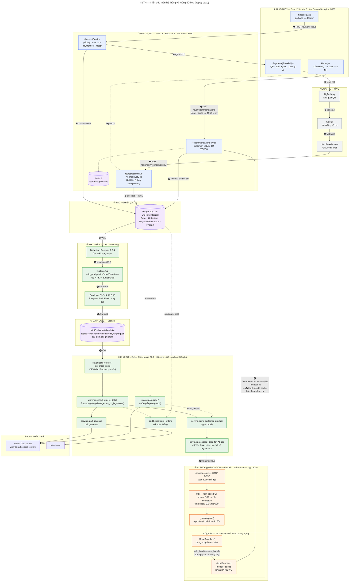
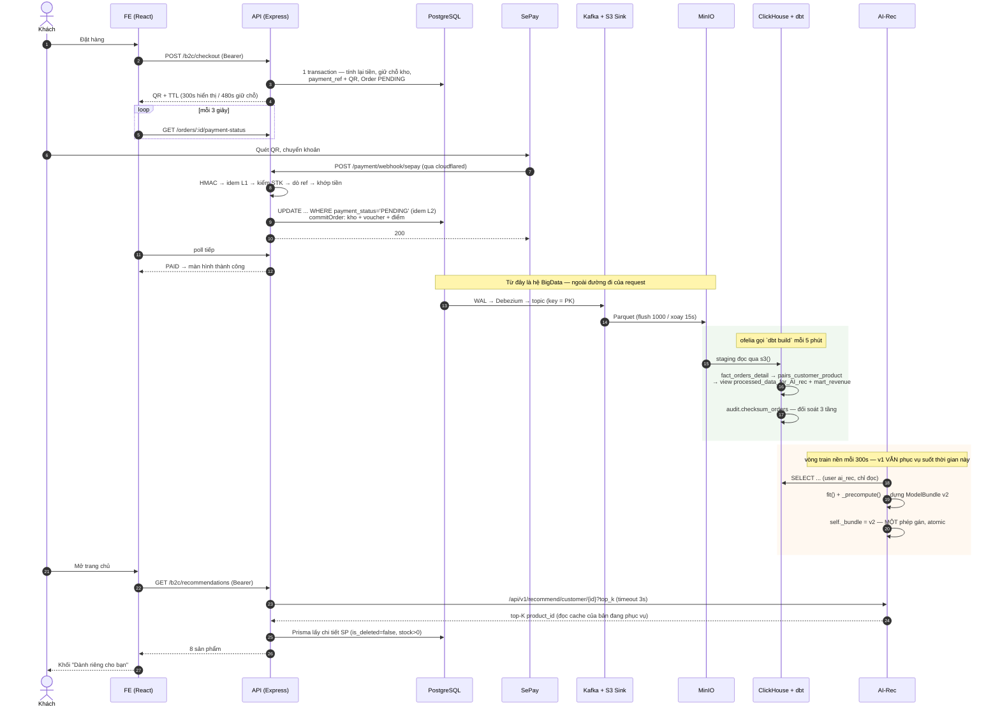

# LUỒNG HIỆN TẠI — KIẾN TRÚC TOÀN HỆ THỐNG

> Cập nhật: 17/09/2026
> Phạm vi: **cả ba hệ** — Ecommerce (`ktln-Getshopy`), BigData (`local-infra-sandbox`),
> AI Recommendation (`ai-rec`) — theo đúng những gì **đang chạy trong repo**.
> Kiến trúc riêng của hệ BigData: [`local-infra-sandbox/docs/architecture.md`](../local-infra-sandbox/docs/architecture.md).
> Hợp đồng dữ liệu: [`data-contract-warehouse.md`](implement-phase/implement-plan/data-contract-warehouse.md).

Tài liệu lần theo **một happy case duy nhất**, từ lúc khách bấm đặt hàng cho tới
lúc gợi ý sản phẩm hiện trên trang chủ:

> Khách mua hàng → thanh toán QR → webhook SePay đối soát → ghi nhận vào
> PostgreSQL → CDC Kafka đưa sang hệ BigData → dbt tinh chế thành bảng train →
> AI-Rec kéo về train bản mới **trong khi bản cũ vẫn phục vụ** → FE gọi lấy gợi ý.

---

## Mục lục

1. [Sơ đồ toàn hệ thống](#1-sơ-đồ-toàn-hệ-thống)
2. [Tầng lớp và tech stack](#2-tầng-lớp-và-tech-stack)
3. [Luồng happy case — 20 bước](#3-luồng-happy-case--20-bước)
4. [Sơ đồ tuần tự](#4-sơ-đồ-tuần-tự)
5. [Cơ chế cache khi train: v1 phục vụ, v2 đang dựng](#5-cơ-chế-cache-khi-train-v1-phục-vụ-v2-đang-dựng)
6. [Ngân sách độ trễ](#6-ngân-sách-độ-trễ)
7. [Thay đổi 17/09: nối lại FE → AI-Rec](#7-thay-đổi-1709-nối-lại-fe--ai-rec)
8. [Hạn chế đã biết](#8-hạn-chế-đã-biết)
9. [Tham chiếu](#9-tham-chiếu)

---

## 1. Sơ đồ toàn hệ thống


> Ảnh gốc: [`diagrams/current-flow.png`](diagrams/current-flow.png) ·
> Mã nguồn Mermaid: [`diagrams/current-flow.mmd`](diagrams/current-flow.mmd)
>
> Số ❶…⓴ trên các mũi tên là **thứ tự thời gian** của happy case, đọc theo bảng ở §3.
> Màu: <span title="ecommerce">xanh dương</span> = hệ Ecommerce · xanh lá = hệ BigData ·
> cam = AI-Rec · tím = nơi lưu trữ · xám = ngoài hệ thống.
>
> Hai mũi tên ⓰ và ⓱ gộp cả chiều hỏi lẫn chiều trả để đồ thị không có chu trình
> (chu trình làm công cụ vẽ đảo lộn thứ tự tầng).

<details>
<summary><b>Mã Mermaid — bấm để mở và copy</b></summary>



</details>

---

## 2. Tầng lớp và tech stack

| # | Tầng | Công nghệ (phiên bản đang chạy) | Vai trò trong happy case |
|---|---|---|---|
| ① | **Giao diện** | React 19.2 · Vite 6.3 · Ant Design 5.22 · ECharts 5.6 · Nginx | Đặt đơn, hiện QR, poll trạng thái, hiển thị 8 sản phẩm gợi ý |
| ② | **Ứng dụng** | Node.js · Express 5.2 · Prisma 5.10 · jsonwebtoken 9 · qrcode 1.5 | Tính lại tiền, giữ chỗ kho, sinh QR EMVCo, đối soát webhook, gọi AI-Rec |
| — | **Cache ứng dụng** | Redis 7 (có fallback in-memory) | Read-through cache cho danh mục/sản phẩm; **không** nằm trên đường gợi ý |
| ③ | **Tác nghiệp** | PostgreSQL 16, `wal_level=logical` | Nguồn sự thật nghiệp vụ; sinh WAL cho CDC |
| ④ | **Thu nhận** | Debezium Postgres 2.5.4 · Kafka 7.4.0 · Confluent S3 Sink 10.5.13 | Bắt mọi thay đổi, giữ đúng thứ tự, đóng gói Parquet |
| ⑤ | **Data lake** | MinIO (S3 API), bucket `data-lake` | Lưu thô bất biến — nguồn để tính lại toàn bộ tầng trên |
| ⑥ | **Kho dữ liệu** | ClickHouse 24.8 · dbt-core 1.8.9 · dbt-clickhouse 1.8.5 · ofelia | Staging → fact → bảng tinh chế + đối soát 3 tầng |
| ⑦ | **AI Recommendation** | Python 3.11 · FastAPI · scikit-learn ≥1.5 · scipy · pandas ≥2.2 · joblib | Train item-based CF mỗi 5 phút, phục vụ top-K qua HTTP |
| ⑧ | **Khai thác khác** | Metabase · Admin Dashboard | Báo cáo doanh thu, đối soát vận hành |
| — | **Ngoài hệ thống** | SePay · cloudflared quick tunnel | Nhận biến động số dư, đưa webhook về máy dev |

**Ba hệ, một compose, một network.** Hai quyết định gộp hạ tầng (13/09): **một**
PostgreSQL (CDC đọc thẳng DB thật của Ecommerce, bỏ `postgres-mock-source`) và
**một** ClickHouse 24.8 (dùng chung cho analytics của Ecom lẫn warehouse của dbt).

---

## 3. Luồng happy case — 20 bước

### 3.1. Đặt hàng và thanh toán (❶–❼)

| # | Ở đâu | Việc gì xảy ra | Vì sao đáng chú ý |
|---|---|---|---|
| ❶ | FE → API | `POST /api/b2c/checkout` kèm `Bearer token` (`authB2C`) | `customer_id` lấy **từ token**, không từ body — bản cũ nhận từ body nên ai cũng tự khai được |
| ❷ | API → Postgres | **Một transaction**: `pricingService` tính lại toàn bộ tiền từ DB · `inventoryService` giữ chỗ kho atomic · sinh `payment_ref` + QR EMVCo động · `INSERT Order + OrderItem` trạng thái `PENDING` | Hoặc có đơn đầy đủ kèm chỗ trong kho, hoặc không có gì. Tiền **không bao giờ** lấy từ `req.body` |
| ❸ | API → FE | Trả chuỗi QR + hai mốc TTL: hiển thị 300s, giữ chỗ 480s | Chuẩn EMVCo **không có trường hết hạn**; khoảng 5→8 phút là cố ý, để khách quét ở phút 4:50 mà ngân hàng xử lý xong lúc 5:15 vẫn kịp |
| ❹ | FE → API | Poll `GET /b2c/orders/:id/payment-status` mỗi 3s (`authB2C`) | Trả **404** thay vì 403 khi không phải chủ đơn — 403 xác nhận đơn tồn tại, đủ để dò danh sách id |
| ❺❻ | Khách → Ngân hàng → SePay | Quét QR, chuyển khoản; SePay nhận biến động số dư | Nội dung chuyển khoản **phải bắt đầu bằng `SEVQR`** với VietinBank, nếu không SePay không thấy giao dịch nào |
| ❼ | SePay → tunnel | `POST` webhook tới URL công khai do cloudflared cấp | URL này khai **thủ công** bên SePay; tunnel chạy lại là đổi subdomain |

### 3.2. Đối soát và ghi nhận (❽–❾)

| # | Bước trong `webhookService.processTransaction()` | Nếu sai thì sao |
|---|---|---|
| ❽ | Xác thực **HMAC trước khi làm bất cứ gì** | Sai key → 401, ghi log kèm IP (dò key lặp lại là dấu hiệu tấn công) |
| ❾.1 | Ghi `PaymentTransaction` **trước khi xử lý** — `provider_txn_id` là `@unique` → **idempotency tầng 1** | Provider retry khi timeout; không chặn thì xử lý lại một giao dịch |
| ❾.2 | So `bankAccount` với `VIETQR_ACCOUNT_NO` | Không kiểm thì tiền vào tài khoản khác vẫn làm đơn `PAID` |
| ❾.3 | Dò `payment_ref` trong nội dung. 0 mã → `UNMATCHED` (job re-match quét lại) · nhiều mã → `REFUND_REQUIRED` | Không đoán bừa đơn nào — đưa người thật xử lý |
| ❾.4 | Số tiền phải **khớp chính xác** | QR động đã khoá sẵn số tiền, lệch nghĩa là có gì đó không ổn |
| ❾.5 | `UPDATE "Order" SET payment_status='PAID' ... WHERE id=? AND payment_status='PENDING'` → **idempotency tầng 2** | Chặn khách chuyển 2 lần: hai giao dịch hợp lệ, khác `provider_txn_id` nên tầng 1 không chặn được |
| ❾.6 | `commitOrder()`: chốt tồn kho **+ voucher + điểm** cùng lúc | Commit mỗi tồn kho mà quên voucher là mã giảm giá của khách biến mất |

> **Nguyên tắc xuyên suốt:** không bao giờ im lặng bỏ qua tiền. Mọi giao dịch
> không gán được đều nằm lại trong `PaymentTransaction` với trạng thái
> `UNMATCHED` / `REFUND_REQUIRED` / `DUPLICATE` để người thật xử lý.

### 3.3. Sang hệ BigData (❿–⓮)

| # | Thành phần | Chi tiết | Ràng buộc |
|---|---|---|---|
| ❿ | PostgreSQL | Ghi WAL | `wal_level=logical`, thiếu thì connector lỗi **lúc đăng ký** |
| ⓫ | Debezium | Envelope `{before, after, op, ts_ms}`, `op` = `c`/`u`/`d`/`r` | Key của message = khoá chính ⇒ cùng một đơn luôn vào **cùng partition** ⇒ giữ đúng thứ tự — điều kiện tiên quyết để dedup theo phiên bản cho kết quả đúng |
| ⓬⓭ | S3 Sink | Ghi Parquet, phân vùng `year=/month=/day=` | Đóng tệp khi đủ `flush.size=1000` **hoặc** sau `rotate.schedule.interval.ms=15000` theo **đồng hồ thật** (không phải timestamp của record) |
| ⓮ | ClickHouse | View `staging.stg_*` đọc lake qua hàm bảng `s3()` | Truy cập trường **theo tên**, kèm giá trị mặc định để một view đọc được cả hai thế hệ tệp |

### 3.4. dbt tinh chế (trong ⓮, mỗi 5 phút)

```
staging.stg_orders + stg_order_items        VIEW, không lưu gì
        │  dedup trong lô (row_number theo event_ts DESC)
        ▼
warehouse.fact_orders_detail                 ReplacingMergeTree(_event_ts, _is_deleted)
        │                                    incremental append, watermark dùng >= chứ không >
        ├──────────────► serving.mart_revenue           (dashboard đọc paid_revenue)
        │
        ▼
serving.pairs_customer_product               append-only, mọi cặp (khách, sản phẩm)
        │  lọc: PAID · không CANCELLED · sản phẩm còn bán (join masterdata.dim_products)
        ▼
serving.processed_data_for_AI_rec            VIEW — FINAL sẵn + lọc SP dưới 3 người mua
```

**Vì sao tách `pairs_customer_product` (bảng) khỏi `processed_data_for_AI_rec` (view):**
ngưỡng "sản phẩm phải có ≥ 3 người mua khác nhau" **không đặt được** trong một
bảng incremental. Sản phẩm P có 2 người mua → dưới ngưỡng, bị loại. Người thứ 3
mua → P đủ ngưỡng, nhưng chỉ người thứ ba sinh dòng fact mới, nên hai cặp cũ
không nằm trong tập "vừa đụng tới" và **thiếu vĩnh viễn**. Đặt ngưỡng ở view thì
nó tính lại trên toàn bộ dữ liệu mỗi lần đọc.

**Vì sao cần ngưỡng đó:** cosine giữa hai sản phẩm tính trên vector có số chiều
bằng số khách. Món chỉ một người mua có vector gần như một chiều, nên cosine của
nó với mọi món người đó cũng mua đều bị thổi lên và nó leo thẳng lên đầu danh
sách gợi ý. Đã xảy ra thật: 5 sản phẩm sinh ra từ vài đơn test chiếm gần hết top
gợi ý của một khách.

### 3.5. AI-Rec train và phục vụ (⓯–⓴)

| # | Ở đâu | Việc gì |
|---|---|---|
| ⓯ | AI-Rec → ClickHouse | Mỗi `TRAIN_INTERVAL_SECONDS=300`: `SELECT CustomerID, ProductID, Quantity, dateDiff('day', LastPurchasedAt, now()) AS DaysSince ... FORMAT TabSeparatedWithNames`, bằng user `ai_rec` **chỉ đọc** |
| — | AI-Rec | `fit()`: `Quantity × 0.5^(DaysSince/30)` (time decay) → ma trận thưa CSR → L2-normalize theo item |
| — | AI-Rec | `_precompute()`: tính sẵn top-20 cho **mọi** khách, trần 60s |
| — | AI-Rec | **Đổi bản**: `self._bundle = new_bundle` — xem §5 |
| ⓰ | FE → API | `GET /api/b2c/recommendations` kèm `Bearer token` |
| ⓱⓲ | API → AI-Rec | `GET /api/v1/recommend/customer/{id}?top_k=N`, timeout 3s → trả danh sách `product_id` |
| ⓳ | API → Postgres | Prisma lấy chi tiết sản phẩm, lọc `is_deleted=false` + `stock>0`, phủ giá flash sale |
| ⓴ | API → FE | 8 sản phẩm cho khối "Dành riêng cho bạn" |

**Kéo toàn bộ chứ không phải phần chênh lệch.** Bảng nguồn là bảng tổng hợp —
grain một dòng cho mỗi cặp (khách, sản phẩm) — nên khi khách mua lại một sản
phẩm thì dòng **cũ** bị đổi số lượng, không phải thêm dòng mới. Lấy "các dòng
mới hơn lần trước" sẽ bỏ sót đúng những thay đổi đó, và sai một cách im lặng.

**CF item-based không train tăng dần được:** thêm một đơn là ma trận user-item
đổi, vector chuẩn hoá của mọi sản phẩm liên quan đổi theo. Bù lại việc train rẻ
— `fit()` chỉ dựng ma trận thưa và chuẩn hoá, **không** nhân ma trận item × item
(để dành lúc suy luận).

---

## 4. Sơ đồ tuần tự



---

## 5. Cơ chế cache khi train: v1 phục vụ, v2 đang dựng

Đây là phần quan trọng nhất về mặt vận hành: **không có một giây nào dịch vụ
gợi ý ngừng trả lời**, kể cả giữa lúc đang train.

### 5.1. Đơn vị đổi bản là `ModelBundle`, không phải từng thuộc tính

```python
@dataclass
class ModelBundle:
    model: CollaborativeFiltering
    cache: dict[str, list[str]]     # top-20 tính sẵn cho mỗi khách
    trained_at: datetime
    source: str                     # "clickhouse" | "csv" | "disk"
    version: int
    stats: dict[str, int]
```

Model và cache **phải đi cùng nhau**. Nếu chúng là hai thuộc tính rời của
service thì sẽ có khoảnh khắc model đã là v2 còn cache vẫn của v1 — request rơi
đúng lúc đó nhận gợi ý trỏ tới sản phẩm không còn trong catalog của model. Đổi
cả gói bằng **một** phép gán thì không tồn tại trạng thái lai đó.

### 5.2. Dòng thời gian một chu kỳ

```
t=0        ModelBundle v1 đang phục vụ ─────────────────────────────────────────►
           │
t=0        vòng train nền thức dậy (asyncio, mỗi 300s)
           │   ├─ asyncio.to_thread(...)  ← train là việc nặng CPU, chạy thẳng
           │   │                            trong event loop sẽ TREO toàn bộ API
           │   ├─ fetch từ ClickHouse            (vài trăm ms – vài giây)
           │   ├─ fit(): CSR + L2-normalize      (vài trăm ms)
           │   └─ _precompute(): top-20 mọi khách (trần 60s)
           │
           │   ↑ SUỐT quãng này mọi request vẫn đọc v1 và trả lời bình thường
           │
t=T        self._bundle = new_bundle   ← ĐIỂM DUY NHẤT v1 ngừng phục vụ
           │                              atomic nhờ GIL: không có nửa bước nào
           │                              để một request rơi vào
           │
t=T+       ModelBundle v2 phục vụ ──────────────────────────────────────────────►
           v1 được giải phóng khi request cuối cùng đang cầm nó kết thúc
           (Python đếm tham chiếu — KHÔNG gọi gc ép thu gom sớm)
```

### 5.3. Ba lớp bảo vệ khác

| Tình huống | Cơ chế | Kết quả |
|---|---|---|
| Warehouse sập giữa chừng | `_load_frame()` bắt `ClickHouseUnavailable`, vòng lặp `while True` **không được phép chết** | Giữ nguyên model cũ, chu kỳ sau thử lại |
| Tập train rỗng ở chu kỳ này | `if df is None or df.empty: return None` | Giữ nguyên model cũ, **không** đổi sang bản rỗng |
| Chu kỳ trước chạy quá 300s | `asyncio.Lock` — `if self._training.locked(): bỏ qua lượt này` | Không xếp hàng chồng nhau; xếp hàng chỉ làm tình trạng chậm tệ thêm |
| Khách mới, chưa có trong cache | `bundle.model.recommend(cid, top_k)` tính tại chỗ từ **chính bản đó** | Cache là **tối ưu**, không phải điều kiện đúng đắn — thiếu đường dự phòng này thì khách mới không có gợi ý suốt 5 phút |
| Khách chưa mua gì (cold start) | Trả `popular_items` — cũng đã áp time decay | Không quảng bá món bán chạy từ năm ngoái |
| Container khởi động lại | `initialize()` nạp `item_cf.joblib` từ đĩa, phục vụ ngay; train nền lo phần làm mới | Train đồng bộ lúc khởi động sẽ làm healthcheck Docker hết giờ và container bị khai tử giữa chừng |
| Ghi model ra đĩa | Ghi file tạm rồi `os.replace` (đổi tên là thao tác nguyên tử) | Tiến trình chết giữa lúc ghi không để lại file `.joblib` cụt cho lần khởi động sau nạp phải |

### 5.4. Đọc cache lúc phục vụ

```python
bundle = self._bundle          # chụp tham chiếu MỘT lần
```

Đọc `self._bundle` nhiều lần trong cùng một request có thể rơi vào **hai bản
khác nhau** nếu vòng train đổi bản ở giữa — lúc đó cache của bản này ghép với
model của bản kia.

Trạng thái thật lúc viết tài liệu (lấy từ `GET /health`):

```json
{ "status": "ok", "model_version": 6, "data_source": "clickhouse",
  "customers": 200, "products": 71, "interactions": 2857, "cached_customers": 200 }
```

---

## 6. Ngân sách độ trễ

| Chặng | Độ trễ điển hình | Cái gì quyết định |
|---|---|---|
| Đặt đơn → QR hiện trên màn hình | < 1 s | Một transaction Postgres + sinh QR |
| Chuyển khoản → webhook về | vài giây – vài chục giây | Ngân hàng và SePay, **ngoài tầm kiểm soát** |
| Webhook → đơn `PAID` | < 200 ms | Đối soát trong DB |
| Postgres → Kafka | < 1 s | Tốc độ đọc WAL của Debezium |
| Kafka → Parquet trên MinIO | ≤ 15 s | `rotate.schedule.interval.ms` |
| Parquet → bảng tinh chế | ≤ 5 phút | `DBT_SCHEDULE` của ofelia |
| Bảng tinh chế → model mới | ≤ 5 phút | `TRAIN_INTERVAL_SECONDS` |
| **Đơn mới ảnh hưởng tới gợi ý** | **≈ 10–11 phút** | Hai chu kỳ 5 phút nối tiếp |
| Gợi ý: FE → kết quả | < 200 ms | Tra dict trong cache, không nhân ma trận |

Hai chu kỳ 5 phút **không đồng bộ với nhau**: dbt và AI-Rec chạy theo đồng hồ
riêng. Trường hợp xấu nhất là dbt vừa ghi xong thì AI-Rec vừa fetch xong trước
đó một giây → phải chờ trọn chu kỳ sau.

---

## 7. Thay đổi 17/09: nối lại FE → AI-Rec

### 7.1. Vấn đề

Đường từ FE tới AI-Rec **chưa từng chạy**, và không có lỗi nào báo ra:

| Mắt xích | Trạng thái cũ |
|---|---|
| FE gửi | chỉ `email` (`api.js`) |
| Route đọc | `customerId` **từ query string** — FE không gửi ⇒ `undefined` |
| Service dùng `email` | **không** — chữ `email` chỉ xuất hiện ở JSDoc và tham số hàm |
| Điều kiện gọi AI-Rec | `if (results.length < 8 && customerId && AI_REC_URL)` ⇒ **không bao giờ đúng** |

Kết quả: khối "Dành riêng cho bạn" rơi thẳng xuống fallback rule-based (top bán
chạy → sản phẩm mới nhất). API vẫn trả 200 kèm đủ 8 sản phẩm, nhìn từ ngoài y
hệt như gợi ý AI đang chạy. Container `ai-rec` vẫn train đều, vẫn `healthy` —
chỉ là không ai gọi nó.

### 7.2. Cách sửa

Danh tính lấy **từ token**, không từ query string:

```js
router.get('/b2c/recommendations', optionalAuthB2C, async (req, res) => {
  const { categoryId, brandId, sessionId } = req.query;
  const result = await RecommendationService.getRecommendations(null, {
    ...,
    customerId: req.b2cUser ? req.b2cUser.id : undefined,
  });
```

**Dùng `optionalAuthB2C` chứ không `authB2C`.** Đây là endpoint công khai, khách
vãng lai phải xem được gợi ý. Bắt buộc đăng nhập thì khách chưa có token nhận
401, mà `request()` phía client xử lý 401 bằng `localStorage.clear()` + redirect
`'/'` — tức là **trang chủ tự tải lại vô hạn**.

Phía FE bỏ luôn tham số `email` thừa; `request()` vốn đã tự gắn `Bearer` cho mọi
lời gọi.

### 7.3. Kiểm chứng

| Trường hợp | Kết quả |
|---|---|
| Không token (khách vãng lai) | `HTTP 200`, 8 sản phẩm — không 401, không vòng lặp redirect |
| `Bearer null` (token rác) | `HTTP 200` — coi như vãng lai |
| Token hợp lệ, `customer_id=1` | `HTTP 200`, **7/8 id trùng với kết quả gọi thẳng AI-Rec** |

```
AI-Rec  /api/v1/recommend/customer/1 : ['51','50','15','13','7','28','6','47']
API     khách đăng nhập              : [7, 13, 15, 28, 47, 50, 51, 2]
API     khách vãng lai               : [7, 2, 105765, 88492, 97148, 83696, 102996, 94323]
```

- Sản phẩm **6** (iPad Pro M4) rụng vì `stock = 0` — nhánh CF lọc `stock > 0`.
- Sản phẩm **2** được nhánh fill "top bán chạy" thêm vào cho đủ 8.
- Danh sách của khách vãng lai **khác hẳn** ⇒ nhánh CF thật sự đã chạy.

Log server 3 request đều `200`, không có dòng `AI Rec container unavailable`.

**File đã sửa:** `server/src/routes/recommendation.js` ·
`server/src/services/RecommendationService.js` (chỉ thêm chú thích cảnh báo
tham số chết) · `client/src/services/api.js` · `client/src/pages/b2c/Home.jsx`.

---

## 8. Hạn chế đã biết

| # | Hạn chế | Ảnh hưởng | Hướng xử lý |
|---|---|---|---|
| 1 | **`sessionId` vẫn chưa được FE gửi** | Nhánh v4 behavior-aware (Recently Viewed, user profile, trending) nằm trong `if (sessionId)` nên chưa chạy từ trang chủ | Truyền `sessionId` từ lớp tracking hành vi |
| 2 | **Nhánh fill "top bán chạy" không lọc `stock > 0`** trong khi nhánh CF có lọc | Gợi ý vẫn có thể chứa hàng đã hết kho (sản phẩm id 2 ở §7.3 là ví dụ thật) | Thêm `stock: { gt: 0 }` cho truy vấn `topSellers` |
| 3 | **`province` không tới nhánh lạnh** | Báo cáo theo vùng ở nhánh lakehouse chưa dùng được; nhánh nóng có đủ | Chuyển `JsonConverter` → Avro + Schema Registry |
| 4 | Độ trễ đơn mới → gợi ý ≈ 10–11 phút | Khách vừa mua xong chưa thấy gợi ý đổi ngay | Hạ chu kỳ, hoặc cho AI-Rec train theo sự kiện thay vì theo lịch |
| 5 | `config-clickhouse/s3.xml` **là thư mục rỗng** | Hiện không gãy gì (model `s3()` truyền key trực tiếp) | Tạo tệp thật hoặc gỡ bind-mount |
| 6 | Hệ số nhân bản 1 ở mọi thành phần | Hỏng một container là mất khả dụng | Thuộc giai đoạn cụm nhiều máy |

### 🔴 Bí mật đang nằm trong repo

`local-infra-sandbox/.env` và `src/.env` chứa mật khẩu thật, **không có
`.gitignore`** ở cả hai nơi. Trước khi đẩy code đi bất cứ đâu: thêm `.gitignore`,
**xoay lại toàn bộ** `POSTGRES_PASSWORD`, `MINIO_ACCESS_KEY` / `MINIO_SECRET_KEY`,
`CLICKHOUSE_PASSWORD`, `AI_REC_CH_PASSWORD`, `JWT_SECRET`, khoá SePay — và nếu đã
commit thì xoá khỏi **lịch sử** git, không chỉ khỏi bản hiện tại.

---

## 9. Tham chiếu

### Trong repo

| Vai trò | Tệp |
|---|---|
| Compose toàn hệ | [`../docker-compose.yml`](../docker-compose.yml) |
| Khởi tạo BigData | [`../scripts/bootstrap-bigdata.sh`](../scripts/bootstrap-bigdata.sh) |
| Đặt đơn | `ktln-Getshopy/.../server/src/services/payment/checkoutService.js` |
| Đối soát webhook | `.../server/src/services/payment/webhookService.js` · `.../routes/payment.js` |
| Vòng đời đơn | `.../server/src/services/payment/orderLifecycle.js` |
| Gợi ý (server) | `.../server/src/routes/recommendation.js` · `.../services/RecommendationService.js` |
| Xác thực khách | `.../server/src/middleware/authB2C.js` |
| Vòng train + đổi bản | `.../ai-rec/api/service.py` |
| Mô hình CF | `.../ai-rec/models/cf_recommendation.py` |
| Đọc warehouse | `.../ai-rec/data_source/clickhouse.py` · `.../ai-rec/config.py` |
| dbt models | [`../local-infra-sandbox/dbt_warehouse/models/`](../local-infra-sandbox/dbt_warehouse/models/) |
| Nhánh nóng | [`../scripts/etl/realtime-layer.sql`](../scripts/etl/realtime-layer.sql) |
| Kiến trúc hệ BigData | [`../local-infra-sandbox/docs/architecture.md`](../local-infra-sandbox/docs/architecture.md) |
| Nhật ký sự cố | [`implement-phase/results/results.md`](implement-phase/results/results.md) |

### Ngoài repo

- Debezium — PostgreSQL Connector: https://debezium.io/documentation/reference/stable/connectors/postgresql.html
- Confluent — S3 Sink Connector: https://docs.confluent.io/kafka-connectors/s3-sink/current/overview.html
- ClickHouse — `ReplacingMergeTree`: https://clickhouse.com/docs/en/engines/table-engines/mergetree-family/replacingmergetree
- dbt — Incremental models: https://docs.getdbt.com/docs/build/incremental-models
- SePay — kết nối VietinBank (tiền tố `SEVQR`): https://docs.sepay.vn/ket-noi-vietinbank.html
- EMVCo — QR Code Specification for Payment Systems: https://www.emvco.com/specifications/
- Sarwar, B. et al. — *Item-based Collaborative Filtering Recommendation Algorithms*, WWW '01
- Kleppmann, M. — *Designing Data-Intensive Applications*, O'Reilly, 2017 (ch. 11)
