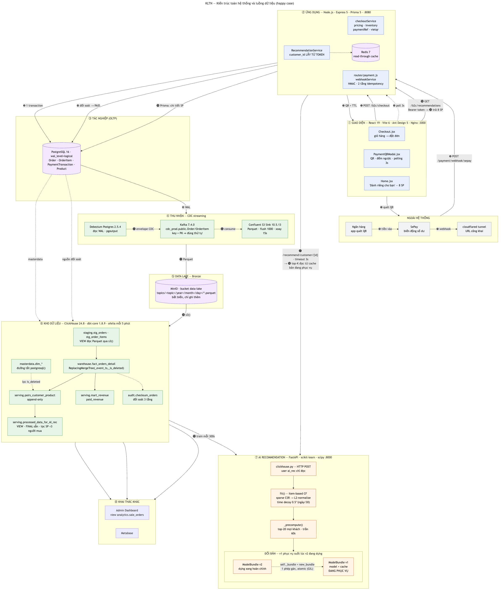

# LUỒNG HIỆN TẠI — KIẾN TRÚC TOÀN HỆ THỐNG

> Mốc snapshot: 17/09/2026. Tài liệu này là bản ghi của **một thời điểm nghiên cứu** trong giai đoạn 08/2026–12/2026, không phải bản mô tả trạng thái mới nhất của hệ thống sau thời điểm đó.
> Phạm vi: **cả ba hệ** — Ecommerce (`ktln-Getshopy`), BigData (`local-infra-sandbox`), AI Recommendation (`ai-rec`) — theo đúng những gì **đang chạy trong repo tại mốc snapshot này**.
> Kiến trúc riêng của hệ BigData: [`local-infra-sandbox/docs/architecture.md`](../local-infra-sandbox/docs/architecture.md).
> Hợp đồng dữ liệu: [`data-contract-warehouse.md`](implement-phase/implement-plan/data-contract-warehouse.md).
>
> Khi đọc tài liệu này, cần hiểu rằng các phiên bản phần mềm, cấu hình, số liệu healthcheck, số liệu benchmark và trạng thái tích hợp đều là **số liệu thời điểm**. Chúng không được xem là trạng thái hiện tại của repo nếu repo đã có thay đổi sau 17/09/2026.

Tài liệu lần theo **một happy case duy nhất**, từ lúc khách bấm đặt hàng cho tới
lúc gợi ý sản phẩm hiện trên trang chủ:

> Khách mua hàng → thanh toán QR → webhook SePay đối soát → ghi nhận vào
> PostgreSQL → CDC Kafka đưa sang hệ BigData → dbt tinh chế thành bảng train →
> AI-Rec kéo về train bản mới **trong khi bản cũ vẫn phục vụ** → FE gọi lấy gợi ý.

---

## Mục lục

1. [Sơ đồ toàn hệ thống](#1-sơ-đồ-toàn-hệ-thống)
2. [Tầng lớp và tech stack](#2-tầng-lớp-và-tech-stack)
3. [Luồng happy case — 20 bước](#3-luồng-happy-case--20-bước)
4. [Sơ đồ tuần tự](#4-sơ-đồ-tuần-tự)
5. [Cơ chế cache khi train: v1 phục vụ, v2 đang dựng](#5-cơ-chế-cache-khi-train-v1-phục-vụ-v2-đang-dựng)
6. [Ngân sách độ trễ](#6-ngân-sách-độ-trễ)
7. [Snapshot 17/09/2026: nối lại FE → AI-Rec](#7-snapshot-17092026-nối-lại-fe--ai-rec)
8. [Hạn chế đã biết](#8-hạn-chế-đã-biết)
9. [Tham chiếu](#9-tham-chiếu)

---

## 1. Sơ đồ toàn hệ thống

> Ảnh gốc: [`diagrams/current-flow.png`](diagrams/current-flow.png) ·
> Mã nguồn Mermaid: [`diagrams/current-flow.mmd`](diagrams/current-flow.mmd)
>
> Số ❶…⓴ trên các mũi tên là **thứ tự thời gian** của happy case, đọc theo bảng ở §3.
> Đây là một snapshot kiến trúc, không phải tài liệu trạng thái hiện tại của dự án.
