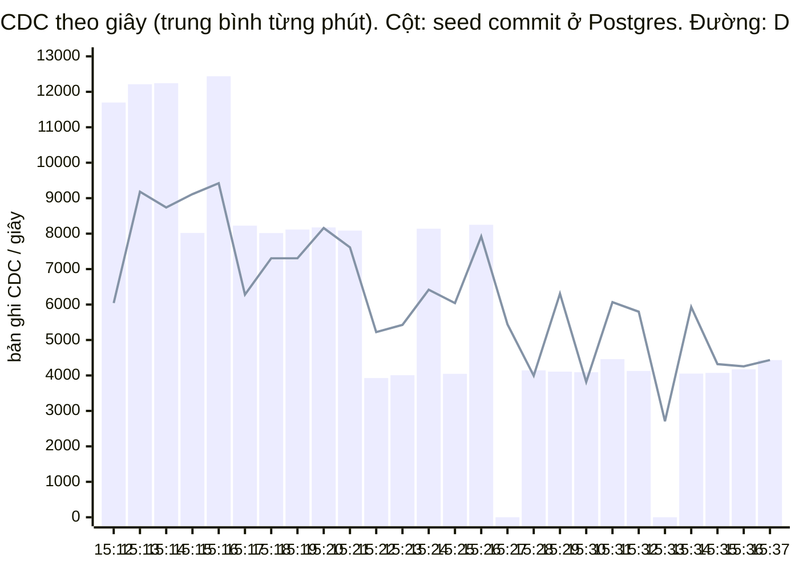
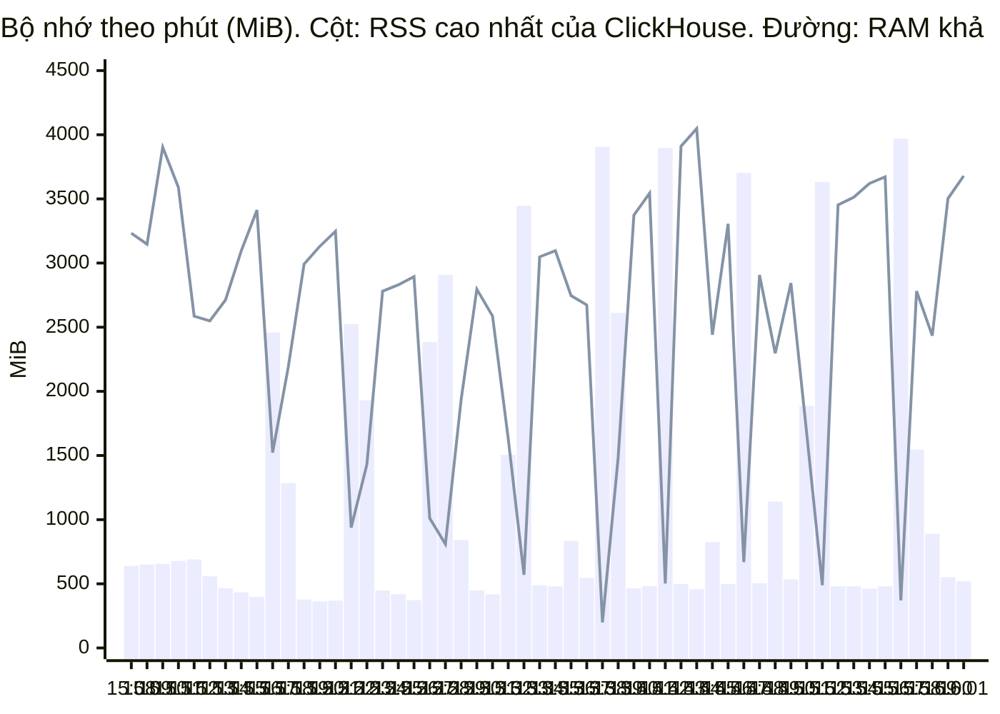

# Benchmark tải hệ BigData — nạp dồn 3 triệu đơn qua CDC

> Ngày đo: 23/10/2026 · Môi trường: sandbox một máy (Docker Desktop / WSL2, Windows 11) · **Số lần chạy: 1**
> Dữ liệu: **giả lập** bằng `data-platform-poc/demo_dataset.py` — kết quả là hành vi của hệ trên bộ này, không phải trên khách thật.
> Số liệu thô và script đo: [`benchmark-tai-3tr-don-Oct23/`](benchmark-tai-3tr-don-Oct23/README.md)
> Mọi mốc giờ trong tài liệu là **UTC** (giờ máy đo = UTC+7), trừ khi ghi khác.

---

## Tóm tắt

| Câu hỏi | Kết quả đo |
|---|---|
| Hệ có xử lý hết 3 triệu đơn không? | **Có.** 3.000.000 đơn / 6.795.746 dòng hàng đi hết Postgres → Debezium → Kafka → MinIO → dbt → warehouse. Checksum 3 tầng `KHỚP` từ lượt dbt 15:42 (số dòng và tổng tiền 72.938.406.667.400 đ). |
| Có mất hay nhân bản dữ liệu không? | Không, trong lần chạy này: Kafka, lake và warehouse đều đúng 3.000.000 + 6.795.746 bản ghi. |
| Có tràn RAM không? | **Không có tiến trình nào bị OOM killer giết** tới 16:02, không có lỗi `MEMORY_LIMIT_EXCEEDED`, không lượt dbt nào hỏng vì tài nguyên. Nhưng RAM khả dụng của máy ảo xuống **199 MiB** (15:38:47); bộ nhớ đang giữ (RAM dùng + swap dùng) lên **10,2 GiB** lúc nạp — lớn hơn dung lượng WSL2 mặc định của máy này (9,6 GiB) → với cấu hình mặc định, hệ gần như chắc chắn đã OOM (suy luận, chưa chạy lại để kiểm chứng). **Sau khi nạp xong, swap đầy 100%** (15:52:30) và mỗi lượt dbt vẫn kéo RAM khả dụng xuống 370–670 MiB: hệ ổn định nhưng không còn biên. |
| **Ngưỡng chịu tải?** (đơn vị/giây, §5.2) | **≈ 1.900 đơn/s duy trì = ~6.300 bản ghi CDC/s** (~6,9 triệu đơn/giờ); đỉnh ngắn ~2.900 đơn/s (9.400 bản ghi/s). Trần do **Debezium** (đọc WAL Postgres → Kafka) quyết định; sink S3 và dbt chưa bão hoà. Tải vào vượt trần (seed ghi tới 4.393 đơn/s) chỉ làm độ trễ tăng — commit → Debezium p50 96–118 s, max 221 s — không mất dữ liệu. Mức cao nhất của TN1 (5.000 giao dịch/phút = 83/s) thấp hơn trần ~23 lần. |
| Độ trễ đầu-cuối (commit Postgres → có trong warehouse)? | p50 **263 s** · p95 **439 s** · max 487 s — dưới tải dồn, dbt 5 phút/lượt. |
| Truy vấn nặng nhất? | **`checksum_orders`** (lớp audit): 1,1 → **3,3 GiB** mỗi lượt, tăng tuyến tính theo dữ liệu. ClickHouse đạt đỉnh 3,99 GiB mỗi lượt dbt **kể cả ở trạng thái ổn định**, khi không còn dữ liệu mới. |
| Đĩa? | Kafka lưu JSON kèm schema **3,7–5,0 KB/bản ghi** (~110 lần parquet) → ngoại suy ~40 GB cho 9,8 triệu bản ghi; phải giới hạn retention 8 GiB/topic giữa lúc chạy. Cả lần đo tiêu thụ ~31 GB đĩa. |

---

## 1. Mục đích và phạm vi

Đo hành vi của toàn bộ đường dữ liệu khi nạp **một lần** bộ demo 3 triệu đơn trong lúc cả stack đang chạy — CDC dạng streaming qua replication slot, không phải snapshot ban đầu — cho tới khi hệ vỡ hoặc đối soát khớp. Mục tiêu đi kèm: xác định điểm nghẽn và mức tài nguyên thật, làm cơ sở cho bước ràng trần và chia mẻ sau này.

Đối chiếu với bộ thực nghiệm của đề cương ([DE-CUONG.md](../../../DE-CUONG.md), bảng TN):

| TN | Lần đo này cung cấp | Còn thiếu so với giao thức của đề cương |
|---|---|---|
| TN1 — độ trễ đầu-cuối theo mức tải | p50/p95/p99 ở **một** mức tải: tải dồn, vượt ngưỡng bão hoà | Bốn mức 100 / 500 / 1.000 / 5.000 giao dịch/phút (= 1,7 / 8,3 / 16,7 / 83 giao dịch/s — thấp hơn trần đo được hàng chục lần, §5.2), giao dịch nhỏ như OLTP thật |
| TN2 — thông lượng bão hoà | Thông lượng Debezium khi đã bão hoà + thành phần nghẽn | Tăng tải từng bậc tới khi lag tăng đơn điệu không hồi phục |
| TN4 — incremental vs ghi lại toàn bảng | Quan sát song song trong cùng lượt dbt: model incremental (`fact_orders_detail`) và các model dựng lại cả bảng | So sánh có đối chứng trên **cùng một** model |
| TN5 — đối soát & SLA | Checksum 3 tầng về `KHỚP`, không mất / không nhân bản dưới tải lớn | Tiêm lỗi: hạ Kafka, hạ ClickHouse, ngắt mạng, kill giữa lúc ghi |

---

## 2. Môi trường

### 2.1 Phần cứng và ảo hoá

| | |
|---|---|
| Máy | Intel Core i7-12650H (16 luồng), RAM 15,7 GB, Windows 11 Home (10.0.22631) |
| Docker | Docker Desktop 4.47.0, Engine 28.4.0, backend WSL2 |
| Máy ảo Docker | **8.940 MiB RAM + 4.096 MiB swap**, 16 vCPU — đặt bằng `%USERPROFILE%\.wslconfig` (`memory=9GB`, `swap=4GB`, swap trên D:). Mặc định WSL2 của máy này: 7.796 MiB RAM + 2.048 MiB swap (50% RAM máy, swap 25%) |
| Đĩa | Ổ ảo `docker_data.vhdx` và file swap đặt trên D: (49 GB trống lúc bắt đầu) |
| Tải nền trên Windows | Cursor và Chrome mở suốt lúc đo (~6 GB working set) |

### 2.2 Phiên bản

| Thành phần | Phiên bản |
|---|---|
| PostgreSQL | 16.15 (`postgres:16-alpine`), `wal_level=logical` |
| Debezium PostgreSQL connector | 2.5.4, plugin `pgoutput`, 1 task |
| Kafka / Zookeeper / Kafka Connect | Confluent Platform 7.4.0 (Apache Kafka 3.4), 1 broker, 1 partition mỗi topic |
| Confluent S3 Sink | 10.5.13, định dạng Parquet |
| MinIO | RELEASE.2025-09-07T16-13-09Z (build từ mã nguồn) |
| ClickHouse | 24.8.14.39 |
| dbt | dbt-core 1.8.9, dbt-clickhouse 1.8.5, dbt_utils 1.4.1 · lịch: ofelia `@every 5m` |
| Metabase | v0.64.3.4 (thẻ `latest` kéo ngày 23/10) — không ai mở dashboard trong lúc đo |

### 2.3 Cấu hình ảnh hưởng tới kết quả

| Mục | Giá trị khi đo | Ghi chú |
|---|---|---|
| `flush.size` của S3 sink | **10.000** | nâng từ 1.000 ngay trước lần đo |
| `rotate.schedule.interval.ms` | 15.000 | theo đồng hồ thật |
| `retention.bytes` của 2 topic CDC | **8 GiB** | đặt lúc ~15:17:30, **khi đang chạy** (§5.7); trước đó là mặc định — không giới hạn dung lượng, giữ 7 ngày. Hiện vẫn còn hiệu lực |
| Converter của Connect | `JsonConverter`, schema nhúng trong từng message, producer không nén | |
| dbt | `dbt build` mỗi 5 phút; ofelia **không** bật `no-overlap` (mặc định `false`) | |
| ClickHouse | **Không có trần riêng.** `max_server_memory_usage` = 0,9 × RAM máy ảo = 7,86 GiB; `max_memory_usage` = 0 (không giới hạn từng truy vấn); `max_bytes_before_external_sort` = `max_bytes_before_external_group_by` = 0 (không tràn ra đĩa); `max_threads` = 16 | Các biến `CLICKHOUSE_MEM_LIMIT`, `CLICKHOUSE_QUERY_MAX_MEMORY`, `CLICKHOUSE_SPILL_BYTES`, `CLICKHOUSE_QUERY_MAX_THREADS` có trong `.env` nhưng `docker-compose.yml` không tham chiếu → không có tác dụng |
| Heap JVM | Kafka 1 GB, Zookeeper 512 MB, Connect tối đa 2 GB — đọc từ script khởi động trong image; Metabase theo mặc định của JVM (tối đa 1/4 RAM) | |
| ai-rec | Train mỗi 300 s, timeout ClickHouse 120 s | |

---

## 3. Tải

| | |
|---|---|
| Bộ sinh | `data-platform-poc/demo_dataset.py`, seed 20261004 — dữ liệu giả lập có cấu trúc (gu, mua kèm, mua lặp); giả định và nguồn ở docstring của file |
| Catalog | 600.000 sản phẩm, 1.200.539 dòng tồn kho (`seed-catalog`, 1 phút 54 giây) |
| Khách | 40.001 (40.000 khách demo + `test@getshopy.vn`) |
| Đơn | **3.000.000** đơn, **6.795.746** dòng hàng (2,27 dòng/đơn), trải trên 365 ngày |
| Cách ghi | `COPY` theo mẻ 1.000 khách — **mỗi transaction ~75.000 đơn + ~170.000 dòng hàng**, 41 mẻ |
| Sự kiện CDC phát sinh | 9.795.746 (mỗi dòng một sự kiện insert) |
| Mốc thời gian | stack lên 15:07 · seed 15:11:57 → 15:39:16 (commit mẻ cuối ~15:37, sau đó cập nhật `Product.sold` và `ANALYZE`) |

---

## 4. Phương pháp đo

| Đại lượng | Nguồn | Độ phân giải |
|---|---|---|
| RAM khả dụng của máy ảo, RSS của ClickHouse | `system.asynchronous_metric_log` (`OSMemoryAvailable` đọc `/proc/meminfo` của kernel máy ảo; `MemoryResident`) | 1 s |
| Bộ nhớ ClickHouse tự theo dõi | `system.metric_log` (`CurrentMetric_MemoryTracking`) | 1 s |
| RAM từng container | `docker stats` — RSS, **không tính phần đã bị đẩy ra swap** | 30 s |
| RAM dùng / swap của máy ảo | `free -m` trong distro `docker-desktop` | 30 s |
| RAM, thời gian, số dòng đọc của từng model dbt | `system.query_log` | từng truy vấn |
| Thời gian từng lượt dbt | log ofelia | từng lượt |
| Thông lượng và độ trễ CDC | đọc thẳng parquet: `source.ts_ms` (commit ở Postgres), `ts_ms` (Debezium xử lý), `_time` (file ghi xong lên MinIO) | từng bản ghi |
| Độ trễ tới warehouse | `fact_orders_detail._loaded_at` ghép với giờ commit theo `item_id` | từng dòng hàng |
| Đối soát | model `audit.checksum_orders` | mỗi lượt dbt |
| OOM | `docker events` (oom, die), `dmesg` của máy ảo, `system.errors` mã 241 / 173 | liên tục / 20 s |

**Hai lưu ý phương pháp rút ra trong lúc đo:**

1. Lấy mẫu 30 s **đánh giá thấp đỉnh**. RSS cao nhất của ClickHouse theo `docker stats` là 3,33 GiB, theo mẫu 1 s là 3,88 GiB; RAM khả dụng thấp nhất theo mẫu 30 s là 984 MiB, theo mẫu 1 s là 199 MiB. Tài liệu dùng số 1 s khi có.
2. Câu truy vấn có hàm `postgresql()` (chứa mật khẩu) được ghi vào `query_log` **không kèm chú thích `node_id`** mà dbt gắn vào. Gán truy vấn về model phải dựa thêm vào bảng đích `*__dbt_backup`; lọc riêng theo `node_id` sẽ bỏ sót `checksum_orders` và các model masterdata.

---

## 5. Kết quả

### 5.1 Đúng và đủ — đối soát

| Tầng | Số dòng hàng | Tổng tiền (đ) |
|---|---|---|
| Postgres (`OrderItem`) | 6.795.746 | 72.938.406.667.400 |
| Kafka (offset cuối) | 6.795.746 · `Order`: 3.000.000 | – |
| Lake (parquet) | 6.795.746 · `Order`: 3.000.000 | 72.938.406.667.400 |
| Warehouse (`fact_orders_detail FINAL`) | 6.795.746 · 3.000.000 đơn | 72.938.406.667.400 |

Kết quả `KHỚP` lần đầu ở lượt dbt 15:42:04 — khoảng 5 phút sau khi seed commit mẻ cuối — và giữ nguyên ở các lượt đọc lại sau đó.

Đây là **quan sát của một lần chạy, không phải bảo đảm** exactly-once: trong lúc đo không có lần khởi động lại connector nào. Debezium giao ít nhất một lần (at-least-once); S3 sink chỉ exactly-once khi partitioner tất định, mà xoay file theo đồng hồ thật (`rotate.schedule.interval.ms`) không tất định [3].

### 5.2 Thông lượng và ngưỡng chịu tải

> **Đơn vị.** Pipeline nhận *giao dịch ghi vào Postgres*, không nhận request HTTP, nên thông lượng đo bằng **đơn/giây** (giao dịch nghiệp vụ, tương đương TPS) và **bản ghi CDC/giây** (mỗi dòng `Order` hoặc `OrderItem` thay đổi là một bản ghi; bộ này trung bình 3,27 bản ghi mỗi đơn). RPS — request/giây — là đơn vị của tầng web/API; tầng đó **không nằm trong lần đo này** vì seed ghi thẳng Postgres bằng `COPY` (§8).

**Ngưỡng chịu tải theo từng tầng:**

| Tầng | Thông lượng đo được | Bão hoà? |
|---|---|---|
| Ghi Postgres (seed `COPY` — tải đầu vào) | đỉnh **4.393 đơn/s** (~14.300 dòng/s, 5 mẻ đầu); trung bình 1.992 đơn/s (~6.500 dòng/s) | – |
| **CDC: Debezium (Postgres → Kafka)** | trung bình **1.923 đơn/s = 6.279 bản ghi/s**; phút cao nhất ~2.900 đơn/s = 9.421 bản ghi/s; lúc máy thiếu RAM ~830–1.930 đơn/s (2.709–6.308 bản ghi/s) | **Có — nút thắt.** Suốt đợt nạp luôn có tồn đọng |
| Sink S3 (Kafka → MinIO) | bám sát Debezium, phút cao nhất 9.419 bản ghi/s; độ trễ p50 ~3 s | Không |
| Warehouse: dbt (lô 5 phút) | mỗi chu kỳ nạp tối đa ~6.200 dòng hàng/s ≈ 2.700 đơn/s; lượt dài nhất chỉ chiếm 47% chu kỳ (141 / 300 s) | Không |
| **Cả pipeline, đầu-cuối** | **≈ 1.900 đơn/s duy trì = ~6.300 bản ghi CDC/s** (~6,9 triệu đơn/giờ); đỉnh ngắn ~2.900 đơn/s | Trần do Debezium quyết định |

Số đơn/s theo từng phút là quy đổi từ bản ghi/s theo tỉ lệ trung bình 3,27 bản ghi/đơn; số trung bình cả đợt là chính xác (3.000.000 đơn trong 26 phút Debezium hoạt động).

Cách đọc: suốt đợt nạp Debezium luôn có việc tồn đọng, vì seed ghi nhanh hơn nó đọc, nên tốc độ xả tồn đọng đo được chính là **trần thông lượng của tầng thu nhận** ở cấu hình này. Tải vào vượt trần chỉ làm độ trễ commit → Debezium tăng (tối đa 221 s, §5.3) — **không mất dữ liệu**, và hệ hồi phục ngay khi tải dừng: bản ghi cuối được xử lý trong cùng phút với commit cuối (15:37), warehouse `KHỚP` lúc 15:42. Ở trần này, độ trễ đầu-cuối p50 263 s, p95 439 s.

Đối chiếu với mức tải của TN1 trong đề cương: 100 / 500 / 1.000 / 5.000 giao dịch/phút = **1,7 / 8,3 / 16,7 / 83 giao dịch/s**. Mức cao nhất chỉ bằng ~4% trần đo được (thấp hơn ~23 lần), nên bốn mức đó không chạm được điểm nghẽn. Muốn TN1/TN2 tìm ra ngưỡng SLA, các mức tải nên đặt theo giây quanh trần này — ví dụ 100 / 500 / 1.000 / 2.000 đơn/s (đề xuất, cần thống nhất với GVHD).

**Seed — ghi vào Postgres**, theo nhóm 5 mẻ:

| Mẻ | Đơn | Thời gian | Đơn/s |
|---|---|---|---|
| 1–5 | 289.917 | 66 s | 4.393 |
| 6–10 | 374.186 | 108 s | 3.465 |
| 11–15 | 375.984 | 114 s | 3.298 |
| 16–20 | 372.382 | 156 s | 2.387 |
| 21–25 | 374.199 | 132 s | 2.835 |
| 26–30 | 369.605 | 234 s | 1.580 |
| 31–35 | 378.739 | 294 s | 1.288 |
| 36–40 | 383.414 | 348 s | 1.102 |

Trung bình cả đợt: 3.000.000 đơn trong 25,1 phút ≈ 1.990 đơn/s (~6.500 dòng Postgres/s). Seed chậm dần ~4 lần, cùng lúc với giai đoạn máy ảo dùng swap nhiều (§5.5) — đây là tương quan, chưa tách được nguyên nhân.

**CDC — bản ghi `Order` + `OrderItem` mỗi giây** (trung bình từng phút; chia 3,27 để ra đơn/s):



Ba phút đầu seed commit ~12.000 bản ghi/s, gấp 1,3–1,9 lần tốc độ Debezium đọc — tồn đọng hình thành từ đây và đạt đỉnh **~1,08 triệu bản ghi lúc 15:21** (≈ 170 s việc của Debezium, khớp với độ trễ p95 ~180–200 s ở §5.3), đi ngang tới ~15:26, rồi giảm về 0 lúc 15:36 khi seed chậm lại còn ~4.000–8.000 bản ghi/s. Tính lũy kế: tổng commit trừ tổng Debezium đã xử lý, theo [`throughput.tsv`](benchmark-tai-3tr-don-Oct23/throughput.tsv). Cột seed có những phút bằng 0 vì mỗi mẻ là một transaction: cả ~245.000 dòng mang chung một giờ commit. Debezium xử lý xong bản ghi cuối lúc 15:37; sink ghi file cuối lúc 15:38.

### 5.3 Độ trễ

| Chặng | Topic | p50 | p95 | p99 | max |
|---|---|---|---|---|---|
| commit Postgres → Debezium xử lý | Order | 96,2 s | 177,1 s | 189,5 s | 200,0 s |
| | OrderItem | 118,3 s | 195,8 s | 210,4 s | 221,2 s |
| Debezium → file parquet trên MinIO | Order | 3,3 s | 12,7 s | 19,2 s | 34,1 s |
| | OrderItem | 2,7 s | 10,1 s | 16,3 s | 49,8 s |
| Debezium → warehouse (`_loaded_at`) | OrderItem | 151 s | 292 s | 305 s | 314 s |
| **commit Postgres → warehouse (đầu-cuối)** | OrderItem | **263 s** | **439 s** | 450 s | 487 s |

p90 đầu-cuối: 390 s. Đọc kết quả:

- Chặng commit → Debezium chứa cả thời gian **xếp hàng trong mẻ**: seed commit ~245.000 dòng một lúc, Debezium phải phát lần lượt. Với giao dịch nhỏ của OLTP thật, chặng này sẽ khác — TN1 phải đo lại ở các mức tải đề cương quy định.
- Chặng Debezium → warehouse bị chi phối bởi lịch dbt 5 phút: chờ trung bình ~2,5 phút cộng thời gian chạy lượt.
- So với mức nêu trong [architecture.md](../../../local-infra-sandbox/docs/architecture.md) (Kafka → Parquet ≤ 15 s; tổng ≈ 5–6 phút): chặng sink đạt ở p50/p95 (3 / 13 s) nhưng p99/max vượt 15 s; đầu-cuối đạt ở p50 (4,4 phút), vượt ở p95 (7,3 phút). Các số này đo **dưới tải dồn**.

### 5.4 dbt — từng lượt

RAM tính bằng MiB, là đỉnh của truy vấn nặng nhất thuộc model (`system.query_log`). Ba cột số dòng là giá trị tại lúc `checksum_orders` chạy trong lượt đó.

| Lượt | Bắt đầu | Thời gian | Postgres | Lake | Warehouse | Dòng `fact` đọc | `checksum_orders` | `fact_orders_detail` | `purchase_events_for_AI_rec` | `mart_revenue` |
|---|---|---|---|---|---|---|---|---|---|---|
| 1 | 15:12:04 | 6,8 s — **lỗi**, thiếu `dbt deps` (§7) | 0 | 0 | – | – | – | – | – | – |
| 2 | 15:17:04 | 75,9 s | 2.699.375 | 1.948.001 | 1.858.957 | 2,7 triệu (dựng lần đầu) | 1.113 | 1.759 | 649 | 600 |
| 3 | 15:22:04 | 93,9 s | 4.210.806 | 3.465.617 | 3.370.661 | 18,5 triệu | 1.709 | 2.004 | 1.031 | 1.085 |
| 4 | 15:27:04 | 116,2 s | 5.400.677 | 4.794.000 | 4.714.050 | 27,3 triệu | 2.324 | 1.905 | 1.346 | 1.413 |
| 5 | 15:32:07 | 121,4 s | 6.099.090 | 5.909.753 | 5.819.741 | 34,7 triệu | 2.793 | 1.756 | 1.615 | 1.524 |
| 6 | 15:37:04 | 140,8 s | 6.795.746 | 6.789.744 | 6.745.828 | 40,9 triệu | 3.335 | 1.423 | 1.850 | 1.621 |
| 7 | 15:42:04 | 42,4 s | 6.795.746 | 6.795.746 | 6.795.746 `KHỚP` | 42,9 triệu | 3.220 | 224 | 1.791 | 1.674 |
| 8 | 15:47:04 | 46,2 s | 6.795.746 | 6.795.746 | 6.795.746 | 43,0 triệu | 3.229 | 172 | 1.857 | 1.619 |
| 9 | 15:52:04 | 44,7 s | 6.795.746 | 6.795.746 | 6.795.746 `KHỚP` | 43,0 triệu | 3.240 | 174 | 1.811 | 1.628 |
| 10 | 15:57:04 | 65,0 s | 6.795.746 | 6.795.746 | 6.795.746 | 43,0 triệu | 3.293 | 184 | 1.812 | 1.640 |

Số liệu đầy đủ của mọi model: [`dbt-runs.tsv`](benchmark-tai-3tr-don-Oct23/dbt-runs.tsv).

- **`checksum_orders` là truy vấn nặng nhất** từ lượt 4 (~70% dữ liệu), tăng tuyến tính ~0,45 GiB cho mỗi triệu dòng hàng. Mỗi lượt nó đọc toàn bộ `OrderItem` từ Postgres qua `postgresql()`, chạy `row_number()` trên toàn bộ `stg_order_items` (quét cả lake) và đọc `fact FINAL` — kể cả khi không có dữ liệu mới. Bình thường mất 7–15 s; ở lượt 6 (máy thiếu RAM) mất 43,6 s, ở lượt 10 (swap đã đầy) mất 26,6 s.
- **`fact_orders_detail`** (incremental): RAM bám theo **kích thước phần mới** — 1,4–2,0 GiB khi mỗi lượt có ~0,9–1,5 triệu dòng mới, ~0,2 GiB khi không có. Nhưng số dòng đọc bám theo **kích thước lake**: mỗi lượt quét toàn lake 4 lần (2,7 → 43,0 triệu dòng đọc), vì glob `s3()` không cắt tỉa theo thời gian.
- Hai model **dựng lại cả bảng** mỗi lượt (`purchase_events_for_AI_rec`, `mart_revenue`) tăng theo tổng dữ liệu: 0,6 → 1,6–1,9 GiB.
- Thời gian lượt tăng 76 → 141 s trong lúc nạp; 42–65 s sau khi nạp xong. Không lượt nào vượt 300 s, nên không có lượt chạy chồng (tối đa 1 container dbt cùng lúc).
- Lượt 2 là lần dựng `fact_orders_detail` đầu tiên (không incremental) trên 27% dữ liệu: 1,72 GiB. **Dựng lại toàn bộ (`--full-refresh`) trên 100% dữ liệu chưa được đo**; ngoại suy tuyến tính ~6,3 GiB — chỉ là ước tính.
- ai-rec đọc warehouse để train tốn thêm 255–408 MiB phía ClickHouse.

### 5.5 Bộ nhớ



Mỗi cột cao trùng với một lượt dbt (15:17, 15:22, 15:27–28, 15:32–33, 15:38, 15:42, 15:47, 15:52, 15:57). Seed kết thúc lúc 15:39, nhưng bốn lượt sau đó vẫn kéo RAM khả dụng xuống 503, 669, 489 và 370 MiB: **ở quy mô 3 triệu đơn, mỗi 5 phút hệ lại chạm sát trần một lần, dù không còn dữ liệu mới.**

| Chỉ số máy ảo | Giá trị | Lúc | Nguồn |
|---|---|---|---|
| Trước seed | dùng 4.404 MiB, khả dụng 4.247 MiB, swap 0 | 15:10 | đọc tay |
| RAM khả dụng thấp nhất | **199 MiB** | 15:38:47 (lượt dbt 6) | 1 s |
| Swap dùng, trong lúc nạp | cao nhất 3.755 / 4.096 MiB | 15:33:39 | 30 s |
| Swap dùng, sau khi nạp xong | **đầy 4.096 / 4.096 MiB**; dao động 3,2–4,1 GB từ 15:41 tới hết lúc đo (16:02: 3.996 MiB) | 15:52:30 | 30 s |
| Bộ nhớ đang giữ = RAM dùng + swap dùng | 10.455 MiB (10,2 GiB) lúc nạp; 11.154 MiB (10,9 GiB) lúc swap đầy | 15:33:39 / 15:52:30 | 30 s |
| Dung lượng khi đo | 8.940 + 4.096 = 13.036 MiB | | |
| Dung lượng WSL2 mặc định của máy này | 7.796 + 2.048 = 9.844 MiB | | đo trước khi đặt `.wslconfig` |

Đọc số "bộ nhớ đang giữ": swap chứa cả những trang ít dùng mà kernel đã đẩy ra và chưa kéo về (heap rảnh của Metabase, Kafka…), nên con số này là **cận trên** của nhu cầu, không phải tập làm việc thật. Nhưng swap đầy nghĩa là đã hết đường lùi: lượt dbt nào cần thêm RAM thì chỉ còn page cache để thu hồi, trước khi OOM killer phải ra tay.

| Container | Đỉnh RAM | Nguồn |
|---|---|---|
| ClickHouse | **3,88 GiB** RSS (15:57:43) · MemoryTracking **3,99 GiB** (15:47:37) | 1 s |
| Kafka Connect (Debezium + S3 sink) | 2,28 GiB — vượt heap tối đa 2 GB (phần ngoài heap) | 30 s |
| Metabase | 1,45 GiB lúc rảnh; về sau bị đẩy ra swap, RSS còn ~0,24 GiB | 30 s |
| ai-rec | 1,25 GiB (train #4 trên đủ dữ liệu) | 30 s |
| Kafka | 1,14 GiB | 30 s |
| Postgres | 1,10 GiB | 30 s |
| MinIO | 0,74 GiB | 30 s |
| seed-data | 0,36 GiB | 30 s |
| Zookeeper | 0,17 GiB | 30 s |
| Còn lại (server, ai-bot, redis, client, ofelia, container dbt) | < 0,15 GiB mỗi cái | 30 s |
| **Tổng RSS mọi container cùng lúc, cao nhất** | 7,00 GiB (15:22:44) | 30 s |

Tổng RSS (7,0 GiB) thấp hơn nhu cầu thật (10,2 GiB) vì RSS không tính phần đã ra swap — đỉnh swap là 3,7 GiB. Hệ trụ được nhờ kernel đẩy các JVM ít hoạt động (Metabase, Kafka) ra swap, đổi lại mọi thứ chậm đi (§5.2, §5.4, §5.6).

### 5.6 ai-rec

| Bản train | Xong lúc | Thời gian | Tương tác | Khách | Bối cảnh |
|---|---|---|---|---|---|
| #1 | 15:23:47 | 85,5 s | 1.089.855 | 10.987 | đang seed |
| #2 | 15:31:37 | 167,9 s | 2.755.175 | 27.684 | đang seed, swap ~3 GiB |
| #3 | 15:40:43 | 231,7 s | 3.396.785 | 34.041 | trùng lượt dbt 6 (RAM khả dụng 199 MiB) |
| #4 | 15:47:12 | **88,3 s** | **3.962.715** | 39.576 | seed đã xong |
| #5 | 15:54:11 | 118,2 s | 3.962.715 | 39.576 | trùng lượt dbt 9, swap đầy |
| #6 | 16:00:48 | 97,2 s | 3.962.715 | 39.576 | swap ~98% |

Bản #4 chạy trên nhiều dữ liệu nhất nhưng nhanh nhất: lúc tranh tài nguyên với seed, CDC và swap, train chậm ~2,6 lần. Chu kỳ train 300 s chạy tuần tự nên không chồng lượt; RAM đỉnh 1,25 GiB ở bản #4 (mẫu 30 s, có thể thấp hơn thực tế).

### 5.7 Đĩa

| | |
|---|---|
| Kafka, mỗi message | `Order` **4.958 B** · `OrderItem` **3.660 B** (đo tại 516.521 / 1.138.687 message) |
| Kafka nếu không giới hạn (ngoại suy) | ~40 GB = 3,0 triệu × 4,96 KB + 6,8 triệu × 3,66 KB |
| Kafka thực tế (giới hạn 8 GiB/topic) | volume cao nhất 21,8 GB (15:22); lúc kết thúc 2 topic còn 8,8 + 8,4 GB |
| Lake parquet | 1.075 file (902 file đủ 10.000 bản ghi), 344 MiB — `Order` 46 B, `OrderItem` 33 B mỗi bản ghi, tức nhỏ hơn Kafka **~110 lần** (107 / 112 lần) |
| Postgres | 6,87 GB lúc kết thúc; WAL 2,6 GB tại 1,86 triệu đơn, slot giữ lại 1,6 GB |
| ClickHouse / MinIO | 1,58 GB / 0,36 GB |
| Ổ D: (chứa vhdx và swap) | 49 GB → 18 GB trống (−31 GB) từ 15:10 tới 15:41, sau đó đứng yên |

Giới hạn retention được đặt lúc ~15:17:30, khi ước tính cho thấy ổ D: sẽ chạm ngưỡng dừng 5 GB trước khi CDC đẩy xong. Kafka xoá segment đầu tiên lúc 15:23:34 — kiểm tra retention chạy 5 phút một lần, segment 1 GiB. Cửa sổ 8 GiB tương đương ~1,7 triệu message `Order` hoặc ~2,3 triệu message `OrderItem`. Lag của sink đo tay lúc ~15:15 là 76.100 `Order` + 169.816 `OrderItem` (~1 GB), và bộ theo dõi lag (mỗi 2 phút, từ 15:19) không lần nào thấy vượt 50% cửa sổ. Đối soát §5.1 xác nhận không bản ghi nào bị xoá trước khi sink đọc.

---

## 6. Điểm nghẽn và nhận định

**B1 — Debezium là nút thắt thông lượng thu nhận.** PostgreSQL connector luôn chạy **một** task trên một replication stream [2]; với `JsonConverter` nhúng schema, nó đạt ~6.300 bản ghi/s (~1.900 đơn/s) trung bình, thấp hơn tốc độ seed ghi (~12.400 bản ghi/s đầu đợt). Lag dồn ở chặng commit → Debezium (p50 ~2 phút); sink S3 theo kịp (p50 ~3 s).

**B2 — Chi phí dbt cố định theo tổng dữ liệu, không theo phần mới.** `checksum_orders` (3,3 GiB) và hai model dựng lại cả bảng (1,6–1,9 GiB) chạy lại trên toàn bộ dữ liệu mỗi 5 phút. Vì vậy ClickHouse đạt ~4 GiB **mỗi lượt**, kể cả khi không có đơn mới — đây là phần quyết định đỉnh RAM khi hệ ổn định, không phải lượng dữ liệu nạp vào.

**B3 — `fact_orders_detail` tiết kiệm RAM nhưng không tiết kiệm I/O.** Logic incremental giữ RAM theo phần mới, nhưng 4 lần quét toàn lake mỗi lượt làm số dòng đọc tăng tuyến tính theo lake (43 triệu dòng/lượt ở 3 triệu đơn) — chi phí này tiếp tục lớn lên khi lake lớn lên.

**B4 — Biên bộ nhớ toàn hệ rất mỏng, kể cả khi đã ổn định.** Nền ~4,3 GiB (chủ yếu JVM: Metabase, Connect, Kafka, Zookeeper) + ClickHouse ~4 GiB mỗi lượt dbt + ai-rec ~1,25 GiB + seed → bộ nhớ đang giữ 10,2 GiB lúc nạp. Sau khi nạp xong, swap đầy và mỗi lượt dbt vẫn kéo RAM khả dụng xuống 370–670 MiB. Hệ sống nhờ 9 GB RAM + 4 GB swap; cái giá là swap: `checksum_orders` 7–15 s → 43,6 s, seed 4.393 → 1.102 đơn/s, train ai-rec 232 s lúc tranh tài nguyên so với 88 s lúc rảnh (với nhiều dữ liệu hơn).

**B5 — Đĩa là trần đầu tiên trên máy này, không phải RAM.** JSON kèm schema, không nén, nặng ~110 lần parquet cho cùng bản ghi. Không giới hạn retention thì 9,8 triệu bản ghi cần ~40 GB chỉ riêng cho Kafka.

**B6 — Chưa có cơ chế chặn chồng lượt dbt.** Lần đo này an toàn vì lượt dài nhất (141 s) ngắn hơn chu kỳ 300 s, nhưng ofelia mặc định cho chạy chồng (`no-overlap = false`) [6]. Hai lượt chồng nhau sẽ nhân đôi phần ~4 GiB của ClickHouse — vượt biên còn lại.

---

## 7. Sự cố phát hiện khi chạy trên máy mới

| # | Hiện tượng | Nguyên nhân | Ảnh hưởng | Xử lý trong lần đo |
|---|---|---|---|---|
| S1 | Lượt dbt đầu thoát mã 2: `dbt found 1 package(s) … Run "dbt deps"` | `dbt_packages/` bị gitignore; image dbt và job ofelia không chạy `dbt deps` | Trên mọi máy clone mới, scheduler hỏng **im lặng** mỗi 5 phút, warehouse rỗng; lỗi chỉ thấy trong log ofelia | Chạy tay `docker compose --profile dbt run --rm dbt deps` một lần (15:13). Chưa sửa gốc |
| S2 | Bootstrap bước 3b: `Database warehouse does not exist` | View tương thích của dashboard được tạo trước khi dbt tạo database `warehouse` | Trên máy mới, các truy vấn dashboard đọc `analytics.sale_orders` thiếu view cho tới khi chạy lại bootstrap | Chưa xử lý |
| S3 | ai-rec lượt train đầu nhận 403 | ai-rec train sau 20 s, bootstrap tạo user `ai_rec` sau ~1 phút | Tạm thời, tự hết ở lượt sau | Không cần |
| S4 | Kafka có volume ẩn danh (17–22 GB) | Image `cp-kafka` tự khai báo `VOLUME /var/lib/kafka/data`; README ghi "Kafka không có volume" | Theo cơ chế volume ẩn danh, `down` rồi `up` tạo volume mới và volume cũ nằm lại chiếm đĩa (chưa thử) — ngoài việc Debezium snapshot lại như README đã nêu | Chưa xử lý |
| S5 | Biến trần RAM ClickHouse trong `.env` không có tác dụng | `docker-compose.yml` không tham chiếu `CLICKHOUSE_MEM_LIMIT`… | Tưởng có trần nhưng thực tế không | Ghi nhận |
| S6 | Kafka ~4–5 KB/message | `JsonConverter` nhúng schema, producer không nén | Đĩa là trần đầu tiên (B5) | Giới hạn retention 8 GiB/topic — **vẫn đang bật** |

---

## 8. Hạn chế của phép đo

- **n = 1**: không lặp lại nên không có phương sai hay khoảng tin cậy; số liệu là một điểm quan sát.
- **Dữ liệu giả lập** với giả định của bộ sinh; tải là **tải dồn** (mỗi transaction ~245.000 dòng), khác hẳn giao dịch nhỏ của OLTP.
- **Mỗi đơn của seed chỉ sinh sự kiện insert.** Đơn thật đi qua nhiều trạng thái (`PENDING_PAYMENT` → `CONFIRMED` → `SHIPPING` → `DELIVERED`…), mỗi lần đổi thêm một bản ghi CDC cho `Order`, nên với tải thật, trần tính theo **đơn/s** sẽ thấp hơn 1.900. Con số mang sang được là trần theo **bản ghi CDC/s** (~6.300/s). Transaction nhỏ cũng có thể làm trần thấp hơn transaction lớn của seed (chưa đo).
- **Không đo tầng web/API.** Seed ghi thẳng Postgres bằng `COPY`, nên chưa có số RPS của server Node (đặt hàng, thanh toán). Đó là một thí nghiệm riêng, ví dụ bằng k6 hoặc Locust, nếu cần.
- **Máy dùng chung**: Windows, Cursor, Chrome chạy song song; WSL2 thêm một lớp ảo hoá.
- **Lấy mẫu**: RAM từng container và swap chỉ có ở 30 s (§4); RSS không tính swap.
- **Cấu hình đổi giữa chừng**: retention Kafka đặt lúc 15:17:30.
- **Chưa đo `--full-refresh` trên 100% dữ liệu**; lần dựng đầu tiên chỉ ở 27% (§5.4).
- **Cửa sổ quan sát kết thúc lúc 16:02**, 23 phút sau khi nạp xong. Trạng thái ổn định chạy nhiều giờ — swap đã đầy, ai-rec train trùng lượt dbt, `ch-optimize` mỗi giờ (`OPTIMIZE FINAL` bảng 6,8 triệu dòng) — chưa được quan sát.
- **Không có truy vấn từ người dùng**: Metabase và dashboard admin không được mở; tải đọc thật sẽ cộng thêm vào ClickHouse.
- **Bộ đo có tải riêng nhỏ**: `docker stats` mỗi 30 s, công cụ JVM `kafka-consumer-groups` mỗi 2 phút.
- Lượt 1 hỏng do thiếu `dbt deps` (S1) — nhưng chạy lúc chưa có dữ liệu nên không ảnh hưởng kết quả.

---

## 9. Gợi ý cho bước ràng trần và chia mẻ

> Phần này là **đề xuất để chọn**, chưa thực hiện. Mọi thay đổi kiến trúc hoặc luồng xử lý cần tác giả xác nhận trước.

**Ràng trần — số đo để định cỡ:**

| Thành phần | Đỉnh đo được | Điều cần lưu ý khi đặt trần |
|---|---|---|
| ClickHouse | 3,88 GiB RSS · 3,99 GiB tracked | `checksum_orders` một mình cần 3,3 GiB; đặt trần truy vấn thấp hơn thì phải bật tràn ra đĩa (`max_bytes_before_external_*`) hoặc viết lại model, nếu không lượt dbt sẽ lỗi `MEMORY_LIMIT_EXCEEDED` |
| Kafka Connect | 2,28 GiB | đã vượt heap 2 GB; trần container phải tính cả phần ngoài heap |
| Metabase | 1,45 GiB lúc rảnh | heap mặc định 1/4 RAM máy ảo; chưa đo lúc có truy vấn |
| Kafka · Postgres · ai-rec | 1,14 · 1,10 · 1,25 GiB | |
| ofelia | – | bật `no-overlap` để hai lượt dbt không cộng dồn ~4 GiB (B6) |
| Tổng | bộ nhớ đang giữ 10,2–10,9 GiB | máy ảo có 8,73 GiB RAM; Windows không nhường thêm được |

**Chia mẻ và song song hoá — số đo cho thấy:**

1. **Đỉnh RAM không nằm ở phần nạp.** Phần nặng nhất là các model chạy trên toàn bộ dữ liệu mỗi lượt (B2), nên chia nhỏ seed không hạ được đỉnh này. Ứng viên để chia: `checksum_orders` (đối soát theo phân vùng ngày hoặc theo watermark, hoặc chạy thưa hơn 5 phút), `purchase_events_for_AI_rec` và `mart_revenue` (incremental theo phân vùng).
2. **Song song hoá seed không tăng thông lượng CDC.** Debezium chỉ có một task (B1): ghi song song nhiều mẻ chỉ làm lag và WAL bị giữ tăng lên, độ trễ đầu-cuối không giảm. Muốn thu nhận nhanh hơn thì phải tác động ở Connect — converter không nhúng schema (Avro / Protobuf), nén producer, `max.batch.size` / `max.queue.size` của Debezium [2] — cần đo lại từng thay đổi.
3. **Cắt bớt 4 lần quét toàn lake** của `fact_orders_detail` (B3), ví dụ lọc file theo phân vùng `day=` hoặc các cột ảo `_file` / `_time` của `s3()`, để I/O bám theo phần mới thay vì theo cả lake.
4. **Mẻ × độ song song phải nằm dưới trần.** Chia nhỏ hạ đỉnh của từng truy vấn, nhưng chạy N mẻ song song nhân đỉnh đó lên N lần. Chọn N từ đỉnh đo được của một mẻ.

**Chỉ số so sánh trước / sau** (chạy lại bằng cùng bộ script ở §10): RAM khả dụng thấp nhất (1 s), nhu cầu đỉnh RAM + swap, ClickHouse đỉnh mỗi lượt, thời gian lượt dbt, độ trễ đầu-cuối p50/p95, thông lượng Debezium và seed (đơn/s, bản ghi CDC/s), đối soát `KHỚP`, số lần OOM.

---

## 10. Tái lập

```bash
docker compose up -d
docker compose --profile dbt run --rm dbt deps               # máy mới — bắt buộc (S1)
docker compose --profile seed run --rm seed-catalog
docker compose --profile seed run --rm seed-data demo_dataset.py --dry-run
# giới hạn retention như lần đo này (B5) — đặt TRƯỚC khi seed
for t in cdc_prod.public.Order cdc_prod.public.OrderItem; do
  docker compose exec kafka kafka-configs --bootstrap-server localhost:9092 \
    --alter --entity-type topics --entity-name "$t" --add-config retention.bytes=8589934592
done
docker compose --profile seed run --rm seed-data
```

Đo trong lúc chạy (Git Bash, từ thư mục [`benchmark-tai-3tr-don-Oct23/`](benchmark-tai-3tr-don-Oct23/README.md); kết quả ghi vào `$OUT`, mặc định `./benchmark-out`):

```bash
bash metrics.sh            # RAM, swap, đĩa, tiến độ — mỗi 30 s
bash events.sh             # in sự kiện: OOM, lượt dbt, ai-rec, RAM thấp, đĩa thấp
bash latency.sh            # sau khi xong: thông lượng và độ trễ CDC từ parquet
OUT=./benchmark-out node summarize.js   # đỉnh RAM từng container
```

Trong lúc chạy cần nhớ: topic CDC chỉ tạo ra khi Debezium đăng ký xong, nên lệnh đặt retention phải chạy sau bootstrap. Muốn gỡ giới hạn retention: thay `--add-config retention.bytes=8589934592` bằng `--delete-config retention.bytes`.

---

## Tài liệu tham khảo

1. ClickHouse Docs — Server settings (`max_server_memory_usage_to_ram_ratio`), Settings (`max_memory_usage`, `max_bytes_before_external_sort`, `max_bytes_before_external_group_by`), System tables (`query_log`, `metric_log`, `asynchronous_metric_log`). https://clickhouse.com/docs
2. Debezium 2.5 — PostgreSQL Connector (một task mỗi connector; ý nghĩa `source.ts_ms` và `ts_ms`; `max.batch.size`, `max.queue.size`). https://debezium.io/documentation/reference/2.5/connectors/postgresql.html
3. Confluent — Amazon S3 Sink Connector (`flush.size`, `rotate.schedule.interval.ms`, điều kiện exactly-once). https://docs.confluent.io/kafka-connectors/s3-sink/current/overview.html
4. Apache Kafka 3.4 Documentation — topic config `retention.bytes`, `segment.bytes`; broker `log.retention.check.interval.ms`; Kafka Connect `JsonConverter` (`schemas.enable`). https://kafka.apache.org/34/documentation.html
5. Microsoft Learn — Advanced settings configuration in WSL (`.wslconfig`: `memory`, `swap`, `swapFile`). https://learn.microsoft.com/windows/wsl/wsl-config
6. mcuadros/ofelia — `middlewares/overlap.go` (`no-overlap`, mặc định `false`). https://github.com/mcuadros/ofelia
