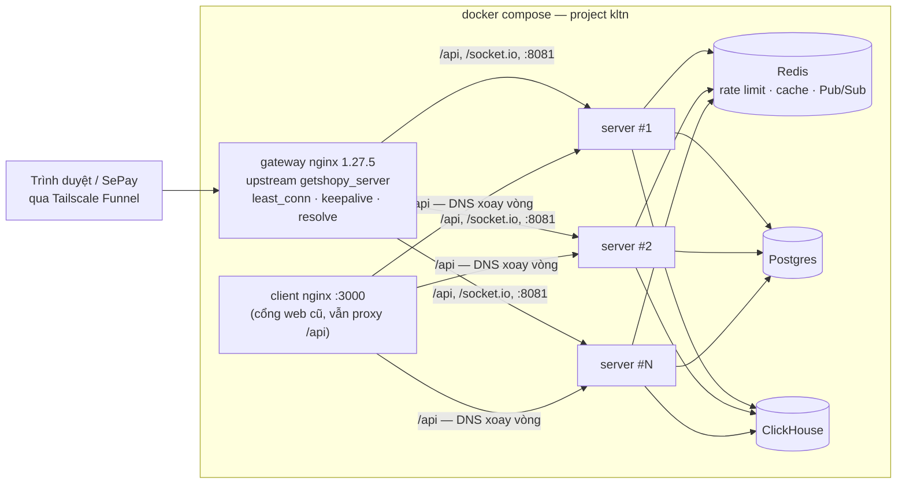

# Cân bằng tải nhiều bản server (Docker Compose + nginx)

Soạn 18/11/2026, nhánh `feat/lb-multi-server`. Khác với bản demo Kubernetes ở
`deploy/k8s-demo/` (cụm riêng, dùng chung DB production), tài liệu này mô tả **chính stack
Compose** chạy `server` thành N bản sau gateway nginx.

Mọi con số hiệu năng để `[đo]` — điền sau khi chạy `scripts/lb-demo.ps1` trên máy demo.

Xem phân bố tải **trực tiếp** (request/s, độ trễ, lỗi, CPU/RAM của từng bản) trên Grafana:
[docs/monitoring.md](monitoring.md) — Prometheus + Grafana và `scripts/grafana-demo.ps1`; log API của
mọi bản (Loki) và cảnh báo email khi một bản treo: cùng tài liệu, mục 10–11.

## 1. Kiến trúc



- Số bản: `SERVER_REPLICAS` trong `.env` (mặc định 3) → `deploy.replicas` của service `server`.
  Đổi nóng: `docker compose up -d --no-deps --scale server=2 server`.
- `server` không có `container_name` / `ports` (cả hai buộc đúng một container). Lệnh chạy tay:
  `docker compose exec server ...` (bản số 1; bản khác: `--index 2`).
- Gateway chia **theo từng request** (L7), không theo kết nối như Service của Kubernetes.
- Header `X-Served-By` (id container) bật mặc định (`SERVED_BY_HEADER=1`) để thấy bản nào trả
  lời; cổng public 8090 gỡ header này.

### Cấu hình gateway (`gateway/nginx.conf`)

| Directive | Giá trị | Vì sao |
|---|---|---|
| `server server:8080 resolve` + `zone` | — | nginx tự phân giải lại tên `server` (resolver `valid=10s`): scale lên/xuống không cần reload. `resolve` có trong nginx mã nguồn mở từ 1.27.3 [1] — compose ghim `nginx:1.27.5-alpine` |
| `least_conn` | — | gửi tới bản ít request dở dang nhất; request dài (đếm sản phẩm, AI) không xếp hàng sau nhau |
| `max_fails=3 fail_timeout=10s` | bị động | nginx mã nguồn mở không có health check chủ động |
| `keepalive 32`, `keepalive_timeout 4s` | — | dùng lại kết nối; 4 s < 5 s `keepAliveTimeout` mặc định của Node để nginx đóng trước |
| `proxy_next_upstream error timeout` | tries 3, 10 s | chỉ chuyển bản khi lỗi kết nối / timeout. **Không** `http_502/503`: Express tự trả 502/503/504 khi phụ thuộc dùng chung hỏng (ai-bot, circuit breaker ClickHouse) — thử bản khác vô ích, và mã nào ghi ở đây bị tính vào `max_fails` → loại cả N bản lành. Không `non_idempotent`: POST đã gửi không gửi lại |
| `proxy_connect_timeout 1s` | — | container vừa gỡ mà nginx còn nhớ IP thì connect treo (không bị từ chối) tới hết hạn — mặc định 60 s |
| `map $http_upgrade $connection_upgrade` | — | WebSocket qua upstream có keep-alive [2] |

`client/nginx.conf` (cổng 3000 — trước đây ngrok đưa webhook SePay vào đây) chuyển sang `proxy_pass` qua biến +
`resolver`: phân giải mỗi request, DNS Docker trả IP mọi bản, nginx xoay vòng. Trước đây tên tĩnh
chỉ phân giải lúc khởi động — scale xong là giữ IP cũ.

## 2. Trạng thái dùng chung giữa các bản

Nguyên tắc: thứ mà request sau **phụ thuộc** vào → Redis/DB; cache dẫn xuất được phép trễ → giữ
từng bản; cache mà quản trị **xoá chủ động** → giữ từng bản + xoá chéo qua bus Redis Pub/Sub
(`server/src/cluster/bus.js`, kênh `getshopy:bus`).

| Trạng thái | Ở đâu | Quyết định | Vì sao |
|---|---|---|---|
| Rate limit chung 2000/phút/IP | `index.js` `limiter` | Redis (`rate-limit-redis` [3]), khoá `rl:api:*`; Redis không sẵn sàng / lỗi / > 250 ms → đếm bộ nhớ | MemoryStore đếm riêng từng bản → hạn mức thật N × 2000. Rơi về bộ nhớ = xuống cấp có chủ đích, không treo, không 500 |
| Rate limit AI 20/phút/IP | `index.js` `aiLimiter` | như trên, `rl:ai:*` | gọi LLM tính tiền: N bản = N × ngân sách |
| OTP quên mật khẩu, cooldown, đếm sai | `routes/passwordReset.js` | giữ nguyên — đã ở Redis; Redis không sẵn sàng thì 503 | đã nhất quán |
| Đăng nhập | JWT không trạng thái | không cần làm gì | `JWT_SECRET` chung qua `.env` |
| Trạng thái khách (`is_active`) đệm 30 s | `services/customerStatusCache.js` | đệm từng bản + xoá chéo `customer-status` | quản trị vô hiệu hoá phải có hiệu lực ngay trên mọi bản |
| Số đếm / thứ hạng danh sách `_listingMem` | `routes/b2c.js` | đệm từng bản (+ Redis) + xoá chéo `listing-cache` | quản trị thêm/sửa/xoá sản phẩm |
| Bộ đệm L2 `memCache` của `cached()` | `redis.js` | xoá chéo `mem-cache` khi `invalidate()` | `cached()` đọc Redis rồi tới Map: key Redis bị xoá thì bản khác vẫn trả bản cũ trong Map tới 5 phút (chi nhánh, hãng) |
| Flash sale đệm 60 s | `routes/b2c.js`, `RecommendationService.js` | giữ từng bản | trước đây cũng không xoá khi sửa; trễ ≤ 60 s như cũ |
| KnowledgeCache (5 phút), ProductSpecsCache (10 phút), `huggingface._cache`, `hasUnaccent` | services, ai | giữ từng bản | dữ liệu dẫn xuất, không ai xoá chủ động; trễ như cũ |
| Phiên chat `aiHandlers._store`, `QUERY_CACHE` | `routes/aiHandlers.js` | không áp dụng | file không được nạp: `index.js` chuyển chat sang container `ai-bot` (một bản) |
| Upload | — | không áp dụng | `multer` có trong `package.json` nhưng không route nào dùng; ảnh là URL / MinIO |
| Buffer sự kiện hành vi (50 / 5 s) | `BehaviorService.js` | giữ từng bản, **đẩy khi tắt êm** | mỗi bản đẩy phần của mình sang ClickHouse |
| Client WebSocket | `index.js` | từng bản; `STOCK_UPDATE` (đơn, thanh toán, huỷ) qua bus `ws-broadcast` | client nối một bản; bản phát bỏ tin vọng lại của mình → mỗi client nhận đúng một lần |
| KPI WebSocket 5 s | `index.js` | từng bản gửi client của mình | đi qua bus thì client nhận N lần |
| Circuit breaker ClickHouse | `index.js` (opossum) | từng bản | mỗi bản tự đánh giá đường tới ClickHouse |
| Job đóng đơn quá hạn | `expireScheduler.js` | `pg_try_advisory_xact_lock` trong transaction | bản cũ lấy khoá cấp phiên rồi nhả bằng câu khác qua pool Prisma — có thể nhả sai kết nối, khoá kẹt [5] |
| Chuẩn bị DB lúc khởi động | `docker-entrypoint.sh` | advisory lock khởi động (`scripts/with-startup-lock.js`) | xem mục 4 |
| Idempotency webhook | `webhookService.js` | giữ nguyên — ràng buộc unique trong DB | đã an toàn đa bản |

Bus là "bắn rồi quên": bản đang mất kết nối Redis thì lỡ tin. Mỗi lần subscriber nối lại, bản đó
xoá sạch các bộ đệm trên (`onResync`); tin lỡ trong khoảng ngắn trước khi SUBSCRIBE xong thì bộ
đệm tự hết hạn theo TTL.

## 3. Tắt êm (graceful shutdown)

`server/src/lifecycle/gracefulShutdown.js`. Trước đây server không bắt tín hiệu: node là PID 1
trong container nên `docker stop` chờ 10 s rồi SIGKILL (exit 137).

Khi nhận SIGTERM/SIGINT (mốc cứng `SHUTDOWN_TIMEOUT_MS` = 8 s < `stop_grace_period: 12s`):

1. `draining`: `/api/health` → 503; mọi response kèm `Connection: close` (kể cả request tới
   trước SIGTERM) để nginx không gửi tiếp vào kết nối keep-alive tới bản này.
2. Dừng việc nền: timer KPI, job đóng đơn quá hạn (chờ lượt đang chạy).
3. `server.close()`: thôi nhận kết nối mới — nginx gặp "connection refused" thì chuyển request
   sang bản khác (kể cả POST, vì chưa gửi đi); đóng kết nối rảnh; chờ request dở dang.
   WebSocket đóng mã 1001 "Going Away" [6].
4. Quá `8 s − 2,5 s` mà còn request → cắt, để dành thời gian dọn dẹp.
5. Dọn dẹp (mỗi bước ≤ 2 s): đẩy buffer hành vi → đóng bus → Redis → Prisma → ClickHouse.
6. `exit(0)`; `exit(1)` nếu phải cắt request hoặc chạm mốc cứng.

`SHUTDOWN_DRAIN_DELAY_MS` (mặc định 0): chờ thêm trước bước 3 — dành cho Kubernetes, nơi
readiness probe cần vài giây để gỡ pod khỏi Service.

## 4. Khởi động N bản cùng lúc

- `docker-entrypoint.sh` chạy lại chính nó dưới **advisory lock của Postgres** (khoá 728312,
  `scripts/with-startup-lock.js`): migrate, ràng buộc tồn kho (DROP/CREATE TRIGGER), seed nền khi
  DB trống, `ensure-inventory`, `seed-demo` chạy **lần lượt từng bản**. Bản sau thấy DB đã có dữ
  liệu thì đi đường ngắn. Khoá cấp phiên trên **một** kết nối (`connection_limit=1`); tiến trình
  chết thì Postgres tự nhả. `STARTUP_LOCK=0` để bỏ.
- `prisma migrate deploy` tự có advisory lock riêng nên chạy đồng thời vẫn an toàn — nhưng chỉ cho
  phần migrate và chỉ chờ 10 s [4]; phần còn lại mới cần khoá khởi động.
- `healthcheck.start_period` nâng lên 180 s: bản cuối chờ các bản trước. Thời gian chuẩn bị DB
  mỗi bản: `[đo]` s.

## 5. Kết nối Postgres

Prisma mặc định mở tới `2 × số CPU + 1` kết nối mỗi tiến trình [7]. Postgres để
`max_connections` mặc định = 100 (compose không đổi), trong đó 3 dành cho superuser.

| Nguồn | Tối đa |
|---|---|
| server: `SERVER_REPLICAS × SERVER_DB_CONNECTION_LIMIT` | 3 × 10 = 30 |
| khoá khởi động | +1 mỗi bản, chỉ lúc khởi động |
| ai-bot (Prisma, chưa đặt `connection_limit`) | 2 × CPU + 1 |
| Debezium (kafka-connect), pg_dump, dbt, seed | vài kết nối, phần lớn ngắn |
| demo Kubernetes nếu đang chạy (`deploy/k8s-demo`, `connection_limit=5` mỗi pod) | `getshopy-demo` tối đa 4 pod (HPA) × 5 = 20; bước blue-green thêm 2 màu × 2 pod × 5 = 20 |

Giữ `SERVER_REPLICAS × SERVER_DB_CONNECTION_LIMIT` + phần còn lại < 97. `SERVER_DB_CONNECTION_LIMIT`
tối thiểu 2 (job đóng đơn giữ một kết nối làm khoá). Lưu ý khi so sánh: mỗi bản có pool riêng, nên
N bản = N × kết nối DB — đó là một phần của mở rộng ngang, không chỉ CPU Node.

## 6. Chạy demo

```powershell
# máy demo, thư mục repo; chạy lúc vắng khách
.\scripts\lb-demo.ps1                 # (a) phân bố 30 request, (b) k6 với N = 1, 2, 3, (c) trả về SERVER_REPLICAS
.\scripts\lb-demo.ps1 -Rate 300 -Yes  # đổi tải, không hỏi
.\scripts\lb-demo.ps1 -SkipLoad       # chỉ (a)
```

- k6 (`scripts/loadtest/k6-lb.js`, image `grafana/k6:1.8.2`, trần 2 CPU / 1 GB) chạy trong
  network của compose và gọi thẳng `http://gateway`. Chỉ endpoint đọc công khai: danh mục, danh
  sách, chi tiết sản phẩm, health — không đăng nhập, không ghi.
- Mô hình tải "mở" (constant-arrival-rate): `-Rate` request/giây cố định, 15 s khởi động + 60 s
  đo. Muốn thấy khác biệt thì `-Rate` phải vượt sức một bản (chọn bằng cách chạy `-Replicas 1`
  vài mức).
- Mỗi VU mang một IP giả trong `198.18.0.0/15` (RFC 2544, dải dành cho đo kiểm) qua
  `X-Forwarded-For` để mô phỏng nhiều khách; nếu không, mọi request chung một IP và chạm rate
  limit 2000/phút — giờ đếm chung cả cụm. `SPOOF_XFF=0` để minh hoạ rate limit chung.
- Kết quả: `scripts/loadtest/results/<thời điểm>/summary-N*.json`, `table.json`.
- Mở dashboard Grafana "Getshopy — Cân bằng tải" song song để thấy từng bước scale theo thời gian
  thực; kịch bản dựng sẵn cho việc đó (tải ổn định → scale 1..4 → 1 server chết):
  `scripts/grafana-demo.ps1` — [docs/monitoring.md](monitoring.md) §7.

| N | req/s | p95 (ms) | p99 (ms) | lỗi (%) | bỏ lượt | phân bố |
|---|---|---|---|---|---|---|
| 1 | [đo] | [đo] | [đo] | [đo] | [đo] | [đo] |
| 2 | [đo] | [đo] | [đo] | [đo] | [đo] | [đo] |
| 3 | [đo] | [đo] | [đo] | [đo] | [đo] | [đo] |

## 7. Kiểm thử

```bash
cd ktln-Getshopy/qu-n-ly-ban-l/source/server
node --test $(ls tests/*.test.js | grep -v perf)      # perf cần server đang chạy
# Redis thật (container tạm, KHÔNG phải Redis production):
docker run -d --rm --name redis-test-tam -p 127.0.0.1:26379:6379 redis:7-alpine
REDIS_TEST_URL=redis://127.0.0.1:26379 node --test tests/redis-integration.test.js
docker rm -f redis-test-tam
```

| File | Kiểm gì |
|---|---|
| `tests/clusterBus.test.js` | bus: mỗi bản xử lý đúng một lần, bỏ tin của chính mình, Redis rớt vẫn chạy cục bộ, nối lại → resync; vô hiệu hoá khách ở bản A → bản B đọc lại DB; WebSocket mỗi client đúng một lần |
| `tests/rateLimitStore.test.js` | Redis sẵn sàng / chưa sẵn sàng / lỗi / treo; hai bản đếm chung một hạn mức |
| `tests/gracefulShutdown.test.js` | request dở dang chạy xong + `Connection: close`, cổng đóng, WebSocket 1001, thứ tự dọn dẹp, mốc cứng |
| `tests/expireScheduler.test.js` | khoá cấp transaction, bỏ lượt khi bản khác giữ khoá, `stop()` chờ lượt đang chạy; URL khoá khởi động |
| `tests/redis-integration.test.js` | như trên với Redis thật (bỏ qua nếu không đặt `REDIS_TEST_URL`) |

## 8. Giới hạn đã biết

- Bus Pub/Sub không đảm bảo giao tin (xem mục 2) — đủ cho xoá cache, không dùng cho việc phải
  chắc chắn xảy ra.
- `Dashboard.jsx` không tự nối lại WebSocket: bản đang giữ kết nối tắt (scale xuống, cập nhật)
  thì KPI trực tiếp dừng tới khi tải lại trang.
- nginx đổi danh sách bản (sau lần phân giải mới) đúng lúc một request đang thử lại thì request
  đó nhận trang bảo trì — hiếm, chỉ khi scale.
- Compose không có rolling update: `docker compose up -d --build` tạo lại các bản gần như cùng
  lúc. Tắt êm giúp request dở dang không bị cắt, nhưng vẫn có khoảng không bản nào sẵn sàng —
  muốn cập nhật không gián đoạn thì xem demo Kubernetes (`deploy/k8s-demo/`).
- Cờ `isConnected()` của `redis.js` bật một lần và không tắt khi Redis rớt (có từ trước): Redis
  rớt giữa chừng thì `cached()` và cache danh sách chờ node-redis nối lại thay vì đọc DB. Rate
  limit và bus dùng `isReady` nên không bị.

## Nguồn

1. nginx — upstream `server ... resolve`, `zone`, `least_conn`, `keepalive`:
   https://nginx.org/en/docs/http/ngx_http_upstream_module.html · thay đổi 1.27.3:
   https://nginx.org/en/CHANGES
2. nginx — WebSocket proxying: https://nginx.org/en/docs/http/websocket.html
3. rate-limit-redis: https://github.com/express-rate-limit/rate-limit-redis
4. Prisma Migrate — advisory locking:
   https://www.prisma.io/docs/orm/prisma-migrate/workflows/development-and-production#advisory-locking
5. PostgreSQL — advisory locks: https://www.postgresql.org/docs/16/explicit-locking.html#ADVISORY-LOCKS
6. RFC 6455 §7.4.1 (mã đóng 1001): https://www.rfc-editor.org/rfc/rfc6455#section-7.4.1
7. Prisma — connection pool: https://www.prisma.io/docs/orm/prisma-client/setup-and-configuration/databases-connections/connection-pool
8. Redis Pub/Sub: https://redis.io/docs/latest/develop/interact/pubsub/
9. k6 — constant-arrival-rate: https://grafana.com/docs/k6/latest/using-k6/scenarios/executors/constant-arrival-rate/
10. Docker Compose — `deploy.replicas`: https://docs.docker.com/reference/compose-file/deploy/#replicas
