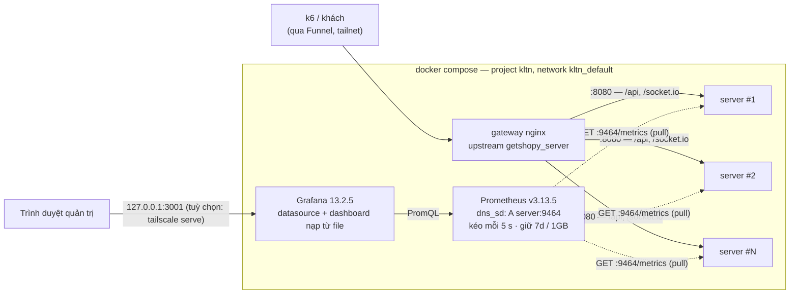
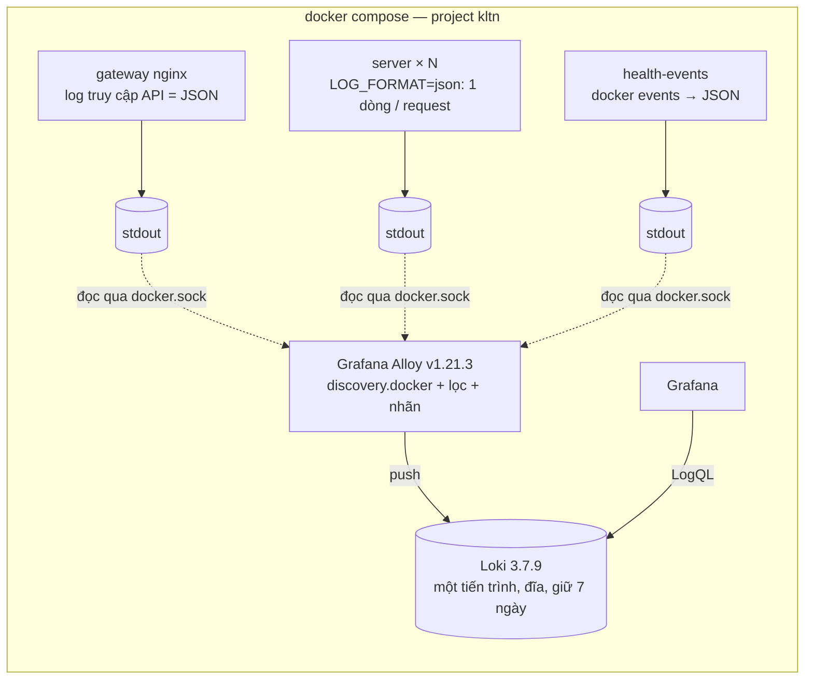

# Giám sát cân bằng tải — Prometheus + Grafana, log tập trung, cảnh báo

Soạn 19/11/2026, nhánh `feat/monitoring-grafana` (số đo, dashboard) và `feat/logging-alerts` (log
tập trung, cảnh báo email — mục 10–12). Bổ sung cho [load-balancing.md](load-balancing.md):
`lb-demo.ps1` đo một lượt k6 rồi in bảng; tài liệu này giúp **thấy** gateway chia tải cho các bản
`server` theo thời gian thực — request/s, độ trễ, lỗi, CPU/RAM của từng bản — đọc log API của cả cụm ở
một chỗ, và **nhận email** khi một bản treo hoặc web sập.

Số đo của **production** để `[đo]`. Số ghi "stack thử" là đo trên một project compose tách biệt
(`kltnmon-e2e`, `kltnlog-e2e`; bản server giả — mục 9), chỉ minh hoạ cơ chế, không phải hiệu năng thật.

## 1. Kiến trúc



- **Kéo (pull)**: Prometheus tự gọi `/metrics` của từng bản; server không cần biết Prometheus ở đâu.
- **Tự tìm bản mới**: DNS nội bộ của Docker trả MỌI IP của service cho tên `server` (cùng cơ chế
  gateway dùng để chia tải). `dns_sd_configs` kiểu `A`, hỏi lại mỗi 5 s [2] — scale 1 → 4 bản
  không phải sửa cấu hình.
- **Cổng riêng 9464**: `/metrics` không phải route của Express; gateway chỉ chuyển tới `server:8080`
  nên `/metrics` không bao giờ đi qua gateway hay Funnel (mục 5).
- **Grafana**: datasource và dashboard nạp từ file trong repo lúc khởi động (provisioning [7]) —
  dựng lại máy là có ngay, không phải bấm tay.

| File | Vai trò |
|---|---|
| `ktln-Getshopy/qu-n-ly-ban-l/source/server/src/metrics/index.js` | số đo của server (prom-client [1]) + cổng 9464 |
| `monitoring/prometheus/prometheus.yml` | job `getshopy-server` (DNS), job `prometheus` (tự đo) |
| `monitoring/grafana/provisioning/datasources/datasources.yml` | datasource `getshopy-prometheus`, `getshopy-loki` |
| `monitoring/grafana/provisioning/dashboards/getshopy.yml` | nạp mọi JSON trong `monitoring/grafana/dashboards/` |
| `monitoring/grafana/dashboards/getshopy-load-balancing.json` | dashboard "Getshopy — Cân bằng tải" |
| `scripts/grafana-demo.ps1` | demo trực tiếp (mục 7) |
| `ktln-Getshopy/qu-n-ly-ban-l/source/server/src/middleware/requestLog.js` | một dòng JSON / request (mục 10) |
| `gateway/nginx.conf` (`log_format getshopy_api`) | log truy cập API dạng JSON (mục 10) |
| `monitoring/loki/loki.yml`, `monitoring/alloy/config.alloy`, `monitoring/health-events/events.sh` | log tập trung (mục 10) |
| `monitoring/blackbox/blackbox.yml` + job `blackbox-*` trong `prometheus.yml` | thăm dò HTTP cho cảnh báo (mục 11) |
| `monitoring/grafana/provisioning/alerting/` | luật, nơi nhận, chính sách, mẫu email (mục 11) |

## 2. Số đo server xuất ra

| Số đo | Loại | Nhãn | Ý nghĩa |
|---|---|---|---|
| `http_requests_total` | counter | `method`, `route`, `status_code` | số request đã trả lời |
| `http_request_duration_seconds` | histogram | như trên | thời gian từ lúc request vào Express tới lúc gửi xong response |
| `getshopy_server_info` | gauge = 1 | `hostname` | tên bản = header `X-Served-By` = id ngắn của container |
| `process_cpu_seconds_total`, `process_resident_memory_bytes`, `nodejs_heap_size_used_bytes`, `nodejs_eventloop_lag_p99_seconds`, `nodejs_gc_duration_seconds`, ... | mặc định của prom-client (`collectDefaultMetrics`) | — | CPU, RAM, heap, độ trễ event loop, GC của tiến trình Node |

Prometheus tự gắn thêm `job` và `instance` (= `ip:9464`, phân biệt từng bản). Dashboard nối
`instance` với `getshopy_server_info` để hiện **cùng tên** như `lb-demo.ps1` (`X-Served-By`).

**Nhãn `route` — giữ số chuỗi (cardinality) nhỏ.** Mỗi tổ hợp nhãn là một chuỗi thời gian riêng [5],
nên nhãn không bao giờ chứa URL thật, id, query string hay dữ liệu người dùng:

- `route` = **mẫu** route của Express: `/api/b2c/products/123?q=...` → `/api/b2c/products/:id`.
  Lấy đúng lúc router khớp route (kể cả khi handler async ném lỗi và Express trả 500 sau khi rời
  router con).
- Không khớp route nào → `unmatched`: 404, hoặc middleware trả lời trước (429 rate limit, preflight CORS).
- Lưới an toàn: quá 300 mẫu khác nhau thì gộp vào `other` (code hiện có ~100 route; chỉ xảy ra nếu
  sau này ai đó mount router ở đường dẫn có tham số).

**Bucket độ trễ** (giây): 0,005 · 0,01 · 0,025 · 0,05 · 0,1 · 0,25 · 0,5 · 0,75 · 1 · 2,5 · 5 · 10 · 30.
Dày quanh 0,1–1 s (ngưỡng p95 mặc định của `k6-lb.js` là 1 s). p95/p99 trên dashboard là
`histogram_quantile` — nội suy tuyến tính **trong** bucket, nên chỉ chính xác tới độ rộng bucket [4].

**Bật/tắt**: `METRICS_ENABLED` — trong code mặc định TẮT (chỉ bật khi đúng `"1"`, như
`SERVED_BY_HEADER`), compose đặt `${METRICS_ENABLED:-1}`. Chạy tay (`npm run dev`) hay demo
Kubernetes không đặt biến thì không mở thêm cổng nào. `METRICS_PORT` cố định 9464 trong compose
(ghi cứng cả trong `prometheus.yml`).

Lưu ý khi đọc: healthcheck của Docker gọi `/api/health` **ngay trong container** mỗi 10 s
(interval trong compose), không qua gateway — lúc không có tải mỗi bản vẫn có 0,1 request/s.

## 3. Dashboard "Getshopy — Cân bằng tải"

Mặc định: 15 phút gần nhất, tự làm mới 5 s. Mọi `rate()` dùng `$__rate_interval`; datasource khai
`timeInterval: 5s` (= chu kỳ kéo) nên Grafana tính cửa sổ = max(`$__interval` + 5 s, 4 × 5 s) [8] —
tức tối thiểu 20 s: đường request/s là trung bình trượt 20 s, phản ứng trễ cỡ đó.

| Hàng | Panel | Cho thấy | Đọc thế nào khi chạy k6 |
|---|---|---|---|
| Tổng quan | Bản server đang chạy | `sum(up)` của job server, giá trị hiện tại (không giữ số cũ khi rỗng) | đổi khi scale / một bản chết |
| | Tổng request/s | tổng mọi bản | ~ `RATE` của k6 (cộng 0,1 req/s healthcheck mỗi bản) |
| | p95 toàn cụm | histogram mọi bản | tăng vọt khi quá tải |
| | Tỷ lệ lỗi 5xx | 5xx / tổng | lỗi do **server** trả; lỗi gateway tự sinh (không bản nào trả lời) không có ở đây — xem k6 |
| | Độ lệch tải giữa các bản | độ lệch chuẩn / trung bình request/s giữa các bản (CV) | 0 % = chia đều tuyệt đối; chỉ tính khi tổng > 1 req/s (trên mức healthcheck) và ≥ 2 bản, không thì hiện "không tải"; ngưỡng màu chỉ để dễ nhìn |
| Phân bố tải | Request/s mỗi bản | một đường mỗi bản + "Tổng" nét đứt | chia đều → các đường sát nhau ở ~ RATE/N |
| | Tỷ trọng lưu lượng mỗi bản (%) | xếp chồng = 100 % | mỗi dải ~ 100/N %; scale thêm → dải mới, dải cũ mỏng lại; chỉ vẽ khi tổng > 1 req/s |
| Độ trễ và lỗi | Độ trễ p95 / p99 mỗi bản | theo bản, đo **trong** server | một bản cao hơn hẳn → bản đó chậm (CPU, GC); thêm bản → hạ xuống. **Không** gồm thời gian xếp hàng trước khi Express nhận request (gateway, hàng đợi kết nối của bản đang bão hoà) — độ trễ khách thấy là số của k6 |
| | Lỗi 5xx mỗi bản | 0 khi không lỗi | lỗi ở một bản: nghi bản đó; ở mọi bản: phụ thuộc dùng chung (Postgres, ClickHouse, ai-bot) |
| Các bản server | Danh sách bản server | hostname, instance, up, request/s, tỷ trọng, p95, CPU, RAM | ảnh chụp hiện tại để đọc số |
| Tài nguyên mỗi bản | CPU mỗi bản | `rate(process_cpu_seconds_total)`, 100 % = một nhân | JavaScript chạy trên một luồng [13]: chạm ~100 % là bản đó bão hoà dù máy còn nhân rảnh |
| | RAM (RSS) mỗi bản | `process_resident_memory_bytes` | rò bộ nhớ → đường đi lên mãi |
| | Độ trễ event loop p99 mỗi bản | `nodejs_eventloop_lag_p99_seconds` | p99 giữa hai lần kéo (`monitorEventLoopDelay`, độ phân giải 10 ms [13]) — lúc rảnh ~10 ms là độ phân giải đo, không phải trễ thật (stack thử: 10,4 ms); cao = luồng JS bận, mọi request của bản đó phải chờ |
| Theo route | Top 10 route theo request/s | mẫu route | khớp với mix của `k6-lb.js` (danh mục, danh sách, chi tiết, health) |
| | Request/s theo mã trạng thái | tổng mọi bản | 429 = chạm rate limit (đếm chung cả cụm trong Redis) |

Thêm 19/11/2026 (log, cảnh báo — mục 10, 11):

| Hàng | Panel | Cho thấy | Đọc thế nào |
|---|---|---|---|
| Cảnh báo và sự kiện container | Cảnh báo đang bật | luật đang Pending / Firing | trống = bình thường; "Server treo" kèm tên bản |
| | Sự kiện container theo loại | số sự kiện Docker / phút (Loki) | chết rồi tự lên = die + start + healthy; treo = không có gì (tới khi unhealthy: retries 12 ≈ 3 phút) |
| | Dòng sự kiện container | từng sự kiện health-events | exit_code khi die (137 = SIGKILL), signal khi kill |
| Độ trễ và lỗi | Độ trễ phía gateway p95 (từ log) | `request_time` của nginx theo bản đã trả lời | gồm xếp hàng / thử lại — độ trễ khách thấy; khác p95 của server |
| | Request/s qua gateway theo nhóm mã (từ log) | mọi request API qua gateway | 5xx ở đây gồm cả trang bảo trì 503 do gateway tự trả |
| Log API (Loki) | Log truy cập API — gateway / Log request — server | từng dòng log, mới nhất trên cùng | lọc theo biến **Bản** ở đầu trang |

Biến **Bản** (đầu trang) lọc các panel log theo hostname. Vạch cam trên các biểu đồ: annotation "Số bản
server thay đổi" (số bản `up` khác 5 s trước); vạch đỏ: "Container chết" (sự kiện die / oom từ
health-events). Tắt bằng nút gạt ở góc trên.

**Bản bão hoà thì số đo cũng chậm**: `/metrics` chạy trên cùng event loop với app. Stack thử: lúc
một bản giả gánh 100 req/s, lượt kéo `/metrics` mất tới 2,3 s (bình thường ~2 ms). Quá
`scrape_timeout` 4 s thì Prometheus ghi `up = 0` cho lượt đó dù bản vẫn chạy — khi "Bản server đang
chạy" chập chờn lúc tải nặng, nhìn thêm CPU và độ trễ event loop của bản đó.

Trên stack thử, từ lúc container mới chạy tới mẫu số đo đầu tiên mất ~9,5 s (2 lần đo: 9,5 s và
9,6 s) — thời gian node khởi động + ≤ 5 s chờ lượt hỏi DNS + ≤ 5 s chờ lượt kéo. Production: `[đo]`.

Sửa dashboard: sửa file JSON (Grafana đọc lại sau 30 s). Sửa trên giao diện thì không lưu được
(`allowUiUpdates: false`) — muốn giữ: *Export → JSON* rồi chép đè file trong repo.

## 4. Mở Grafana

```powershell
# lần đầu: đặt GRAFANA_ADMIN_PASSWORD trong .env TRƯỚC (mục 5), rồi
docker compose up -d prometheus grafana
```

Mở <http://localhost:3001> (chỉ trên chính máy chạy Docker), đăng nhập `admin` — trang chủ là
dashboard cân bằng tải. Grafana khởi động mất `[đo]` s (stack thử: ~23 s lần đầu — phần lớn là tạo
DB nội bộ; ~6 s các lần sau).

**Xem từ máy khác trong tailnet** (tuỳ chọn, CHƯA thử trên máy demo):

```powershell
tailscale serve --bg --https=3001 http://127.0.0.1:3001     # chỉ thiết bị trong tailnet
tailscale serve status                                     # 3001 KHÔNG được có "(Funnel on)"
tailscale serve --https=3001 off                           # gỡ
```

**KHÔNG** dùng `tailscale funnel` cho cổng này: Funnel đưa ra cả Internet [14].

## 5. Bảo mật

- **Cổng số đo 9464 chỉ trong network Docker**: compose chỉ `expose`, không publish. App Express
  không có route `/metrics` (kiểm bằng unit test), gateway chỉ chuyển tới `server:8080`. Thử trên
  stack thử với `gateway/nginx.conf` thật: `/api/metrics` → 404 (server), cổng 8081 `/metrics` → 404
  (server), cổng public 8090 `/api/metrics` → 404 (nginx).
- `/metrics` và API của Prometheus **không có xác thực**: mọi container trong `kltn_default` đọc
  được. Nội dung chỉ là số đếm theo mẫu route — không có dữ liệu người dùng — nhưng lộ danh sách
  route và mức tải. Không thêm cổng publish cho hai thứ này.
- Prometheus không bật `--web.enable-lifecycle`: không container nào tắt / nạp lại Prometheus qua
  HTTP được. Nạp lại cấu hình: `docker compose kill -s SIGHUP prometheus` [6].
- **Grafana chỉ nghe 127.0.0.1**; tắt truy cập ẩn danh và tự đăng ký; không gọi ra Internet (tắt
  báo số liệu sử dụng, kiểm tra bản mới, tin tức, tự cài plugin lúc khởi động).
- **Mật khẩu admin**: `GRAFANA_ADMIN_PASSWORD` trong `.env` (sinh: `openssl rand -base64 24`).
  - Grafana chỉ đọc biến này khi **tạo tài khoản admin lần đầu** (volume `grafana_data` trống) [9].
    Đặt sau lần đầu thì không có tác dụng — đổi bằng:
    `docker compose exec grafana grafana cli admin reset-admin-password <mật-khẩu-mới>`.
  - Cố ý không dùng `${VAR:?}`: CD chạy `docker compose config/up` với `.env` production, biến bắt
    buộc mà thiếu là hỏng **mọi** lần deploy. Thiếu biến → `admin` (mặc định của Grafana; lần đăng
    nhập đầu Grafana hiện màn hình "Update your password" [10] — nhưng có nút **Skip**, đã thử trên
    13.2.5) — chỉ tạm chấp nhận vì cổng nằm trên loopback. Đặt biến trước lần khởi động đầu.
  - `server` dùng `env_file: .env` nên mọi biến trong `.env` (kể cả mật khẩu này, như các bí mật
    khác đã có) cũng nằm trong môi trường container server.
- Bí mật không vào repo: `.env.example` chỉ có tên biến, giá trị để trống.
- **docker.sock** (19/11/2026): Alloy và health-events gắn `/var/run/docker.sock:ro` — `:ro` KHÔNG làm API
  thành chỉ đọc: tiến trình có socket coi như root trên máy ảo Docker (như dbt-scheduler đã có). Hai
  image ghim phiên bản, health-events chỉ chạy `docker events`. Siết hơn: đặt một socket proxy chỉ mở
  API đọc (containers, events) — chưa làm.
- **Log chứa dữ liệu cá nhân**: `xff` / `remote_addr` trong log gateway là IP khách. Chỉ nằm trong nội
  dung dòng (không làm nhãn), Loki xoá sau 7 ngày, chỉ xem được qua Grafana (loopback). Không ghi query
  string, header, body, cookie, token.
- **Loki, blackbox** không xác thực, không publish cổng — như Prometheus.
- **SMTP**: Grafana nhận `SMTP_PASS` qua biến `GF_SMTP_PASSWORD` (đã có trong môi trường container
  server từ trước, qua `env_file`). Email cảnh báo chứa tên bản (id container) và IP nội bộ Docker.

## 6. Chi phí tài nguyên và lưu trữ

| | Trần (compose) | Production | Stack thử (3–4 bản giả, vài route) |
|---|---|---|---|
| Prometheus RAM | `mem_limit` 512m (`PROMETHEUS_MEM_LIMIT`) | `[đo]` | ~100 MiB (`docker stats`) |
| Grafana RAM | `mem_limit` 512m (`GRAFANA_MEM_LIMIT`) | `[đo]` | ~180 MiB |
| Số chuỗi (`prometheus_tsdb_head_series`) | — | `[đo]` | 1 630 (sau ~9 phút; 7 container server đã qua + chính Prometheus) |
| Mẫu mỗi lượt kéo một bản (`scrape_samples_scraped`) | — | `[đo]` | 153 (4 route) |
| Thời gian một lượt kéo (`scrape_duration_seconds`) | timeout 4 s | `[đo]` | trung vị ~2–2,4 ms; tới 2,3 s khi bản giả bão hoà CPU |
| Dung lượng TSDB | 1GB (`PROMETHEUS_RETENTION_SIZE`) | `[đo]` | 504 KB sau ~9 phút |

- Thêm 19/11/2026 (trần trong compose / đo trên stack thử `kltnlog-e2e`, vài phút, 3 bản giả):
  Loki 512m / ~97 MiB, Alloy 256m / ~61 MiB, blackbox 64m / ~19 MiB, health-events 64m / ~7 MiB;
  Grafana (bật lại datasource Loki + cảnh báo) ~230 MiB. Production: `[đo]`. Log: một dòng gateway
  ~350 byte, một dòng server ~170 byte; dung lượng / ngày = số request API × ~0,5 KB trước nén — `[đo]`.
- Grafana 13 chạy mỗi datasource đóng gói sẵn thành một tiến trình riêng (đo trên stack thử: 13 tiến
  trình, ~22–32 MB RSS mỗi cái). Compose tắt 12 cái không dùng (`GF_PLUGINS_DISABLE_PLUGINS`), chỉ
  giữ Prometheus (19/11/2026 bật lại Loki) — RAM Grafana trên stack thử từ ~410–420 MiB (gần chạm
  trần 512m) xuống ~180 MiB (chỉ Prometheus).
- Mỗi bản server: `/metrics` chỉ được gọi mỗi 5 s; middleware đo mỗi request là một bộ đếm + một
  histogram trong bộ nhớ. Chi phí CPU thêm: `[đo]` (so `lb-demo.ps1` trước/sau).
- **Lưu trữ**: giữ theo thời gian **và** dung lượng — `PROMETHEUS_RETENTION_TIME` (mặc định 7d),
  `PROMETHEUS_RETENTION_SIZE` (mặc định 1GB); chạm mức nào trước thì xoá block cũ trước [3]. Trần
  dung lượng là bắt buộc vì ổ D: từng đầy làm sập production (15/11). Ước lượng: Prometheus dùng
  trung bình ~1–2 byte/mẫu [3]; kéo mỗi 5 s → 17 280 mẫu/chuỗi/ngày → dung lượng/ngày ≈ số chuỗi ×
  17 280 × 1–2 byte. Số chuỗi thật của production: `[đo]`.

## 7. Kịch bản demo trực tiếp

`scripts/grafana-demo.ps1` (PowerShell 5.1) tạo tải và thay đổi số bản trong lúc bạn nhìn Grafana.
k6 (`grafana/k6:1.8.2`, trần 2 CPU / 1 GB) chạy trong network compose, chỉ gọi `http://gateway`,
chỉ endpoint ĐỌC công khai (danh mục, danh sách, chi tiết sản phẩm, health) — dùng lại
`scripts/loadtest/k6-lb.js` với `PROFILE=live` (tăng dần 0 → `-Rate` trong `-RampSec`, rồi giữ).

```powershell
# mở http://localhost:3001 trước; máy demo, thư mục repo; chạy lúc vắng khách
.\scripts\grafana-demo.ps1                          # steady -> scale -> 1 server chết, hỏi xác nhận
.\scripts\grafana-demo.ps1 -Scenario scale -Yes      # một kịch bản, không hỏi
.\scripts\grafana-demo.ps1 -Rate 300 -Minutes 2 -StepSec 60
.\scripts\grafana-demo.ps1 -DryRun                   # chỉ in lệnh docker / k6
```

- Script chỉ đụng service `server` (`--no-deps --no-recreate`: chỉ thêm/bớt container, không tạo
  lại bản đang chạy), không bao giờ postgres / clickhouse / redis. Mọi lệnh compose chạy với
  `SERVER_DB_PREP=off` như CD — bản tạo thêm lúc scale chỉ chạy node, không chạy script DB.
- Số bản **luôn** được trả về như lúc bắt đầu (`finally`, kể cả lỗi / Ctrl+C); container k6 dở dang
  bị gỡ. Trước mỗi kịch bản script in URL Grafana và panel cần nhìn; cuối cùng in dòng thời gian
  (giờ, T+ giây tính từ lúc k6 của kịch bản bắt đầu) để đối chiếu với biểu đồ.
- Tải chạy trên Postgres/Redis **thật**; lúc 1 bản thì một bản gánh cả khách thật.

| Kịch bản | Script làm gì | Nhìn panel nào | Hình mong đợi | Production |
|---|---|---|---|---|
| `steady` | tăng dần rồi giữ `-Rate` (mặc định 150 req/s) trong `-Minutes` (3) | Request/s mỗi bản, Tỷ trọng, Độ lệch tải | các đường sát nhau ở ~ Rate/N; mỗi dải ~ 100/N % | 19/11 02:23: 29.249 request, p95 5,1 ms, 0 lỗi (results.md §21.2) |
| `scale` | về 1 bản, rồi mỗi `-StepSec` (60 s) scale 2 → 3 → 4 trong lúc tải không đổi | Bản đang chạy, Request/s mỗi bản, Tỷ trọng, p95, CPU | mỗi bước thêm một đường; các đường cũ hạ xuống Rate/N; p95, CPU hạ nếu Rate vượt sức 1 bản | 37.872 request, 0 lỗi, 378 lượt bỏ lúc còn 1 bản; bản mới healthy sau 7–8 s (§21.2) |
| `failover` | giết một bản (dưới đây) | Request/s mỗi bản, Bản đang chạy, Lỗi 5xx, Theo mã trạng thái | đường bản chết đứt, các bản còn lại tăng lên; bản đó quay lại cùng tên | 2 lần: vắng mặt 6,1 s và 5,4 s, 0 response lỗi (§21.2) |
| `hang` (không nằm trong `all`) | SIGSTOP một bản (treo), chờ cảnh báo "Server treo" Firing, rồi `docker restart` như người trực | Cảnh báo đang bật, Request/s mỗi bản, Độ trễ phía gateway, Dòng sự kiện container | Pending → Firing sau ~1 phút, email; restart → healthy → cảnh báo hết | Firing sau 70 s, email sau 99 s, 8 response lỗi (§21.5) |

`scale` chủ động xuống 1 bản nên script tạo **silence** cho "Thiếu server" trong lúc chạy (gỡ ở
`finally`) nếu có mật khẩu Grafana; `hang` bắt buộc có mật khẩu (hỏi API cảnh báo). Mật khẩu lấy
theo thứ tự: `-GrafanaCredential`; `-GrafanaPasswordFile` (để trống = file
`%LOCALAPPDATA%\getshopy-monitoring\grafana-admin.txt` nếu có — dòng `password: ...` hoặc một dòng chỉ
có mật khẩu); hỏi lúc chạy (`Read-Host -AsSecureString`). Script không đọc `.env`, không in mật khẩu.
`hang` cũng kiểm `DB_PREP=off` như `failover` và gửi SIGCONT ở `finally` nếu bị dừng giữa chừng.

`-Yes` = chạy không người trông: script **không bao giờ dừng chờ nhập** — thiếu mật khẩu thì `hang`
dừng ngay với lỗi, `scale` bỏ qua silence; bản thiếu `DB_PREP=off` thì mặc định không đụng. (Lượt chạy
nền `-Scenario hang -Yes` đêm 19/11/2026 kẹt ở bước hỏi mật khẩu từ 03:24 tới sáng vì bản cũ vẫn hỏi
khi có `-Yes`.)

Stack thử (`-Rate 100 -Minutes 1 -RampSec 10 -StepSec 30`, mỗi bản giả trần 0,25 CPU — chỉ minh hoạ
cơ chế):

- `steady`, 3 bản: 33,4 / 33,5 / 33,7 req/s mỗi bản, tỷ trọng 33,2 / 33,3 / 33,5 %, độ lệch (CV) 0,3 %;
  k6: 6 500 request, p95 52 ms, 0 response lỗi.
- `scale`: 1 bản giả không gánh nổi 100 req/s — k6 cả lượt: p95 ~13 s, 53 response khác 200, 2 467
  lượt bỏ (k6 thoát mã 99 = threshold không đạt, vẫn là số đo hợp lệ). Lúc đó panel CPU của bản đó
  chạm trần 25 %, độ trễ event loop p99 ~1,4 s, nhưng panel p95 của server chỉ ~89 ms: thời gian
  xếp hàng trước khi Express nhận request không nằm trong số đo của server (mục 3). Mỗi lần scale,
  đường mới xuất hiện sau ~9,5 s.
- `failover`: xem bảng dưới.

### Kịch bản 1 server chết

Mục tiêu: cho thấy một bản **chết bất thường** thì **tự quay lại**, chỉ nhờ restart policy của
Docker (`restart: unless-stopped` của service `server`) — không cần Swarm / Kubernetes.

**Cách giết**: lấy PID của tiến trình chính trong container (`docker inspect -f '{{.State.Pid}}'`,
PID trong namespace của máy ảo Docker) rồi gửi `kill -9` từ một container dùng một lần:

```powershell
docker run --rm --privileged --pid=host alpine:3.20 kill -9 <pid>
```

Như OOM killer / crash thật: Docker thấy container thoát bất thường (mã 137) và khởi động lại nó
(cùng container, cùng tên = cùng đường trên Grafana). Container trợ giúp có toàn quyền trên máy ảo
Docker (`--privileged --pid=host`) — script chỉ chạy đúng lệnh `kill` trên PID vừa đọc rồi xoá nó.

**Vì sao không dùng `docker kill` / `docker stop`**: Docker coi đó là dừng **tay** và bỏ qua restart
policy [11] — bản đó không tự quay lại, demo sai mục đích. Thử 19/11/2026 (Docker 28.4.0, container
`alpine` có `--restart unless-stopped`): `docker kill` → `exited`, RestartCount 0 sau 6 s;
`kill -9` PID qua `--pid=host` → `running`, RestartCount 1, FinishedAt → StartedAt ~35 ms.

**An toàn**: chỉ chọn MỘT bản `server` (bản đầu tiên theo id) và đọc biến `DB_PREP` của nó (không in
biến khác — có bí mật). Container do CD tạo luôn có `DB_PREP=off`: khởi động lại **không chạy script
DB nào** (`docker-entrypoint.sh`), chỉ chạy lại node. Thiếu `DB_PREP=off` → script cảnh báo và hỏi
lại; với `-Yes` thì không hỏi mà bỏ qua kịch bản (mặc định an toàn). Còn < 2 bản thì scale lên 2
trước để có bản gánh tải.

**Script đo và in**: lúc kill; lúc Docker khởi động lại (RestartCount tăng; thêm FinishedAt →
StartedAt theo đồng hồ Docker); lúc healthy lại; **thời gian bản đó vắng mặt** (kill → healthy, như
"downtime" một pod của Kubernetes); số response khác 200 của k6 trước / sau lúc kill (k6 tách bằng
`MARK_AT`; mốc lệch ~1 s vì k6 khởi động sau lệnh docker). Quá `-RecoverTimeoutSec` (120 s) mà
chưa healthy → `docker compose up -d --no-deps --no-recreate --scale server=N server` và báo rõ là
tự khởi động lại **không** thành công.

Cách đọc: "healthy" chỉ được đánh dấu ở lượt healthcheck kế tiếp (interval 10 s) nên thời gian vắng
mặt gồm cả phần chờ lượt kiểm tra. Gateway không xét health của Docker: nó gửi lại cho bản đó khi bản
trả lời được **và** hết thời gian tạm loại sau lỗi (`max_fails=3 fail_timeout=10s`,
`gateway/nginx.conf`). Gateway chuyển request sang bản khác khi **lỗi kết nối / timeout**
(`proxy_next_upstream error timeout`): GET đang dở trên bản chết được gửi lại bản khác, nên thường
còn ít hoặc không lỗi; POST dở dang **không** gửi lại (tránh đặt hàng hai lần).

| | Production | Stack thử |
|---|---|---|
| Docker khởi động lại sau (FinishedAt → StartedAt) | 0,05 s và 0,04 s (19/11 02:32 và 03:21) | 0,04 s và 0,08 s (2 lần chạy) |
| Bản đó vắng mặt (kill → healthy) | 6,1 s và 5,4 s | 6,2 s và 6,6 s |
| Prometheus | `[đo]` | lỡ 1 lượt kéo (`up = 0` một mẫu), đường của bản đó đứt ~10 s |
| Gateway gửi lại cho bản đó | `[đo]` | ~10 s sau lúc kill (= `fail_timeout`) |
| k6 response khác 200 sau lúc kill | 0 cả 2 lần (trước lúc kill: 0) | 0 cả 2 lần (trước lúc kill: 0) |

**Giới hạn — server TREO thì KHÔNG tự khởi động lại.** Restart policy chỉ phản ứng khi tiến trình
**thoát** [11]. Server còn sống nhưng không trả lời (vòng lặp vô hạn, deadlock) thì healthcheck chỉ
đánh dấu `unhealthy` [12] — Docker thường (không Swarm) không làm gì thêm. Gateway cũng không đọc
health của Docker: nginx mã nguồn mở chỉ tạm loại một bản **sau khi** gặp lỗi / timeout (`max_fails`,
kiểm tra bị động), trong lúc đó request gửi tới bản treo phải chờ tới timeout. Trường hợp này cần một
trình "autoheal" theo dõi trạng thái health, hoặc Swarm / Kubernetes (liveness probe) — **ngoài phạm
vi** hiện tại.

## 8. Vận hành

| Việc | Lệnh |
|---|---|
| Bật lần đầu / sau khi đổi image, compose | `docker compose up -d prometheus grafana` |
| Nạp lại `prometheus.yml` | `docker compose kill -s SIGHUP prometheus` |
| Xem target Prometheus thấy | `docker compose exec prometheus wget -qO- http://localhost:9090/api/v1/targets` |
| Dừng giám sát | `docker compose stop prometheus grafana` (không có profile: `docker compose up -d` lần sau bật lại) |
| Xoá dữ liệu số đo | `docker compose rm -sf prometheus` rồi `docker volume rm kltn_prometheus_data` |
| Tắt số đo của server | `METRICS_ENABLED=0` trong `.env`, có hiệu lực khi các bản server được tạo lại (lần deploy sau) |
| Bật log tập trung, cảnh báo (lần đầu / sau khi đổi file trong `monitoring/`) | `docker compose up -d blackbox loki alloy health-events` rồi `docker compose up -d --force-recreate prometheus grafana` |
| Áp `gateway/nginx.conf` mới (log JSON) | `docker compose up -d --force-recreate gateway` (file mount đơn lẻ không tự cập nhật) |
| Thử gửi email cảnh báo | Grafana > Alerting > Contact points > `getshopy-email` > Test |
| Tạm tắt email khi bảo trì có chủ đích | Grafana > Alerting > Silences (hoặc `grafana-demo.ps1` tự làm khi scale) |
| Đổi `SERVER_REPLICAS` | sửa số 3 của luật "Thiếu server" trong `monitoring/grafana/provisioning/alerting/rules.yml`, rồi `docker compose restart grafana` |
| Xem log khi Grafana chết | `docker compose logs --tail 100 server gateway` (vẫn như cũ) |

- CD (`deploy/cd/pull-deploy.ps1`) chỉ tạo lại 4 service ứng dụng: bản server mới tự có số đo,
  nhưng Prometheus / Grafana không bao giờ do CD bật. Đổi file trong `monitoring/` → `deploy.log` ghi
  cảnh báo kèm lệnh chạy tay. Trước khi bản server có số đo được deploy, target Prometheus báo
  `down` (cổng 9464 chưa mở) — bình thường.
- Prometheus mất bản nào đó → bản đó biến khỏi DNS, Prometheus đánh dấu chuỗi của nó là cũ (stale);
  đường trên Grafana dừng lại thay vì kéo dài.

## 9. Kiểm thử

```bash
cd ktln-Getshopy/qu-n-ly-ban-l/source/server
node --test tests/metrics.test.js tests/requestLog.test.js   # 13 + 10 test
node --test $(ls tests/*.test.js | grep -v perf)      # cả bộ (19/11/2026: 138 test, 136 đạt, 2 bỏ qua vì không có REDIS_TEST_URL)
```

```powershell
# thư mục gốc repo: kiểm cú pháp prometheus.yml bằng promtool của đúng image đã ghim
docker run --rm --entrypoint promtool -v "${PWD}\monitoring\prometheus:/cfg:ro" prom/prometheus:v3.13.5 check config /cfg/prometheus.yml
docker run --rm -v "${PWD}\monitoring\loki:/etc/loki:ro" grafana/loki:3.7.9 -config.file=/etc/loki/loki.yml -verify-config
docker run --rm -e COMPOSE_PROJECT=kltn -v "${PWD}\monitoring\alloy:/etc/alloy:ro" grafana/alloy:v1.21.3 validate /etc/alloy/config.alloy
docker run --rm -v "${PWD}\monitoring\blackbox:/etc/bb:ro" prom/blackbox-exporter:v0.29.1 --config.file=/etc/bb/blackbox.yml --config.check
# nginx -t với cấu hình thật (gateway cần network có DNS nội bộ của Docker):
docker network create nginx-thu
docker run --rm --network nginx-thu -v "${PWD}\gateway\nginx.conf:/etc/nginx/conf.d/default.conf:ro" -v "${PWD}\gateway\maintenance.html:/usr/share/nginx/maintenance/maintenance.html:ro" nginx:1.27.5-alpine nginx -t
docker network rm nginx-thu
```

Cấu hình Grafana (provisioning) không có lệnh kiểm riêng: lỗi đọc file làm Grafana không khởi động —
chạy thử trên stack tách biệt (dưới đây) trước khi đưa lên production.

`tests/requestLog.test.js`: `LOG_FORMAT` khác `json` → morgan như cũ; một dòng JSON / request với mẫu
route, không query; KHÔNG ghi header / cookie / token / body; `unmatched` + path không query, cắt 200
ký tự; `probe` docker / blackbox; handler async ném lỗi vẫn đúng route; khách bỏ dở → `aborted`, đúng
một dòng; chạy chung middleware số đo; hostname = `POD_NAME`.

`tests/metrics.test.js`: mặc định tắt; nhãn route là mẫu (id, query không lọt vào nhãn); `unmatched`
cho 404 / 429; handler async ném lỗi vẫn mang mẫu đầy đủ; histogram cùng nhãn; trần `other`; `/metrics`
trên cổng riêng có số đo HTTP + mặc định + `getshopy_server_info`; app chính KHÔNG có `/metrics`;
hostname trùng `X-Served-By`; `stop()` không chờ keep-alive; cổng bận không làm server dừng.

**Stack thử end-to-end** (19/11/2026, không build image ứng dụng, không đụng production): project
`kltnmon-e2e` dùng **chính** `docker-compose.yml` (Prometheus, Grafana, gateway với `nginx.conf` thật)
cộng một file ghi đè thay `server` bằng `node:20-alpine` chạy module `src/metrics` của repo (3 bản,
trần 0,25 CPU, giả lập 4–8 ms CPU mỗi request).

- Prometheus tìm đủ 3 bản qua DNS (`__meta_dns_name=server`), mọi target `up`; mọi biểu thức PromQL
  của dashboard (22 truy vấn + annotation) chạy qua proxy datasource của Grafana không lỗi.
- Grafana nạp datasource (health: "Successfully queried the Prometheus API") và dashboard (thư mục
  Getshopy, trang chủ = dashboard); không đăng nhập → 401; mật khẩu sai → 401.
- Qua gateway thật: `/api/metrics` → 404, `:8081/metrics` → 404, `:8090/api/metrics` → 404; trong
  network `server:9464/metrics` → 200 với `getshopy_server_info{hostname="<id container>"} 1`.
- `grafana-demo.ps1` chạy đủ 3 kịch bản (số ở mục 7) và trả về 3 bản; đường lỗi (image k6 không tồn
  tại) vẫn trả về 3 bản. Ctrl+C dùng cùng khối `finally` (chưa thử bấm Ctrl+C thật).

## 10. Log tập trung (Loki + Alloy)

Bổ sung 19/11/2026, nhánh `feat/logging-alerts`. Chỉ gom **hai loại** log: log API (gateway + server)
và sự kiện sức khoẻ container. Log khác (console.log của server, error log dạng chữ của nginx) không
đẩy về — vẫn xem được bằng `docker compose logs`.



| Nguồn (nhãn `service`) | Một dòng chứa | File |
|---|---|---|
| `gateway` | `time, method, path` (KHÔNG query string), `status, bytes, request_time` (giây, ở gateway), `upstream_addr, upstream_status, upstream_response_time` (nhiều giá trị = đã thử lại bản khác), `served_by` (bản trả lời), `server_port` (80 tailnet / webhook qua Funnel 8443, 8090 public, 8081 WebSocket), `remote_addr, xff` | `gateway/nginx.conf` (`log_format getshopy_api escape=json`) |
| `server` | `ts, type:"request", method, route` (MẪU route, cùng logic nhãn số đo), `status, ms, bytes, hostname`; `path` (không query) chỉ khi `route=unmatched`; `probe: docker\|blackbox` cho request kiểm tra; `aborted` khi khách bỏ dở | `server/src/middleware/requestLog.js` |
| `health-events` | `ts, action` (start, restart, die, kill, oom, stop, destroy, `health_status: healthy\|unhealthy`), `service` (server/gateway), `container, replica, exit_code, signal` | `monitoring/health-events/events.sh` |

- **Không bao giờ** ghi query string, header, body, cookie, token. Server chỉ ĐỌC User-Agent để gắn
  `probe` (blackbox gửi `Blackbox-Exporter/0.29.1` — đo 19/11/2026), không ghi ra. Web tĩnh của
  gateway không ghi log (mỗi trang tải hàng chục file).
- **Nhãn Loki — ít giá trị**: `service, container, replica` (= 12 ký tự đầu id container = hostname =
  `X-Served-By`), `status_class` (2xx…5xx), `event, health`. Đường dẫn, IP, người dùng nằm trong nội
  dung dòng, lọc bằng `| json` — mỗi giá trị nhãn mới là một luồng mới trong Loki [16].
- **Chỉ project này**: Alloy lọc ngay ở Docker API theo nhãn `com.docker.compose.project=<tên>` rồi giữ
  đúng 3 service; health-events lọc cùng nhãn (so khớp chính xác). Thử 19/11/2026: stack thử chạy song
  song production trên cùng Docker chỉ thấy container của chính nó.
- **health-events** dùng `docker events` [22]. Thử 19/11/2026 (Docker 28.4.0): nhiều `--filter label=` là
  **AND** (không OR được service=server với service=gateway — lọc service trong `--format`); nhiều
  `--filter event=` là **OR**; không lấy `exec_*` (mỗi lượt healthcheck sinh 3 sự kiện exec).
- Request kiểm tra vẫn có trong log server (giữ, lọc được): healthcheck Docker mỗi 10 s/bản
  (`probe="docker"`), blackbox mỗi 10 s/bản và qua gateway (`probe="blackbox"`).
- `SERVER_LOG_FORMAT=dev` trong `.env` = quay về `morgan('dev')`.

LogQL hay dùng (Grafana > Explore > Loki):

```logql
{service="server", status_class="5xx"} | json                          # lỗi 5xx của server
{service="server"} | json | probe="" | route="/api/b2c/products/:id"   # một route, bỏ probe
{service="gateway"} | json | upstream_status=~".*,.*"                   # request nginx phải thử lại bản khác
{service="gateway"} | json | server_port="8090" | status="404"          # dò API từ Internet (cổng public)
{service="health-events", event="die"} | json                           # bản nào chết, mã thoát
{service="health-events", health="unhealthy"}                           # healthcheck báo unhealthy
sum by (served_by) (rate({service="gateway"} | json | served_by!="" [1m]))   # req/s theo bản, từ log
quantile_over_time(0.95, {service="gateway"} | json | __error__="" | unwrap request_time [1m]) by (served_by)
```

Loki: một tiến trình, lưu trên đĩa (tsdb, schema v13), giữ **7 ngày** (compactor xoá), trần nhận
4 MB/s (vượt thì trả 429, Alloy tự gửi lại), không xác thực vì chỉ nghe trong network Docker
(`monitoring/loki/loki.yml`, [17]).

## 11. Cảnh báo (Grafana alerting + email)

Luật, nơi nhận, chính sách và mẫu email nạp từ file `monitoring/grafana/provisioning/alerting/`.
Dữ liệu từ Prometheus; ngoài số đo của server, **blackbox exporter** thăm dò HTTP từ bên ngoài [18]:
`/api/health` của từng bản (`server:8080`, danh sách lấy qua DNS như job số đo), qua gateway, và URL
public. Probe đi đúng đường của request thật nên thấy cả trường hợp **treo** (tiến trình còn, không trả lời).

| Luật | Điều kiện (liên tục) | Mức | Email nói gì / làm gì |
|---|---|---|---|
| **Server treo** | một bản (đã từng chạy) không trả lời `/api/health` **hoặc** không cho kéo số đo, 1 phút | critical | tên bản (`hostname` = id container): **"Treo thì Docker KHÔNG tự khởi động lại — chạy tay: `docker restart <hostname>`"** |
| **Thiếu server** | số bản trả lời `/api/health` < 3 (= `SERVER_REPLICAS` mặc định), 1 phút; không bản nào → 0 (`or vector(0)`) | warning | `docker compose ps server`, log, `docker compose up -d --no-deps server` |
| **Web sập** | `http://gateway/api/health` không 2xx, 1 phút; mất luôn dữ liệu probe cũng tính | critical | gateway hay mọi bản server chết |
| **Nhiều lỗi 5xx** | > 5 % response là 5xx trong 5 phút, khi có tải (> 0,2 req/s) | warning | panel "Lỗi 5xx mỗi bản", log Loki |
| **Đường public hoặc webhook đứt** | URL public 443 hoặc đường webhook SePay 8443 (GET phải 404 **có** `X-Served-By` — tiêu chí "ĐƯỜNG THÔNG" của AGENTS.MD) hỏng, 2 phút | critical | bật từ 19/11/2026 (probe production đạt cho cả hai URL) — xem dưới |

- **`for: 1m`** là cái phân biệt: một bản **chết** rồi Docker tự khởi động lại sau vài giây
  (`restart: unless-stopped`, mục 7) chỉ làm luật Pending vài giây, **không** gửi email; một bản
  **treo** thì gửi. Docker chỉ khởi động lại khi tiến trình **thoát**; healthcheck chỉ đánh dấu
  `unhealthy` [11][12].
- **Tên bản trong email**: nhãn `hostname` nối từ `getshopy_server_info`; bản treo thì chuỗi đó ngừng
  cập nhật nên luật lấy chuỗi có mẫu mới nhất trong 24 giờ cho mỗi địa chỉ (IP có thể được cấp lại
  cho bản mới sau khi scale). Bản chưa từng trả số đo (khởi động hỏng) không có tên — nằm ở "Thiếu server".
- **Gửi email**: chính sách gom theo (`alertname`, `hostname`) — hai bản cùng treo là hai email; chờ
  30 s trước email đầu (`group_wait`), nhóm đã gửi thì ≥ 5 phút mới gửi tiếp (`group_interval` — kể cả
  email **ĐÃ HẾT**), còn lỗi thì nhắc lại mỗi 4 giờ (`repeat_interval`) [19].
- **Máy gửi**: dùng lại `SMTP_HOST/PORT/USER/PASS` của chức năng "Quên mật khẩu". Grafana dùng TLS ngay
  từ đầu khi cổng là **465** (như `SMTP_SECURE=true` của server); cổng khác thì STARTTLS — compose đặt
  `MandatoryStartTLS` để mật khẩu không bao giờ đi dạng chữ thường [9]. Thử 19/11/2026: Grafana gửi tới
  mailpit nghe SMTPS cổng 465 (TLS bắt buộc) thành công. `SMTP_SECURE=true` mà cổng khác 465 thì
  Grafana KHÔNG dùng TLS ngay từ đầu — đặt cổng 465.
- **Địa chỉ**: `ALERT_EMAIL_FROM` (chỉ địa chỉ; Gmail: chính `SMTP_USER`) và `ALERT_EMAIL_TO` trong
  `.env`. Contact point lấy `${ALERT_EMAIL_TO}` từ biến môi trường của Grafana (file contact point có
  thay biến — đã thử). File LUẬT thì **không** thay biến (Grafana 13.2.5, đã thử) nên số 3 của "Thiếu
  server" ghi thẳng trong `rules.yml`: **đổi `SERVER_REPLICAS` thì sửa số 3 trong `rules.yml`** rồi
  `docker compose restart grafana`.
- **Đọc email**: tiêu đề `[CẢNH BÁO] <luật> — bản <hostname> (Getshopy)` hoặc `[ĐÃ HẾT] …`; thân email:
  trạng thái, mức độ, "Bắt đầu" (= lúc chuyển Firing, giờ Việt Nam), mô tả và dòng **"Cách xử lý"**.
  `DatasourceError` = luật không chạy được (Prometheus / truy vấn hỏng) — tức đang mất giám sát.
- **Đường public**: probe đi từ container ra Internet rồi vòng về chính máy qua Funnel. Kiểm trên
  production 19/11/2026 03:2x: `probe_success{job="blackbox-public"}` = 1 cho cả hai URL → đã bật
  (`isPaused: false` trong `rules.yml`). Tailscale / Funnel tắt thì luật báo sau 2 phút. Mỗi 30 s là một
  request thật qua Funnel (log gateway có ghi; GET đường webhook trả 404 — đúng tiêu chí "ĐƯỜNG THÔNG").
- Lỗi đọc file provisioning làm **Grafana không khởi động được** (gặp khi thử: chu kỳ đánh giá phải là
  bội số của 10 s; số trong mảng YAML không được là `${…}`) — sửa `monitoring/grafana/provisioning/`
  thì chạy thử trên stack tách biệt trước (mục 9).

**Runbook — "Server treo"** (email ghi sẵn tên bản):

```powershell
docker restart <hostname>          # vd. docker restart c5a7a4356352 — tên trong email = id container
docker compose ps server           # bản đó Up (healthy) lại sau ~10-20 s
```

Bản treo không xử lý được SIGTERM nên `docker restart` chờ hết `stop_grace_period` (12 s) rồi SIGKILL
(đo trên stack thử: 12 s). Server dùng `DB_PREP=off` (container CD tạo) thì khởi động lại không chạy
script DB nào. Vài phút sau có email `[ĐÃ HẾT]`.

Stack thử 19/11/2026 (bản giả `node:20-alpine`, mailpit làm hộp thư):

| Tình huống | Kết quả |
|---|---|
| `kill -9` một bản, Docker tự khởi động lại | "Server treo" Pending ~10 s rồi về Normal — **không** email |
| SIGSTOP một bản (treo) | Pending sau 16 s, **Firing sau 71 s**; email `[CẢNH BÁO] Server treo — bản c5a7a4356352` sau 29 s nữa (group_wait), đọc được tiếng Việt, có dòng `docker restart c5a7a4356352`; kèm "Thiếu server" (còn 2/3). "Web sập" chỉ Pending chập chờn: probe qua gateway thỉnh thoảng rơi vào bản treo rồi hết giờ |
| `docker restart` bản treo | lệnh mất 12 s; healthy sau 19 s; "Server treo" hết sau ~10 s nữa; email `[ĐÃ HẾT]` đúng 5 phút sau email đầu (`group_interval`) |
| Mọi bản server về 0 (100 s) | "Thiếu server" Firing sau 75 s, "Web sập" sau 77 s, email cả hai; "Server treo" KHÔNG bắn (lần thử đầu đã bắn sai cho các bản đã gỡ — xem chú thích của luật, đã sửa) |
| `grafana-demo.ps1 -Scenario hang`, k6 60 req/s | Pending sau 15 s, **Firing sau 74 s**; `docker restart` 13,1 s; healthy 20 s sau lệnh; cảnh báo hết 15 s sau đó. k6: 0 lỗi trước lúc treo, **6 response khác 200** sau — log gateway cho thấy đúng 6 request rơi vào bản treo: 5 cái chờ 60 s rồi k6 bỏ (mã 499 trong log nginx), 1 cái nhận 503 sau 43,5 s lúc bản đó bị restart |
| Production, `grafana-demo.ps1 -Scenario hang`, k6 150 req/s (19/11/2026 08:31–08:37) | Pending sau 9 s, **Firing sau 70 s**; email "Server treo" gửi sau 99 s (không lỗi; người dùng đã nhận), "Thiếu server" sau 111 s; `docker restart` 13,7 s; healthy 22 s sau lệnh; cảnh báo hết 18 s sau đó; `[ĐÃ HẾT]` gửi 08:40. k6: 47.250 request, 0 lỗi trước lúc treo, **8 response khác 200** sau — đúng 8 request rơi vào bản treo: 5 chờ 60 s rồi k6 bỏ (499), 3 nhận 503 lúc bản đó bị restart. Lúc treo không có sự kiện `unhealthy` (healthcheck retries 12 ≈ 3 phút). Chi tiết: results.md §21.5–21.6 |

Vì sao bản treo vẫn làm hỏng vài request: tiến trình bị dừng nhưng **nhân hệ điều hành vẫn nhận kết nối
TCP** cho nó (hàng đợi listen), nên nginx không gặp "connection refused" để chuyển bản khác; request đã
gửi tới đó chờ tới khi hết thời gian (khách bỏ — k6 60 s —, hoặc `proxy_read_timeout` 120 s của gateway).
`least_conn` thấy bản treo giữ nhiều kết nối dở nên thôi chọn nó — chỉ vài request đầu bị kẹt.

## 12. Hướng phát triển: tự hồi phục khi server treo

Hiện tại: bản **chết** tự quay lại (restart policy, mục 7), bản **treo** chỉ được **phát hiện và báo**
(mục 11) — sửa tay. Ba hướng tự động hoá, theo mức thay đổi tăng dần:

| Hướng | Cách làm | Được | Mất |
|---|---|---|---|
| **autoheal** (sidecar) | container theo dõi sự kiện health của Docker, `docker restart` container nào `unhealthy` (vd. `willfarrell/autoheal`, gắn nhãn cho service cần theo dõi) | thêm một service vào compose, không đổi kiến trúc | cần docker.sock (toàn quyền Docker); chỉ dựa healthcheck — chậm: cần 12 lượt hỏng liên tiếp (interval 10 s, timeout 5 s) mới `unhealthy`; lần thử treo 122 s trên stack thử chưa có sự kiện `unhealthy`, trong khi cảnh báo đã bắn sau 71 s; không phải dự án chính thức của Docker |
| **Docker Swarm** | `docker stack deploy` cùng file compose; service có `healthcheck`, `deploy.update_config` (cuốn chiếu, `failure_action: rollback`), `deploy.rollback_config` [20] | Swarm thay task `unhealthy`, cập nhật cuốn chiếu, tự quay về khi bản mới hỏng | đổi cách chạy toàn hệ thống (network overlay, `docker stack`), một số tuỳ chọn compose khác hành vi |
| **Kubernetes** | `livenessProbe` (hỏng thì kubelet khởi động lại container), `readinessProbe` (hỏng thì gỡ khỏi Service, không nhận request) [21] — demo sẵn ở `deploy/k8s-demo/` | xử lý cả treo lẫn chết, cập nhật không gián đoạn, blue-green | cụm riêng tốn RAM, thêm một lớp vận hành |

Số **đo trên phần cứng production** ngày 19/11/2026, 01:40–01:46 (`deploy/k8s-demo/`, tải đọc liên tục):

| Thử | Kết quả |
|---|---|
| xoá một pod | pod thay thế Ready sau ~7 s; 62 request, 0 lỗi |
| cập nhật cuốn chiếu v1 → v2 | ~27 s; 287 request, 0 lỗi |
| bản phát hành hỏng (không bao giờ Ready) | 459 request, 0 lỗi (bản cũ vẫn phục vụ), rồi `kubectl rollout undo` |
| chuyển blue-green | 350 request, 0 lỗi |
| control plane Kubernetes rỗng | +636 MiB RAM máy ảo |

So với Compose hiện tại: liveness probe của Kubernetes khởi động lại đúng loại bản **treo** mà Compose
chỉ báo được; đổi lại là cụm riêng (+636 MiB khi chưa chạy gì). Với quy mô khoá luận, báo động + sửa
tay (mục 11) là đủ; autoheal là bước nhỏ nếu cần tự động.

## Nguồn

1. prom-client: https://github.com/siimon/prom-client — npm báo gói được thay bằng
   `@prometheus-io/client` (https://github.com/prometheus/client_js), nhưng gói này đòi Node ≥ 22,
   image server đang chạy Node 20.
2. Prometheus — `dns_sd_config`: https://prometheus.io/docs/prometheus/latest/configuration/configuration/#dns_sd_config
3. Prometheus — lưu trữ, retention theo thời gian / dung lượng, ước lượng byte/mẫu:
   https://prometheus.io/docs/prometheus/latest/storage/
4. Prometheus — histogram và quantile: https://prometheus.io/docs/practices/histograms/
5. Prometheus — đặt tên, nhãn và cardinality: https://prometheus.io/docs/practices/naming/#labels
6. Prometheus — nạp lại cấu hình bằng SIGHUP: https://prometheus.io/docs/prometheus/latest/configuration/configuration/
7. Grafana — provisioning datasource / dashboard: https://grafana.com/docs/grafana/latest/administration/provisioning/
8. Grafana — `$__rate_interval`: https://grafana.com/docs/grafana/latest/datasources/prometheus/template-variables/#use-__rate_interval
9. Grafana — cấu hình (`admin_password`, ghi đè bằng biến `GF_*`, `disable_plugins`):
   https://grafana.com/docs/grafana/latest/setup-grafana/configure-grafana/
10. Grafana — đăng nhập lần đầu: https://grafana.com/docs/grafana/latest/setup-grafana/sign-in-to-grafana/
11. Docker — restart policy (dừng tay thì bỏ qua policy): https://docs.docker.com/engine/containers/start-containers-automatically/
12. Dockerfile `HEALTHCHECK`: https://docs.docker.com/reference/dockerfile/#healthcheck
13. Node.js — event loop: https://nodejs.org/en/learn/asynchronous-work/dont-block-the-event-loop ;
    `perf_hooks.monitorEventLoopDelay`: https://nodejs.org/api/perf_hooks.html#perf_hooksmonitoreventloopdelayoptions
14. Tailscale — `serve` (chỉ tailnet) và Funnel (Internet): https://tailscale.com/kb/1312/serve ·
    https://tailscale.com/kb/1223/funnel
15. nginx — `log_format ... escape=json`: https://nginx.org/en/docs/http/ngx_http_log_module.html#log_format
16. Loki — nhãn (cardinality): https://grafana.com/docs/loki/latest/get-started/labels/bp-labels/
17. Loki — cấu hình, retention: https://grafana.com/docs/loki/latest/configure/ ·
    https://grafana.com/docs/loki/latest/operations/storage/retention/ ; Grafana Alloy —
    `loki.source.docker`, `discovery.docker`, `loki.process`: https://grafana.com/docs/alloy/latest/reference/components/
18. Blackbox exporter: https://github.com/prometheus/blackbox_exporter
19. Grafana — chính sách thông báo (group_wait, group_interval, repeat_interval):
    https://grafana.com/docs/grafana/latest/alerting/fundamentals/notifications/notification-policies/ ;
    nạp cảnh báo từ file: https://grafana.com/docs/grafana/latest/alerting/set-up/provision-alerting-resources/file-provisioning/
20. Docker Swarm / Compose `deploy.update_config`, `rollback_config`: https://docs.docker.com/reference/compose-file/deploy/ ·
    https://docs.docker.com/engine/swarm/
21. Kubernetes — liveness / readiness probe: https://kubernetes.io/docs/tasks/configure-pod-container/configure-liveness-readiness-startup-probes/
22. `docker events` (bộ lọc): https://docs.docker.com/reference/cli/docker/system/events/
