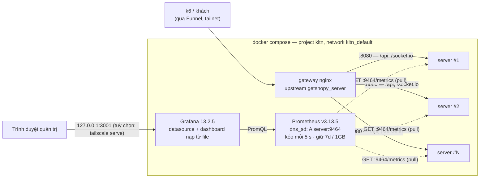

# Giám sát cân bằng tải — Prometheus + Grafana

Soạn 19/11/2026, nhánh `feat/monitoring-grafana`. Bổ sung cho [load-balancing.md](load-balancing.md):
`lb-demo.ps1` đo một lượt k6 rồi in bảng; tài liệu này giúp **thấy** gateway chia tải cho các bản
`server` theo thời gian thực — request/s, độ trễ, lỗi, CPU/RAM của từng bản.

Số đo của **production** để `[đo]`. Số ghi "stack thử" là đo trên một project compose tách biệt
(`kltnmon-e2e`, bản server giả trần 0,25 CPU — mục 9), chỉ minh hoạ cơ chế, không phải hiệu năng thật.

## 1. Kiến trúc



- **Kéo (pull)**: Prometheus tự gọi `/metrics` của từng bản; server không cần biết Prometheus ở đâu.
- **Tự tìm bản mới**: DNS nội bộ của Docker trả MỌI IP của service cho tên `server` (cùng cơ chế
  gateway dùng để chia tải). `dns_sd_configs` kiểu `A`, hỏi lại mỗi 5 s [2] — scale 1 → 4 bản
  không phải sửa cấu hình.
- **Cổng riêng 9464**: `/metrics` không phải route của Express; gateway chỉ chuyển tới `server:8080`
  nên `/metrics` không bao giờ đi qua gateway hay Funnel (mục 5).
- **Grafana**: datasource và dashboard nạp từ file trong repo lúc khởi động (provisioning [7]) —
  dựng lại máy là có ngay, không phải bấm tay.

| File | Vai trò |
|---|---|
| `ktln-Getshopy/qu-n-ly-ban-l/source/server/src/metrics/index.js` | số đo của server (prom-client [1]) + cổng 9464 |
| `monitoring/prometheus/prometheus.yml` | job `getshopy-server` (DNS), job `prometheus` (tự đo) |
| `monitoring/grafana/provisioning/datasources/prometheus.yml` | datasource uid `getshopy-prometheus` |
| `monitoring/grafana/provisioning/dashboards/getshopy.yml` | nạp mọi JSON trong `monitoring/grafana/dashboards/` |
| `monitoring/grafana/dashboards/getshopy-load-balancing.json` | dashboard "Getshopy — Cân bằng tải" |
| `scripts/grafana-demo.ps1` | demo trực tiếp (mục 7) |

## 2. Số đo server xuất ra

| Số đo | Loại | Nhãn | Ý nghĩa |
|---|---|---|---|
| `http_requests_total` | counter | `method`, `route`, `status_code` | số request đã trả lời |
| `http_request_duration_seconds` | histogram | như trên | thời gian từ lúc request vào Express tới lúc gửi xong response |
| `getshopy_server_info` | gauge = 1 | `hostname` | tên bản = header `X-Served-By` = id ngắn của container |
| `process_cpu_seconds_total`, `process_resident_memory_bytes`, `nodejs_heap_size_used_bytes`, `nodejs_eventloop_lag_p99_seconds`, `nodejs_gc_duration_seconds`, ... | mặc định của prom-client (`collectDefaultMetrics`) | — | CPU, RAM, heap, độ trễ event loop, GC của tiến trình Node |

Prometheus tự gắn thêm `job` và `instance` (= `ip:9464`, phân biệt từng bản). Dashboard nối
`instance` với `getshopy_server_info` để hiện **cùng tên** như `lb-demo.ps1` (`X-Served-By`).

**Nhãn `route` — giữ số chuỗi (cardinality) nhỏ.** Mỗi tổ hợp nhãn là một chuỗi thời gian riêng [5],
nên nhãn không bao giờ chứa URL thật, id, query string hay dữ liệu người dùng:

- `route` = **mẫu** route của Express: `/api/b2c/products/123?q=...` → `/api/b2c/products/:id`.
  Lấy đúng lúc router khớp route (kể cả khi handler async ném lỗi và Express trả 500 sau khi rời
  router con).
- Không khớp route nào → `unmatched`: 404, hoặc middleware trả lời trước (429 rate limit, preflight CORS).
- Lưới an toàn: quá 300 mẫu khác nhau thì gộp vào `other` (code hiện có ~100 route; chỉ xảy ra nếu
  sau này ai đó mount router ở đường dẫn có tham số).

**Bucket độ trễ** (giây): 0,005 · 0,01 · 0,025 · 0,05 · 0,1 · 0,25 · 0,5 · 0,75 · 1 · 2,5 · 5 · 10 · 30.
Dày quanh 0,1–1 s (ngưỡng p95 mặc định của `k6-lb.js` là 1 s). p95/p99 trên dashboard là
`histogram_quantile` — nội suy tuyến tính **trong** bucket, nên chỉ chính xác tới độ rộng bucket [4].

**Bật/tắt**: `METRICS_ENABLED` — trong code mặc định TẮT (chỉ bật khi đúng `"1"`, như
`SERVED_BY_HEADER`), compose đặt `${METRICS_ENABLED:-1}`. Chạy tay (`npm run dev`) hay demo
Kubernetes không đặt biến thì không mở thêm cổng nào. `METRICS_PORT` cố định 9464 trong compose
(ghi cứng cả trong `prometheus.yml`).

Lưu ý khi đọc: healthcheck của Docker gọi `/api/health` **ngay trong container** mỗi 10 s
(interval trong compose), không qua gateway — lúc không có tải mỗi bản vẫn có 0,1 request/s.

## 3. Dashboard "Getshopy — Cân bằng tải"

Mặc định: 15 phút gần nhất, tự làm mới 5 s. Mọi `rate()` dùng `$__rate_interval`; datasource khai
`timeInterval: 5s` (= chu kỳ kéo) nên Grafana tính cửa sổ = max(`$__interval` + 5 s, 4 × 5 s) [8] —
tức tối thiểu 20 s: đường request/s là trung bình trượt 20 s, phản ứng trễ cỡ đó.

| Hàng | Panel | Cho thấy | Đọc thế nào khi chạy k6 |
|---|---|---|---|
| Tổng quan | Bản server đang chạy | `sum(up)` của job server, giá trị hiện tại (không giữ số cũ khi rỗng) | đổi khi scale / một bản chết |
| | Tổng request/s | tổng mọi bản | ~ `RATE` của k6 (cộng 0,1 req/s healthcheck mỗi bản) |
| | p95 toàn cụm | histogram mọi bản | tăng vọt khi quá tải |
| | Tỷ lệ lỗi 5xx | 5xx / tổng | lỗi do **server** trả; lỗi gateway tự sinh (không bản nào trả lời) không có ở đây — xem k6 |
| | Độ lệch tải giữa các bản | độ lệch chuẩn / trung bình request/s giữa các bản (CV) | 0 % = chia đều tuyệt đối; chỉ tính khi tổng > 1 req/s (trên mức healthcheck) và ≥ 2 bản, không thì hiện "không tải"; ngưỡng màu chỉ để dễ nhìn |
| Phân bố tải | Request/s mỗi bản | một đường mỗi bản + "Tổng" nét đứt | chia đều → các đường sát nhau ở ~ RATE/N |
| | Tỷ trọng lưu lượng mỗi bản (%) | xếp chồng = 100 % | mỗi dải ~ 100/N %; scale thêm → dải mới, dải cũ mỏng lại; chỉ vẽ khi tổng > 1 req/s |
| Độ trễ và lỗi | Độ trễ p95 / p99 mỗi bản | theo bản, đo **trong** server | một bản cao hơn hẳn → bản đó chậm (CPU, GC); thêm bản → hạ xuống. **Không** gồm thời gian xếp hàng trước khi Express nhận request (gateway, hàng đợi kết nối của bản đang bão hoà) — độ trễ khách thấy là số của k6 |
| | Lỗi 5xx mỗi bản | 0 khi không lỗi | lỗi ở một bản: nghi bản đó; ở mọi bản: phụ thuộc dùng chung (Postgres, ClickHouse, ai-bot) |
| Các bản server | Danh sách bản server | hostname, instance, up, request/s, tỷ trọng, p95, CPU, RAM | ảnh chụp hiện tại để đọc số |
| Tài nguyên mỗi bản | CPU mỗi bản | `rate(process_cpu_seconds_total)`, 100 % = một nhân | JavaScript chạy trên một luồng [13]: chạm ~100 % là bản đó bão hoà dù máy còn nhân rảnh |
| | RAM (RSS) mỗi bản | `process_resident_memory_bytes` | rò bộ nhớ → đường đi lên mãi |
| | Độ trễ event loop p99 mỗi bản | `nodejs_eventloop_lag_p99_seconds` | p99 giữa hai lần kéo (`monitorEventLoopDelay`, độ phân giải 10 ms [13]) — lúc rảnh ~10 ms là độ phân giải đo, không phải trễ thật (stack thử: 10,4 ms); cao = luồng JS bận, mọi request của bản đó phải chờ |
| Theo route | Top 10 route theo request/s | mẫu route | khớp với mix của `k6-lb.js` (danh mục, danh sách, chi tiết, health) |
| | Request/s theo mã trạng thái | tổng mọi bản | 429 = chạm rate limit (đếm chung cả cụm trong Redis) |

Vạch cam trên các biểu đồ: annotation "Số bản server thay đổi" (số bản `up` khác 5 s trước); tắt bằng
nút gạt ở góc trên.

**Bản bão hoà thì số đo cũng chậm**: `/metrics` chạy trên cùng event loop với app. Stack thử: lúc
một bản giả gánh 100 req/s, lượt kéo `/metrics` mất tới 2,3 s (bình thường ~2 ms). Quá
`scrape_timeout` 4 s thì Prometheus ghi `up = 0` cho lượt đó dù bản vẫn chạy — khi "Bản server đang
chạy" chập chờn lúc tải nặng, nhìn thêm CPU và độ trễ event loop của bản đó.

Trên stack thử, từ lúc container mới chạy tới mẫu số đo đầu tiên mất ~9,5 s (2 lần đo: 9,5 s và
9,6 s) — thời gian node khởi động + ≤ 5 s chờ lượt hỏi DNS + ≤ 5 s chờ lượt kéo. Production: `[đo]`.

Sửa dashboard: sửa file JSON (Grafana đọc lại sau 30 s). Sửa trên giao diện thì không lưu được
(`allowUiUpdates: false`) — muốn giữ: *Export → JSON* rồi chép đè file trong repo.

## 4. Mở Grafana

```powershell
# lần đầu: đặt GRAFANA_ADMIN_PASSWORD trong .env TRƯỚC (mục 5), rồi
docker compose up -d prometheus grafana
```

Mở <http://localhost:3001> (chỉ trên chính máy chạy Docker), đăng nhập `admin` — trang chủ là
dashboard cân bằng tải. Grafana khởi động mất `[đo]` s (stack thử: ~23 s lần đầu — phần lớn là tạo
DB nội bộ; ~6 s các lần sau).

**Xem từ máy khác trong tailnet** (tuỳ chọn, CHƯA thử trên máy demo):

```powershell
tailscale serve --bg --https=3001 http://127.0.0.1:3001     # chỉ thiết bị trong tailnet
tailscale serve status                                     # 3001 KHÔNG được có "(Funnel on)"
tailscale serve --https=3001 off                           # gỡ
```

**KHÔNG** dùng `tailscale funnel` cho cổng này: Funnel đưa ra cả Internet [14].

## 5. Bảo mật

- **Cổng số đo 9464 chỉ trong network Docker**: compose chỉ `expose`, không publish. App Express
  không có route `/metrics` (kiểm bằng unit test), gateway chỉ chuyển tới `server:8080`. Thử trên
  stack thử với `gateway/nginx.conf` thật: `/api/metrics` → 404 (server), cổng 8081 `/metrics` → 404
  (server), cổng public 8090 `/api/metrics` → 404 (nginx).
- `/metrics` và API của Prometheus **không có xác thực**: mọi container trong `kltn_default` đọc
  được. Nội dung chỉ là số đếm theo mẫu route — không có dữ liệu người dùng — nhưng lộ danh sách
  route và mức tải. Không thêm cổng publish cho hai thứ này.
- Prometheus không bật `--web.enable-lifecycle`: không container nào tắt / nạp lại Prometheus qua
  HTTP được. Nạp lại cấu hình: `docker compose kill -s SIGHUP prometheus` [6].
- **Grafana chỉ nghe 127.0.0.1**; tắt truy cập ẩn danh và tự đăng ký; không gọi ra Internet (tắt
  báo số liệu sử dụng, kiểm tra bản mới, tin tức, tự cài plugin lúc khởi động).
- **Mật khẩu admin**: `GRAFANA_ADMIN_PASSWORD` trong `.env` (sinh: `openssl rand -base64 24`).
  - Grafana chỉ đọc biến này khi **tạo tài khoản admin lần đầu** (volume `grafana_data` trống) [9].
    Đặt sau lần đầu thì không có tác dụng — đổi bằng:
    `docker compose exec grafana grafana cli admin reset-admin-password <mật-khẩu-mới>`.
  - Cố ý không dùng `${VAR:?}`: CD chạy `docker compose config/up` với `.env` production, biến bắt
    buộc mà thiếu là hỏng **mọi** lần deploy. Thiếu biến → `admin` (mặc định của Grafana; lần đăng
    nhập đầu Grafana hiện màn hình "Update your password" [10] — nhưng có nút **Skip**, đã thử trên
    13.2.5) — chỉ tạm chấp nhận vì cổng nằm trên loopback. Đặt biến trước lần khởi động đầu.
  - `server` dùng `env_file: .env` nên mọi biến trong `.env` (kể cả mật khẩu này, như các bí mật
    khác đã có) cũng nằm trong môi trường container server.
- Bí mật không vào repo: `.env.example` chỉ có tên biến, giá trị để trống.

## 6. Chi phí tài nguyên và lưu trữ

| | Trần (compose) | Production | Stack thử (3–4 bản giả, vài route) |
|---|---|---|---|
| Prometheus RAM | `mem_limit` 512m (`PROMETHEUS_MEM_LIMIT`) | `[đo]` | ~100 MiB (`docker stats`) |
| Grafana RAM | `mem_limit` 512m (`GRAFANA_MEM_LIMIT`) | `[đo]` | ~180 MiB |
| Số chuỗi (`prometheus_tsdb_head_series`) | — | `[đo]` | 1 630 (sau ~9 phút; 7 container server đã qua + chính Prometheus) |
| Mẫu mỗi lượt kéo một bản (`scrape_samples_scraped`) | — | `[đo]` | 153 (4 route) |
| Thời gian một lượt kéo (`scrape_duration_seconds`) | timeout 4 s | `[đo]` | trung vị ~2–2,4 ms; tới 2,3 s khi bản giả bão hoà CPU |
| Dung lượng TSDB | 1GB (`PROMETHEUS_RETENTION_SIZE`) | `[đo]` | 504 KB sau ~9 phút |

- Grafana 13 chạy mỗi datasource đóng gói sẵn thành một tiến trình riêng (đo trên stack thử: 13 tiến
  trình, ~22–32 MB RSS mỗi cái). Compose tắt 12 cái không dùng (`GF_PLUGINS_DISABLE_PLUGINS`), chỉ
  giữ Prometheus — RAM Grafana trên stack thử từ ~410–420 MiB (gần chạm trần 512m) xuống ~180 MiB.
- Mỗi bản server: `/metrics` chỉ được gọi mỗi 5 s; middleware đo mỗi request là một bộ đếm + một
  histogram trong bộ nhớ. Chi phí CPU thêm: `[đo]` (so `lb-demo.ps1` trước/sau).
- **Lưu trữ**: giữ theo thời gian **và** dung lượng — `PROMETHEUS_RETENTION_TIME` (mặc định 7d),
  `PROMETHEUS_RETENTION_SIZE` (mặc định 1GB); chạm mức nào trước thì xoá block cũ trước [3]. Trần
  dung lượng là bắt buộc vì ổ D: từng đầy làm sập production (15/11). Ước lượng: Prometheus dùng
  trung bình ~1–2 byte/mẫu [3]; kéo mỗi 5 s → 17 280 mẫu/chuỗi/ngày → dung lượng/ngày ≈ số chuỗi ×
  17 280 × 1–2 byte. Số chuỗi thật của production: `[đo]`.

## 7. Kịch bản demo trực tiếp

`scripts/grafana-demo.ps1` (PowerShell 5.1) tạo tải và thay đổi số bản trong lúc bạn nhìn Grafana.
k6 (`grafana/k6:1.8.2`, trần 2 CPU / 1 GB) chạy trong network compose, chỉ gọi `http://gateway`,
chỉ endpoint ĐỌC công khai (danh mục, danh sách, chi tiết sản phẩm, health) — dùng lại
`scripts/loadtest/k6-lb.js` với `PROFILE=live` (tăng dần 0 → `-Rate` trong `-RampSec`, rồi giữ).

```powershell
# mở http://localhost:3001 trước; máy demo, thư mục repo; chạy lúc vắng khách
.\scripts\grafana-demo.ps1                          # steady -> scale -> 1 server chết, hỏi xác nhận
.\scripts\grafana-demo.ps1 -Scenario scale -Yes      # một kịch bản, không hỏi
.\scripts\grafana-demo.ps1 -Rate 300 -Minutes 2 -StepSec 60
.\scripts\grafana-demo.ps1 -DryRun                   # chỉ in lệnh docker / k6
```

- Script chỉ đụng service `server` (`--no-deps --no-recreate`: chỉ thêm/bớt container, không tạo
  lại bản đang chạy), không bao giờ postgres / clickhouse / redis. Mọi lệnh compose chạy với
  `SERVER_DB_PREP=off` như CD — bản tạo thêm lúc scale chỉ chạy node, không chạy script DB.
- Số bản **luôn** được trả về như lúc bắt đầu (`finally`, kể cả lỗi / Ctrl+C); container k6 dở dang
  bị gỡ. Trước mỗi kịch bản script in URL Grafana và panel cần nhìn; cuối cùng in dòng thời gian
  (giờ, T+ giây tính từ lúc k6 của kịch bản bắt đầu) để đối chiếu với biểu đồ.
- Tải chạy trên Postgres/Redis **thật**; lúc 1 bản thì một bản gánh cả khách thật.

| Kịch bản | Script làm gì | Nhìn panel nào | Hình mong đợi | Production |
|---|---|---|---|---|
| `steady` | tăng dần rồi giữ `-Rate` (mặc định 150 req/s) trong `-Minutes` (3) | Request/s mỗi bản, Tỷ trọng, Độ lệch tải | các đường sát nhau ở ~ Rate/N; mỗi dải ~ 100/N % | `[đo]` |
| `scale` | về 1 bản, rồi mỗi `-StepSec` (60 s) scale 2 → 3 → 4 trong lúc tải không đổi | Bản đang chạy, Request/s mỗi bản, Tỷ trọng, p95, CPU | mỗi bước thêm một đường; các đường cũ hạ xuống Rate/N; p95, CPU hạ nếu Rate vượt sức 1 bản | `[đo]` |
| `failover` | giết một bản (dưới đây) | Request/s mỗi bản, Bản đang chạy, Lỗi 5xx, Theo mã trạng thái | đường bản chết đứt, các bản còn lại tăng lên; bản đó quay lại cùng tên | `[đo]` |

Stack thử (`-Rate 100 -Minutes 1 -RampSec 10 -StepSec 30`, mỗi bản giả trần 0,25 CPU — chỉ minh hoạ
cơ chế):

- `steady`, 3 bản: 33,4 / 33,5 / 33,7 req/s mỗi bản, tỷ trọng 33,2 / 33,3 / 33,5 %, độ lệch (CV) 0,3 %;
  k6: 6 500 request, p95 52 ms, 0 response lỗi.
- `scale`: 1 bản giả không gánh nổi 100 req/s — k6 cả lượt: p95 ~13 s, 53 response khác 200, 2 467
  lượt bỏ (k6 thoát mã 99 = threshold không đạt, vẫn là số đo hợp lệ). Lúc đó panel CPU của bản đó
  chạm trần 25 %, độ trễ event loop p99 ~1,4 s, nhưng panel p95 của server chỉ ~89 ms: thời gian
  xếp hàng trước khi Express nhận request không nằm trong số đo của server (mục 3). Mỗi lần scale,
  đường mới xuất hiện sau ~9,5 s.
- `failover`: xem bảng dưới.

### Kịch bản 1 server chết

Mục tiêu: cho thấy một bản **chết bất thường** thì **tự quay lại**, chỉ nhờ restart policy của
Docker (`restart: unless-stopped` của service `server`) — không cần Swarm / Kubernetes.

**Cách giết**: lấy PID của tiến trình chính trong container (`docker inspect -f '{{.State.Pid}}'`,
PID trong namespace của máy ảo Docker) rồi gửi `kill -9` từ một container dùng một lần:

```powershell
docker run --rm --privileged --pid=host alpine:3.20 kill -9 <pid>
```

Như OOM killer / crash thật: Docker thấy container thoát bất thường (mã 137) và khởi động lại nó
(cùng container, cùng tên = cùng đường trên Grafana). Container trợ giúp có toàn quyền trên máy ảo
Docker (`--privileged --pid=host`) — script chỉ chạy đúng lệnh `kill` trên PID vừa đọc rồi xoá nó.

**Vì sao không dùng `docker kill` / `docker stop`**: Docker coi đó là dừng **tay** và bỏ qua restart
policy [11] — bản đó không tự quay lại, demo sai mục đích. Thử 19/11/2026 (Docker 28.4.0, container
`alpine` có `--restart unless-stopped`): `docker kill` → `exited`, RestartCount 0 sau 6 s;
`kill -9` PID qua `--pid=host` → `running`, RestartCount 1, FinishedAt → StartedAt ~35 ms.

**An toàn**: chỉ chọn MỘT bản `server` (bản đầu tiên theo id) và đọc biến `DB_PREP` của nó (không in
biến khác — có bí mật). Container do CD tạo luôn có `DB_PREP=off`: khởi động lại **không chạy script
DB nào** (`docker-entrypoint.sh`), chỉ chạy lại node. Thiếu `DB_PREP=off` → script cảnh báo và hỏi
lại (kể cả khi `-Yes`). Còn < 2 bản thì scale lên 2 trước để có bản gánh tải.

**Script đo và in**: lúc kill; lúc Docker khởi động lại (RestartCount tăng; thêm FinishedAt →
StartedAt theo đồng hồ Docker); lúc healthy lại; **thời gian bản đó vắng mặt** (kill → healthy, như
"downtime" một pod của Kubernetes); số response khác 200 của k6 trước / sau lúc kill (k6 tách bằng
`MARK_AT`; mốc lệch ~1 s vì k6 khởi động sau lệnh docker). Quá `-RecoverTimeoutSec` (120 s) mà
chưa healthy → `docker compose up -d --no-deps --no-recreate --scale server=N server` và báo rõ là
tự khởi động lại **không** thành công.

Cách đọc: "healthy" chỉ được đánh dấu ở lượt healthcheck kế tiếp (interval 10 s) nên thời gian vắng
mặt gồm cả phần chờ lượt kiểm tra. Gateway không xét health của Docker: nó gửi lại cho bản đó khi bản
trả lời được **và** hết thời gian tạm loại sau lỗi (`max_fails=3 fail_timeout=10s`,
`gateway/nginx.conf`). Gateway chuyển request sang bản khác khi **lỗi kết nối / timeout**
(`proxy_next_upstream error timeout`): GET đang dở trên bản chết được gửi lại bản khác, nên thường
còn ít hoặc không lỗi; POST dở dang **không** gửi lại (tránh đặt hàng hai lần).

| | Production | Stack thử |
|---|---|---|
| Docker khởi động lại sau (FinishedAt → StartedAt) | `[đo]` | 0,04 s và 0,08 s (2 lần chạy) |
| Bản đó vắng mặt (kill → healthy) | `[đo]` | 6,2 s và 6,6 s |
| Prometheus | `[đo]` | lỡ 1 lượt kéo (`up = 0` một mẫu), đường của bản đó đứt ~10 s |
| Gateway gửi lại cho bản đó | `[đo]` | ~10 s sau lúc kill (= `fail_timeout`) |
| k6 response khác 200 sau lúc kill | `[đo]` | 0 cả 2 lần (trước lúc kill: 0) |

**Giới hạn — server TREO thì KHÔNG tự khởi động lại.** Restart policy chỉ phản ứng khi tiến trình
**thoát** [11]. Server còn sống nhưng không trả lời (vòng lặp vô hạn, deadlock) thì healthcheck chỉ
đánh dấu `unhealthy` [12] — Docker thường (không Swarm) không làm gì thêm. Gateway cũng không đọc
health của Docker: nginx mã nguồn mở chỉ tạm loại một bản **sau khi** gặp lỗi / timeout (`max_fails`,
kiểm tra bị động), trong lúc đó request gửi tới bản treo phải chờ tới timeout. Trường hợp này cần một
trình "autoheal" theo dõi trạng thái health, hoặc Swarm / Kubernetes (liveness probe) — **ngoài phạm
vi** hiện tại.

## 8. Vận hành

| Việc | Lệnh |
|---|---|
| Bật lần đầu / sau khi đổi image, compose | `docker compose up -d prometheus grafana` |
| Nạp lại `prometheus.yml` | `docker compose kill -s SIGHUP prometheus` |
| Xem target Prometheus thấy | `docker compose exec prometheus wget -qO- http://localhost:9090/api/v1/targets` |
| Dừng giám sát | `docker compose stop prometheus grafana` (không có profile: `docker compose up -d` lần sau bật lại) |
| Xoá dữ liệu số đo | `docker compose rm -sf prometheus` rồi `docker volume rm kltn_prometheus_data` |
| Tắt số đo của server | `METRICS_ENABLED=0` trong `.env`, có hiệu lực khi các bản server được tạo lại (lần deploy sau) |

- CD (`deploy/cd/pull-deploy.ps1`) chỉ tạo lại 4 service ứng dụng: bản server mới tự có số đo,
  nhưng Prometheus / Grafana không bao giờ do CD bật. Đổi file trong `monitoring/` → `deploy.log` ghi
  cảnh báo kèm lệnh chạy tay. Trước khi bản server có số đo được deploy, target Prometheus báo
  `down` (cổng 9464 chưa mở) — bình thường.
- Prometheus mất bản nào đó → bản đó biến khỏi DNS, Prometheus đánh dấu chuỗi của nó là cũ (stale);
  đường trên Grafana dừng lại thay vì kéo dài.

## 9. Kiểm thử

```bash
cd ktln-Getshopy/qu-n-ly-ban-l/source/server
node --test tests/metrics.test.js                     # 13 test
node --test $(ls tests/*.test.js | grep -v perf)      # cả bộ (19/11/2026: 128 test, 126 đạt, 2 bỏ qua vì không có REDIS_TEST_URL)
```

```powershell
# thư mục gốc repo: kiểm cú pháp prometheus.yml bằng promtool của đúng image đã ghim
docker run --rm --entrypoint promtool -v "${PWD}\monitoring\prometheus:/cfg:ro" prom/prometheus:v3.13.5 check config /cfg/prometheus.yml
```

`tests/metrics.test.js`: mặc định tắt; nhãn route là mẫu (id, query không lọt vào nhãn); `unmatched`
cho 404 / 429; handler async ném lỗi vẫn mang mẫu đầy đủ; histogram cùng nhãn; trần `other`; `/metrics`
trên cổng riêng có số đo HTTP + mặc định + `getshopy_server_info`; app chính KHÔNG có `/metrics`;
hostname trùng `X-Served-By`; `stop()` không chờ keep-alive; cổng bận không làm server dừng.

**Stack thử end-to-end** (19/11/2026, không build image ứng dụng, không đụng production): project
`kltnmon-e2e` dùng **chính** `docker-compose.yml` (Prometheus, Grafana, gateway với `nginx.conf` thật)
cộng một file ghi đè thay `server` bằng `node:20-alpine` chạy module `src/metrics` của repo (3 bản,
trần 0,25 CPU, giả lập 4–8 ms CPU mỗi request).

- Prometheus tìm đủ 3 bản qua DNS (`__meta_dns_name=server`), mọi target `up`; mọi biểu thức PromQL
  của dashboard (22 truy vấn + annotation) chạy qua proxy datasource của Grafana không lỗi.
- Grafana nạp datasource (health: "Successfully queried the Prometheus API") và dashboard (thư mục
  Getshopy, trang chủ = dashboard); không đăng nhập → 401; mật khẩu sai → 401.
- Qua gateway thật: `/api/metrics` → 404, `:8081/metrics` → 404, `:8090/api/metrics` → 404; trong
  network `server:9464/metrics` → 200 với `getshopy_server_info{hostname="<id container>"} 1`.
- `grafana-demo.ps1` chạy đủ 3 kịch bản (số ở mục 7) và trả về 3 bản; đường lỗi (image k6 không tồn
  tại) vẫn trả về 3 bản. Ctrl+C dùng cùng khối `finally` (chưa thử bấm Ctrl+C thật).

## Nguồn

1. prom-client: https://github.com/siimon/prom-client — npm báo gói được thay bằng
   `@prometheus-io/client` (https://github.com/prometheus/client_js), nhưng gói này đòi Node ≥ 22,
   image server đang chạy Node 20.
2. Prometheus — `dns_sd_config`: https://prometheus.io/docs/prometheus/latest/configuration/configuration/#dns_sd_config
3. Prometheus — lưu trữ, retention theo thời gian / dung lượng, ước lượng byte/mẫu:
   https://prometheus.io/docs/prometheus/latest/storage/
4. Prometheus — histogram và quantile: https://prometheus.io/docs/practices/histograms/
5. Prometheus — đặt tên, nhãn và cardinality: https://prometheus.io/docs/practices/naming/#labels
6. Prometheus — nạp lại cấu hình bằng SIGHUP: https://prometheus.io/docs/prometheus/latest/configuration/configuration/
7. Grafana — provisioning datasource / dashboard: https://grafana.com/docs/grafana/latest/administration/provisioning/
8. Grafana — `$__rate_interval`: https://grafana.com/docs/grafana/latest/datasources/prometheus/template-variables/#use-__rate_interval
9. Grafana — cấu hình (`admin_password`, ghi đè bằng biến `GF_*`, `disable_plugins`):
   https://grafana.com/docs/grafana/latest/setup-grafana/configure-grafana/
10. Grafana — đăng nhập lần đầu: https://grafana.com/docs/grafana/latest/setup-grafana/sign-in-to-grafana/
11. Docker — restart policy (dừng tay thì bỏ qua policy): https://docs.docker.com/engine/containers/start-containers-automatically/
12. Dockerfile `HEALTHCHECK`: https://docs.docker.com/reference/dockerfile/#healthcheck
13. Node.js — event loop: https://nodejs.org/en/learn/asynchronous-work/dont-block-the-event-loop ;
    `perf_hooks.monitorEventLoopDelay`: https://nodejs.org/api/perf_hooks.html#perf_hooksmonitoreventloopdelayoptions
14. Tailscale — `serve` (chỉ tailnet) và Funnel (Internet): https://tailscale.com/kb/1312/serve ·
    https://tailscale.com/kb/1223/funnel
