# Bộ Code Mermaid Chuẩn Báo Cáo cho Toàn Bộ Sơ Đồ trong `DACNTT + KLTN (đã sửa).md`

Tài liệu này được sinh trực tiếp từ [Checklist_Diagram_UseCase_UI_UX_KLTN.md](file:///d:/khóa-luận-tốt-nghiệp/ktln-Getshopy/qu-n-ly-ban-l/source/Checklist_Diagram_UseCase_UI_UX_KLTN.md) và khớp 100% với nội dung, thuật ngữ, số liệu của [DACNTT + KLTN (đã sửa).md](<file:///d:/khóa-luận-tốt-nghiệp/ktln-Getshopy/qu-n-ly-ban-l/source/DACNTT%20+%20KLTN%20(đã%20sửa).md>).

---

## Bảng tổng hợp vị trí chèn của 15 Sơ đồ Mermaid trong `DACNTT + KLTN (đã sửa).md`

|     STT     | Mã Hình / Tên Sơ đồ                                                                                                        | Thuộc Chương / Mục           |                                                                               Vị trí chèn trong `DACNTT + KLTN (đã sửa).md`                                                                               | Loại biểu đồ Mermaid | Nhóm                                  |
| :----------: | :------------------------------------------------------------------------------------------------------------------------------- | :------------------------------- | :---------------------------------------------------------------------------------------------------------------------------------------------------------------------------------------------------------------: | :----------------------- | :------------------------------------- |
| **1** | **Hình 2.1.** Quy trình mua hàng trực tuyến                                                                           | Chương 2 — Mục 2.3.1         |                [Dòng 376](<file:///d:/khóa-luận-tốt-nghiệp/ktln-Getshopy/qu-n-ly-ban-l/source/DACNTT%20+%20KLTN%20(đã%20sửa).md#L376>) (`*Hình 2.1. Quy trình mua hàng trực tuyến*`)                | `flowchart LR`         | Nhóm 1 (Đã có tên trong bài)     |
| **2** | **Hình 4.1.** Kiến trúc tổng thể ba phân hệ và các đường dữ liệu                                             | Chương 4 — Mục 4.1.1         | [Dòng 721](<file:///d:/khóa-luận-tốt-nghiệp/ktln-Getshopy/qu-n-ly-ban-l/source/DACNTT%20+%20KLTN%20(đã%20sửa).md#L721>) (`*Hình 4.1. Kiến trúc tổng thể ba phân hệ và các đường dữ liệu*`) | `flowchart TB`         | Nhóm 1 (Đã có tên trong bài)     |
| **3** | **Hình 4.2.** Luồng từ hồ dữ liệu tập trung xuống kho                                                              | Chương 4 — Mục 4.3.1         |         [Dòng 790](<file:///d:/khóa-luận-tốt-nghiệp/ktln-Getshopy/qu-n-ly-ban-l/source/DACNTT%20+%20KLTN%20(đã%20sửa).md#L790>) (`*Hình 4.2. Luồng từ hồ dữ liệu tập trung xuống kho*`)         | `flowchart LR`         | Nhóm 1 (Đã có tên trong bài)     |
| **4** | **Hình 4.3.** Kiến trúc mô hình gợi ý lai và vòng đời huấn luyện của AI-Rec                                  | Chương 4 — Mục 4.5.3         |         [Dòng 895](<file:///d:/khóa-luận-tốt-nghiệp/ktln-Getshopy/qu-n-ly-ban-l/source/DACNTT%20+%20KLTN%20(đã%20sửa).md#L895>) (`*Hình 4.3. Vòng đời một bản huấn luyện của AI-Rec*`)         | `flowchart TB`         | Nhóm 1 (Đã có tên trong bài)     |
| **5** | **Hình 4.4.** Luồng xử lý của trợ lý hội thoại                                                                    | Chương 4 — Mục 4.6           |            [Dòng 904](<file:///d:/khóa-luận-tốt-nghiệp/ktln-Getshopy/qu-n-ly-ban-l/source/DACNTT%20+%20KLTN%20(đã%20sửa).md#L904>) (`*Hình 4.4. Luồng xử lý của trợ lý hội thoại*`)            | `flowchart TB`         | Nhóm 1 (Đã có tên trong bài)     |
| **6** | **Hình 4.5.** Vòng đời đơn chuyển khoản (rút gọn)                                                                | Chương 4 — Mục 4.7           |          [Dòng 914](<file:///d:/khóa-luận-tốt-nghiệp/ktln-Getshopy/qu-n-ly-ban-l/source/DACNTT%20+%20KLTN%20(đã%20sửa).md#L914>) (`*Hình 4.5. Vòng đời đơn chuyển khoản (rút gọn)*`)          | `stateDiagram-v2`      | Nhóm 1 (Đã có tên trong bài)     |
| **7** | **Hình 5.1.** Nạp tăng dần theo tập đơn có biến động                                                            | Chương 5 — Mục 5.2.3         |       [Dòng 1072](<file:///d:/khóa-luận-tốt-nghiệp/ktln-Getshopy/qu-n-ly-ban-l/source/DACNTT%20+%20KLTN%20(đã%20sửa).md#L1072>) (`*Hình 5.1. Nạp tăng dần theo tập đơn có biến động*`)       | `flowchart TB`         | Nhóm 1 (Đã có tên trong bài)     |
| **8** | **Hình 5.2.** Vòng đời một bản huấn luyện và hoán đổi `ModelBundle` của AI-Rec                              | Chương 5 — Mục 5.3.4         |        [Dòng 1146](<file:///d:/khóa-luận-tốt-nghiệp/ktln-Getshopy/qu-n-ly-ban-l/source/DACNTT%20+%20KLTN%20(đã%20sửa).md#L1146>) (`*Hình 5.2. Vòng đời một bản huấn luyện của AI-Rec*`)        | `flowchart LR`         | Nhóm 1 (Đã có tên trong bài)     |
| **9** | **Hình 5.3.** Chuỗi đầu-cuối từ giao dịch B2C tới kho và AI (14 bước)                                           | Chương 5 — Mục 5.5.1         |     [Dòng 1213](<file:///d:/khóa-luận-tốt-nghiệp/ktln-Getshopy/qu-n-ly-ban-l/source/DACNTT%20+%20KLTN%20(đã%20sửa).md#L1213>) (`*Hình 5.3. Chuỗi đầu-cuối từ giao dịch B2C tới kho và AI*`)     | `flowchart TB`         | Nhóm 1 (Đã có tên trong bài)     |
| **10** | **Sơ đồ bổ sung 2.1.** Biểu đồ Use Case tổng quát toàn hệ thống (6 tác nhân)                                 | Chương 2 — Mục 2.5.2         |      [Sau dòng 429](<file:///d:/khóa-luận-tốt-nghiệp/ktln-Getshopy/qu-n-ly-ban-l/source/DACNTT%20+%20KLTN%20(đã%20sửa).md#L429>) (Ngay sau *Bảng 2.3. Các ca sử dụng nghiệp vụ tiêu biểu*)      | `flowchart LR`         | Nhóm 2 (Sơ đồ thiết kế bổ sung) |
| **11** | **Sơ đồ bổ sung 4.1.** Sơ đồ Thực thể – Liên kết (ERD) cơ sở dữ liệu tác nghiệp PostgreSQL (21 bảng)    | Chương 4 — Mục 4.2           |        [Sau dòng 766](<file:///d:/khóa-luận-tốt-nghiệp/ktln-Getshopy/qu-n-ly-ban-l/source/DACNTT%20+%20KLTN%20(đã%20sửa).md#L766>) (Ngay sau *Bảng 4.2. Các thực thể của CSDL tác nghiệp*)        | `erDiagram`            | Nhóm 2 (Sơ đồ thiết kế bổ sung) |
| **12** | **Sơ đồ bổ sung 4.2.** Lược đồ hình sao (Star Schema) & Hợp đồng dữ liệu Kho ClickHouse                      | Chương 4 — Mục 4.3.3 & 4.3.4 |             [Sau dòng 826](<file:///d:/khóa-luận-tốt-nghiệp/ktln-Getshopy/qu-n-ly-ban-l/source/DACNTT%20+%20KLTN%20(đã%20sửa).md#L826>) (Ngay sau *Bảng 4.4. Các bảng phục vụ AI-Rec*)             | `erDiagram`            | Nhóm 2 (Sơ đồ thiết kế bổ sung) |
| **13** | **Sơ đồ bổ sung 5.1.** Biểu đồ Tuần tự (Sequence) Đặt hàng giữ chỗ nguyên tử & Đối soát Webhook SePay   | Chương 5 — Mục 5.1.4 & 5.1.5 |      [Sau dòng 1032](<file:///d:/khóa-luận-tốt-nghiệp/ktln-Getshopy/qu-n-ly-ban-l/source/DACNTT%20+%20KLTN%20(đã%20sửa).md#L1032>) (Cuối Mục 5.1.5 *Thanh toán chuyển khoản và đối soát*)      | `sequenceDiagram`      | Nhóm 2 (Sơ đồ thiết kế bổ sung) |
| **14** | **Sơ đồ bổ sung 5.2.** Biểu đồ Tuần tự (Sequence) Gợi ý trang chủ gọi AI-Rec & Bổ sung tồn kho OLTP         | Chương 5 — Mục 5.3.5         |          [Sau dòng 1155](<file:///d:/khóa-luận-tốt-nghiệp/ktln-Getshopy/qu-n-ly-ban-l/source/DACNTT%20+%20KLTN%20(đã%20sửa).md#L1155>) (Cuối Mục 5.3.5 *Tích hợp gợi ý vào trang chủ*)          | `sequenceDiagram`      | Nhóm 2 (Sơ đồ thiết kế bổ sung) |
| **15** | **Sơ đồ bổ sung 6.1.** Sơ đồ Triển khai (Deployment Diagram) 17 dịch vụ Docker Compose & Đường hầm `ngrok` | Chương 6 — Mục 6.1 & 6.3     |     [Sau dòng 1258](<file:///d:/khóa-luận-tốt-nghiệp/ktln-Getshopy/qu-n-ly-ban-l/source/DACNTT%20+%20KLTN%20(đã%20sửa).md#L1258>) (Cuối Mục 6.3 *Điều phối truy cập và webhook thanh toán*)     | `flowchart TB`         | Nhóm 2 (Sơ đồ thiết kế bổ sung) |

---

## PHẦN 1. Code Mermaid cho 9 Hình vẽ đã khai báo trong bài (`Hình 2.1` → `Hình 5.3`)

---

### 1. Hình 2.1. Quy trình mua hàng trực tuyến

| Hạng mục                                                | Thông tin chi tiết                                                                                                                                                                                               |
| :-------------------------------------------------------- | :----------------------------------------------------------------------------------------------------------------------------------------------------------------------------------------------------------------- |
| **Tên hình trong báo cáo**                      | `*Hình 2.1. Quy trình mua hàng trực tuyến*`                                                                                                                                                                 |
| **Thuộc Chương / Mục**                          | Chương 2 (*Tổng quan về đề tài*) — **Mục 2.3.1. Quy trình mua hàng**                                                                                                                            |
| **Vị trí trong `DACNTT + KLTN (đã sửa).md`** | **[Dòng 376](<file:///d:/khóa-luận-tốt-nghiệp/ktln-Getshopy/qu-n-ly-ban-l/source/DACNTT%20+%20KLTN%20(đã%20sửa).md#L376>)** (Ngay dưới danh sách 6 bước mua hàng từ dòng 369 đến dòng 374) |
| **Nội dung thể hiện**                            | 6 bước mua hàng trực tuyến kết hợp các điểm phát sinh sự kiện hành vi và giao dịch về hệ thống                                                                                                  |

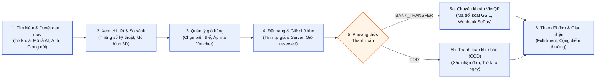

---

### 2. Hình 4.1. Kiến trúc tổng thể ba phân hệ và các đường dữ liệu

| Hạng mục                                               | Thông tin chi tiết                                                                                                                                                                                           |
| :------------------------------------------------------- | :------------------------------------------------------------------------------------------------------------------------------------------------------------------------------------------------------------- |
| **Tên hình trong báo cáo**                     | `*Hình 4.1. Kiến trúc tổng thể ba phân hệ và các đường dữ liệu*`                                                                                                                               |
| **Thuộc Chương / Mục**                         | Chương 4 (*Thiết kế hệ thống*) — **Mục 4.1.1. Kiến trúc khái niệm**                                                                                                                        |
| **Vị trí trong `DACNTT +KLTN (đã sửa).md`** | **[Dòng 721](<file:///d:/khóa-luận-tốt-nghiệp/ktln-Getshopy/qu-n-ly-ban-l/source/DACNTT%20+%20KLTN%20(đã%20sửa).md#L721>)** (Ngay dưới 6 luồng dữ liệu chính từ dòng 714 đến dòng 719) |
| **Nội dung thể hiện**                           | Ba phân hệ (Thương mại điện tử, Nền tảng Lakehouse, Phân hệ AI gồm `AI-Rec` và `ai-bot`) cùng 6 luồng dữ liệu đánh số (1)–(6) và các đường dữ liệu ở Bảng 4.1               |

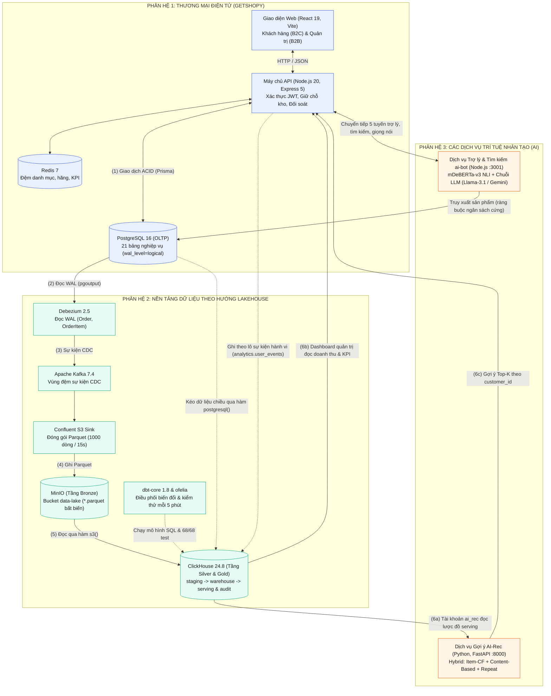

---

### 3. Hình 4.2. Luồng từ hồ dữ liệu tập trung xuống kho

| Hạng mục                                                | Thông tin chi tiết                                                                                                                                                                                                                    |
| :-------------------------------------------------------- | :-------------------------------------------------------------------------------------------------------------------------------------------------------------------------------------------------------------------------------------- |
| **Tên hình trong báo cáo**                      | `*Hình 4.2. Luồng từ hồ dữ liệu tập trung xuống kho*`                                                                                                                                                                         |
| **Thuộc Chương / Mục**                          | Chương 4 (*Thiết kế hệ thống*) — **Mục 4.3.1. Tổ chức các tầng**                                                                                                                                                    |
| **Vị trí trong `DACNTT + KLTN (đã sửa).md`** | **[Dòng 790](<file:///d:/khóa-luận-tốt-nghiệp/ktln-Getshopy/qu-n-ly-ban-l/source/DACNTT%20+%20KLTN%20(đã%20sửa).md#L790>)** (Ngay dưới *Bảng 4.3. Tổ chức tầng dữ liệu (đối chiếu Bronze – Silver – Gold)*) |
| **Nội dung thể hiện**                            | Kiến trúc phân tầng Bronze – Silver – Gold và tầng Kiểm soát (`audit`) theo hướng ELT do dbt điều phối trên ClickHouse                                                                                                |

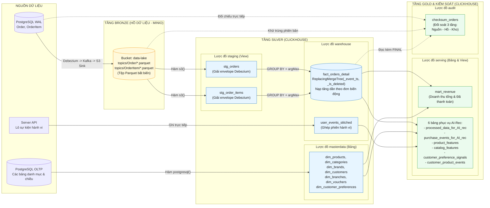

---

### 4. Hình 4.3. Kiến trúc mô hình gợi ý lai và vòng đời huấn luyện của AI-Rec

| Hạng mục                                                | Thông tin chi tiết                                                                                                                                                                                                                 |
| :-------------------------------------------------------- | :----------------------------------------------------------------------------------------------------------------------------------------------------------------------------------------------------------------------------------- |
| **Tên hình trong báo cáo**                      | `*Hình 4.3. Vòng đời một bản huấn luyện của AI-Rec*` *(Khuyến nghị đổi thành: `*Hình 4.3. Kiến trúc mô hình gợi ý lai và vòng đời huấn luyện của AI-Rec*` để không trùng tên với Hình 5.2)* |
| **Thuộc Chương / Mục**                          | Chương 4 (*Thiết kế hệ thống*) — **Mục 4.5.3. Vòng đời huấn luyện và phục vụ**                                                                                                                               |
| **Vị trí trong `DACNTT + KLTN (đã sửa).md`** | **[Dòng 895](<file:///d:/khóa-luận-tốt-nghiệp/ktln-Getshopy/qu-n-ly-ban-l/source/DACNTT%20+%20KLTN%20(đã%20sửa).md#L895>)** (Ngay dưới tiêu đề `### 4.5.3. Vòng đời huấn luyện và phục vụ`)              |
| **Nội dung thể hiện**                            | Cách kết hợp 3 kênh gợi ý (Item-CF, Content-Based từ lịch sử + Onboarding, Repeat theo danh mục), lọc cứng sở thích phủ định và chuẩn hoá về `[0, 1]`                                                         |

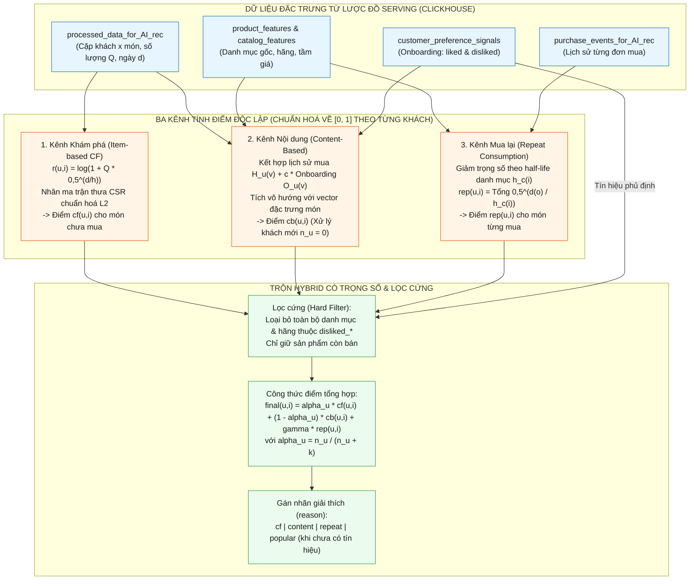

---

### 5. Hình 4.4. Luồng xử lý của trợ lý hội thoại

| Hạng mục                                                | Thông tin chi tiết                                                                                                                                                                                                                                                                                                    |
| :-------------------------------------------------------- | :---------------------------------------------------------------------------------------------------------------------------------------------------------------------------------------------------------------------------------------------------------------------------------------------------------------------- |
| **Tên hình trong báo cáo**                      | `*Hình 4.4. Luồng xử lý của trợ lý hội thoại*`                                                                                                                                                                                                                                                               |
| **Thuộc Chương / Mục**                          | Chương 4 (*Thiết kế hệ thống*) — **Mục 4.6. Thiết kế phân hệ trợ lý và tìm kiếm**                                                                                                                                                                                                              |
| **Vị trí trong `DACNTT + KLTN (đã sửa).md`** | **[Dòng 904](<file:///d:/khóa-luận-tốt-nghiệp/ktln-Getshopy/qu-n-ly-ban-l/source/DACNTT%20+%20KLTN%20(đã%20sửa).md#L904>)** (Ngay dưới tiêu đề `## 4.6. Thiết kế phân hệ trợ lý và tìm kiếm`)                                                                                              |
| **Nội dung thể hiện**                            | Phân loại ý định 2 tầng (`preClassify` + NLI `mDeBERTa-v3`), trích thực thể giá/hãng/danh mục, truy vấn PostgreSQL với ngân sách là **ràng buộc cứng**, nhánh dự phòng ngân sách và chuỗi LLM dự phòng (`Llama-3.1-8B-Instruct` → `Gemini` → `OpenRouter` → Mẫu tĩnh) |

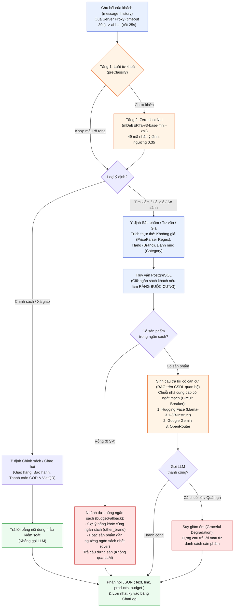

---

### 6. Hình 4.5. Vòng đời đơn chuyển khoản (rút gọn)

| Hạng mục                                                | Thông tin chi tiết                                                                                                                                                                                                                                         |
| :-------------------------------------------------------- | :----------------------------------------------------------------------------------------------------------------------------------------------------------------------------------------------------------------------------------------------------------- |
| **Tên hình trong báo cáo**                      | `*Hình 4.5. Vòng đời đơn chuyển khoản (rút gọn)*`                                                                                                                                                                                                |
| **Thuộc Chương / Mục**                          | Chương 4 (*Thiết kế hệ thống*) — **Mục 4.7. Thiết kế luồng thanh toán chuyển khoản**                                                                                                                                                   |
| **Vị trí trong `DACNTT + KLTN (đã sửa).md`** | **[Dòng 914](<file:///d:/khóa-luận-tốt-nghiệp/ktln-Getshopy/qu-n-ly-ban-l/source/DACNTT%20+%20KLTN%20(đã%20sửa).md#L914>)** (Ngay dưới tiêu đề `## 4.7. Thiết kế luồng thanh toán chuyển khoản`)                                   |
| **Nội dung thể hiện**                            | Biểu đồ trạng thái (State Diagram) của đơn hàng chuyển khoản (`status`, `payment_status`), giữ chỗ tồn kho (`reserved`) và các trạng thái đối soát giao dịch (`MATCHED`, `LATE_MATCHED`, `REFUND_REQUIRED`, `DUPLICATE`) |

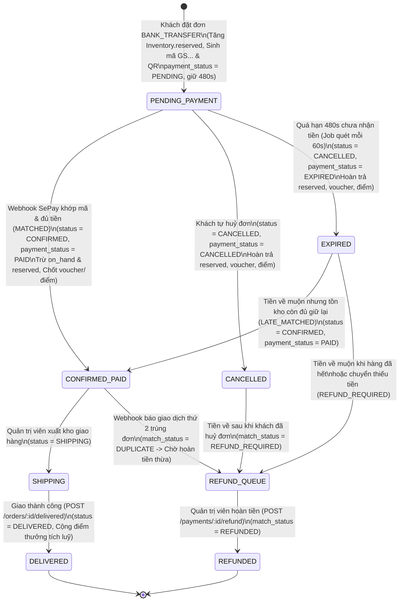

---

### 7. Hình 5.1. Nạp tăng dần theo tập đơn có biến động

| Hạng mục                                                | Thông tin chi tiết                                                                                                                                                                                                                                           |
| :-------------------------------------------------------- | :------------------------------------------------------------------------------------------------------------------------------------------------------------------------------------------------------------------------------------------------------------- |
| **Tên hình trong báo cáo**                      | `*Hình 5.1. Nạp tăng dần theo tập đơn có biến động*`                                                                                                                                                                                              |
| **Thuộc Chương / Mục**                          | Chương 5 (*Cài đặt hệ thống*) — **Mục 5.2.3. Bảng sự kiện và nạp tăng dần**                                                                                                                                                            |
| **Vị trí trong `DACNTT + KLTN (đã sửa).md`** | **[Dòng 1072](<file:///d:/khóa-luận-tốt-nghiệp/ktln-Getshopy/qu-n-ly-ban-l/source/DACNTT%20+%20KLTN%20(đã%20sửa).md#L1072>)** (Ngay dưới mô tả 2 lỗi kinh điển "Thay đổi một phía" và "Hai nguồn xả lệch thời điểm")            |
| **Nội dung thể hiện**                            | Cơ chế dùng 2 mốc watermark độc lập (`_order_event_ts`, `_item_event_ts`), gom tập `changed_order_ids`, lấy lại toàn bộ lịch sử của các đơn trong tập biến động rồi khử trùng bằng `GROUP BY + argMax(tuple(...), event_ts)` |

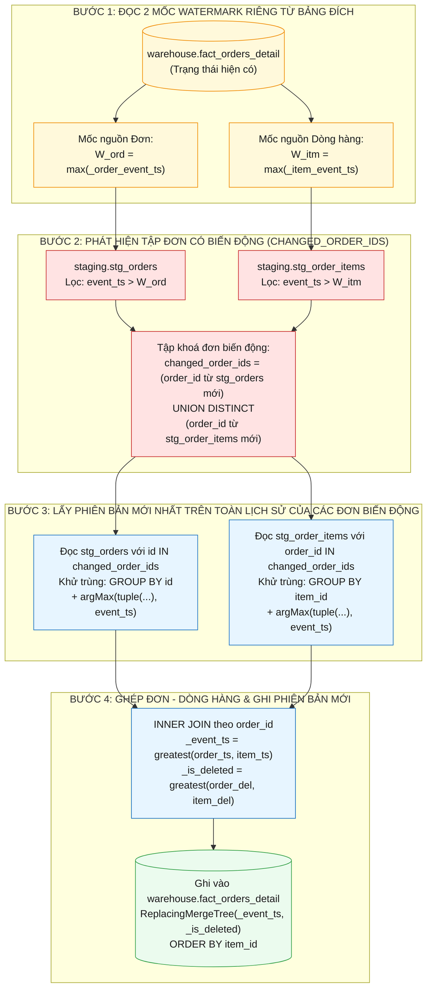

---

### 8. Hình 5.2. Vòng đời một bản huấn luyện và hoán đổi `ModelBundle` của AI-Rec

| Hạng mục                                                | Thông tin chi tiết                                                                                                                                                                                                                                                       |
| :-------------------------------------------------------- | :------------------------------------------------------------------------------------------------------------------------------------------------------------------------------------------------------------------------------------------------------------------------- |
| **Tên hình trong báo cáo**                      | `*Hình 5.2. Vòng đời một bản huấn luyện của AI-Rec*`                                                                                                                                                                                                            |
| **Thuộc Chương / Mục**                          | Chương 5 (*Cài đặt hệ thống*) — **Mục 5.3.4. Huấn luyện nền và phục vụ**                                                                                                                                                                            |
| **Vị trí trong `DACNTT + KLTN (đã sửa).md`** | **[Dòng 1146](<file:///d:/khóa-luận-tốt-nghiệp/ktln-Getshopy/qu-n-ly-ban-l/source/DACNTT%20+%20KLTN%20(đã%20sửa).md#L1146>)** (Cuối Mục 5.3.4)                                                                                                              |
| **Nội dung thể hiện**                            | Cơ chế huấn luyện nền định kỳ 300s (`asyncio.to_thread`), tính sẵn top-20 (`_precompute` trần 60s), ghi đĩa nguyên tử (`os.replace`) và hoán đổi nguyên tử `self._bundle` để luồng phục vụ API không bao giờ bị chặn hay lệch cache |

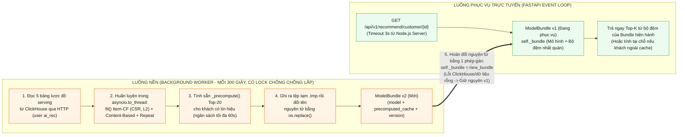

---

### 9. Hình 5.3. Chuỗi đầu-cuối từ giao dịch B2C tới kho và AI

| Hạng mục                                                | Thông tin chi tiết                                                                                                                                                                                                                            |
| :-------------------------------------------------------- | :---------------------------------------------------------------------------------------------------------------------------------------------------------------------------------------------------------------------------------------------- |
| **Tên hình trong báo cáo**                      | `*Hình 5.3. Chuỗi đầu-cuối từ giao dịch B2C tới kho và AI*`                                                                                                                                                                          |
| **Thuộc Chương / Mục**                          | Chương 5 (*Cài đặt hệ thống*) — **Mục 5.5.1. Chuỗi sự kiện từ giao dịch tới gợi ý**                                                                                                                                    |
| **Vị trí trong `DACNTT + KLTN (đã sửa).md`** | **[Dòng 1213](<file:///d:/khóa-luận-tốt-nghiệp/ktln-Getshopy/qu-n-ly-ban-l/source/DACNTT%20+%20KLTN%20(đã%20sửa).md#L1213>)** (Ngay dưới danh sách 14 bước từ dòng 1198 đến dòng 1211)                                   |
| **Nội dung thể hiện**                            | Đầy đủ 14 bước đầu-cuối, tách rõ **Phần đồng bộ (Bước 1–6)** và **Phần bất đồng bộ (Bước 7–14)**, đã cập nhật đúng đường hầm `ngrok` domain cố định và mô hình Hybrid `h = 37` ngày |

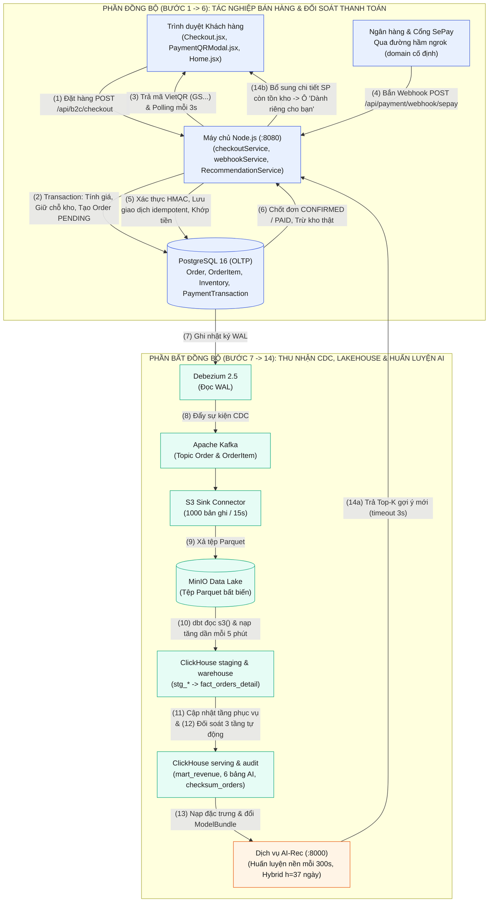

---

## PHẦN 2. Code Mermaid cho 6 Sơ đồ Thiết kế Bổ sung (Use Case, ERD, Star Schema, Sequence, Deployment)

---

### 10. Sơ đồ bổ sung 2.1. Biểu đồ Use Case tổng quát toàn hệ thống

| Hạng mục                                                      | Thông tin chi tiết                                                                                                                                                                                                |
| :-------------------------------------------------------------- | :------------------------------------------------------------------------------------------------------------------------------------------------------------------------------------------------------------------ |
| **Tên hình đề xuất**                                 | `*Hình 2.2. Sơ đồ ca sử dụng (Use Case) tổng quát của hệ thống*`                                                                                                                                       |
| **Thuộc Chương / Mục**                                | Chương 2 (*Tổng quan về đề tài*) — **Mục 2.5.2. Ca sử dụng tiêu biểu**                                                                                                                         |
| **Vị trí chèn trong `DACNTT + KLTN (đã sửa).md`** | **[Sau dòng 429](<file:///d:/khóa-luận-tốt-nghiệp/ktln-Getshopy/qu-n-ly-ban-l/source/DACNTT%20+%20KLTN%20(đã%20sửa).md#L429>)** (Ngay dưới *Bảng 2.3. Các ca sử dụng nghiệp vụ tiêu biểu*) |
| **Nội dung thể hiện**                                  | 6 tác nhân ở Bảng 2.2 tương tác với 9 nhóm ca sử dụng tiêu biểu (`UC01` → `UC09`) ở Bảng 2.3                                                                                                    |

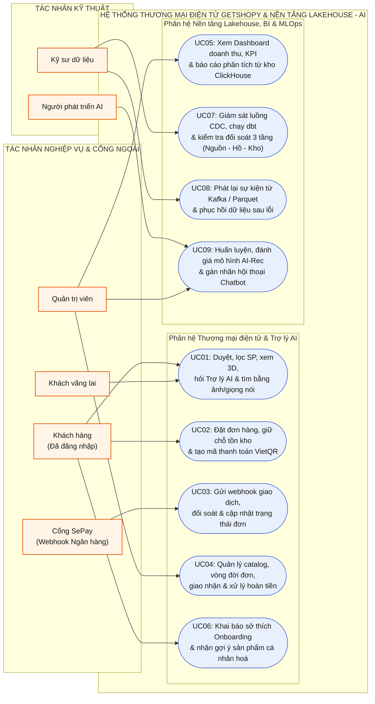

---

### 11. Sơ đồ bổ sung 4.1. Sơ đồ Thực thể – Liên kết (ERD) cơ sở dữ liệu tác nghiệp PostgreSQL (21 bảng)

| Hạng mục                                                      | Thông tin chi tiết                                                                                                                                                                                                          |
| :-------------------------------------------------------------- | :---------------------------------------------------------------------------------------------------------------------------------------------------------------------------------------------------------------------------- |
| **Tên hình đề xuất**                                 | `*Hình 4.1b. Sơ đồ thực thể – liên kết (ERD) của cơ sở dữ liệu tác nghiệp PostgreSQL*`                                                                                                                      |
| **Thuộc Chương / Mục**                                | Chương 4 (*Thiết kế hệ thống*) — **Mục 4.2. Thiết kế cơ sở dữ liệu tác nghiệp**                                                                                                                       |
| **Vị trí chèn trong `DACNTT + KLTN (đã sửa).md`** | **[Sau dòng 766](<file:///d:/khóa-luận-tốt-nghiệp/ktln-Getshopy/qu-n-ly-ban-l/source/DACNTT%20+%20KLTN%20(đã%20sửa).md#L766>)** (Ngay dưới *Bảng 4.2. Các thực thể của cơ sở dữ liệu tác nghiệp*) |
| **Nội dung thể hiện**                                  | Toàn bộ 21 thực thể trong `server/prisma/schema.prisma` cùng khoá chính, khoá ngoại và mối quan hệ nghiệp vụ                                                                                                  |

```mermaid
erDiagram
    B2CCustomer ||--o| CustomerPreference : "khai báo 1-1"
    B2CCustomer ||--o{ Order : "đặt đơn"
    B2CCustomer ||--o{ Wishlist : "yêu thích"
    B2CCustomer ||--o{ LoyaltyTransaction : "sổ cái điểm"
    B2CCustomer ||--o{ VoucherUsage : "sử dụng mã"
    B2CCustomer ||--o{ ChatLog : "hội thoại AI"

    Category ||--o{ Category : "parent_id"
    Category ||--o{ Product : "phân loại"
    Brand ||--o{ Product : "thương hiệu"
    Branch ||--o{ Inventory : "tồn tại chi nhánh"

    Product ||--o{ Inventory : "quản lý tồn"
    Product ||--o{ OrderItem : "snapshot dòng hàng"
    Product ||--o{ Review : "đánh giá"
    Product ||--o{ Wishlist : "nằm trong"
    Product ||--o{ FlashSaleItem : "giảm giá"

    Inventory ||--o{ StockReservation : "giữ chỗ nguyên tử"
    Order ||--|{ OrderItem : "chứa dòng hàng"
    Order ||--o{ PaymentTransaction : "đối soát webhook"
    Order ||--o{ StockReservation : "giữ tồn theo đơn"
    Order ||--o{ VoucherUsage : "áp vào đơn"
    Order ||--o{ LoyaltyTransaction : "tích/tiêu điểm"

    Voucher ||--o{ VoucherUsage : "lịch sử dùng"
    FlashSale ||--o{ FlashSaleItem : "sản phẩm sale"

    User {
        Int id PK
        String email UK
        String role
    }
    B2CCustomer {
        BigInt id PK
        String email UK
        Int loyalty_points
        String provider
    }
    CustomerPreference {
        BigInt customer_id PK,FK
        String status
        StringArray liked_categories
        StringArray disliked_categories
        String price_band
    }
    Product {
        BigInt id PK
        String name
        Int price
        String category_id FK
        String brand_id FK
        Boolean is_deleted
    }
    Inventory {
        BigInt id PK
        BigInt product_id FK
        String variant_id
        String branch_id FK
        Int on_hand
        Int reserved
    }
    StockReservation {
        BigInt id PK
        String order_id FK
        BigInt inventory_id FK
        Int quantity
        String status
        DateTime expires_at
    }
    Order {
        String id PK
        BigInt customer_id FK
        String province
        Int total
        String status
        String payment_method
        String payment_status
        String payment_ref UK
        DateTime expires_at
    }
    OrderItem {
        BigInt id PK
        String order_id FK
        BigInt product_id FK
        String product_name
        Int quantity
        Int unit_price
        Int net_amount
    }
    PaymentTransaction {
        BigInt id PK
        String order_id FK
        String provider_txn_id UK
        Int amount
        String match_status
    }
    Voucher {
        BigInt id PK
        String code UK
        String type
        Int value
        Int used_count
    }
    VoucherUsage {
        BigInt id PK
        BigInt voucher_id FK
        String order_id FK
        String status
    }
    LoyaltyTransaction {
        BigInt id PK
        BigInt customer_id FK
        String order_id FK
        Int points
        String status
    }
    FlashSale {
        BigInt id PK
        String title
        Int discount_percent
    }
    FlashSaleItem {
        BigInt id PK
        BigInt flash_sale_id FK
        BigInt product_id FK
        Int discount_price
    }
    Category {
        String id PK
        String name
        String parent_id FK
    }
    Brand {
        String id PK
        String name
    }
    Branch {
        String id PK
        String name
    }
    Review {
        String id PK
        BigInt product_id FK
        Int rating
    }
    Wishlist {
        BigInt id PK
        BigInt customer_id FK
        BigInt product_id FK
    }
    VoucherTier {
        BigInt id PK
        String name
        Int discount_amount_vnd
    }
    ChatLog {
        BigInt id PK
        String session_id
        String intent
        String corrected_intent
        Boolean is_trained
    }
```

---

### 12. Sơ đồ bổ sung 4.2. Lược đồ hình sao (Star Schema) & Hợp đồng dữ liệu trên ClickHouse

| Hạng mục                                                      | Thông tin chi tiết                                                                                                                                                                                  |
| :-------------------------------------------------------------- | :---------------------------------------------------------------------------------------------------------------------------------------------------------------------------------------------------- |
| **Tên hình đề xuất**                                 | `*Hình 4.2b. Lược đồ hình sao (Star Schema) của bảng sự kiện và các bảng chiều trên ClickHouse*`                                                                                     |
| **Thuộc Chương / Mục**                                | Chương 4 (*Thiết kế hệ thống*) — **Mục 4.3.3. Bảng sự kiện và bảng chiều**                                                                                                      |
| **Vị trí chèn trong `DACNTT + KLTN (đã sửa).md`** | **[Sau dòng 826](<file:///d:/khóa-luận-tốt-nghiệp/ktln-Getshopy/qu-n-ly-ban-l/source/DACNTT%20+%20KLTN%20(đã%20sửa).md#L826>)** (Ngay dưới *Bảng 4.4. Các bảng phục vụ AI-Rec*) |
| **Nội dung thể hiện**                                  | Quan hệ giữa bảng sự kiện trung tâm `warehouse.fact_orders_detail`, 7 bảng chiều `masterdata.dim_*` và các bảng đầu ra ở tầng `serving.*`                                        |

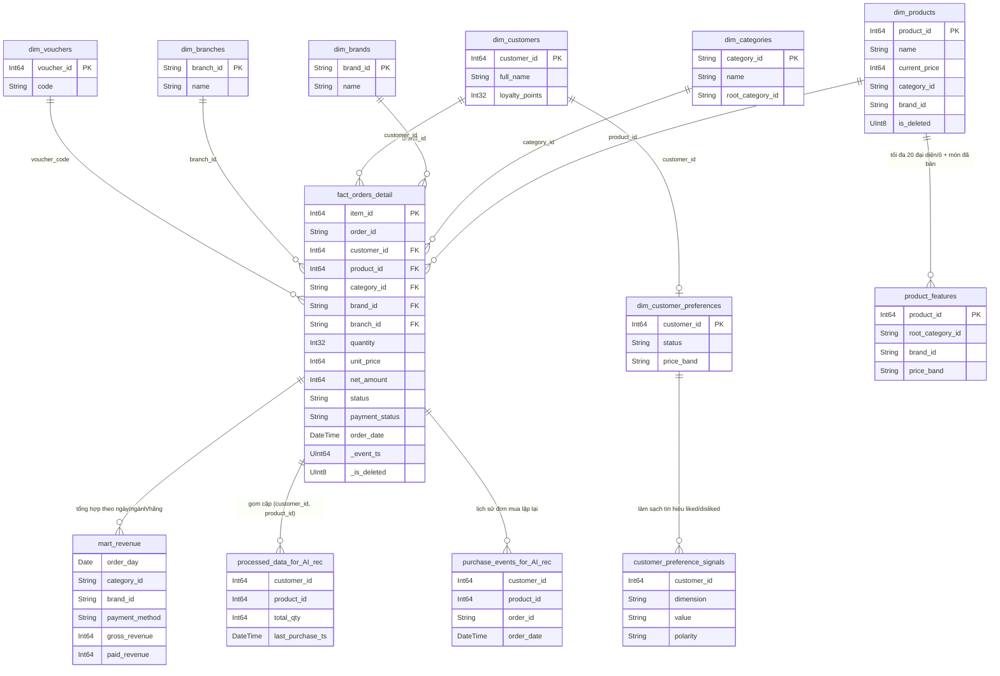

---

### 13. Sơ đồ bổ sung 5.1. Biểu đồ Tuần tự (Sequence Diagram) Đặt hàng giữ chỗ nguyên tử & Đối soát Webhook SePay

| Hạng mục                                                      | Thông tin chi tiết                                                                                                                                                                                             |
| :-------------------------------------------------------------- | :--------------------------------------------------------------------------------------------------------------------------------------------------------------------------------------------------------------- |
| **Tên hình đề xuất**                                 | `*Hình 5.1b. Biểu đồ tuần tự luồng đặt hàng giữ chỗ tồn kho và đối soát webhook thanh toán*`                                                                                                 |
| **Thuộc Chương / Mục**                                | Chương 5 (*Cài đặt hệ thống*) — **Mục 5.1.4 & 5.1.5**                                                                                                                                           |
| **Vị trí chèn trong `DACNTT + KLTN (đã sửa).md`** | **[Sau dòng 1032](<file:///d:/khóa-luận-tốt-nghiệp/ktln-Getshopy/qu-n-ly-ban-l/source/DACNTT%20+%20KLTN%20(đã%20sửa).md#L1032>)** (Cuối Mục 5.1.5 *Thanh toán chuyển khoản và đối soát*) |
| **Nội dung thể hiện**                                  | Tương tác tuần tự từ lúc khách bấm đặt hàng, giữ chỗ nguyên tử trên PostgreSQL, hiện QR đếm ngược, tới khi SePay bắn webhook qua `ngrok` và xác thực HMAC + Idempotency 2 tầng     |

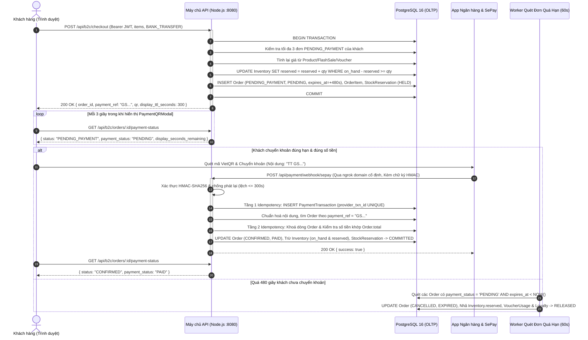

---

### 14. Sơ đồ bổ sung 5.2. Biểu đồ Tuần tự (Sequence Diagram) Gợi ý trang chủ gọi AI-Rec & Bổ sung tồn kho OLTP

| Hạng mục                                                      | Thông tin chi tiết                                                                                                                                                                                       |
| :-------------------------------------------------------------- | :--------------------------------------------------------------------------------------------------------------------------------------------------------------------------------------------------------- |
| **Tên hình đề xuất**                                 | `*Hình 5.2b. Biểu đồ tuần tự luồng lấy gợi ý cá nhân hoá và lọc trạng thái kinh doanh hiện hành*`                                                                                     |
| **Thuộc Chương / Mục**                                | Chương 5 (*Cài đặt hệ thống*) — **Mục 5.3.5. Tích hợp gợi ý vào trang chủ**                                                                                                         |
| **Vị trí chèn trong `DACNTT + KLTN (đã sửa).md`** | **[Sau dòng 1155](<file:///d:/khóa-luận-tốt-nghiệp/ktln-Getshopy/qu-n-ly-ban-l/source/DACNTT%20+%20KLTN%20(đã%20sửa).md#L1155>)** (Cuối Mục 5.3.5)                                          |
| **Nội dung thể hiện**                                  | Tương tác giữa `Home.jsx`, `Server API (optionalAuthB2C)`, `AI-Rec (:8000)` và `PostgreSQL` để đảm bảo gợi ý vừa cá nhân hoá vừa chỉ hiển thị sản phẩm còn bán, còn hàng |

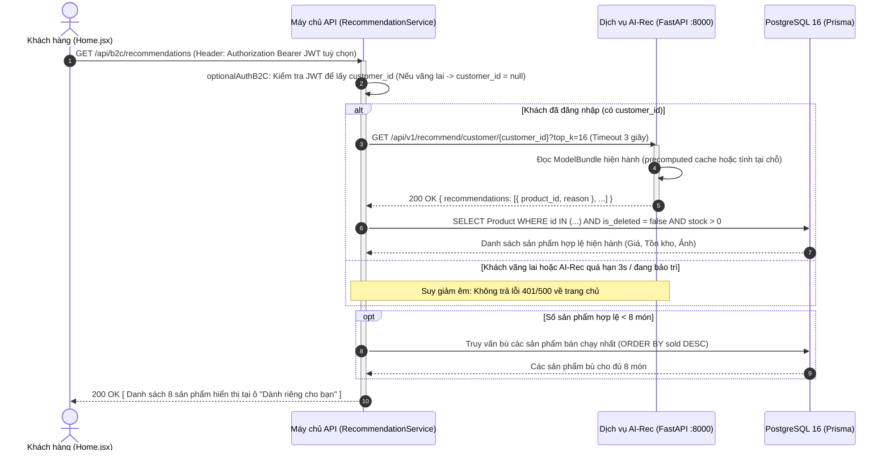

---

### 15. Sơ đồ bổ sung 6.1. Sơ đồ Triển khai (Deployment Diagram) 17 dịch vụ Docker Compose & Đường hầm `ngrok`

| Hạng mục                                                      | Thông tin chi tiết                                                                                                                                                                                               |
| :-------------------------------------------------------------- | :----------------------------------------------------------------------------------------------------------------------------------------------------------------------------------------------------------------- |
| **Tên hình đề xuất**                                 | `*Hình 6.1. Sơ đồ triển khai 17 dịch vụ trong Docker Compose và điều phối truy cập mạng*`                                                                                                           |
| **Thuộc Chương / Mục**                                | Chương 6 (*Triển khai hệ thống*) — **Mục 6.1 & Mục 6.3**                                                                                                                                           |
| **Vị trí chèn trong `DACNTT + KLTN (đã sửa).md`** | **[Sau dòng 1258](<file:///d:/khóa-luận-tốt-nghiệp/ktln-Getshopy/qu-n-ly-ban-l/source/DACNTT%20+%20KLTN%20(đã%20sửa).md#L1258>)** (Cuối Mục 6.3 *Điều phối truy cập và webhook thanh toán*) |
| **Nội dung thể hiện**                                  | Ranh giới mạng bên ngoài, tiến trình `ngrok` (domain cố định), cổng vào Nginx `:3000` và mạng nội bộ Docker chứa 17 dịch vụ của Bảng 6.1                                                   |

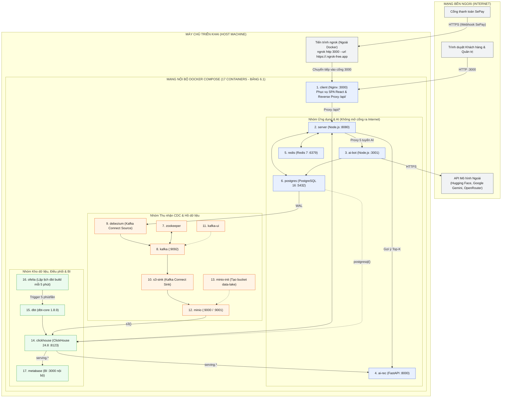
